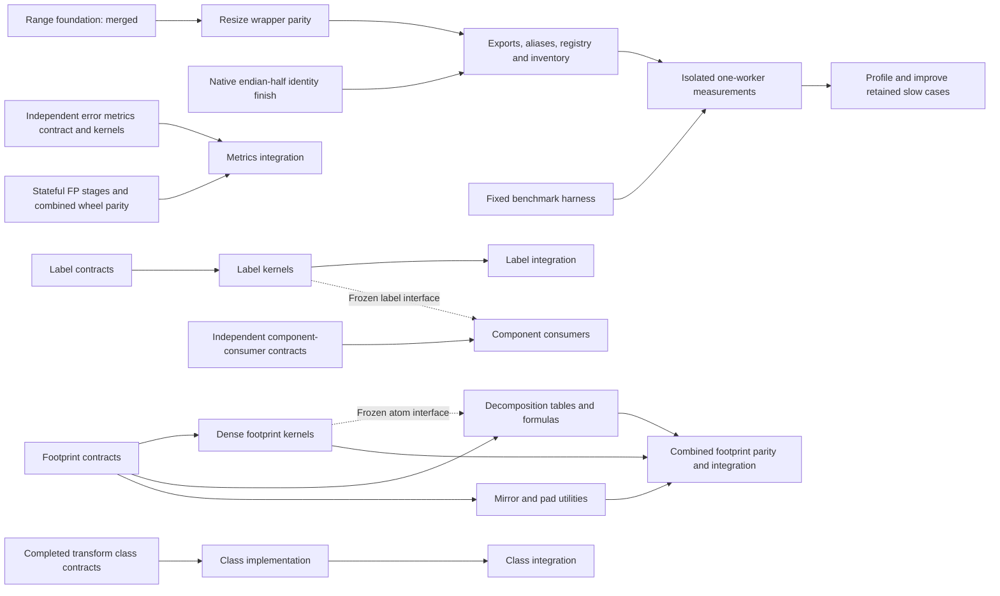

# Parallel implementation and validation plan

Implement the complete scikit-image API in optimized C++ with interchangeable
Python calls, per-function parity, optional process-global workers (default one),
and isolated one-worker comparisons against scikit-image 0.26.0. This includes
classes, nested namespaces, data and I/O. Private helpers and compatibility
forwarding do not count as completed public implementations.

The current inventory contains 477 public paths: 192 native-partial image entries,
three metadata functions, four partial native classes, one exception metadata
provider, and 277 upstream-only entries. The expansion adds 19
source-backed public/legacy rank.generic aliases of existing algorithms, not
19 additional algorithms. Three assessed public bilateral aliases add no algorithms. Imported dependencies are excluded from that count. It includes 29 classes with
284 statically discovered member paths; constructors, state, runtime fields and
additional namespaces still need assessment. These counts describe implementation
classification, not verified parity or performance.

The accepted whole7b product adds four R4 algorithms/eight public paths and
byte-preserving consumer scans:171 partially native image paths. Eight actual
normal/scalar Release/Debug profiles and fresh strict1379-case corpus checks
pass; full104-member packages and59-member SDK/source equality authenticate
explicitly inherited unaffected scopes. The published one-worker R4 comparison
retains all 376 timings per runtime and all 120 slower cases. Large windowed
histograms and selected noise-filter cases remain optimization targets.
Failed whole8 and whole9 trials are retained without public acceptance. The
whole9 products passed all 104 SDK checks but exposed three bilateral endian
error-parity rows and two metadata issues. Corrected source `05e79eb`, run
40063203314, passed all four actual products in normal/scalar modes and complete
independent source/runtime/artifact review. The accepted checkpoint now has
186 partially native image paths: nine percentile algorithms and three bilateral
algorithms add 15 paths. The reverse-stride metrics change is parity accepted;
its speed remains unmeasured. Whole11 now qualifies local Otsu, majority and their
two generic aliases, bringing the accepted count to 190 partial image paths and
31 canonical rank algorithms. Both exact controlled sources pass all four
products: 649,056 before checks and 672,856 after checks, with 224 combined SDK
checks and equal actual common build inputs. Controlled one-worker counts run `40084877921` has independently verified all three profiles and passed the root audit; the [full report, CSV and raw archive](../benchmarks/rank-statistics-counts-comparison.md) are published. All 376 IDs, seven paired rounds and every slower case are retained. These results apply to the frozen 190-path source pair.
Whole12 now admits joined source `f87120c`: TV-Chambolle raises the count to 191
partial image paths. All four actual products pass 698,448 selected mixed checks
and 136 SDK client checks, with complete 108-member wheels and 62-member SDKs.
The previous failed TV run remains failed. Its published initial one-worker
baseline retains all 70 cases per runtime, including 34/38/36 slower observations
on Windows/modern/minimum Linux. Those timings remain tied to `f87120c`.
Whole13 admits Bregman source `3cdd363`: 192 partial image paths, 704,760 mixed
checks and 144 SDK checks with complete 110-member wheels and 63-member SDK18.
The latest qualified source `5e068a5` adds logical strided-address cursors without
adding API paths. All four normal/scalar profiles pass 707,800 mixed checks and
144 SDK checks. Its separate original/before/after comparison uses all 400 frozen
observations before timing the fixed 70 cases in seven paired one-worker rounds.
The [reviewed controller and certificate](evidence/tv-cursor-comparison-controller.json)
preserve actual before `3cdd363` and after `5e068a5` product labels.
The combined 199-path/114-wheel/65-SDK20 candidate remains unaccepted: run
`40117331038` built Windows artifacts but rejected matrix runtime authentication
before public parity groups. Its retained failure is a certificate boundary,
not evidence of a numerical mismatch. Private matrix binding and six max-tree
APIs have separate scoped parity proofs; neither increases accepted public counts.
The [max-tree benchmark reference](evidence/max-tree-benchmark-reference.json)
preserves all 351 source observations and 252 finite candidates per runtime;
native admission and one-worker measurements remain pending.
The integrator owns shared
wiring, exact-source performance dispatch, prompt merges and cleanup.

## What changed after review

The previous sequence waited for each foundation, wrapper and benchmark in turn.
Only shared integration needs that ordering. Kernel families, Python contracts,
benchmark preparation and class discovery can proceed independently.

Use four active agent slots: one integrator and three workers. Each worker owns
an isolated worktree, explicit files and its own build cache. Frozen candidate
wheels may be shared read-only. The integrator owns shared CMake/binding entry
points, public exports, aliases, registry/inventory changes, installation and
merges. Workers must not revert another worker's changes or edit shared files.

Test and benchmark paths in the inventory establish that files exist. They do
not prove a passing contract, a measured source revision, or a speedup. Track
those separately in [work_items.json](work_items.json) and packet evidence.

## Three-agent review and worker lanes

| Lane | Agent | Independent responsibility | Current checkpoint |
|---|---|---|---|
| Integrator | `root` | Shared core/SDK, registry/inventory, hosted measurements, prompt merges and cleanup | Qualified 192-path source `5e068a5` is merged; 199 remains a separate candidate. Review artifact/runtime boundaries, retain failures, merge validated increments and remove released caches. |
| Worker 1 | `metrics_reductions` | Qualified TV cursor original/before/after comparison | Frozen controller `d48a17e` and exact certificate are reviewed; publisher `40118914870` preserves the unchanged certificate. Complete all three preparation profiles before fresh one-worker measurements; retain every raw sample and regression. |
| Worker 2 | `resize_api` | Six-API max-tree public benchmark consumer | Optimized aggregate/staged composition passes private parity. Original-only source `ae57e3e` and all 252 benchmark candidates are merged. Implement the separate public199/SDK20 consumer, with static admission pending genuine qualification and all three preparation barriers. |
| Worker 3 | `resize_bench` | Genuine public199 qualification and matrix certificate diagnosis | Follow the same `40117331038` observer/retainer to terminal. Diagnose the rejected Windows certificate using exact artifact/library bytes and a separate metadata-only fresh-host probe; preserve the missing failed-host getter evidence as a limitation. No forced CPU or relaxed guards. |

The agent names are reused from earlier packets; they do not describe their
current assignments. The recorded three-agent review and safe checkpoints are
visible with `tools/work_queue.py --agents`. Live process state is checked with
the collaboration agent tools, rather than inferred from this ledger.

All three reviewers identified the same avoidable dependency: independent
decomposition work waited for dense-kernel completion. The revised queue releases
it from a versioned, hashed atom interface and requires joint kernel parity at
integration. Component-consumer original contracts are also independent of native
labeling. Their implementation waits for the frozen labeling interface.

## Retained checkpoints

The following records describe their measured source revisions; the ledger above
owns current assignment and readiness. A historical passing source does not
establish complete parity or performance of a later cumulative package.

The read-only planning reviewer completed its audit. Native half identity
(`aed3349`) and public resize/rescale (`21ac60b`) are merged. The exact registered
wheels passed 9,968 tests in each of six runtime/SIMD profiles, and the 373-case
corpus passed untimed checks on all three runtimes at workers one and four.
Performance run [39957875987](https://github.com/bipxx/scikit-imagexx/actions/runs/39957875987)
uses source `66e5f78`; all six preparation/measurement jobs completed successfully. Observe this same run;
do not restart it because of a queue or timeout. The [baseline report](../benchmarks/resize-public-initial.md) retains every sample
and 49/52/61 slower cases across Windows/modern/minimum. Row-span normalization
copies are the first measured-bottleneck trial. Actual complete packages pass
10,918 public and 6,506 shared checks in each of six profiles; the unchanged
373-case remeasurement is queued as
[39987242238](https://github.com/bipxx/scikit-imagexx/actions/runs/39987242238).

The private metrics baseline (`03581ae`, integrated as `99abcfc`) passed 4,082
tests in each of six profiles through the actual shared `_core`. It is merged as
`147bd8b`; original worker ancestry is retained by `1945c2e`. Follow-up `070fc64`
fixes buffered reductions and default-policy details, passing six 4,308-case
profiles plus native sanitizers. Stateful callback policies and exact combined
optimized wheels remain registration gates. Private parity is scoped evidence.
Metrics benchmark tooling (`6c74563`, merged as `d94ef6c`) has a fixed 1,231-case
corpus, including 19 expected errors; its one-worker timing workflow is now queued.
The combined public metrics, footprints and label package at `05c3506` now passes
14,963 public-suite checks and 6,506 metadata/shared API checks in each of six
runtime/SIMD profiles. All 18 dedicated untimed corpus runs pass at workers one
and four, plus native tests, sanitizers and external SDK consumers. Counts include
reference and metadata assertions; they are not distinct algorithm counts.
The [acceptance record](evidence/public-wave1.json) seals 702 retained artifacts.
These public integrations are parity-passed with performance pending. The one-worker
[metrics](https://github.com/bipxx/scikit-imagexx/actions/runs/39983272390),
[footprint](https://github.com/bipxx/scikit-imagexx/actions/runs/39983468427) and
[label](https://github.com/bipxx/scikit-imagexx/actions/runs/39983471905)
measurement workflows completed successfully. Their raw samples and every
regression are retained in the three baseline reports. Metrics are slower
overall (0.67–0.85x); footprint raster generation is 2.16–2.50x while decomposition
and view setup remain slower. Labeling raster ratios are 0.82–1.40x with major
large multivalued/high-connectivity regressions. These measurements leave
optimization work, rather than proving completion of the performance objective.

Four public transform classes and canonical exception metadata now pass six
7,520-check mixed public/state/shared profiles, supplementary standalone exception
checks and a 296-case strict public corpus at workers one/four. Model classes
remain partial: NumPy/SciPy matrix/fitting providers and external provider thread
pools are explicit, with independent C++ solvers and performance still pending.
Installed SDK foundations pass 26 native tests on Windows/Linux plus portable,
sanitizer and external consumer gates. Private rank adds nine algorithms and
component consumers add four public wrappers, accepted through eight actual
Release/Debug package profiles with 5,795 checks each and three 474-path inventory
checks. Returned ArrayMap stays internal. Nine rank algorithms still await their
separate public package gates. Debug validation reproduced generic array
dtype-reference access after GIL release; the four fixed bindings are undergoing
full regression checks without disabling assertions. Completed worktrees are removed only after
evidence archiving and clean/ancestor checks.

## Dependency and merge order



1. Workers freeze interfaces early: shape/dtype/ownership rules, worker policy,
   error/warning behavior and any runtime math providers. They report changes
   before another packet depends on them.
2. Workers submit a commit, advertised contract, exact commands/results, source
   and artifact hashes, unresolved cases and required shared wiring. Commit
   validated increments promptly; do not accumulate completed work in worktrees.
3. The integrator reviews and applies shared wiring. For resize/rescale, exercise
   the complete existing contract against the candidate without weakening the
   pending/native guards. Temporary in-memory candidate adapters are test tools,
   not public registration or coverage evidence.
4. Merge validated private kernels and benchmark tooling independently. Register
   public functions only with their tested wrapper, aliases, default API cases
   and regenerated inventory. Record `parity_passed / performance_pending` until
   exact-source measurements exist. A green path-existence test is insufficient.
5. Freeze the candidate wheel, installed SDK, source fingerprint, dependency
   versions and corpus hash. Benchmark the original and native public calls in
   an isolated Actions job, including allocations and normalization. Require one
   worker; additional worker counts are supplementary results.
6. Return measured bottlenecks to their owning worker. Keep every workload, raw
   sample and rejected trial. Merge validated improvements and remeasure the same
   corpus against the exact baseline; do not remove adverse cases.

Registration/build edits pass through one integrator. That short integration
step is the serialization point; independent implementation and contract work
continues while another packet builds, runs CI or waits for measurements.

## Next independent packets

| Priority | Packet and scope | Shared dependency / handoff |
|---|---|---|
| Accepted cumulative increment | Whole11 sources `66860ae`/`94d2d3f` | 190 native-partial image paths; all eight genuine products, complete selected corpora, source/build/runtime closure and six Release envelopes verified. Full argument and performance parity remain separate. |
| Accepted rank increment | Rank Otsu/majority plus their two generic aliases | Both four-profile runs pass; exactly three counts-optimization paths differ and common compiler/header/link inputs match in all four profiles. Source merged promptly; all three controlled one-worker profiles are measured and independently/root verified. |
| Isolated measured bottleneck | Counts-only R4 windowed histogram update | Controlled run40084877921 passes all three profiles. Histogram cohort gains1.239x/1.159x/1.181x versus prior C++; every before/original regression remains in the published report/CSV/raw ZIP. More bottlenecks remain. |
| Private native foundation | TV typed stages and spatial reductions | `2319db7` stages and `0eaf632` reductions have scoped private evidence. NumPy 1.24.4/2.5.4 reduction association and scalar promotion differ; preserve both exact profiles. These are not public function acceptance. |
| Private complete finite loop | TV kernel `f8f38b6` | C++ now owns finite divergence/output, square/sum, gradient/norm/sum, denominator/dual, energy and strict stopping. Validate actual new bindings and default wrapper calls; stage capability 63 cannot substitute for finite-loop capability 3. |
| Live shared integration | Public TV core, registry and complete SDK | Joined `f87120c`, run `40087742726`: candidate191 paths,108wheel/62SDK,17families/34checks. Original b550 failed metadata/intake gates and is retained.985preflight checks pass; fresh combined-product acceptance is pending. |
| Performance follow-up | TV original-library comparison | The reference-only benchmark authoring has 330 untimed source cases and 70 fixed timing candidates. Consume actual qualified artifacts and exact wheel/SDK/source pins; finish the default-policy parity barrier before isolated one-worker samples. |

Keep all other inventoried names explicitly unassigned until a bounded packet
claims them. Repeat the process for remaining transforms/pyramids, measurements,
features, segmentation, restoration, registration, graph, draw, data, I/O and
utilities. Review additional namespaces and runtime class attributes rather than
treating the current static inventory as exhaustive.

## Execute the queue

The integrator uses the ledger checker before assigning work and after every
handoff. These commands only inspect the plan; they do not launch agents, mutate
source, compile, time code or cancel jobs.

```powershell
.venv/Scripts/python.exe tools/work_queue.py --check
.venv/Scripts/python.exe tools/work_queue.py --check --verify-local-proofs
.venv/Scripts/python.exe tools/work_queue.py --agents
.venv/Scripts/python.exe tools/work_queue.py --ready
.venv/Scripts/python.exe tools/work_queue.py --packet footprints-decomposition
```

Each scoped packet records exact owned paths, a base revision, read/link
dependencies, its build policy, a concrete `collaboration.followup_task` handoff
and acceptance gates. `--ready` lists scoped queued packets whose required proof
scope or frozen interface is available, excluding occupied writable files.
It does not change goal status or assert spare
capacity: the integrator keeps at most three worker agents active, reuses a
completed agent with `followup_task`, and supplies the printed handoff with an
explicit isolated worktree and branch. Unscoped inventory items are not launched.
The checker rejects cycles, missing dependencies, excess worker owners, escaping
paths and concurrent ownership of the same file, including Windows case aliases.
It validates interface hashes and requires source/hash-bearing evidence manifests
with numeric native/pending counts. Registration explicitly requires private
native proofs; measurement requires actual public-native and harness proofs.
Reference contracts and expected failures cannot release either gate.
The optional local-proof check hashes retained manifest bytes in this workspace;
a fresh checkout needs those preserved artifacts before that check can pass.

Current handoffs run in parallel:

1. Worker 1 observes joined TV run `40087742726` at exact `f87120c` through
   terminal, retaining each complete source/build/runtime/public/SDK closure.
   Root accepts and merges only genuinely successful products. The completed
   controlled counts run and its full raw archive stay immutable.
2. Worker 3 closes the general matrix binding/pipeline proof, then qualifies
   actual hosted NumPy/OpenBLAS dispatch profiles. Haswell-only private proof
   cannot establish native execution on a different default BLAS core. Keep
   the 374 original observations, 4,000 general cohorts and every old certified
   route; homogeneous-buffer fusion and wider casting remain follow-ups.
3. Worker 2 implements the six max-tree/attribute-filter primitives from the
   351-ID source contract: 233 safe numeric IDs and 118 metadata-only IDs.
   Stable parent/traverser/tie/label identities and safe source boundaries
   remain exact. Optional parallel work must respect tree dependencies.
4. Root reviews and wires ready Bregman bridge `54dcc71` into the sole core,
   public restoration namespace, inventory and installed SDK on an isolated
   candidate. Use safe original geometry; never execute unchecked singleton
   Cython calls for a generic smoke test. Fresh public parity and fixed-corpus
   one-worker comparison remain required; serial Gauss-Seidel is an explicit
   optimization target.
5. Root integrates passing increments promptly. Public TV measurements consume
   qualified artifacts after all preparation profiles pass. Repeat this for
   remaining APIs, classes/state, nested namespaces, data and I/O. The current
   190 accepted partial image paths do not satisfy the full-library objective.

All active packets use their own ignored cache. An agent's handoff includes its
live process handles; observation timeouts leave those jobs active. A finished
agent reports terminal handles, source SHA, exact artifacts and evidence paths
before the integrator schedules worktree cleanup.
Build environments must be retained: Python, NumPy and pybind11 CMake paths must
not point into an expired temporary build-isolation directory. Interface changes
create a new version/hash and an explicit dependent handoff; frozen interfaces are
not edited silently. Standalone adapters never create a second worker policy in
the installed main `_core`.

## Evidence and coordination rules

- `implementation` and packet state are separate. Suggested packet states are
  `queued`, `contracting`, `implementing`, `validating`, `parity_passed`,
  `performance_pending`, `measuring`, `measured`, and `accepted`.
- Per-API evidence must identify the tested contract, source SHA, wheel/binary
  hash, runtime profile, strict fallback-disabled result, scalar/SIMD result,
  default-one/global-worker behavior and original-library measurement. Class
  evidence also covers state and members. Null evidence means pending.
- Do not claim all-API completion from representative cases or native-partial
  registration. Every advertised contract and remaining inventory item must
  survive the completion audit. Measure non-image APIs according to their actual
  semantics; do not invent an image-kernel speedup for asset loading or metadata.
- Only the integrator changes this task ledger. Workers report evidence and
  request integration; they do not edit another packet's registry or inventory.
  Planning-ledger-only updates do not trigger the full build/test workflow;
  product, contract-test and integration changes still do.
- Never run local timing experiments. Untimed parity and `--check-only` are
  allowed. Never overlap measurements with builds/tests on their measurement
  host, or rebuild/delete a package a benchmark is using.
- Poll the same live process/Actions handle after observation timeouts. A timeout
  is not terminal and does not authorize cancellation or restart.
- After merging, remove only obsolete, clean worktrees whose commits are
  ancestors of `main`, after auditing retained files. Preserve active
  environments/caches, exact baselines/SDKs, running-job files, raw results,
  rejected trials and unfinished source. Never delete the whole `build/` tree.
  Previously rejected deletion paths remain protected.

The integrator fills a free worker slot from the ready queue, prioritizing work
that does not share writable files or require an unfinished interface. When a
measurement job is running remotely, workers can continue independent contracts
and kernels in their own worktrees. Reuse existing agents for follow-up packets.
