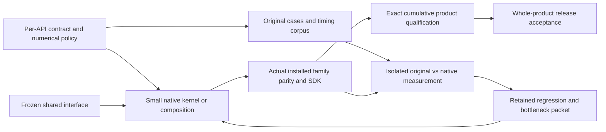

# Complete scikit-image implementation plan

Current execution state is in the [current coverage checkpoint](#current-coverage-checkpoint--supersedes-older-live-status-text). The initial storage-only review below is historical; its paused-state language describes that completed review. The user later authorized the bounded implementation resume. Previously policy-blocked cleanup remains manual-only.

## Track A closure authorization — latest 2026-11-23

User authorized **Track A (Full 477-API + depth/speed/member completion)** from verified `main` `b1d67cc0` (`308` `native-partial`, `10` `packaged-asset-partial`, `5` `native-class-partial`, `3` `metadata`, `1` `exception-metadata-provider`, `150` `upstream-only`; run `45219397159`, `1,007,220` public outcomes, `456` SDK checks). Active sequence: Phase 0 baseline sync (`EXECUTION_PLAN.md`, `work_items.json`, `README.md`) -> Phase 1 harvest of 23 already-built private APIs -> Phase 2 Wave P providers/assets -> Phase 3 W2/W3 -> Phase 4 W4 -> Phase 5 W5 -> Phase 6 depth/class-members/runtime/speed closure -> Phase 7 final qualification & hygiene.

## Optimization Wave 6 (`opt-wave6-477`) Closeout — 2026-11-26

- **Delivered to `main`**: `84ab4c0e6975c8f87fadf3af0914e820d9a465e3` (tree `8ef801de8898925850853ebcd2f75b90a50a5dbc`, fast-forwarded onto `6baf1092`/`b6bcdafc`), integrating 12 parallel Codex CLI (`gpt-6.2-sol`, `medium`) optimization scopes across 37 retained modified implementation files (plus synced `v63`/`v54` source pins: `41` files changed vs `b6bcdafc`; covering `hough_circle`, `hough_line`, `probabilistic_hough_line`, `tomography`, `phase_cross_correlation`, `registration_flows`, `watershed`, `graph_paths`, `graph_rag`, `random_walker`, `slic`, `felzenszwalb`, `histogram_matching`, `simd_avx2`, `simd_histogram_matching_avx2`, `simd_rank_avx2`, `skeletonize`, `thin`, `medial_axis`, `feature_descriptors`, `orb`, `sift`, `restoration_denoise`, `restoration_extra`, `tv_chambolle`, and `_io_suite.py`/`_lpi_filter.py`/`_graph_rag.py`/`_restoration_extra.py`/`_slic.py` + thin `bind_*.cpp`).
- **Pre-Wave-6 repo hygiene**: deleted `574` already-merged local branches via `git branch -d` (`967 -> 393`, preserving `feature/gabor-kernel`, `feature/resize`, `fix/cmake-package` and all `63` active linked worktrees) plus clean `git worktree prune`.
- **Whole-product & local verification (`84ab4c0e`)**: WSL GCC 13 `-O3` (`447` targets, CTest `121/121` in `8.14s`); MSVC 2022 Release build/stage + all 28 active Wave 6 public suites in both normal and `SKIMAGEXX_DISABLE_SIMD=1` scalar modes; complete 186-selector tooling guard barriers + 3 TV isolation tests on Python 3.13 (`4918 passed, 8 subtests passed`, `1767.39s`) and Python 3.11 (`4918 passed, 8 subtests passed`, `1773.67s`); hosted `public-qualification.yml` run `45930018204` (`archive_retained: false`, zero `.zip`s on disk) **4/4 `success`** (`modern` job `140280246644` / artifact `15170823369`, `minimum` job `140280246759` / artifact `15171418778`, `debug` job `140280246467` / artifact `15171053558`, `windows` job `140280246743` / artifact `15172635490`) — `46,879`/`48,952`/`46,738`/`45,588` rehashed manifest records, `0` failed commands, `896` SDK checks (`224`/profile across `112` families), `477/477` shipped inventory; admission receipt `build/evidence/u182-post-haar/opt-wave6-v1/whole-product-root-admission-v1.json` (SHA-256 `c11eb2e989474572144153cdfb912181c850be1a3bfd6af6b669baff8f3ea051`).
- **Performance (`build/evidence/u182-post-haar/opt-wave6-v1/benchmark-comparison.json`, `after-wave6-1t.json`, `matrix-benchmark.json`)**: quiet 1-thread `391` measured APIs (`baseline -> w2 -> w3 -> w4 -> w5 -> w6`) slower `72 -> 43 -> 32 -> 26 -> 18 -> 19`, median `2.387x -> 2.522x -> 3.183x -> 3.359x -> 3.49x -> 3.494x`, geomean `2.557x -> 2.996x -> 3.48x -> 3.692x -> 3.835x -> 3.835x`; `109/109` scaling matrix rows passed (`128x128` geo `1t=3.944x`/`4t=3.899x`, `256x256` geo `1t=4.433x`/`4t=4.663x`, `512x512` geo `1t=4.589x`/`4t=6.5x`).
- **Cleanup & waste review**: retired all 13 `D:/Scratch/opt-wave6` worktrees + `work/opt-wave6-477`/`work/opt6-w01..w12` + `origin/work/opt-wave6-477` (`+21,539,246,080 B`, `360,119,181,312 B` free on `D:`, `0` `.zip` archives on disk). Outcome/reuse: single combined dual-toolchain integration & zero-regression promotion; remaining 19 slower cases, 9 fallbacks, 8 errors, and legacy `known_followup_gaps` stay explicitly tracked.

## Optimization Wave 5 (`opt-wave5-477`) Closeout — 2026-11-26

- **Delivered to `main`**: `6baf1092a48d3f0c8004d4e91f5a61583b07aa98` (tree `31e5fb73d36ebb9e9fd30f22ee04531083d98758`, fast-forwarded onto `0d7fb064`), integrating 12 parallel Codex CLI (`gpt-6.2-sol`, `medium`) optimization scopes across 36 retained modified C++/Python files (`histogram_matching`/`rank_order` + `shannon_entropy` IEEE-754 LSD radix sorts, `skeletonize` frontier LUT, `denoise_bilateral` LUT, `watershed`/`graph_paths` 4-ary heaps, `felzenszwalb` radix edges, `hough_circle`, `graph_rag`, `random_walker`, `optical_flow_tvl1`, `lpi_filter`; regressed `src/isotropic_morphology.cpp` and `src/tv_bregman.cpp` reverted in `3efde66f`) with `v63`/`v54` source pins synced.
- **Exact admissions & receipts**:
  - Four-profile release qualification ([admission](../build/evidence/u182-post-haar/opt-wave5-v1/whole-product-root-admission-v1.json), `sha256: 12fc18373281a932a77d3efe289c500dae09b2b70c6e2ee000a048967f5f0be1`, [run 45909884606](https://github.com/bipxx/scikit-imagexx/actions/runs/45909884606)): `modern` (job `140215409201`, artifact `15163105530`, `46,879` records, `verify_sha256: 32adc387354cd622a2f2b25aa3bc395f13f8910e3c05603b715ce78120ceddcd`), `minimum` (job `140215409467`, artifact `15163273025`, `48,952` records, `verify_sha256: bd853bc29abaa575de65a9ab62a883f2ab71b2e406b4c4f7ee1273c8532e47bb`), `debug` (job `140215409499`, artifact `15163031808`, `46,738` records, `verify_sha256: 05d598d0abd46d169d6b058995310cb0dd810f3a761af964f39027b7f3dc1e6f`), and `windows` (job `140215409459`, artifact `15163385472`, `45,589` records, `verify_sha256: 41212145e8013d03b9674eda3ca68570014d75461b92a73f355f355bed25984b`) all passed (`0` failed commands, `408` native images, `477/477` inventory, `896` installed SDK checks = `224` per profile across `112` families, `archive_retained: false`).
  - Local validation: complete 186-selector Tooling guards on BOTH Python 3.13.14 (`4,918 passed, 8 subtests passed, 0 failed` in `1973.11s`) and Python 3.11.11 (`4,918 passed, 8 subtests passed, 0 failed` in `1987.69s`), standalone TV process-isolation checks (`3 passed` per interpreter), Windows Release verification across 28 affected Wave 5 suites (`6,426 passed` normal & scalar) + `894/894` post-revert recovery checks, WSL GCC 13 `-O3` CTest (`121/121` in `17.27s` after revert), and clean 1-thread Windows benchmark comparison ([benchmark-comparison.json](../build/evidence/u182-post-haar/opt-wave5-v1/benchmark-comparison.json): slower APIs `72 -> 43 -> 32 -> 26 -> 18`, median speedup `2.387x -> 2.522x -> 3.183x -> 3.359x -> 3.49x`, geomean `2.557x -> 2.996x -> 3.48x -> 3.692x -> 3.835x`).
- **Closeout & waste review**:
  - Caught regressions in `src/isotropic_morphology.cpp` (`isotropic_*` `-11%` to `-19%`) and `src/tv_bregman.cpp` (`denoise_tv_bregman` `-13%`) during initial isolated benchmarking and reverted ONLY those 2 files in `3efde66f` before pin sync and qualification, dropping slower APIs from `26` down to **`18`** while keeping major gains (`morphology.skeletonize` `3.071x vs w4`, `restoration.denoise_bilateral` `2.983x`, `measure.shannon_entropy` `2.407x`, `filters.rank_order` `2.046x`, `segmentation.watershed` `1.517x`, `segmentation.felzenszwalb` `1.174x`, `exposure.match_histograms` `1.135x`).
  - Retired all 13 `D:\Scratch\opt-wave5\*` worktrees, deleted `D:\Scratch\opt-wave5` and local/remote `work/opt5*`/`work/opt-wave5-477` branches (`D:` free space `330,541,129,728 -> 360,119,181,312` bytes, `+29,578,051,584` bytes reclaimed; `0` `.zip` archives retained).
- **Next gate (owner: root)**: Project closed and verified on `main` (`6baf1092a48d3f0c8004d4e91f5a61583b07aa98`); no pending dispatch actions.

## Optimization Wave 4 (`opt-wave4-477`) Closeout — 2026-11-26

- **Delivered to `main`**: `02555c92697e1c16477068529dbfd51de2ff363c` (tree `a378c72fcfa1e844bafbc66c8bf94300cfd352ce`, fast-forwarded onto `c8b21e4d`), integrating 11 retained parallel Codex CLI (`gpt-6.2-sol`, `medium`) optimization scopes across 44 modified C++/Python files (including `src/simd_avx2.cpp` MSVC `/arch:AVX2` kernels for `quickshift`, colocalization/metrics/components AVX2 & direct fast paths, `thin`/`medial_axis`/`find_contours`, DAISY/RANSAC/moments, restoration/graph-rag/tomography/canny/peak_local_max; `opt4-w06` `felzenszwalb`/`slic`/`watershed` reverted cleanly to Wave 3 in `5ae97b7f`) with `v63`/`v54` source pins synced.
- **Exact admissions & receipts**:
  - Four-profile release qualification ([admission](../build/evidence/u182-post-haar/opt-wave4-v1/whole-product-root-admission-v1.json), `sha256: 1a3d2d0c434cc4208f0e8516f7bd40cf7546c698c77c9b650e11432f823abeb8`, [run 45788671362](https://github.com/bipxx/scikit-imagexx/actions/runs/45788671362)): `modern` (job `139801868012`, artifact `15105558696`, `46,875` records, `verify_sha256: b3a788a924b340f5b4fd015ee8146a70399b43ad5f1a0c164f382174b12031fb`), `minimum` (job `139801867217`, artifact `15106402725`, `48,950` records, `verify_sha256: 44e13afd8d0184710aa109be5d11712feb23da0c451e797b42be48862898e9c5`), `debug` (job `139801867821`, artifact `15105519842`, `46,738` records, `verify_sha256: 8f695a8bfc99edf4a72d18c95b8c8b652526c65a9f04691ed173b3bba361b127`), and `windows` (job `139801867841`, artifact `15109445078`, `45,588` records, `verify_sha256: 067769a7478a1cc6b856b1cddee6a811f924b690d440478bd466ad4e09c461a0`) all passed (`0` failed commands, `408` native images, `477/477` inventory, `896` installed SDK checks = `224` per profile across `112` families, `archive_retained: false`).
  - Local validation: complete 186-selector Tooling guards on BOTH Python 3.13.14 (`4,918 passed, 8 subtests passed, 0 failed` in `1709.66s`) and Python 3.11.11 (`4,918 passed, 8 subtests passed, 0 failed` in `1715.57s`), standalone TV process-isolation checks (`3 passed` per interpreter), Windows Release verification across 29 affected suites (`5,480 passed` normal & scalar) + `69/69` `w06` recovery checks, WSL GCC 13 `-O3` CTest (`121/121` in `6.55s` after `w06` revert), and clean 1-thread Windows benchmark comparison ([benchmark-comparison.json](../build/evidence/u182-post-haar/opt-wave4-v1/benchmark-comparison.json): slower APIs `72 -> 43 -> 32 -> 26`, median speedup `2.387x -> 2.522x -> 3.183x -> 3.359x`, geomean `2.557x -> 2.996x -> 3.48x -> 3.692x`).
- **Closeout & waste review**:
  - Caught `opt4-w06` regressions during isolated benchmarking (`felzenszwalb` removed `fill_cost_row_avx2`; `slic` downgraded `SLIC_AVX2` to `SLIC_SSE2`; `watershed` regressed) and reverted all 4 `opt4-w06` files in `5ae97b7f` before pin sync and qualification, recovering full Wave 3 speed while retaining the remaining 11 workers' gains (`clear_border` `38.373x vs w3`, `remove_small_objects` `13.58x`, `intersection_coeff` `11.429x`, `morphology.thin` `7.22x`, `mean_squared_error` `5.25x`, `psnr` `5.231x`, `relabel_sequential` `4.933x`, `quickshift` `4.739x`).
  - Retired all 13 `D:\Scratch\opt-wave4\*` worktrees, deleted `D:\Scratch\opt-wave4` and local/remote `work/opt*` Wave 4 branches (`D:` free space `320,850,595,840 -> 360,122,306,560` bytes, `+39,271,710,720` bytes reclaimed; `0` `.zip` archives retained).
- **Next gate (owner: root)**: Project closed and verified on `main` (`02555c92697e1c16477068529dbfd51de2ff363c`); no pending dispatch actions.

## Optimization Wave 3 (`opt-wave3-477`) Closeout — 2026-11-25

- **Delivered to `main`**: `aceb39b526913ff124f908fe316b185034558276` (tree `d3183b91723a5a870c7efc1a0e4849142bbd2d06`, fast-forwarded onto `15a291da`), integrating 12 parallel Codex CLI (`gpt-6.2-sol`, `medium`) optimization scopes across 92 modified files (`CMAKE_CXX_VISIBILITY_PRESET=hidden`, `bind_helpers.hpp`, unpinned kernels, SIMD AVX2/SWAR paths, PocketFFT tile transpose, and Python wrappers) with `v63`/`v54` source pins synced.
- **Exact admissions & receipts**:
  - Four-profile release qualification ([admission](../build/evidence/u182-post-haar/opt-wave3-v1/whole-product-root-admission-v1.json), `sha256: e688cdb7bd117de878ab6d377e0cc69538ae67c1d704b65715b68f6f5bb0b505`, [run 45732125393](https://github.com/bipxx/scikit-imagexx/actions/runs/45732125393)): `modern` (`15079789435`, `46,873` records), `minimum` (`15082565442`, `48,950` records), `debug` (`15081369727`, `46,738` records), and `windows` (`15082322107`, `45,589` records) all passed (`0` failed commands, `408` native images, `477/477` inventory, `896` installed SDK checks = `224` per profile across `112` families, `archive_retained: false`).
  - Local validation: complete 186-selector Tooling guards on BOTH Python 3.13.14 (`4,918 passed, 8 subtests passed, 0 failed` in `1488.91s`) and Python 3.11.11 (`4,918 passed, 8 subtests passed, 0 failed` in `1527.56s`), standalone TV process-isolation checks (`3 passed` per interpreter), Windows Release component/consumer verification after the `src/bind_components.cpp` fix (`2,955 passed` in normal & scalar modes), WSL GCC 13 CTest (`121/121`), and 1-thread Windows benchmark comparison ([benchmark-comparison.json](../build/evidence/u182-post-haar/opt-wave3-v1/benchmark-comparison.json), measured on `c9c2203e`: slower APIs `72 -> 43 -> 32`, median speedup `2.387x -> 2.522x -> 3.183x`, geomean `2.557x -> 2.996x -> 3.48x`).
- **Closeout & waste review**:
  - Superseded failed CI run `45714742225` (`0898c137`, `modern`/`minimum`/`windows` passed; `debug` failed with `pybind11::handle::inc_ref() PyGILState_Check() failure.` in `components_clear_border_fast` calling `image.itemsize()` inside `py::gil_scoped_release`) is preserved in the admission receipt; resolved cleanly in `aceb39b5` by auditing all 28 modified `src/bind_*.cpp` files and hoisting `mutable_data()`/`itemsize()` before `py::gil_scoped_release` in `src/bind_components.cpp`.
  - During pre-qualification pin checks, restored `src/bind_bezier_curve.cpp`, `src/bind_circle_perimeter_aa.cpp`, and `src/image.cpp` to `main` and fixed `quickshift` MSVC AVX2 gating + `morphology.py` regression before re-benchmarking.
- **Next gate (owner: root)**: Retire `D:\Scratch\opt-wave3` (`work/opt-wave3-477` + 13 worktrees); reviewed, no pending Wave 3 delivery action.

## Optimization Wave 2 (`opt-wave2-477`) Closeout — 2026-11-25

- **Delivered to `main`**: `15a291dad7de274e2db6462a8bf862951a32ddd8` (fast-forwarded onto `main` after removing 21 unreferenced `benchmarks/*.zip` archives `-16.08 MiB`, landing 11 parallel Codex CLI `gpt-6.2-sol` `medium` optimization scopes, preserving SHA-256 pinned wrappers, and syncing `v63`/`v54` hashes).
- **Exact admissions & receipts**:
  - Four-profile release qualification ([admission](../build/evidence/u182-post-haar/opt-wave2-v1/whole-product-root-admission-v1.json), `sha256: 6047afe87a5693286b5c1022c32acafbe22467c1d7495fe73fd25b92edb53166`, [run 45644063673](https://github.com/bipxx/scikit-imagexx/actions/runs/45644063673)): `modern` (`15040224100`, `46,871` records), `minimum` (`15041374346`, `48,946` records), `debug` (`15042509785`, `46,738` records), and `windows` (`15045015863`, `45,589` records) all passed (`0` failed commands, `408` native images, `477/477` inventory, `896` installed SDK checks = `224` per profile across `112` families, `archive_retained: false`).
  - Local validation: complete 186-selector Tooling guards (`4,918 passed, 8 subtests passed, 0 failed/skipped`), WSL GCC 13 CTest (`121/121`), and 1-thread Windows benchmark comparison ([benchmark-comparison.json](../build/evidence/u182-post-haar/opt-wave2-v1/benchmark-comparison.json): slower APIs `72 -> 43`, median speedup `2.387x -> 2.522x`, geomean `2.557x -> 2.996x`).
- **Next gate (owner: root/optimization wave 3)**: Retire `D:\Scratch\opt-wave2` and execute the 12-worker Codex CLI (`gpt-6.2-sol`, `medium`) Wave 3 optimization swarm across remaining unpinned hotspots.

## `current408` Full `477/477` Inventory Closeout — 2026-11-25

- **Delivered to `main`**: `c4135c8d38603c1fc51f3d100431a754f9d6196f` (tree `04b563bf34767d036e832e470ff251218f12a4f4`, fast-forwarded onto `main`) closes all **`477/477` inventoried public APIs** (**`408` `native-partial`**, **`37` `packaged-asset-partial`**, **`27` `native-class-partial`**, **`3` `metadata`**, **`2` `exception-metadata-provider`**, **`0` `upstream-only`**, across `448` callables, `29` classes, and `284` static member paths). All temporary `work/final-current408-all477-v1` checkouts are scheduled for retirement; `archive_retained: false`.
- **Exact admissions & receipts**:
  - Four-profile release qualification ([admission](../build/evidence/u182-post-haar/current408-qualification-v1/whole-product-root-admission-v1.json), `sha256: 71839ff454e4878d1ce202148de4434d6c47d1927fb9f67d290ab5f6b7c851c3`, [run 45609669785](https://github.com/bipxx/scikit-imagexx/actions/runs/45609669785)): `modern` (`15024386458`, `46,869` records), `minimum` (`15024616083`, `48,944` records), `debug` (`15025346433`, `46,738` records), and `windows` (`15027787851`, `45,588` records) all passed (`0` failed commands, **`896` installed SDK checks** = `224` per profile across `112` families, `archive_retained: false`).
  - Prior failed qualification runs (`45557858466`, `45582555940`, `45596316544`) remain preserved under `build/evidence/u182-post-haar/current408-qualification-v1/`.

## Batch 1A (`current312`) closeout — 2026-11-24

- **Delivered to `main`**: `1d9a0bbfd06bf715cc4508a50dc2fac429078981` (tree `6259f876460a5e2bc9ebc2a51852ebcabcbaf23f`) adds bounded native `transform.hough_circle_peaks`, `transform.hough_ellipse`, `transform.probabilistic_hough_line`, and `morphology.medial_axis`. Inventory on `main`: **`312` `native-partial`**, **`10` `packaged-asset-partial`**, **`5` `native-class-partial`**, **`3` `metadata`**, **`1` `exception-metadata-provider`**, **`146` `upstream-only`** (477 keys, 29 classes, 284 static members; closing 36 of 182 original upstream-only gaps). All temporary carrier branches deleted; `archive_retained: false` across all admissions.
- **Exact admissions & receipts**:
  - Four-profile release qualification ([admission](../build/evidence/u182-post-haar/current312-qualification-v1/whole-product-root-admission-v1.json), [run 45344078252](https://github.com/bipxx/scikit-imagexx/actions/runs/45344078252)): **`1,008,468` public outcomes** (`253,032` minimum / `249,372` windows / `253,032` modern / `253,032` debug) and **`488` installed SDK checks** (`122` per profile across `61` families, `131` qualification/SDK checks) + 3 packaging stagers, `0` failures/errors/skips.
  - Exact dual-Python source barrier ([readback](../build/evidence/u182-post-haar/current312-source-barrier-v4/complete-312-intake-readback-v4.json), [run 45340542569](https://github.com/bipxx/scikit-imagexx/actions/runs/45340542569)): `windows311` (`27m17s`) & `windows313` (`25m41s`) both `4824/4824`, `0` errors/failures/skips, `scientific_import_attempts: []`.
  - Hosted Windows focused parity/SDK + 16-case 1-worker timing ([admission](../build/evidence/u182-post-haar/current312-windows-focus-v1/root-focus-timing-admission-v1.json), [run 45340574164](https://github.com/bipxx/scikit-imagexx/actions/runs/45340574164)): `public-{normal,scalar}.xml` `150/150` each, `sdk-{normal,scalar}.xml` `4/4` each, and `timing-windows` `parity_speed_pass` across all `16/16` cases (**`1.709x–157.942x`**, `losses: []`, `pre/post CPU: 7% / 2%`; `medial_axis` modern quiet speed also admitted in `45110288114` at `6.704x–14.550x`).
- **Closeout & waste review**: Preserved superseded candidates and pre-fix failures without waiver: `c10af924` (fixed 18 generic `test_api`/`test_dtype_aliases`/`test_dtype_metadata` failures from run `45329234130`), `88bd8869` (passed `source-v2` `45332791279` `4824/4824`; fixed `tests/test_medial_axis_public.py:66-67` monkeypatch signature after `45332794701`), and `e87df809` (passed `source-v3` `45336403469` & `focus-windows`; failed `timing-windows` `45336457806` on `transform.probabilistic_hough_line | dense-default-bands` at `0.933x`), resolved in `1d9a0bbf` via compact `[angle, rho]` `std::int16_t` accumulator, batched `remove_votes`, and IEEE-754 non-contracted SSE2 projection (`0.8261ms` = `8.171x` on Windows). Also fixed `round_half_away` scalar regression caught during local MSVC `/O2 /fp:strict` comparison before hosted dispatch.
- **Batch 1B readiness (idle lookahead workers on clean branches off `6d25d222`)**:
  - Worker A (`D:\Scratch\track-a-workers\worker-a-hough-line`, `coverage/u182-hough-line-l1-v1` @ `4899eca0`): `transform.hough_line` L1-resident opt (needs full Windows/Linux public timing check vs Clang `1.28x`/`2.09x` & MSVC `0.77x` local note) + `draw.{polygon,rectangle}_perimeter` (`1643a402`: `upstream-only` because both invoke `matplotlib >= 3.3` `Path.clip_to_bbox` absent from retained runtimes).
  - Worker B (`D:\Scratch\track-a-workers\worker-b-bilateral-table`, `work/worker-b-bilateral-table` @ `1cc093c1`): `restoration.denoise_bilateral` (needs Python version pin relaxation in `test_denoise_bilateral_public.py` + `tests/sdk/denoise_bilateral/CMakeLists.txt` + Linux-modern timing) + `measure.regionprops_table` (needs Windows & Linux-modern parity/timing).
  - Worker C (`D:\Scratch\track-a-workers\worker-c-iso-moravec`, `work/worker-c-iso-moravec` @ `3cb9e87b`): `isotropic_{erosion,dilation,opening,closing}` (`b26d0ebe`) + `feature.corner_moravec` (`3cb9e87b`, requires root memoryview-exporter waiver decision matching `moments_hu`/`points_in_poly`/`line` + Windows & Linux-modern timing) + GLCM review for Batch 1C.
  - **Next gate (owner: planner/root)**: Plan and integrate Batch 1B on top of `main` `1d9a0bbf` (alongside `fix/ellipse-fallback-policy-v1` scoping).

## Storage maintenance checkpoint — latest 2026-11-23

Feature-worktree 77-copy retirement (2026-11-23, owner root, user-approved cleanup). After confirming zero active project readers, clean working trees, no `pyvenv.cfg` inside `build/*`, no ledger `build/` references, and no policy-block hints, **75** non-empty `build/` directories were preserved intact via same-volume rename (`68` on `C:` → `build/retired-worktree-artifacts/<name>/build`, `7` on `D:` → `D:/Scratch/retired-worktree-builds/<name>/build`; `u182-edt` and `u182-igg` had empty `build/` dirs) and native Windows `git worktree remove` (without `--force`) retired **77** named-branch worktrees (`68` on `C:`, `9` on `D:`, `0` refusals), bringing registered worktrees from `122` to `45`. All 77 Git branch refs and commits remain preserved (`51,974,226,654` logical committed source bytes; not a physical allocation measurement). Observed free space rose from `140,013,805,568` to `175,392,722,944` bytes on `C:` (`130.40` → `163.34 GiB`, `+35,378,917,376` bytes / `+32.95 GiB`) and from `39,040,012,288` to `48,770,678,784` bytes on `D:` (`36.36` → `45.42 GiB`, `+9,730,666,496` bytes / `+9.06 GiB`), including concurrent disk activity. Detached `colocalization-native`, the 26 ledger-`build/`-referenced worktrees, the 9 blocked-hint worktrees, all 8 dirty worktrees, and all policy-blocked scratch targets (`C:\s17`–`C:\n35` and earlier `D:` targets) remain untouched. [Terminal receipt](../build/cleanup/storage-20261115/feature-worktrees-77-retirement-terminal-v1.json)

Clean cache-only worktree retirement (2026-11-23, owner root, user-approved exception). After confirming zero active project reader processes, clean working trees, no `build/` directories, and solely cache-only ignored entries, native Windows `git worktree remove` (without `--force`) retired **44** linked worktrees (`37` on `C:`, `7` on `D:`, `0` refusals), bringing registered worktrees from `166` to `122`. All 44 Git branch refs and commits remain preserved (`46,602,951,161` logical committed source bytes across the 44 trees; not a physical allocation measurement). Observed free space rose from `128,229,482,496` to `140,299,862,016` bytes on `C:` (`119.42` → `130.66 GiB`, `+12,070,379,520` bytes / `+11.24 GiB`) and from `32,475,037,696` to `39,040,012,288` bytes on `D:` (`30.24` → `36.36 GiB`, `+6,564,974,592` bytes / `+6.11 GiB`), including concurrent disk activity. Policy-blocked targets (`u182-haar-integration`, `u182-line-model-nd`, `u182-haar`, `u182-haar-feat`, `C:\s17`–`C:\n35`), dirty worktrees, and `build/`-bearing worktrees remain untouched. [Terminal receipt](../build/cleanup/storage-20261115/clean-cache-only-44-retirement-terminal-v1.json)

Worktree retirement and ledger reconciliation (2026-11-23, owner root). After verifying zero active project readers, clean working trees, no `build/` directories, and ancestor-of-`main` (`b1d67cc0`) status, native Windows `git worktree remove` retired three clean merged checkouts (`D:/Scratch/scikit-imagexx-active-worktrees/mark-lbp-portable-sourceguard-v1`, `mark-lbp16a5-controller-v1`, and `vi-log2-provider-v1`), preserving all three branch refs (`fix/mark-lbp-portable-sourceguard-v1`, `fix/mark-lbp-measurement-output-root-v1`, `fix/vi-log2-provider-hosted-env-v1`) and bringing registered worktrees from 169 to 166. Observed free space moved from `9,499,250,688` to `9,445,933,056` bytes on `C:` (`8.80 GiB`, concurrent disk activity) and from `30,293,254,144` to `32,475,037,696` bytes on `D:` (`30.24 GiB`, `+2,181,783,552` bytes observed; not a physical allocation measurement). `coverage/work_items.json` (`inventory_snapshot` and `latest_accepted_qualification`) was reconciled to `main` `b1d67cc0` (`308` `native-partial`, `10` `packaged-asset-partial`, `5` `native-class-partial`, `3` `metadata`, `1` `exception-metadata-provider`, `150` `upstream-only`; run `45219397159`, 1,007,220 public outcomes, 456 SDK checks). No previously policy-blocked target was retried and no build, test, or benchmark ran; all policy-blocked scratch and worktree targets remain manual-only pending user execution.

V17–V35 C-drive fixture note (2026-11-23, owner root). Verified all 19 disposable pytest roots (`C:\s17`–`C:\s28`, `C:\n29`–`C:\n35`; ~275 GB reported logical total, `0` worktree overlaps, `0` active processes, retained XML/receipts outside under `build/speed-parity-ci-correction-v1/`) remain present (`19/19`) and manual-only per their prior automatic-approval policy-block receipts. No deletion retry was attempted; observed drive free space at check was `135,471,779,840` bytes (`126.17 GiB`) on `C:` and `32,475,037,696` bytes (`30.24 GiB`) on `D:`.

D: scratch review (2026-11-19, owner root). The drive inventory measured 694.66 GB of logical files under `D:\Scratch`. Root verified 62 exact project fixture paths with 350,097,607,694 logical bytes for manual retirement. Retained command, XML, source proofs and failure diagnostics remain outside the targets. Exact first attempts on 14 JOIN/next-metrics fixtures and four golden/IGG fixtures were rejected before execution by automatic approval review. Root verified both sets still present and made no retry. Other targets reuse previous completed disposal reviews and remain manual-only. These file sizes do not establish physical free-space gain. The user removed all 62 exact targets. Root verified all are absent and 235 retained proof hashes match. D: free space increased by an observed 350,426,378,240 bytes. [Manual cleanup verification](../build/cleanup/storage-20261115/scratch-fixtures-user-removal-verification-v1.json) [Exact manual manifest](../build/cleanup/storage-20261115/scratch-fixtures-reviewed-manual-v3.json)

Cleanup follow-up (2026-11-19, owner root). Native Git retired the clean merged `ci26s2` and `d5b031f7` checkouts after verifying ancestry, ignored caches and live-reader scope. Both paths and registrations are gone, every branch ref is unchanged, and C: gained 1,664,823,296 observed free bytes. The two committed source trees contained 1,646,094,064 logical bytes. [Terminal receipt](../build/cleanup/storage-20261115/merged-retirement-20261119-terminal-v1.json)

The `rs33` edit matched the shipped source byte for byte, but the normal Git switch exited 1 and left its original detached head and local edit intact. Retain that checkout. The user manually removed the fifteen previously blocked D: archives. Root verified all fifteen exact paths are absent and all fifteen extracted output roots are present. The removed archives had 18,589,464,604 logical bytes. Observed D: free space rose from 37,105,192,960 to 55,694,688,256 bytes. Archive bytes are unavailable as local evidence. [Exact archive inventory](../build/cleanup/storage-20261115/archive-discard-review.json) Current source, products and retained baselines stay protected. No implementation, build or benchmark ran. [Git switch receipt](../build/cleanup/storage-20261115/rs33-detach-20261119-v1.json)

Cleanup closeout (2026-11-15, owner root, source `4f28df7db7d3e991984519c630d802cf2c8bf0e3`): user authorized project storage cleanup only; implementation remains paused. Reused `build/local-cleanup-inventory-v3.json` and existing terminal evidence. Resolved-path/worktree/reader/environment/source-identity gates passed for five previously unblocked integration fixture groups. [Native PowerShell receipt](../build/cleanup/storage-20261115/fixture-removal-receipt.json) records 8,205 roots / 865,422 files / 61,076,198,094 logical bytes removed in 244.60 seconds; root verified every removed path absent and all 102 retained command/XML/terminal/source-identity hashes unchanged. Kept 154 failed or unmatched fixture roots. Sixteen nested Git markers were verified against the passing source-seal test as one-file synthetic repositories before removal; no full recensus or scientific replay.

[Native Git retirement receipt](../build/cleanup/storage-20261115/worktree-removal-receipt.json) records nine clean ancestor-of-main worktrees removed, 6,113,560,187 tracked logical bytes plus uncounted generated caches. Root verified paths/registrations absent and all branch heads retained. Unfinished perimeter source, all unmerged worktrees, installed environments and baseline dependencies remain. Removed logical files total 67,189,758,281 bytes; C free space observed 217,163,145,216 before fixture removal and 379,348,250,624 after retirement. Concurrent disk activity prevents attributing that entire change to this cleanup; these are not physical allocation measurements.

[Archive product retention](../build/cleanup/storage-20261115/archive-products-receipt.json) and [actual file review](../build/cleanup/storage-20261115/archive-discard-review.json) pass for fifteen D transport ZIPs: 244,009 retained files / 5,316,903,559 logical bytes, including raw command/XML/log/caller evidence, failed pytest reproducers and 36 unpacked package products; 168 existing corpus files reused against manifest hashes. Extraction took 404.03 seconds; D free observed 294,157,213,696 to 288,401,870,848 bytes. Conservative 10 GiB extraction peak plus 20 GiB reserve / 30 GiB floor passed at entry. Raw evidence/products are retained dependencies, owned by root until their matching failed-family diagnosis or baseline consumer closes; they are excluded from disposable scratch limits. No archive digest/seal replay, original call, numerical test, benchmark or build ran.

Archive discard is **BLOCKED**: automatic approval review rejected the exact fifteen-file native PowerShell action with "blocked by policy" before an executor started. It also rejected a subsequent command to write a separate rejection receipt; neither `archive-removal-receipt.json` nor `archive-removal-rejected-v1.json` exists. The outcome is recorded here and in the existing ledger instead. Read-only follow-up confirms all fifteen ZIPs / 18,589,464,604 bytes remain in `D:/Scratch/skimage281-42342525409-artifacts`, `skimage281-42347579925-artifacts` and `skimage282-42356138491-artifacts`. No alternative deletion attempt. Previously denied scratch and the 1.59 GB partial download remain untouched. Six earlier retired C fixture roots and `D:/Scratch/c281-3e` were already absent at entry; immediate completed C build archives checked were also absent. Their removal time/owner/free-space contribution is unknown, and missing archives are unavailable local evidence.

Closeout gates: fixture removal/evidence preservation and merged-worktree retirement **passed**; D archive removal and earlier policy-blocked targets **pending manual action**; document/JSON/link/state/whitespace validation **passed**, recorded in `storage_maintenance.cleanup_20261115`. Removed files minus newly extracted products is 61,872,854,722 logical bytes; generated caches and cleanup receipt/script metadata are not included in that figure. Waste reviewed: reused the prior inventory, receipts and baseline products; the scoped fixture review took 89.19 seconds. One default-encoding ledger read failed and was corrected with explicit UTF-8; a console dictionary projection hid fields, so root used the full JSON receipt before dependent work. Neither caused a repeated deletion, build or scientific run. Required archive extraction remains useful despite policy-blocked disposal. Next owner/trigger: root verifies user-performed removal of the exact blocked targets and checks capacity before any allocation-heavy implementation work; no new cleanup framework, implementation dispatch, merge or push is authorized. Historical blocked/pending text below is retained for its original scope and superseded by this closeout.

Remaining-space follow-up (2026-11-15): [native Git source projection](../build/cleanup/storage-20261115/remaining-source-trees-v1.json) finds 219 C worktrees / 141.05 GB committed blob contents and 28 D worktrees / 19.94 GB. These are source-tree sizes, not current on-disk allocation; 218 C branches are unmerged, and the sole merged C worktree contains previously preserved untracked perimeter source. [Targeted remaining-root review](../build/cleanup/storage-20261115/remaining-large-roots-v1.json), selected from the retained census, measures 33.68 GB in 34 qualification/reference output folders, at least 17.89 GB in retired-worktree products/proofs and 16.72 GB in other selected roots. The 26.14 GB C source-guard/s2 figure remains the retained 2026-11-07 measurement of previously blocked paths, not a new scan. Fifty unreadable WinError3 paths (48 retired, two rolling) and 1,987 skipped retired reparse entries remain explicit; this is a scoped breakdown, not a full current physical-space census. The first cleanup did not establish that all remaining data is necessary or disposable. No further deletion or implementation/scientific work for this question. Waste reviewed: reused old root selection and Git trees, avoiding a walk of ignored worktree outputs; source/stat reads took 12.01/21.18 seconds. Document/state checks only. Next owner root maps source consumers and unique ignored assets before retirement; unmerged C branches do not pass the existing ancestor-of-main gate, and mixed raw outputs/products/caches require selective review. Blocked deletions remain manual-only; implementation stays paused.

Final cleanup/closeout request (2026-11-15): [native Git checkout catalogue](../build/cleanup/storage-20261115/final-worktree-catalogue-v1.json), completed in 23.22 seconds, identifies 154 clean/cache-only copies / 105,802,950,754 committed blob bytes (126 C / 85.87 GB and 28 D / 19.94 GB). The [exact retirement plan](../build/cleanup/storage-20261115/clean-worktree-retirement-plan-v1.json) preserves every Git branch/commit and leaves all 93 other worktrees, including five with source changes, intact. User approval of a narrow ancestor-of-main exception is pending; the plan is preparation, not permission or a completed retirement. Root must receive the actual answer and check live source/ref/asset prerequisites before native Git retirement. Current implementation remains paused and no source/build/scientific agent was resumed.

[Additional fixture review](../build/cleanup/storage-20261115/final-fixtures-review-v1.json) found twelve completed JOIN-density/rolling tmp roots / 956,759,333 logical bytes, retaining eleven failed-run roots and all sibling command/XML/terminal/source records. Automatic approval rejected that exact native PowerShell action before execution with "blocked by policy"; all twelve folders remain and `final-fixtures-removal-v1.json` does not exist. No alternate attempt. Candidate255's 3.31 GB tmp was separately excluded after its existing `retained-temporary-data.json` revealed an earlier policy block; it was never attempted in this closeout. Waste reviewed: reused existing source/size evidence, caught the old rejection before action, and ran only document/state checks. Next owner root awaits the prepared worktree exception; all blocked targets remain manual-only. No additional reclaimed bytes are claimed by this pending closeout.

Implementation remains paused; this supersedes historical active dispatch instructions. The read-only inventory found 544.85 GB logical files in the C checkout (543.58 GB in build/, 833 unreadable entries) and 372.12 GB in D project scratch. These are not physical allocation measurements. Full source-check runs leave roughly 13 GB of disposable copies per two-Python run even when command/XML/results are retained separately.

Root verified the completed D:/Scratch/c281-3e fixture tree: passing terminals and command/XML/plugin/selector evidence remain in build/current281-sourcebarrier-preparation-v1/sourcebarrier-{windows311,windows313}-v3; no registered worktree, reparse point or matching live consumer was found. Its 13.22 GB logical cleanup was rejected by automatic approval review with "blocked by policy". Nothing was deleted. A subsequent attempt to write a manual script alongside documentation was also blocked before execution; no changes from that attempt landed. Cleanup remains pending; no alternative deletion attempted.

Next owner/trigger: root verifies user-performed cleanup and free capacity before allocation-heavy work resumes. On implementation resume, inspect fixture copy exclusions and lifetimes, correct the demonstrated retention cause, and run affected checks. No fixture behavior, scientific tests, builds or benchmarks were changed or executed for this storage task. Apply the AGENTS.md closeout cleanup and capacity rules: one disposable fixture root per worker, 20 GiB per-worker target, free capacity at least estimated peak plus 20 GiB and at least 30 GiB. Protect pending worktrees, shared runtimes, reproducible baselines, raw results and current candidate dependencies; retain exceptions with owner/release trigger. Remaining C/D cleanup is pending, not completed.

Waste reviewed: retained terminal receipts and the existing census were reused; no scientific replay or second full scan. Prevent future multi-run fixture accumulation at terminal closeout rather than scheduling recurring broad audits. No automatic background cleanup service was installed.

[Detailed coverage checklist](COVERAGE_CHECKLIST.md): all477 public keys,29classes/284static member paths, per-key contract focus and C/N/H/P/S/V/W/B/R completion gates. Update affected rows and evidence at bounded closeout; this is a view of the existing inventory/ledger, not a second dispatch queue.

Current correction history: root admitted [IGG private native/policy/SDK scope](evidence/inverse-gaussian-gradient-native-root-admission-v1.json) and [failed280 retention](evidence/vi-reduction-controller-failed-campaign-closeout-v1.json), preserving962450XML/112failures/all4failed profiles and once-retained archives. Source213 [closed the double-inverse defect](evidence/current281-projection-root-admission-v2.json), but its [complete161 commands failed](evidence/current281-complete-source-failure-v1.json) on one omittedrollingSDKfamily assertion perPython (354.157/326.923seconds). Versioned [cd703 assertion-only source admission](evidence/current281-sdk-family-assertion-root-admission-v1.json) now passes independentdeb9 and root5ed review:2testfiles,29affectedchecks eachPython, strictcurrent38/legacy23/selectedSDK108/76 and exactsingle-use historicalpin inverse. All failures remain failed; production/qualifier/workflow/contracts/math unchanged.

Historical lane checkpoint (retired; not a dispatch instruction): [VI controllerb235](evidence/vi-measurement-controller-root-admission-v2.json) and [flood controllere342](evidence/flood-fill-controller-root-admission-v2.json) retargets are source-only admitted with all actualbindingsNULL. C owns preserved futureIGG282 integration, currentlyunready with12sourcefailures/profile and an independently retained missingNumPyinclude compile-setup failure; B refreshes existing281 resultreader metadata to cd; R independently reviewed prior readertemplate7d8e and awaits only affectedsuccessor delta. These lanes cannot delay eligible current281 release. Waste correction: include actual family-discovery assertion in affected closure when adding families; do not wait for unrelated future jobs to correct isolatedcurrent tests. Reuse unchanged scientific/SDK/originals, keep fullbarrier and all losses; no new tracker or auditcampaign.

Coverage-checklist refresh (2026-11-07): retained all 477 public API rows and 284 member rows with nine explicit gates; added concrete domain partitions within those gates. Reconciled terminal successful current281 hosted status and separately labelled peer-reviewed private golden-angle/GLCM evidence; no shipping or full-contract promotion. Root owns affected-row updates at each bounded task closeout, using the existing ledger/handoff source, profile, receipt, domain gaps and next owner/trigger. Validation is document/inventory/link/ledger/whitespace only. Waste review: reused the existing checklist and retained receipts; no additional tracking system, numerical tests, builds, downloads or benchmarks. Reviewed, no coverage change.

Live implementation transition (2026-11-07): all three resumed worker handles confirmed running. Root bound seven actual successful42347579925 artifacts (6,632,664,594 bytes) to unchanged reviewed readers; once-only streamed retention is live83979 under D:/Scratch/skimage281-42347579925-artifacts. Product/SDK/stager admission and one-thread performance remain pending. B owns a versioned ca6 F1 terminal diagnostic/completion correction with strict unchanged-prefix reuse and affected inert controls only; minimum8 capture GO remains blocked. C independently audits already-terminal852 complete166 source receipts, no rerun. R independently reviews frozen f0c91a7d GLCM executable benchmark successor; all timing fields remain unbound. Earlier lane/queued dispatch instructions are historical. No shared integration author is active. Waste review: reused existing readers/prefixes/reference/native evidence; no scientific replay or new tracking system.

Terminal admission / next execution gate (2026-11-07): [Current281 whole-product root admission v2](evidence/current281-whole-product-root-admission-v2.json) passes963512publicXML/304SDK/48corpora and three stagers for exactdda9/run42347579925. Seven archives6632664594B/156602sealrecords/9085stagefiles authenticated once, all reader processes terminal0; no build, original or timing rerun. Main remains271. Root owns bind/current281-measurement-v1, a disjoint controller-only dda9 child: prepare versioned actual bindings for MARK/LBP12, Radon16, changed JOIN/util32, VI4, flood8 and rolling8 (80cases/1120samples/160warmgroups); reuse reviewed controllers and actual minimum13565257857 metadata. Both retained Python affected source/inert guards and independent binding admission must pass before hosted comparisons. Real cohorts precede timing; retain every loss, no automatic retry.

Future-family closeout: [Root golden private admission](evidence/order-angles-golden-ratio-native-root-admission-v1.json) and [GLCM private admission](evidence/graycomatrix-graycoprops-native-root-admission-v1.json) pass within their saved domains; no main coverage promotion. C is the sole shared integration author for isolated futuregolden21file intake, preserving current next_util helper differences; R prepares GLCM outer C1/postbatch source-only adapter. B fixes the concrete ca6 F1 evidence-loss defect; historical four zero-body prefixes stay frozen/reusable, no original8GO until corrected independent/root readiness. [Root complete IGG source readiness](evidence/inverse-gaussian-gradient-complete-source-readiness-v1.json) passes3998ordinary+8subtests eachPython. Actual selector count remains166: reviewer mistakenly counted three existing output-option tokens as selectors169; root rejected that label, verified literalworkflow/argv, and retained the immutable review. No source/test rerun or reduced gate.

Waste/cleanup closeout: reused original/native/mode/SDK/helper/source proofs and once-retained campaign; no extra scientific campaign. Root corrected metadata-only path/schema assumptions before dependent actions, and limits subsequent searches to known evidence directories after one avoidable broad ignored-build scan. Clean9ae documentation worktree was removed with native git worktree remove only after no tracked/untracked/ignored changes and ancestor-of-main checks; all22proofs remain outside the worktree. Previously denied scratch targets remain untouched. Next owners/triggers are the three live handles above and root controller binding; checklist updated in this increment, reviewed no shipping/full-contract change.

IGG larger8 transition: [Root F1 successor readiness](evidence/inverse-gaussian-gradient-large-accuracy-root-readiness-v2.json) passes on13d8a6b2 with47source/inert checks eachPython and strict reuse of four ca6 prefixes; predecessor failure retained. Root separately authorizes only minimum8 fixed original-reference calls through build/igg-large-accuracy-capture-v2/minimum-GO-v1.json. No retry, native/timing/old79 authority; modern remains0 until minimum raw admission. Root owns actual terminal/raw review before any dependent GO.

IGG larger8 gate closed: [Sixteen reference rows](evidence/inverse-gaussian-gradient-large-accuracy-root-raw-v1.json) captured once minimum8 then modern8, all raw/journal/caller32 admitted; both budgets now0. [Native larger accuracy admission](evidence/inverse-gaussian-gradient-large-accuracy-native-root-admission-v1.json) passes16normal private one-worker comparisons, including full values/metadata/input state/semanticFP. Reuse existing83-case mode scope, no old79/mode/build/timing replay. Exact852 complete166 commands already passed3998+8each. Root now performs actualremote/workflow/no-prior-run/capacity checks and dispatches earliest eligible282 genuine qualification; do not wait unfinishedgolden.

Actual dispatch closeout: [282run42356138491](https://github.com/bipxx/scikit-imagexx/actions/runs/42356138491) launched once at2026-11-07T08:35:29Z on exactremote852, activeworkflow394745989, expected282images. Root predispatch3c0f2970 verifies full166 readiness,16larger accuracy calls, clean identity, all four retained230/109/39/78 plans, no prior source run and sufficientDcapacity. Same live watcher24460 owns progress; R now prepares minimal exact-source readers, no archive authentication or science before actualterminal. B owns six qualified281 comparison binding source successors; [v3 root admission](evidence/current281-whole-product-root-admission-v3.json) supplies all existing controller consumer fields after enumerating every route, preserving v1/v2 and qualified driver bytes. C unfinishedgolden stays isolated. Waste review: repeated metadata shape assumptions were corrected before calls/dispatch; broader consumer enumeration prevents another serial schema repair. Root owns terminal/result admission, benchmark dispatch and main; checklist/ledger updated together.

Golden source transition (2026-11-07): [Independent/root shared-source admission](evidence/golden-angle-enabled-root-source-admission-v1.json) passes clean e0e80b83 direct852:70files/80smallproofs,36actual Git inverses,21family intake/19unchanged, final128affected source checks eachPython, scoped configure/GNU-MSVCsyntax only. Root supersedes stale inheritedIGG-pending label with admitted16reference/16native/full166 scopes, without recapture. Root authorizes actual complete168workflow barriers on both retainedWindowsPythons through build/golden283-sourcebarrier-v1/execution-authority-root-v1.json, normalconftest/plugins/no-x/zero science; prior affected-run union is not readiness. Required new input is golden283/286/product232/SDK110/families40/checks80 and its168selectors. Reused exact faithful852runner except WT/scratch locators; fresh D:/Scratch/g283-e0e8 verified absent/capacity. Actual exits/receipts must pass before dependent283 hosted work; live852/282 and qualified281 benchmark binding retain priority.

Golden complete168 failed on e0E: [retained failure](evidence/golden283-complete-source-failure-v1.json), bothPythons4039ordinary+8subtests/1old Radon export-pin failure,0science. [Two-file1fbff2af reader correction](evidence/finite-radon-export-reader-root-admission-v2.json) now independently/root passes20affected checks each, strict actualGit852/0e17/self-source inverses and actual current star declarations. An inferred DRAW collector gate was explicitly withdrawn after tracing full checkout/git-archive/alltracked source state; no partialruntime consumer needs the new guardJSON, no sharedcollector mutation. Root authorizes required complete168 rerun both runtimes with freshDscratch via build/golden283-sourcebarrier-v2/execution-authority-root-v1.json. All e0Efailures remainfailed; no283 hosted dispatch until both terminalreceipts pass. Qualified281/373benchmark admission and live282 retainpriority.

Current281 benchmark dispatch transition: [Independent/root actual-bound373 controller admission](evidence/current281-bound-controller-root-admission-v1.json) passes29sources/40proofs and514source/inert cases eachPython,80cases/1120samples/160warmgroups/13cohorts. Actual registry reads find MARK/Radon/JOINactive and VI/flood/rolling404. [Registration-only source admission](evidence/current281-workflow-registration-source-v1.json) publishes only those three byte-exact reviewed manual workflow entries on main; no DDA/private/native ancestry import, main271 unchanged. Fifteen inlinePython blocks compile on both runtimes; reuse514matching normalplugin source guards. Root must inspect actualregistered states/exactremote/no priorrun and issue actual UTCconditional GO before hosted execution with frozen373 controller ref, qualifiedDDA producer/minimum13565257857. Eachhost realcohorts/C1/oncepostbatch verifier precede firsttiming; no local helper/algorithm/timing has run. This operational prerequisite does not wait futuregolden/GLCM.

Actual281 benchmark GO: main57d49005 registers exact three manual entries; all six actualworkflow IDs nowactive, frozenremote373 matches, no prior373runs, DDA42347579925/min13565257857 stillsuccessful/unexpired/exactdigest. Root issues build/current281-initial-comparisons-v1/root-conditional-GO-v1.json for one fixed comparison per six families:80cases1120samples160warmgroups13cohorts, actualUTCcreation/deadline2h, no retries/alllosses. This permits timing only after each freshhost identity/helper/realcohort/C1/oncepostbatch PASS; actualroot dispatch/run handles and raw performance admission remain subsequent gates. Existing reference-capture budgets remain0; this is separate authorized original-public benchmark execution. No producer/native/main API source changed.

## Coverage checklist reconciliation — latest terminal outcomes (2026-11-07)

The existing [detailed checklist](COVERAGE_CHECKLIST.md#latest-verified-checkpoint--2026-11-07) contains 477 API rows, 284 static-member rows and nine gates per row. Root updates affected rows, domains and exact receipt/source/profile links at every bounded closeout or delivered increment; worker handoffs identify affected keys and unmet gates. No new queue or tracker is introduced.

Read-only GitHub status reconciliation confirms all six exact373 comparison workflows completed: Radon42360529492 and flood42360529644 succeeded; MARK42360529454, VI42360529475, JOIN42360529530 and rolling42360529676 failed. Exact852 qualification42356138491 failed on all four profiles. These outcomes supersede older live/registration-pending text. Root owns once-only actual retention and independent result admission; boundary_worker diagnoses JOIN/rolling, readiness_reviewer MARK/VI and metrics_integrator the282 failure using retained actual evidence. No failure is relabeled as success and no unchanged source is retried. Shipping remains271 partial paths; published68cases34wins34losses remain the admitted performance baseline. Corrected golden complete-source terminal receipts remain pending reconciliation.

Checklist-task acceptance: inventory/member/gate counts, affected local links, ledger JSON/queue consistency and whitespace checks only. Waste review: reused existing records and scoped admissions; no builds, numerical tests, benchmarks or artifact downloads for this documentation update. Next owner/trigger: root reconciles affected gates when actual retained outputs and independent reviews are available; no coverage closure in this increment.

## Actual retention and correction transition — 2026-11-07

[Current281 retained intake](evidence/current281-initial-comparisons-root-intake-v1.json) closes once-only retention of six artifacts and raw/report reconstruction for two successful families:24cases336samples48warmgroups20wins4losses, all losses preserved; independent cohort/helper/authority admission remains pending. Four failed families have zero timed samples. B authors only isolated JOIN/rolling writer/output-boundary successor from373; R authors only MARK64bit outer-label source support fromDDA, with no benchmark dtype/case substitution. VI strict-result failure lacks retained result words and requires bounded diagnostic evidence before any math fix. No unchanged retry, timing or original authority is issued by this entry. Prepared aggregate-reader cyclic hash/all-six-success assumptions and unused flood-fill envelope locator are retained setup failures; root reused narrow raw primitives and unchanged frozen report validators, not the invalid aggregate entry.

[Actual852 failure closeout](evidence/igg282-failed-campaign-root-closeout-v1.json) verifies four archives/seals once,965854XML/38failures/312SDK. All profiles have8half generic error-domain failures; minimum additionally6true saved-result byte mismatches. C may author the independent generic exception-parity test correction in isolated852 successor, retaining float16 descriptor/metadata/input/state requirements; no production change or numerical readiness claim follows. Minimum3case numerical mismatch remains mandatory before successor genuine dispatch. All once-retained artifacts and passing scopes remain reusable only within matching dependency/runtime scope. [Golden1fb complete168 readiness](evidence/golden283-complete-source-readiness-v1.json) passes4041ordinary+8subtests eachPython, zero science; no dependent283 genuine dispatch until inherited failure closure.

Bounded closeout/waste: actual retained bytes changed next actions from generic failed-step guesses to exact schema/output/domain/result defects. No favorable retiming, original recapture, duplicate archive/seal passes or new queue. Source-only successor tests must cover the actual writer/consumer/generated-command boundaries, not only independent helper assertions. Root updates checklist/ledger in this increment; next trigger is each frozen successor and actual numerical diagnostic, with independent admission before dependent execution.

Corrected comparison transition: root independently admits exact8ed six-file JOIN/rolling boundary correction,159actualsource/inert checks eachPython and bothstdlibmanifest intakes. Actualremote8ed/no prior8edruns/activeworkflow IDs409884286+410215251/qualifiedDDAproducer/minimumunexpired exactdigest/capacity pass. Root issues build/current281-boundary-comparisons-v1/root-conditional-GO-v1.json with actualUTC2h window for onlyJOIN32+rolling8 (40cases560samples80warmgroups6cohorts), repeat7/100ms/250ms/workers1/alllosses, one campaign each/no retries after freshhost identity/helper/realcohort/C1/onceverifier prerequisites. Both373predecessors0timing remainfailed. SuccessfulRadon/flood are not repeated; their independentadmission runs separately. Root records actualhandles next; no broad performance or release credit.

Actual corrected8ed handles are JOIN42362296756 and rolling42362296718, both live after two successful dispatchAPI exits; source-only root admission covers159actualXML perPython/6files/16proofs and bothmanifest intakes. Preserve failed373predecessors and24successfuloldmeasurements. [Narrowa706half-error sourceadmission](evidence/igg-half-error-parity-root-source-admission-v1.json) passes6files/27source-inertXML perPython; no original/nativeexecution/fullreadiness. C next prepares minimalnative-only reproduction using actual852minimumcore, exactthree saved3x4cases andexistingretainedruntime/helper, original0/timing0; root must reviewboundedsource/runtime prerequisites before scientificGO. Numericalblock remainsopen. R MARKsourcefirst algorithm preservesfull64bit typed morphology/sentinelcast stages, benchmarkcases unchanged. Rootreserves sharedintegration/main and updatesactualterminalgates next.

Corrected8ed terminal closeout: bothJOIN42362296756 androlling42362296718 SUCCESS. [Actualrootretention/raw/report intake](evidence/current281-corrected-comparisons-root-intake-v1.json) records40cases560samples80warmgroups18wins22losses (JOIN10/22,rolling8/0), eachartifactonce; prior373failuresremainfailed. CombinedwitholdsuccessfulRadon/flood:64cases896samples128warmgroups38wins26losses, stillpendingindependentauthorityadmission. Rootfixedrollingmetadatareader tuple-return assumption afterfailure; no rawpayload/scientific replay. NextB/root reviews actual6cohorts/C1/hosthelper/source-runtime-SDK authority beforepublicperformanceadmission; MARK/VI/IGGminimum numerical blockers unchanged. Main271 unchanged.

Boundedperformance24 closeout: [independent/root Radon/flood admission](evidence/current281-radon-flood-performance-root-admission-v1.json) accepts exactcandidate/publiconeworker24cases336samples48warmgroups20wins4losses with4actualcohorts/3timingenvelopes/2hosthelperbundles andqualifiedDDAchain. [Sixexactrawfiles/percase table](../benchmarks/current281-minimum-initial-v1/README.md) published withoutretiming. CandidateBpartial credit updatedforfrt2/ifrt2/flood/flood_fill; main271/fullcontractsunchanged. B's next versionedsuccessor review covers onlynew8edJOIN/rolling actual6cohorts/2helpers, reusingalloldseals/24raw/validators withoutreplay. Root owns its independentadmission/publication next. Waste reviewed: no newscience/helper/build/largehash; retain all4filllosses and22JOINlosses.

IGGminimum native diagnostic: root independently verifies frozen3bb925 handoff/script/proofindex/nine sourcepins/clean852 and existing localruntime/helper/cachedcoreseal scope. ActualboundedGO build/igg282-minimum-native-diagnostic-v1/root-GO-v1.json permits exactly3owned3x4saved requests (<=15imagebuiltins), original0/timing0/build0/retries0, firstreproduction only onactual852core/local3.11.14minimumruntime (hosted3.11.17difference explicit). No stageprobe or expected/tolerance change. Captureactualwords/FP/input/caller32/terminal; rootreviewsreproduction before nextcausalaction. Main271 andminimumgenuineblock unchanged.

## Actual64-case admission and next causal gates — 2026-11-07

[JOIN/rolling root admission](evidence/current281-join-rolling-performance-root-admission-v1.json) accepts40cases560samples80warmgroups18wins22losses,6actualcohorts/envelopes and2new18-memberhosthelperseals. [Published64cases/18exactrawfiles](../benchmarks/current281-minimum-initial-v1/README.md):896samples128warmgroups38wins26losses. Prior24admission/seals not repeated. RemainingMARK/LBP/VI16cases blocked; main271/fullcontracts unchanged. Preserveall26losses asdemonstratedoptimizationfrontiers; source373failed0timing remainsfailed.

[MARK3106 source-only admission](evidence/mark-wide-outer-root-source-admission-v1.json) covers6files/24proofs/12inertchecks eachPython. Rprepares changedleaf+boundedstageclient fromretainedtoolchain/sourcecastrows, explicitstrictFPcompileflags/safety; rootreviewthenGO. SharedCMakeflags/native-refusaltest corrections are required beforegenuine, not waived; benchmarklabels/cases unchanged.

[Actual852core localnative3 closeout](evidence/igg282-minimum-native-diagnostic-root-closeout-v1.json): exit0/3strictsavedobservations+semanticFP/callerprocess32 pass, original0/timing0. Hosted3case normal/scalar failures remainfailed andunreproduced. Cprepares thinhosted3.11.17/offline14wheel/actualcore diagnostic withCPU/provider metadata and naturallyproducedstage refs onlyifinertFPsafetyproven; rootownsworkflow/sharedintegration andlaterGO. No localmathpatch, expectedrewrite, unchangedlocalrerun or prematurefullqualification. Bprepares VIwrapper to retain actualexecute expected/actual dtype/words afterfrozenprobefinallyrestoration, preservingprimaryfailure; no newtargetcalls/actualdiagnosticgrant.

Waste closeout: existingraw/primitives/retainedreceipts reused, no newqueue/framework or repeatedscience/largeauth. Localnativecostexact3calls, elapsedunknown; do notrerun tomeasureit. Checklist updater initially assumed everyAPI had a followinganchor; lastAPI uses sectionend. Corrected the metadata insertion boundary beforeanywrite, no evidence/implementation effect. Nextowners/triggers: three frozenreadiness packets, rootindependentadmission then boundedexecution; progress remains scopedAPI/domain closure and deliveredincrements.

## Storage transition — cold source locators (2026-11-07)

[Fourcold source worktrees relocated](evidence/cold-worktree-storage-relocation-v1.json) fromCworkspace/build/worktrees toD:/Scratch/scikit-imagexx-cold-worktrees: GLCM2688/05bd, goldenb537/e0E. Eachresolvedpath/clean/noactiveprocess/noenvcompiledproducts wasverified; originalHEADs/branches/cleanstatus remainexact after nativeMove-Item+gitworktreerepair. Initialgitcrossvolumemove failedImproperlink withoutmutation, preserved; no rejectedcleanup retry orrecursive deletion. Historicalhandoffs/receipts remainimmutable andtheir oldCpaths historical; usecurrentDlocators before futureintake. ActiveR3106/BVI/CIGG/DDA/852/1fb sources/handles/raw/envs unchanged. Cfree observed~0.775GB before,~4.55GBafter; concurrentactivity meansno exactreclamationattribution. Dfree~36.6GB. Futuredisposabletestfixtures/nativeobjects goD, no furtherCsourcecopies whiletight. No scientificrerun/acceptancechange fromrelocation. Ledgerupdate initiallyassumed current_checkpoint onthese2olderrecords; theyuse next_gate. Stoppedbeforeledgerwrite, correctedonlyexistingnext_gate fields; no source/evidenceeffect.

GLCMfuturelarger8readiness2688 remainsUNBOUND/no prefix/originalauthority; rootmustreadthecurrentDsource withretained8619handoff beforeGO. Golden1fb complete168 alreadyPASS4041ordinary+8subtests perPython; b537outer source/PERF intake future andinherited852numericalfailure remainpending. Oldlive69747/66891 gates retired. Rootupdatesonlytheseoperationalnextgates; no newqueue/framework or benchmarkreplay.

MARKcompile transition: rootchecks frozena3e8216/handoff17proofs/exact3106 source/client/7commands, actualWSLtoolchain/helper/donor statprefix unchanged andDoutput absent/capacity. build/mark-wide-outer-stage-v1/root-compile-GO-v1.json permits onlytwoTUcompiles/link/twoobjdumps (5namedcommands) usingstrictGNUFPflags/existingruntime donor; alloutputsD. Target/helper/original/timing budgets0. Rmuststoponanyexitfailure, freezeactualcodegen; rootinspectcastinstructions before17converterGO, thenconverterPASS before16stageGO. No wholecore/SDK/env/genuine or unverifiedmathclaim.

MARKactualcompile/codegen5 PASS (02b5b6cf), no executablebody/helpercalls. Rootinspects actualSSEsigned/unsignedconversioninstructions/2^63thresholdandlinkmap ownership; root-conversion-GO-v1 permits17conversionrows<=68primitivecalls withadmittedhelper/defaultRNE+masked controls, image/original/timing0/retries0. ExactD-onlyexecutable cfc3b0b2 pinned. Rootmustinspectactualword/semanticFP/callerprocess32 results beforeany16stageGO. Source3106/golds unchanged; no fullparity claim.

MARK17conversionprocess actualexit0:9int64+8uint64 records matchsourceCload/store wordsandsemanticFP, caller/process32 exact, incomingcleanRNE+masked32 retained. Root-stage-GO-v1 now permits16private rows (2retainedcrossmask+2typedseparablesentinel+12homogeneousoperation/worker/storage), max4elements each/original0/timing0/retries0. StageoutgoingFP recordedonly; originalcomparison-stageFP/publicbridge/SDK/fullparity remainunverified. Actualstageexit/rows mustbe inspected beforefurther work.

## Ready manual workflows and MARK corrective gate — 2026-11-07

Root independentlyadmits [VIwrapper518](evidence/vi-cohort-value-diagnostic-root-source-admission-v1.json)/[VIworkflow78deb](evidence/vi-value-diagnostic-workflow-root-source-admission-v1.json), [IGGhoste392](evidence/igg-host-native-diagnostic-root-source-admission-v1.json)/[IGGworkfloweab](evidence/igg-native-three-workflow-root-source-admission-v1.json), and [draw_multiblock_lbp0587subset](evidence/lbp-only-comparison-root-source-admission-v1.json)/[LBPworkflow493](evidence/lbp-only-workflow-root-source-admission-v1.json). Exactfrozenrefs pushed; only3reviewedmanualworkflowYAMLfiles registeredonmain, no private/native source ancestry. Actualsource guards: VI7/version+unchangedwrapper13; IGGcomplete2modules64/version; LBPcomplete2modules33/version, inlinePython/shellsyntax withinreceipts, normalconftest/plugins0science. RootactualregisteredAPI/remote/no-priorruns/retainedproducer/artifact/capacity checks thenfreshconditionalUTC GO are stillmandatory beforedispatch; no authorPASS grantsactualcalls. VIoneoriginal+onenative/no timing; IGGnative3/<=15imageentries/original0/timing0/newsourcehelper; LBPonecohortthen4fixedcomparisons56samples8warm/alllosses. LBP API isfeature.draw_multiblock_lbp; remainingMARK8/VI4 stayseparate, no pixel-LBP scope substitution.

[ActualMARK33privatecontrols](evidence/mark-wide-outer-private-stage-root-admission-v1.json) PASS after5smallcompile/codegencommands/17converter+16stageprocesses, original0/timing0; notfullouter/originalFP proof. Missingoriginalouterdomains inventoried: old125allquarantined, retainedrounded-wideFindrowTHICK notouter. Fournew3x4witnessplan correctlymax288B/fourreturns456B (V1wrong144/312 retained). [Capture-v2review CHANGES_REQUIRED](evidence/mark-wide-outer-capture-root-review-v1.json): partialterminalpath earlyrethrow suppressesfallback; lastcase/finalvalidation diagnostics missingatwriter;8actualfixtureinvocations/process64total vsdeclared4/32; resolvedoriginacceptedbutrawfilenameentrypredicatecanmissalias. Rauthorsone groupedversionedfix+actualpartialwriter/alias/counterinertguards beforeANY8prefixes; originalminimum4/modern4 budgets0 untilseparateprefix/readiness/GO. No prospectivegatewaiver or neworaclefromprivatecontrols.

Waste correction: originaldomaininventory should precedefullprivatebridge; reused33usefulABIcontrols ratherthanmislabelingthemparity. Sourcebudgetsderiveactualdtype+allfinitefixturecalls, notonly4explicitfactorycontrols. Correctedrootcontext-onlyexecutionsteering tofollowup_task beforedepending; no newscientificcall orduplicatedsourcebarrier. Rootretainsmain/admission/dispatch, B'sreadyLBPsource lane nolongerwaitsMARK. Nextsourcecontroller/genuine/performance/optimization domains remainopen; main271 unchanged.

## Current coverage checkpoint — supersedes older live-status text

### Delivered SSIM increment

Root has started the bounded SSIM-only integration. Installed ownership, hot-swap, relocated SDK, complete two-Python source checks, four-profile qualification and integrated one-thread evidence are its acceptance gates.

The local CMake install passed 54 focused public and hot-swap tests in each dispatch mode. Both relocated SDK checks passed. All eight integrated one-thread comparisons passed at 1.290×–7.257× on the same WSL host. Root reconciled their 112 accepted samples. The first source probes on both retained Python versions reported 34 failures and 11 setup errors each. The versioned correction preserves the predecessor files and updates the exact affected assertions. Rerun those guards before the complete workflow source command. [Public terminal receipt](../build/ssim-grayscale-v1/integration-public-terminal.json) · [Installed timing](../build/ssim-grayscale-v1/integration-sustained.json) · [Python 3.11 source probe](../build/ssim-grayscale-v1/integration-source-probe-py311.xml) · [Python 3.13 source probe](../build/ssim-grayscale-v1/integration-source-probe-py313.xml)

Both complete commands on `2ef1ef09` passed 4,717 tests and eight subtests each, with two source assertion failures and 34 setup errors from the rank capsule fixture. Successor `0f58e069` corrects the SDK census, literal collector entry and historical function source check. The 136 affected tests passed per Python. Root verified the same production fingerprint and started both complete 183-selector commands on the successor. Hosted qualification waits for both exact terminal results. [Python 3.11 V37 receipt](../build/ssim-grayscale-v1/windows311-complete-ssim-v37/terminal.json) · [Python 3.13 V37 receipt](../build/ssim-grayscale-v1/windows313-complete-ssim-v37/terminal.json) · [V38 binding](../build/ssim-grayscale-v1/integration-complete-binding-v38.json)

Both complete commands on `0f58e069` passed 4,753 tests and eight subtests each. Root read back the exact remote candidate and dispatched four-profile qualification with 282 expected native image paths. Independent terminal intake for all four profiles and three packagers is the next delivery gate. [Complete source admission](../build/ssim-grayscale-v1/integration-complete-admission-v38.json) · [Hosted qualification](https://github.com/bipxx/scikit-imagexx/actions/runs/44682431197)

The three Linux profiles passed independent readback. The Windows SDK build failed with MSVC errors C2039 and C3861 because the SSIM consumer omitted `<string>`. Successor `15c79172` adds that include. Local MSVC compiled the client against the retained Windows SDK and both modes passed. The production source and measured scope are unchanged. The exact hosted minimum binary passed all eight one-thread cases at 1.230×–7.108× original speed in the retained WSL runtime. Root runs the complete source barrier for the corrected commit before its exact four-profile qualification. [Windows compiler log](../build/ssim-grayscale-v1/hosted-44682431197/failed-windows/sdk-build.log) · [Corrected SDK test](../build/ssim-grayscale-v1/msvc-sdk-v39-normal.xml) · [Hosted minimum speed admission](../build/ssim-grayscale-v1/hosted-minimum-speed-root-admission.json)

The corrected commit `15c79172` passed both complete source commands with 4,753 tests and eight subtests each. All four hosted profiles and three packagers passed. Root independently verified 966,102 public outcomes, including 240 SSIM cases, and 312 SDK checks. The final minimum package core matches the measured binary byte for byte. Root fast-forwarded and pushed the qualified tree to `main`, then removed the clean merged checkout while preserving all 847 branch refs. C: gained an observed 999,026,688 free bytes. Policy-blocked fixture cleanup remains manual-only. For the next SDK consumer change, run its existing target with the retained Windows SDK before dispatch to catch compiler-specific dependencies early. [Complete source admission](../build/ssim-grayscale-v1/integration-complete-admission-v39.json) · [Four-profile admission](../build/ssim-grayscale-v1/integration-genuine-admission-v39.json) · [Worktree retirement](../build/ssim-grayscale-v1/worktree-retirement-terminal-v39.json)

- **SSIM.** Private `e70e83a5` passed 29 public overlay tests and the compiled GNU SDK leaf oracle. All eight one-thread score-only grayscale cases beat scikit-image 0.26.0 by 1.283×–7.178× on WSL. The float32 scores matched bitwise and the largest float64 absolute difference was `7.77e-16`. Root reconciled 112 accepted samples against the raw journal. Reused the retained minimum runtime and primitive library. Seven superseded build files were released, with an observed 3,080,192 additional free bytes. Root advances SSIM first through shared build and registry wiring, an installed SDK consumer and coverage for the explicit-range public and hot-swap routes, then the complete source and release gates on the integrated candidate. Preserve the private evidence in its measured scope. [Public XML](../build/ssim-grayscale-v1/public-py311-final.xml) · [SDK leaf log](../build/ssim-grayscale-v1/compile-py311-final.log) · [Timing results](../build/ssim-grayscale-v1/private-sustained-py311.json) · [Raw samples](../build/ssim-grayscale-v1/private-sustained-py311.batches.jsonl)

### Next gap-closure round

The four planned API additions shipped in two increments. Extrema moved `main` to 284 native image paths at `f493cec8`. Golden-angle and Pearson moved it to 286 at `9a30600e`. Both exact delivery commits passed all four profiles and three packaging stagers. Historical assignments below record the work that led to delivery. The remaining domain gaps are in the coverage checklist. The existing JOIN speed checkpoint retains its separate trigger. [Coverage checklist](COVERAGE_CHECKLIST.md#shipping-snapshot) · [Operational ledger](work_items.json)

Implementation entry (2026-11-21). The user authorized parallel closure. Root verified remote `15c79172`, clean private checkouts `gld1` and `ext1`, retained receipts and the installed Windows original 0.26.0 runtime. Root dispatched separate golden-angle, extrema and Pearson owners and confirmed all three running. D: had 309.1 GiB free. The initial private work uses up to 2 GiB per lane there, with no expansion before a fresh capacity check. Root schedules an exclusive local performance window after correctness activity stops. Integration and release remain gated by the evidence below.

Preparation verified the SSIM admission receipt and both frozen successor bases. The shipped inventory has 282 native image API paths. Root retains independent admission, shared registry/build/workflow wiring and main delivery. [Shipped baseline](../build/ssim-grayscale-v1/integration-genuine-admission-v39.json) · [Coverage checklist](COVERAGE_CHECKLIST.md#shipping-snapshot)

1. **Golden-angle order is first for integration once eligible.** Reuse the 24-file family-only change at `0cd7e277`, the earlier private native admission on `fb2a7c0c` and both frozen original observation sets. The family owner first implements compatibility routing on first resume before any yield, then verifies live gathers on later resumes, including mutation and deferred errors. The current port passed 29 source checks per retained Python. The changed generator must pass the affected native/public and SDK checks, then all four fixed one-worker cases must meet original speed before integration. Keep the earlier IGG failure and receipts in their original scope. [Private native admission](evidence/order-angles-golden-ratio-native-root-admission-v1.json) · [Python 3.11 XML](../build/golden-angle-current-main-v1/windows311-initial.xml) · [Python 3.13 XML](../build/golden-angle-current-main-v1/windows313-initial.xml)
2. **Local extrema starts with performance diagnosis.** Preserve private `4c25a9f6`, its 41 public checks, 2,000 differential comparisons, MSVC leaf pass and centerless-footprint compatibility rule. The family owner localizes dense-array, plateau and indices costs on representative retained cases before choosing one change. The fixed eight cases remain the acceptance set for the changed candidate. Six measured losses (0.348×–0.453×) block integration, and both tiny wins stay in the test matrix. Reuse the retained runtime and keep the previous 112 samples. [Correctness receipt](../build/evidence/local-extrema-v1/receipt.txt) · [Timing receipt](../build/evidence/local-extrema-v1/one-worker-receipt.txt)

   The isolated three-case diagnostic exited 0 with exact original outputs and 189 observations. Traversal consumed 81.2%–95.4% of the representative instrumented public medians. The owner is changing native traversal first. Affected correctness and the original eight-case speed gate are pending. [Diagnostic results](../build/evidence/local-extrema-v1/phase-diagnostic.json) · [Raw observations](../build/evidence/local-extrema-v1/phase-diagnostic.jsonl)
3. **Pearson correlation starts with a reference contract and test design.** The family owner freezes masked and unmasked cases on original scikit-image 0.26.0. The retained Windows source calls SciPy `pearsonr` after shape checking and flattening or binary-mask selection, then returns two Python floats. Capture both `r` and the two-sided p-value, mask validation and selected counts 0/1/2/>2, shape errors, constant and near-constant warnings, perfect and near-perfect correlations, and representative layouts/dtypes. Pick a bounded native domain only after those observations and identify any provider computation. Fix the paired one-worker public cases before writing the kernel. [API checklist](COVERAGE_CHECKLIST.md#api-measure-pearson-corr-coeff)

   The reference gate passed on frozen `528b047b` and the four-file reference increment was fast-forwarded and pushed to `main`. Root verified its direct parent, 70 pinned Windows observations, fixture hash and both four-test frozen-only runs. The separate native candidate uses a bounded float64 and Boolean-mask contract, with one scalar SciPy beta computation on the larger-sample route. [Frozen contract](contracts/pearson-reference-v1.json)

Private handoff intake: Golden-angle `c33c8341` passed all four fixed one-worker cases at 1.121×–3.042×. Extrema `db2aeee6` passed all eight at 1.006×–22.550×, with both plateau medians close to parity. Pearson `513340cd` retains the canonical measured source of `e98fc410`, which passed all eight private cases at 1.666×–49.820×. Extrema is first through shared integration because its speed and leaf handoff were ready first. The three native candidates still require installed and release evidence. [Golden-angle handoff](../build/golden-angle-current-main-v1/compatibility-v1/handoff-v1.json) · [Extrema handoff](../build/evidence/local-extrema-v1/early-stop-receipt.txt)

Extrema integration `f6444e6d` has 284 candidate image paths and 40 required SDK consumers. The CMake-installed WSL product passed 45 dedicated/registry checks per mode, 96 exact pair-specific shared checks per mode and 64 descriptor checks per mode. The relocated SDK client passed both modes. All eight fixed integrated one-worker comparisons passed at 1.415×–33.817×, with 112 accepted samples. The original private plateau losses and near-parity Windows successor remain scoped evidence. [Installed benchmark](../build/evidence/local-extrema-v1/integration-one-worker-v1.json) · [Relocated SDK](../build/evidence/local-extrema-v1/integration-sdk.log)

The first local source runs recorded 42 failures per Python from stale current census assertions and a rank capsule fixture that reads tracked scope files. Corrected `f6444e6d` passed 142 affected checks per Python. Both complete runs exposed 13 isolated AST checks that do not load module-level registry constants. Root made the dtype branch self-contained and removed a branch that duplicated the existing default-call behavior. Successor `f493cec8` passed 109 affected checks on each Python. The exact 183-selector successor runs are active and must pass before hosted dispatch. Root verified the measured native inputs and binary are unchanged. The first installed test setup selected the retained baseline because it omitted candidate Python sources. Root staged exact Python source beside the CMake-installed core and reran the affected checks. Automatic deletion review blocked focused v1/v2/v3 and first complete fixture removal. Those exact roots are manual-only, and capacity for the successor independently passed. [Complete predecessor XML](../build/evidence/local-extrema-v1/windows313-complete-extrema-v1/results.xml) · [Affected successor XML](../build/evidence/local-extrema-v1/source-guard-v3-windows313.xml) · [Complete successor binding](../build/evidence/local-extrema-v1/integration-complete-binding-v2.json) · [Measured scope reuse](../build/evidence/local-extrema-v1/integration-speed-scope-reuse-v2.json)

While those exact source checks ran, three workers prepared the Golden-angle and Pearson successor in `D:/Scratch/ng-next` with isolated file ownership. Root verified both frozen family deltas, the shared wiring and portable test handoff hashes. All four draft source plans reported 286 candidate paths and 42 SDK clients. The normal WSL draft install passed 194 family/registry checks and 130 shared checks per dispatch mode, plus both relocated SDK clients per mode. Root carried the `f493cec8` source correction into the draft, resolved only the registry helper overlap, and bound 436 retained-source equations in `05e8b8e5`. The local core and timed inputs were preserved. [Shared draft receipt](../build/evidence/golden-pearson-integration/shared-draft-wiring-v1.json) · [Installed proof](../build/evidence/golden-pearson-integration/local-public-v1-normal.xml) · [Relocated SDK](../build/evidence/golden-pearson-integration/local-sdk-v1.log)

Extrema `f493cec8` passed 4,755 tests and eight subtests per Python on both exact 183-selector commands. Root verified the final remote branch and all four source plans for 284 paths, 232 product members, 110 SDK members and 80 SDK checks per profile. Hosted run 44881239674 is active on four profiles. Independent terminal profile and packaging intake comes next, followed by main delivery if all required gates pass. [Complete source admission](../build/evidence/local-extrema-v1/integration-complete-admission-v2.json) · [Hosted qualification](https://github.com/bipxx/scikit-imagexx/actions/runs/44881239674)

The next draft `8957810c` updates the exact Linux saved-group expectation after the first focused runs returned three failures per Python. The successor passed 100 affected tests per Python. All four fixed Golden-angle calls passed locally at 1.359×–3.705× and all eight Pearson calls at 1.375×–55.503×, with 168 accepted batches independently reconciled on the exact installed minimum WSL draft. Pearson included its scalar beta provider. Both complete local source commands for the 286-path draft are active. This overlaps local readiness with the earlier hosted campaign. Hosted dispatch remains gated on the exact extrema outcome and its compatible source projection. Automatic removal of the terminal extrema successor and draft focused fixture roots was rejected by policy, so no reclaimed space is claimed. Capacity for the new source commands passed with 291,707,191,296 bytes free on D:. [Draft installed benchmarks](../build/evidence/golden-pearson-integration/local-installed-speed-root-admission-v2.json) · [Draft complete source binding](../build/evidence/golden-pearson-integration/integration-complete-binding-v1.json)

Keep the remaining reversed-`int32` JOIN loss in its existing speed checkpoint. The trigger there remains diagnosis of allocation, copy and sort costs inside native unique. That work does not gate the three family actions above.

For the first compatible eligible bundle, root verifies installed native ownership and hot-swap, relevant SIMD and worker behavior, relocated SDK and applicable one-worker public-call parity against the original. Check changed SDK clients against the retained Windows SDK before hosted dispatch. Run the affected guards on both supported Pythons, then the complete workflow source barrier on both versions and exact-source four-profile qualification with packaging. Freeze one cumulative candidate and deliver promptly when those gates pass.

Use D: for the paired source barrier and concurrent fixtures, with individual peak estimates and a fresh capacity check before allocation. Reserve at least 20 GiB above combined peak, with a 30 GiB floor. Reuse retained runtimes, corpora and evidence within their verified scope. Keep one disposable root per worker and isolate timings from other builds and tests. Preparation reused source, receipts and document/state checks. Root owns admission on the first frozen handoff and scheduling the exclusive performance window once the relevant private candidate and benchmark are ready.

Root prepared the draft’s hosted evidence reader for `8957810c`. Its expected counts reconcile to both local installed XML streams. Hosted intake will require the portable Golden-angle and Pearson checks on all four profiles, the saved Golden-angle suite on the three Linux profiles, and the installed SDK results in both modes. The reader has no run binding and downloaded no artifacts. The current extrema and draft source runs were both verified live. [Hosted evidence reader](../build/evidence/golden-pearson-integration/read-hosted-golden-pearson-v1.py)

Both complete draft runs on `8957810c` exited 1 with 4,757 tests and eight subtests passing. The two failures were the frozen Radon export check and the MARK SDK collector check. Root added a versioned byte projection that restores both historical Radon source hashes and the original guard. The MARK fixture is again the last literal in the existing collector list, and root verified the SDK fixture set is identical. Successor `9a30600e` passed 156 affected checks per Python and four source plans. Both exact 183-selector successor commands are live. The measured inputs and installed core have the same hashes, so the local speed evidence carries forward. Automatic review blocked deletion of the four terminal draft fixture paths listed in the ledger; the next allocation passed capacity. Hosted dispatch still awaits the extrema outcome and both draft source results. [Failed complete XML](../build/evidence/golden-pearson-integration/windows313-complete-golden-pearson-v1/results.xml) · [Affected successor XML](../build/evidence/golden-pearson-integration/source-guard-v3-windows313.xml) · [Complete successor binding](../build/evidence/golden-pearson-integration/integration-complete-binding-v2.json) · [Bound evidence reader](../build/evidence/golden-pearson-integration/read-hosted-golden-pearson-v2.py)

The bounded Windows Golden-angle preflight passed for exact source `9a30600e`. The MSVC leaf and client linked against the verified V39 Windows SDK and passed 432 fixture cases across both streams and dispatch modes with the Windows value-scope sentinel. Root verified actual terminal exits, input hashes and CTest results. Pearson reuses its passing MSVC preflight because its client, header and leaf match `513340cd` byte for byte. These receipts cover Windows consumer preflight. Hosted ownership and packaging remain pending. The automatic approval review rejected cleanup of `D:/Scratch/ng-golden-win-sdk` before execution; seven files with 596,502 logical bytes remain for manual cleanup. [Golden-angle MSVC receipt](../build/evidence/golden-pearson-integration/golden-windows-msvc-sdk-v1-terminal.json)

The complete `9a30600e` source reruns passed 4,759 tests and eight subtests per Python. Root admitted both exact 183-selector receipts and verified their unchanged source, working tree and runtime scope. The draft is ready for the next hosted gate once the extrema predecessor ships. Automatic review rejected removal of the terminal `D:/Scratch/ng-next/build/source-barrier-v3/g` and `h` fixtures before execution. [Draft source admission](../build/evidence/golden-pearson-integration/integration-complete-admission-v2.json)

The extrema modern Linux profile and its packaging stager passed independent intake. Root verified 242,802 public outcomes, 43 local-extrema outcomes per mode and 80 installed SDK checks against the exact artifact. The two authenticated artifact streams were read once, and 214 installed members were reused from V39. Terminal Windows, minimum Linux and debug Linux outcomes and the remaining packaging evidence still gate delivery. [Modern qualification receipt](../build/evidence/local-extrema-v1/hosted-44881239674/modern/root-readback.json) · [Modern stager receipt](../build/evidence/local-extrema-v1/hosted-44881239674/stager-modern/root-readback.json)

All three hosted Linux extrema profiles and both Linux packaging stagers now pass independent intake. Together the Linux profiles have 728,406 public outcomes and 240 SDK checks. The hosted minimum binary differs from the earlier local build. Root measured its exact extracted bytes on the retained WSL runtime with the same eight case inputs and one worker. All eight matched the original outputs and beat its median time by 1.426×–32.760×, with 112 accepted samples. Each measurement and artifact stream was read once. Windows qualification and its packaging stager now gate main delivery. [Linux admission and exact minimum timing](../build/evidence/local-extrema-v1/hosted-44881239674/linux-profiles-speed-root-admission-v1.json)

Extrema shipped on local and remote `main` at `f493cec8`. Root admitted 967,758 public outcomes, including 344 local-extrema outcomes, and 320 SDK checks from all four profiles. Three packaging stagers passed. The fast-forward matched the qualified tree and preserved nine existing local files by hash. All seven artifacts were read once and 856 installed members were reused, with no local archives retained. The clean `D:/Scratch/ng-release` checkout still contains fixture children whose deletion was blocked, so worktree retirement is pending manual cleanup. [Whole-product admission](../build/evidence/local-extrema-v1/hosted-44881239674/whole-product-root-admission-v1.json) · [Main delivery](../build/evidence/local-extrema-v1/hosted-44881239674/main-delivery-root-v1.json)

With the exact extrema predecessor shipped, root published `9a30600e` and dispatched the four-profile Golden-angle and Pearson campaign with 286 expected image paths. Both exact source commands, the local installed and relocated SDK checks, Windows consumer preflight and the 12 fixed one-worker cases passed in their verified scope. [Qualification run](https://github.com/bipxx/scikit-imagexx/actions/runs/44887385792) · [Source admission](../build/evidence/golden-pearson-integration/integration-complete-admission-v2.json)

Modern Linux was the first independently verified profile on `9a30600e`. Root authenticated both artifact digests and verified 243,454 public outcomes and 84 SDK checks, including the portable Golden-angle, saved Linux Golden-angle and Pearson cases in both dispatch modes. The linked modern packaging stager passed. Both streams were read once, 215 identical installed members were reused and no archive was retained. [Modern qualification](../build/evidence/golden-pearson-integration/hosted-44887385792/modern/root-readback.json) · [Modern packaging](../build/evidence/golden-pearson-integration/hosted-44887385792/stager-modern/root-readback.json)

Golden-angle and Pearson shipped to local and remote `main` at exact source `9a30600e`. Root admitted 970,156 public outcomes and 336 SDK checks with all four profiles and three packaging stagers. Both dispatch modes included 72 portable Golden-angle, 630 Linux saved Golden-angle, 624 Pearson and 344 local-extrema outcomes in total. The qualified tree matched shipping, and the fast-forward preserved nine existing local paths. The fixed one-worker evidence covers four Golden-angle and eight Pearson calls on the retained WSL minimum install. Root reused 860 identical installed members and retained no archives. The clean `D:/Scratch/ng-next` worktree remains pending manual retirement because it contains previously blocked fixtures. The prescribed CRLF-aware whitespace check passed after the default check flagged intentional line endings. Use that command on the next shipping diff. [Whole-product admission](../build/evidence/golden-pearson-integration/hosted-44887385792/whole-product-root-admission-v1.json) · [Main delivery](../build/evidence/golden-pearson-integration/hosted-44887385792/main-delivery-root-v1.json)

### Closure of the 182 upstream-only public APIs

The active goal covers every entry classified `upstream-only` in `coverage/api.json` at shipped `9a30600e`. All 182 keys have existing routes, including 159 callables and 23 classes. The dependency waves cover 4 W1, 8 W2, 35 W3, 49 W4, 21 W5 and 65 ecosystem entries. Each computational API needs an admitted contract, owned computation or an explicitly reviewed provider boundary and installed public and SDK evidence where applicable. Each advertised function needs a relevant fixed one-worker comparison. Stateful APIs require lifecycle and public-member evidence. Data, I/O, plotting and interactive APIs require their pinned asset, codec, plugin or protocol contracts. A partial registration leaves its uncovered domains open for this goal.

Start three isolated batches from `9a30600e`. `coverage_golden` owns `draw.ellipsoid_stats` and its scalar volume/surface contract. `pearson_native` owns `metrics.hausdorff_distance` and `metrics.hausdorff_pair` together, including attaining-pair and tie behavior. `coverage_extrema` owns `segmentation.expand_labels` and its bounded Euclidean nearest-label primitive, with spacing, tie and dtype semantics. Root owns shared registry, build and workflow wiring, independent admission, the exclusive timing window and delivery. Freeze each contract and exact reference cases before dependent implementation. Preserve unsupported domains, provider computation and any speed losses in the handoff. [Per-key routes](API_IMPLEMENTATION_PATHS.md) · [Operational state](work_items.json)

The three clean worktrees are `D:/Scratch/u182-ell`, `D:/Scratch/u182-hd` and `D:/Scratch/u182-edt`. D: had 251,977,625,600 bytes free after checkout. Initial private work allows up to 4 GiB additional scratch per lane with the required 20 GiB reserve and 30 GiB floor. Reuse installed originals and existing samplers. Keep fresh evidence outside disposable pytest roots and use one fixture root per worker. Ask root to recheck capacity before exceeding the initial reservation. The first compatible admitted family can advance while the other lanes continue.

The ecosystem lane has started. The retained Windows 0.26.0 install has the registered `chelsea.png` at its exact SHA-256 and declares `cat` as the same callable as `chelsea`. Reuse it for the first asset/cache/decoder reference after checking redistribution terms. Root verified 17 `data.file_hash` observations each on Windows without Pooch and Linux with Pooch 1.9.0. The seven digests agreed, with profile-specific errors retained. The small fixtures were released and no asset was downloaded. `pearson_native` owns the new file-hash implementation and will use the existing provider where applicable. [Windows observations](../build/evidence/u182-data-file-hash/windows-original-v1.json) · [Linux observations](../build/evidence/u182-data-file-hash/linux-pooch-original-v1.json)

Root independently admitted all three private numerical family handoffs. Every fixed one-worker comparison passed in its measured scope, with 15 Hausdorff, six ellipsoid and eight label-expansion cases. Root started Hausdorff wiring in `D:/Scratch/u182-int` and can now combine the compatible ellipsoid and label-expansion leaves before freezing the first candidate. Candidate public and installed SDK results, exact-source source barriers, qualification and main delivery remain pending. The label-expansion admission reader needed a case-ID field correction, with timing receipts reused. [Hausdorff admission](../build/evidence/u182-hausdorff/root-private-admission-v1.json) · [Ellipsoid admission](../build/evidence/u182-ellipsoid-stats/root-private-admission-v1.json) · [Label expansion admission](../build/evidence/u182-expand-labels/root-private-admission-v1.json)

Combined source `a182a669` has 290 candidate native paths. The minimum CMake product passed 291 focused public checks and three relocated SDK clients in each dispatch mode. Both captured setup failures are preserved. The test now uses the live NumPy 1 fallback error for the one affected case and retains the exact NumPy 2 error. The SDK launcher reuses the established OpenMP and authenticated FENV options. Four source plans resolve to 242 product members, 115 SDK members and 90 checks per profile. Root still owns the complete source guards on both retained Pythons, installed one-worker comparisons and four-profile qualification before delivery. [Minimum admission](../build/evidence/u182-first-integration/minimum-local-root-admission-v1.json)

`data.file_hash` remains held from integration. The two Windows medians below parity are retained. The Linux timing successor fixed its version check and completed all four cases, confirming direct Pooch callable identity. Those same-callable timing ratios are retained as run-to-run variation. [File-hash handoff](../build/evidence/u182-data-file-hash/handoff-v2.json) · [Linux timing](../build/evidence/u182-data-file-hash/linux-timing-v2.json)

While root prepares the 290-path candidate, the next three family owners use separate worktrees from shipping `9a30600e`. `coverage_extrema` reconciles the retained source, accuracy and unresolved minimum failures for `segmentation.inverse_gaussian_gradient`. `coverage_golden` owns `feature.draw_haar_like_feature`, including seeded ordering and rectangle overlays. `pearson_native` owns the license, asset, offline decoder and identity contract for `data.chelsea` and `data.cat`. Preserve the blocked fixture paths and use the same scratch limits. Root continues to own shared wiring and the exclusive timing schedule. [Inverse-gradient retained evidence](evidence/inverse-gaussian-gradient-enabled-root-admission-v2.json)

The exact `5a5d5b60` installed minimum product passed all 29 fixed one-worker cases. Root reconciled 406 samples. Six focused guard failures per interpreter remain preserved at `b5d22e02`. They came from missing synthetic wheel members and stale literal selector expectations. The corrected affected guards passed 160 checks per interpreter. The complete 184-selector commands are live on both Windows Pythons, with independent fixture roots. Hosted dispatch waits for both terminal passes. The hosted reader is prepared for exact source and requires 90 SDK checks per profile. [Installed speed](../build/evidence/u182-first-integration/installed-speed-root-admission-v1.json) · [Source binding](../build/evidence/u182-first-integration/complete-290-binding-v1.json)

Root independently admitted the private Haar drawing, Chelsea and isotropic morphology handoffs. NumPy still supplies Haar RNG selection, and Chelsea uses a verified CC0 package resource with compatibility routing for missing or corrupt data. Isotropic morphology depends on the exact label-expansion leaf in the current candidate. Keep these proven private scopes ready for the next integration. The inverse Gaussian gradient handoff passed 131 source checks per interpreter. Its six historical minimum failures remain open and require the paired-stage diagnostic before timing or release. [Haar admission](../build/evidence/u182-draw-haar/root-private-admission-v1.json) · [Chelsea admission](../build/evidence/u182-chelsea-cat/root-private-admission-v1.json) · [Isotropic admission](../build/evidence/u182-isotropic/root-private-admission-v1.json) · [Inverse-gradient admission](../build/evidence/u182-igg/root-source-admission-v1.json)

Three further family worktrees are clean at the shipped base while the 184-selector checks run. The Haar coordinate and value lane can reuse the existing integral-image conventions and the exact ordering observed by Haar drawing. The binary-blobs lane can reuse the existing Gaussian leaf where its precision and boundary rules match the original. The texture lane starts with retained brick, grass, gravel and text assets, with source provenance and decoded bytes checked separately for each. Each lane has 4 GiB reserved for private scratch and retains original, public, applicable SDK and fixed one-worker gates. D: had 212,617,330,688 bytes free after checkout. Root owns integration and schedules timing after local builds and tests stop.

The first bundle successor `8deb0d48` corrects the rank SDK capsule from 112 to 115 members and checks the three real additions. Both retained Pythons passed 192 affected guards. The unchanged workflow command now runs all 184 selectors again on each Python. Keep the earlier 34 setup errors per Python as failed evidence. Production and benchmark bytes match the earlier locally admitted candidate. Automatic policy blocked removal of both previous full-run fixture children and both new guard folders before command execution. Those exact paths remain manual-only with no reclaimed bytes claimed. Root admits both complete receipts before hosted dispatch. [Exact source and guard manifest](../build/evidence/u182-first-integration/source-manifest-290-v2.json)

Both complete 184-selector checks passed on `8deb0d48`, with 4,768 tests and eight subtests per Python and zero failures, errors, skips or scientific imports. The exact branch was pushed and dispatched as four-profile hosted run 44997239007. Automatic review blocked removal of the two successor source fixture children before execution, with no reclaimed bytes claimed. [Complete source admission](../build/evidence/u182-first-integration/complete-290-root-admission-v2.json) · [Hosted run](https://github.com/bipxx/scikit-imagexx/actions/runs/44997239007)

The first hosted campaign ended failed. Bounded, record-hash-checked HTTPS reads retained the same 64 failure IDs per Linux profile using 46.3 MB across three archives. Windows readback is included in the later complete failure intake. The failure paths covered common dtype metadata handling and two tuple aliases. The corrective source `99d9340b` changes six nonproduction files and passes both 5,570-test minimum installed modes and 155 affected source guards per Python. Both complete source processes were superseded by the separate Windows correction. [Failed Linux intake](../build/evidence/u182-first-integration/hosted-44997239007/three-linux-failed-root-intake-v1.json) · [Corrective local admission](../build/evidence/u182-first-integration/minimum-generic-corrective-root-admission-v1.json)

All four hosted jobs in run 44997239007 failed. The readback verified 972,900 public outcomes and 360 SDK checks. The 260 failures comprise the common dtype tests plus two Windows ellipsoid cases per dispatch mode. Only 58.5 MB of selected diagnostic ranges were transferred and no ZIP was retained. The subsequent Windows stock capture and recovered wheel verified the platform correction. Exact test-only successor `152832eb` passed 5,645 Windows checks per mode as well as the previously admitted minimum scope. The superseded `99d9340b` complete source run stopped at 57% and 58% after the new Windows evidence was confirmed. Both complete 184-selector commands passed on `152832eb`, with 4,769 tests and eight subtests each. All four profiles and all three stagers passed the retry. Root verified 972,900 public outcomes and 360 SDK checks and fast-forwarded remote main to `152832eb`. Main now has 290 partial native image paths and 178 upstream-only keys. All 29 fixed installed minimum cases met parity speed at 2.212×–216.266×. [Whole-product admission](../build/evidence/u182-first-integration/hosted-45004954877/whole-product-root-admission-v1.json) · [Delivery](../build/evidence/u182-first-integration/hosted-45004954877/main-delivery-root-v1.json) Automatic policy blocked both completed fixture removals, with no reclaimed bytes. [Complete source admission](../build/evidence/u182-first-integration/complete-290-root-admission-v4.json) · [Hosted retry](https://github.com/bipxx/scikit-imagexx/actions/runs/45004954877) [Failed campaign intake](../build/evidence/u182-first-integration/hosted-44997239007/four-profile-failed-root-intake-v1.json) · [Windows corrective admission](../build/evidence/u182-first-integration/windows-corrective-root-admission-v1.json)

The nine-function draft now carries both corrective fixture changes in private revision aef6527c. Both Python versions passed all 165 affected source checks. Independent admission verified the production projection is unchanged from the staged minimum build and the two parents preserve the earlier history. The reused minimum install passed all 5,582 generic tests in each dispatch mode. Root verified all 128 installed package files and the same core, with no new fixture or build. Both complete 184-selector commands passed on the exact draft with 4,771 tests and eight subtests each. Root verified 239 source file hashes, both exits and XML. New complete-command fixtures are terminal and pending manual removal after policy blocked the exact paths, with no reclaimed bytes. The exact draft is in four-profile run 45011599601 following first-bundle delivery. All eight installed minimum binary_blobs speed cases passed at 1.886×–3.102× with 112 accepted samples and exact original, installed and frozen outputs. The first launch stopped before science on a runtime identity comparison. The corrected launch waited out an unrelated local process and passed once. Installed asset comparisons and exact hosted admission are pending. Root found an asset timing launcher variable collision before execution. V4 keeps runtime inputs separate from the scratch threshold and passed both profile plan and authority checks. [Installed binary blobs evidence](../build/evidence/u182-next-data-integration/binary-installed-timing/root-installed-speed-admission-v1.json) [Asset launcher correction](../build/evidence/u182-next-data-integration/installed-asset-readiness-v4.json) [Hosted run](https://github.com/bipxx/scikit-imagexx/actions/runs/45011599601) [Complete 291 source admission](../build/evidence/u182-next-data-integration/complete-291-root-admission-v2.json) [Minimum runtime admission](../build/evidence/u182-next-data-integration/minimum-generic-291-root-admission-v1.json) Automatic policy blocked removal of the 3.08 GB logical test fixture. The next asset provenance review found separate embedded color-profile rights on astronaut and rocket. Exact packaging stays held. [Staged admission](../build/evidence/u182-next-data-integration/first-corrective-291-root-staged-admission-v1.json) · [Minimum readiness](../build/evidence/u182-next-data-integration/minimum-generic-291-readiness-v1.json) · [Embedded profile evidence](../build/evidence/u182-next-asset-provenance/astronaut-icc-v1.json)

The next cumulative draft is frozen at e4c45f8d for the three Haar functions. Root verified the 58 changed files, 23 exact family blobs, source ancestry and ordered 186-selector workflow. Both complete source commands and fresh minimum and Windows staged builds are live. Installed generic dtype parity, the relocated SDK, fixed speed and separate qualification remain required. The four isotropic functions, bounded regionprops_table and three data assets have disjoint source attachments after Haar. Denoise bilateral has a separate small attachment and an open generic dtype gate. Keep these scopes ready without allocating another release candidate. Root admitted exact stock captures for bounded match_descriptors and hough_line, and the family owners are preparing private source. [Haar source admission](../build/evidence/u182-haar-features/haar-294-root-source-admission-v1.json) · [Following attachment feasibility](../build/evidence/u182-next-numerical-lookahead/after-haar-attachment-feasibility-v1.json)

The exact 291 candidate failed all four profiles in run 45011599601. Each profile reported ten shared registry failures per mode. Minimum also failed six Gaussian-stage digest assertions per mode after frozen public outputs passed. The old exact wheel matched retained local stock on all six stage and public outputs. Corrective source `3a1e341c` compares those six internal stages with stock on each minimum host and retains the same frozen masks, cutoff values and public outputs. Both Python versions passed 1,387 affected source checks on the first corrective child. The final child corrects the minimum stock source pin to match the stock wheel RECORD. The exact corrective child passed 6,508 installed checks in each of the four profile and mode combinations. Both complete 184-selector source checks passed with 4,771 tests and eight subtests each. The exact corrected candidate passed all four hosted profiles and all three staged products in run 45020725998. [Source admission](../build/evidence/u182-next-data-integration/complete-291-root-admission-v3.json) · [Hosted qualification](https://github.com/bipxx/scikit-imagexx/actions/runs/45020725998) Root verified all sixteen fixed packaged-accessor speed comparisons and 224 accepted samples. Windows gains were 11.647×–86.199× and WSL minimum gains were 7.458×–11.125×. Reuse those scoped timings and the separate binary blobs timing. Root verified all seven artifacts, 997,948 public outcomes and 360 SDK checks. Remote main fast-forwarded to `3a1e341c`, leaving 169 upstream-only keys. Nine existing workspace paths were preserved. Native Git retired the clean merged C checkout, with 1.13 GB observed free-space gain. The release archives were verified in memory and discarded. [Main delivery](../build/evidence/u182-next-data-integration/hosted-45020725998/main-delivery-root-v1.json) [Retirement](../build/evidence/u182-next-data-integration/hosted-45020725998/merged-worktree-retirement-v1.json) [Windows failure intake](../build/evidence/u182-next-data-integration/hosted-45011599601/windows-failure-root-admission-v1.json) · [Minimum diagnosis](../build/evidence/u182-next-data-integration/hosted-45011599601/minimum-failure-root-admission-v1.json) · [Corrective source](../build/evidence/u182-next-data-integration/data-291-corrective-root-source-admission-v1.json) · [Installed asset speed](../build/evidence/u182-next-data-integration/installed-asset-speed-root-admission-v2.json)

Both initial Haar source commands failed 15 matching metadata and history guards. Its corrective child `0d90b306` passed 1,039 affected tests per Python. The existing staged public and SDK results remain reusable within their unchanged scope. The exact ancestry merge `384cd104` preserves both corrections and passed 64 affected checks per Python. Root admitted it. The attached scope passed 6,612 installed checks in each of four local combinations. The two complete 186-selector commands ended with 4,777 tests and eight subtests passing per interpreter. Both failed the same three fixture and collector guards for the new active history. Exact source `817b6f82` passed all 166 affected checks on each Python version and preserves the public workflow, production code, SDK and Haar timing inputs. Its full exact rerun requires 45.1 GB free on D:. The agent cleanup was blocked and manual capacity remains pending. [Scoped correction admission](../build/evidence/u182-haar-features/haar-294-fixture-collector-root-admission-v1.json) [Complete failure evidence](../build/evidence/u182-haar-features/complete-294-failed-root-admission-v2.json) [Affected installed Haar results](../build/evidence/u182-haar-features/haar-294-affected-runtime-root-admission-v1.json) In parallel, the Hough peaks owner is implementing a bounded native leaf against admitted two-profile stock references. The match descriptors owner is attaching the tested Boolean descriptor cases. Timing remains isolated from the live checks. [Haar correction](../build/evidence/u182-haar-features/haar-294-root-corrective-source-admission-v1.json) · [Peaks reference](../build/evidence/u182-hough-line-peaks/stock-reference-root-admission-v1.json) · [Descriptor reference](../build/evidence/u182-next-numerical-lookahead/match-descriptors/descriptor-stock-root-admission-v1.json)

Private `transform.hough_line_peaks` passed 104 checks and four SDK runs. Private `transform.hough_circle` passed 88 checks and four SDK runs. Private `morphology.thin` passed 84 checks and both SDK clients. The private one-worker comparisons for match descriptors, Hough line peaks and Hough circle passed all 24 cases with exact output and 336 accepted samples. Their speedup ranges were 4.96×–13.08×, 13.41×–53.57× and 2.29×–3.78×. The initial thinning entry stopped before any calls because it reused a compile-space assertion. The corrected read-only entry passed all eight fixed private comparisons across Windows and WSL at 8.07×–106.98×, with exact outputs and 112 accepted one-worker samples. Installed parity and release remain open. [Thinning timing admission](../build/evidence/u182-next-numerical-lookahead/thin/timing-v4/timing-root-admission-v4.json) [Timing evidence](../build/evidence/u182-next-numerical-lookahead/private-timing-window-root-admission-v1.json) Circle peaks still needs a native route that preserves profile-specific ties and its stock output contracts. FAST and corner orientations expose the original Cython memoryview exporter, which leaves their exact ownership gate open. [Hough line peaks](../build/evidence/u182-hough-line-peaks/private-component-root-admission-v1.json) · [Hough circle](../build/evidence/u182-hough-circle/private-component-root-admission-v1.json) · [Thin](../build/evidence/u182-next-numerical-lookahead/thin/private-component-root-admission-v1.json) · [FAST](../build/evidence/u182-next-numerical-lookahead/corner-fast/handoff-v1.json) · [Orientation](../build/evidence/u182-next-numerical-lookahead/corner-orientations/handoff-v1.json)

Three sparse private implementations have scoped verification. Planar `convex_hull_image` passed 72 checks and two standalone SDK clients. `find_contours` passed 87 checks in each of four runs across two Linux runtimes and one standalone SDK client. `hough_ellipse` matched 48 reference rows, passed eight strict-fallback refusals, and passed both standalone SDK clients. All fixed private one-worker cases passed for planar hull at 1.40×–156.46× and contour tracing at 3.27×–6.41×, with exact outputs and 112 accepted samples per family. Hough ellipse also passed all eight fixed Windows and WSL comparisons at 15.21×–23.04× with exact outputs and 112 accepted samples. [Ellipse timing](../build/evidence/u182-hough-ellipse/timing-v1/timing-root-admission-v2.json) Installed release gates remain open. [Planar hull timing](../build/evidence/u182-next-numerical-lookahead/convex-hull/image-timing-v1/timing-root-admission-v1.json) · [Contour timing](../build/evidence/u182-next-numerical-lookahead/find-contours/timing-v1/timing-root-admission-v1.json) [Planar hull](../build/evidence/u182-next-numerical-lookahead/convex-hull/image-root-admission-v1.json) · [Contour tracing](../build/evidence/u182-next-numerical-lookahead/find-contours/native-root-admission-v1.json) · [Ellipse transform](../build/evidence/u182-hough-ellipse/private-component-root-admission-v1.json)

Rectangle and polygon perimeter reference coverage now includes 22 calls in two existing Windows Python 3.12 environments with Matplotlib. Both produced the same five successful coordinate rows and six error controls. The installed ordered line kernel reproduced all five captured coordinate rows from the exact AGG vertices in both Windows and WSL, in normal and forced-scalar modes. [Installed edge evidence](../build/evidence/u182-next-numerical-lookahead/draw-perimeters/verified-installed-perimeter-edge-reuse-v1.json) Paired native perimeter components passed 44 checks across two provider-equipped Windows environments and two provider-absent WSL modes. Both standalone SDK clients passed. The paired perimeter private one-worker cases all passed at 3.98×–5.76× across the two Matplotlib-equipped environments with exact outputs and 112 accepted samples. Shared wiring, installed provider-capable parity, installed speed and release remain open. [Perimeter timing](../build/evidence/u182-next-numerical-lookahead/draw-perimeters/timing-v1/timing-root-admission-v1.json) [Private component admission](../build/evidence/u182-next-numerical-lookahead/draw-perimeters/native-root-admission-v1.json) [Provider-present evidence](../build/evidence/u182-next-numerical-lookahead/draw-perimeters/verified-provider-positive-v1.json) · [Provider-absent evidence](../build/evidence/u182-next-numerical-lookahead/draw-perimeters/handoff-v1.json)

For the following numerical lane, the ordered resize replay matched every fixed timing input exactly but changed four smaller normalized inputs. Keep default compatibility for the unresolved domain. The next private implementation is the bounded default regionprops_table contract. Both retained profiles matched all eight stock rows and 15 controls on values and array storage. The fixed comparisons passed in a later private run. The isolated Haar repair passed 104 private checks on each profile and both GNU and MSVC dual-header SDK clients. The repaired source a918f931 met all five fixed private comparisons at 1.127×–99.102× across 70 accepted samples. Installed integration and release remain open. [Private timing admission](../build/evidence/u182-haar-features/private-sustained-v2-root-admission-v1.json) Camera and coffee passed exact two-profile stock parity and provenance, with four fixed warm cases frozen. Their separate source draft reuses the existing asset layout. Regionprops_table passed 24 private cases in each genuine-base overlay and both standalone SDK clients. The four fixed private comparisons passed at 8.959×–366.730× across 56 accepted samples. Installed parity and performance remain pending. [Region-table private timing](../build/evidence/u182-next-numerical-lookahead/regionprops-table/timing-v1/root-timing-admission-v1.json) Camera and coffee source stands at fee98881. Root attached exact binary attributes before freezing after the first whitespace check treated pixels as text. Payload bytes are unchanged. [Resize replay](../build/evidence/u182-next-numerical-lookahead/resize-local-mean/ordered-reduction-handoff-v1.json) · [Table reference admission](../build/evidence/u182-next-numerical-lookahead/regionprops-table/root-reference-admission-v1.json) · [Haar repair](../build/evidence/u182-haar-features/haar-native-allocation-repair-handoff-v1.json) · [Asset provenance](../build/evidence/u182-next-asset-provenance/next-four/handoff-v1.md)

The four texture resources have passed exact private output checks on Windows and Linux. All eight fixed warm-local comparisons passed at 4.955–20.136×. Root will verify shared exports and the installed wheel for the next eligible bundle. Binary blobs passed private output checks and all eight timing pairs matched, but six comparisons ran at 0.685–0.965×. Keep that API out of the release bundle and retain the failure for a focused bottleneck review. The Haar coordinate/value lane has frozen safe original references, candidate parity and applicable private SDK checks. All five private Haar timing cases passed at 1.010–96.346×. The mixed-coordinate case has a narrow measured margin. Final reconciliation, installed public qualification and release remain pending. [Texture handoff](../build/evidence/u182-texture-assets/handoff-v1.json) · [Binary blobs timings](../build/evidence/u182-binary-blobs/one-worker.json) · [Haar readiness](../build/evidence/u182-haar-features/timing-ready-v1.json)

Root reconciled all texture, Haar and binary-blobs timing samples against the original journals. During the complete source runs, the asset worker can capture and implement clock and horse in a fresh checkout. Checkerboard and page remain pending a redistribution basis. The feature worker can capture source-proven safe multiblock LBP observations and implement its checked float32 descriptor. The binary-blobs worker is preparing the two-case diagnostic. Only isolated untimed work runs alongside the source checks. [Private admissions](../build/evidence/u182-first-integration/parallel-private-root-review-v1.json) · [Asset provenance](../build/evidence/u182-next-asset-provenance/handoff-v1.json) · [Multiblock LBP source review](../build/evidence/u182-multiblock-lbp/source-review-v1.json)

Clock and horse passed all four warm-local private comparisons at 5.754–79.343×. One author is drafting the eight admitted data routes, including cat and Chelsea, while current qualification runs remotely. Multiblock LBP passed both float32 timings and narrowly missed both cast timings. Binary blobs still has six losses, with Gaussian smoothing the largest cost seen in the two-case diagnostic. Separate private successors address the measured costs. Root will admit parity and fixed speed before either enters a release draft. [Clock and horse timing](../build/evidence/u182-clock-horse/handoff-v2.json) · [Multiblock LBP timing](../build/evidence/u182-multiblock-lbp/private-timing-closeout-v1.json) · [Binary blobs diagnostic](../build/evidence/u182-binary-blobs/phase-outcome-v1.md)

The inverse-gradient observer passed 96 exact 32-byte floating-point environment comparisons with real NumPy arrays on the retained minimum WSL runtime. The two pinned hosted inputs are still available. GitHub returned 404 for the prepared paired-stage workflow and its legacy diagnostic entry. An eligible workflow or exact runtime entry remains necessary for the original/native pair. [Local observer receipt](../build/evidence/u182-igg/local-observer-neutrality-v1.json)

Next parallel increment from shipped `3a1e341c`: `coverage_extrema` owns probabilistic Hough line, `coverage_golden` owns skeletonize, and `pearson_native` owns convex hull objects. Each worker owns only family code, hot-swap cases, the applicable SDK consumer and benchmark preparation. Before implementation, verify exact stock evidence or freeze missing rows. Keep actual scratch under 150 MiB per lane using sparse scopes and existing installs. Keep shared wiring, benchmark dispatch and release with root. Exact installed and release gates remain pending.

Three more private components passed scoped Windows and WSL checks in normal and forced-scalar modes. Probabilistic Hough line matched 68 ordered native outputs, including all 20 checked PCG64 states. Bounded 2D Zhang skeletonize passed 92 checks. Convex hull objects passed 72 checks, including 40 compiled returns, and depend on the admitted planar hull leaf. All six standalone SDK clients passed. Lee skeletonization and exceptional Qhull behavior continue through compatibility. Fixed one-worker comparisons, shared installed validation and exact release remain pending. [Probabilistic Hough](../build/evidence/u182-probabilistic-hough-line/private-component-root-admission-v1.json) · [Zhang skeletonize](../build/evidence/u182-next-numerical-lookahead/skeletonize/native-root-admission-zhang-v1.json) · [Convex hull objects](../build/evidence/u182-next-numerical-lookahead/convex-hull/object-native-root-admission-v1.json)

The fixed one-worker comparisons produced 20 parity-speed passes out of 24, with exact outputs throughout. All eight probabilistic Hough line cases passed at 1.01×–2.01× and all eight convex hull object cases passed at 3.23×–354.34×. Zhang skeletonize passed all four WSL cases at 1.07×–2.13× and fell below parity in all four Windows cases at 0.54×–0.93×. Hold Zhang from integration and measure where time goes in the Windows frontend, conversion and traversal before changing the kernel. Exact shared installed validation and qualification remain open for the private cohort. [Probabilistic Hough timing](../build/evidence/u182-probabilistic-hough-line/timing-v1/timing-root-admission-v2.json) · [Convex hull object timing](../build/evidence/u182-next-numerical-lookahead/convex-hull/object-timing-v1/timing-root-admission-v1.json) · [Zhang timing](../build/evidence/u182-next-numerical-lookahead/skeletonize/timing-zhang-v1/timing-root-admission-zhang-v1.json)

The two-case Windows Zhang diagnostic matched exact outputs and recorded 28 one-worker samples. The compiled comparison still lost at 0.560× and 0.870× with both public wrappers bypassed. The deficit remains in compiled validation, allocation, copy or traversal. The first diagnostic stopped before timing because `functools.partial` bypassed a profiler event; the corrected witness verified the native return and preserved both timed calls. The earlier four fixed Windows losses remain the release gate. [Windows direct diagnostic](../build/evidence/u182-next-numerical-lookahead/skeletonize/windows-phase-zhang-v2/phase-root-admission-zhang-v2.json)

The copy-removal Zhang successor passed another 92 focused checks and both standalone SDK clients. It matched every fixed output and retained all four WSL speed passes at 1.04×–1.60×. All four Windows cases still fell below parity at 0.62×–0.92×, so both Zhang drafts remain held. Before another optimization, isolate repeated ordered removal from compiled validation and output copy. [Successor correctness](../build/evidence/u182-next-numerical-lookahead/skeletonize/native-root-admission-zhang-v2.json) · [Successor timing](../build/evidence/u182-next-numerical-lookahead/skeletonize/timing-zhang-v2/timing-root-admission-zhang-v2.json)

Stock reference work passed on both profiles for `hough_circle_peaks` (29 cases each) and `LineModelND` (52 cases each, all eight static members). Hough circle peak ties require each runtime’s ordering, and the exact corner pruning case depends on SciPy’s radius calculation. LineModelND retains a two-ULP SVD direction difference and a warning punctuation difference across profiles. Private native implementations, SDK evidence and speed are open. [Circle peaks reference](../build/evidence/u182-hough-circle-peaks/root-stock-reference-admission-v1.json) · [LineModelND reference](../build/evidence/u182-line-model-nd/root-reference-admission-v1.json)

Private `hough_circle_peaks` and `LineModelND` passed 116 and 208 scoped outcomes respectively, each on two runtimes and both dispatch modes. Both standalone SDK clients passed for each family. The four peak and eight model one-worker comparisons are authenticated and wait for an exclusive host window. Shared/installed gates and class fallback identity with stock absent stay open. [Circle peaks admission](../build/evidence/u182-hough-circle-peaks/private-component-root-admission-v1.json) · [LineModelND admission](../build/evidence/u182-line-model-nd/native-root-admission-v1.json)

Windows Zhang probe attributed a median 96.4% and 75.0% of the two instrumented spans to repeated removal. The passive probe ran 1.27×–1.29× faster than the retained uninstrumented build, so the result prioritizes traversal and gives approximate shares. Root reconstructed all 28 passive batches, 896 active observations and 896 empty controls. The current worker owns a traversal-only successor; the four public Windows losses stay open until changed-source timing passes. [Compiled diagnostic](../build/evidence/u182-next-numerical-lookahead/skeletonize/windows-compiled-phase-zhang-v1/compiled-phase-root-admission-v1.json)

This private round passed 30 of 32 fixed one-worker comparisons with exact outputs. `hough_circle_peaks` passed all eight at 9.48×–140.26× including genuine NumPy ranking and SciPy pruning. The traversal-only Zhang successor `d6d20ac7` passed 96 focused outcomes and both SDKs, then all eight original speed cases at 1.27×–3.02×, resolving all previous fixed Windows losses. Lee and default 3D retain compatibility. `LineModelND` passed 14 of 16 and remains held. Its bounded native and legacy two-point fit cases ran 2.71×–5.98×, but Windows `predict_y` and WSL `predict_x` measured 0.9958× and 0.9995× respectively. Preserve both losses and review genuine provider-route cost before changing source. Shared install/SDK/speed and exact release remain open. [Circle peaks speed](../build/evidence/u182-hough-circle-peaks/timing-v1/timing-root-admission-v1.json) · [Zhang speed](../build/evidence/u182-next-numerical-lookahead/skeletonize/timing-zhang-v3/timing-root-admission-zhang-v3.json) · [LineModelND speed](../build/evidence/u182-line-model-nd/timing-v1/timing-root-admission-v1.json)

Root verified installed Haar timing can reuse the staged product on exact `817b6f82`. All 32 changes since the stage are outside the frozen public and speed dependencies. The retained WSL launcher reproduced the same ten-case plan. The first read-only audit stopped on the prior failed intake schema and its successor verified that rejection explicitly. Timing authority stays unbound until both complete source receipts pass and the host is quiet. [Exact timing scope](../build/evidence/u182-haar-features/final-installed-timing-scope-v2.json)

Next private work uses three lanes. Hough circle peaks owns bounded local selection and retains the measured NumPy tie order and SciPy pruning. LineModelND owns lifecycle and the two-point fit with genuine NumPy SVD for many points. Zhang owns Windows compiled-phase attribution before another optimization. Root owns shared integration, exact public speed and the active Haar release.

Root verified three older terminal D fixtures with 18.44 GB of logical data and preserved the separate logs, XML, source identity and failed reproducers. Automatic approval blocked the exact native removal before execution. All three paths remain manual-only and no bytes were reclaimed. Haar still requires 45.1 GB free. [Exact cleanup outcome](../build/cleanup/storage-20261115/legacy-source-fixtures-retirement-blocked-20261122-v1.json)

Next private work follows the two measured LineModelND prediction losses, tests exact ordered `resize_local_mean` reductions against the retained counterexamples, and freezes the stock topology/RNG contract for `medial_axis`. Preserve the existing private wins and keep Haar first in release order.

Root started [Haar hosted source-only run 45038914055](https://github.com/bipxx/scikit-imagexx/actions/runs/45038914055) on separate Windows runners. Both capacity steps passed. The carrier is `42ced5e5`; it checks the pristine `817b6f82` candidate on 3.11.11 and 3.13.14 using the ordered 186 selectors and normal conftest/plugins. The previous local failures are preserved. Accept only complete passing XML, exact source and both actual process outcomes, then run installed timing and four-profile release qualification separately.

Root preserved the first hosted Python 3.11 setup failure. The managed interpreter rejected package installation before any source tests. A verified virtual-environment correction restarted only 3.11 in [run 45039381229](https://github.com/bipxx/scikit-imagexx/actions/runs/45039381229). The original 3.13 lane remains active in [run 45038914055](https://github.com/bipxx/scikit-imagexx/actions/runs/45038914055). Both active lanes retain the exact candidate and 186 selectors. No source, installed or release pass is inferred from a live job.

Bounded `resize_local_mean` passed 104 native checks and both direct SDK clients. The largest normalized workload still uses compatibility. The two-profile phase diagnostic found that the four historical output differences first appear in the horizontal reduction. Retaining NumPy for that axis matched all five frozen diagnostic rows. A broader vertical reduction proof and the original four-case speed gate remain open. [Component admission](../build/evidence/u182-next-numerical-lookahead/resize-local-mean/bounded-component-root-admission-v1.json) · [Reduction diagnostic](../build/evidence/u182-next-numerical-lookahead/resize-local-mean/axis-order-diagnostic-handoff-v1.json)

Bounded `medial_axis` passed 120 focused tests with both dispatch modes on Windows and WSL. GNU and MSVC standalone SDK clients passed. C++ owns exact ordered topology, with SciPy distance and NumPy seeded ranks retained. The four fixed public speed cases, installed and release gates remain open. [Private admission](../build/evidence/u182-next-numerical-lookahead/medial-axis/native-root-admission-v1.json)

The corrected `LineModelND` matched all 16 public workloads and met speed parity on 14. `predict_x` passed both profiles. Windows and WSL `predict_y` remained below parity at 0.9852× and 0.9959×. Keep the class held. The diagnosed boundary will compare live alias/owner-view overhead against allocating NumPy prediction when the host is quiet. [Changed-source timing](../build/evidence/u182-line-model-nd/timing-v2/timing-root-admission-v2.json) · [Diagnostic readiness](../build/evidence/u182-line-model-nd/predict-y-diagnostic-v1/diagnostic-readiness-v1.json)

Root verified 47 disjoint family paths and four exact expansion dependencies against current Haar `817b6f82`. The next compatible installed bundle may reuse this audit after delivery. No additional cumulative candidate was created. [Projection check](../build/evidence/u182-next-numerical-lookahead/after-haar-attachment-feasibility-v2.json)

Haar `817b6f82` passed both complete Windows source runs with 4,780 tests and eight subtests per Python. Root independently verified all 186 selectors, 286 source files, both process exits, matching collections, normal plugins and zero scientific imports. The first 3.11 managed-Python setup failed before tests. A virtual environment fixed that lane, and 3.13 ran once. Root admitted all ten installed one-worker cases at 1.026×–108.45×, with 140 accepted samples and exact outputs. Four-profile qualification is live on the same source, with all four capacity steps passed. Exact public, SDK and packaging intake and main delivery remain pending. [Complete source admission](../build/evidence/u182-haar-features/complete-294-root-admission-hosted-v1.json) · [Installed speed](../build/evidence/u182-haar-features/haar-294-installed-speed-root-admission-v2.json) · [Qualification](https://github.com/bipxx/scikit-imagexx/actions/runs/45041856008)

Bounded `medial_axis` passed all eight fixed one-worker comparisons with exact outputs at 6.42×–15.45×. The full public call keeps SciPy distance and NumPy seeded ordering. Shared installation and SDK packaging, installed speed and four-profile release remain open. [Private timing admission](../build/evidence/u182-next-numerical-lookahead/medial-axis/timing-v1/timing-root-admission-v1.json)

Root admitted private `draw.random_shapes` at `ce878576`, with 72 exact image/box results, 24 errors, 76 caller PCG64 states and both standalone SDK clients. The native raster and paint stages ran in all four fixed cases. Root also admitted `pyramid_reduce` and `pyramid_expand` at `738df1a9`, with 160 passing checks and 16 exact compiled stage witnesses. Their composed routes reuse authenticated Gaussian and resize binaries. Pyramids passed all eight fixed one-worker cases at 1.090×–1.820×. Random shapes passed all eight fixed comparisons at 1.053×–1.551×. Root reconstructed 112 samples and verified both terminal exits. [Random-shapes speed](../build/evidence/u182-random-shapes/timing-v1/timing-root-admission-v2.json) Shared installation and release remain open. The random-shapes launcher's transcribed SHA stopped the first attempt before compilation. Its successor reused the same inputs and released 8.5 MB of D intermediates. Pyramids reused the staged binaries and ran no new builds or stock capture. [Random-shapes admission](../build/evidence/u182-random-shapes/private-component-root-admission-v1.json) · [Pyramid admission](../build/evidence/u182-pyramid-spatial/native-root-admission-v1.json) · [Pyramid speed](../build/evidence/u182-pyramid-spatial/timing-v1/timing-root-admission-v1.json)

The fused `LineModelND` candidate `b7f8be0d` passed exact four-mode lifecycle checks and both SDK clients. Its fixed public benchmark improved x/y to 5.896×–11.234×. Root reconstructed 224 accepted samples. Windows `predict` on 3D remained at 0.99283× and minimum Linux SVD fit at 0.99683×. Hold the class. The source review identified a bounded 3D allocating-body extension. Keep the existing SVD provider and warning semantics. Pearson owns the next scoped 3D change after the quiet timing window. The rejected predecessor and its allocating-body diagnostic remain useful. [Native admission](../build/evidence/u182-line-model-nd/native-prediction-root-admission-v1.json) · [Fixed timing](../build/evidence/u182-line-model-nd/timing-v3/timing-root-admission-v4.json)

Camera and coffee Windows v2 retained 28 sampler rows but failed its final one-worker readback. The untimed witness showed that the first stock camera decode lazily loaded a distinct SciPy OpenBLAS pool after the inventory snapshot. The v3 correction preserves the fixed measured calls and opens a fresh limiter after decoder warmup. Both profiles passed four total fixed cases at 1.153×–14.461×; all 56 samples and the one-worker pool readbacks were independently verified. Linux v2 was held. Private v3 evidence is ready for shared installation. Eagle still lacks the required authentic compressed input locally. [Failed-run intake](../build/evidence/u182-next-asset-provenance/camera-coffee-eagle-gate-v1/windows-final-guard-failure-root-intake-v1.json) · [Camera and coffee speed](../build/evidence/u182-next-asset-provenance/camera-coffee-eagle-gate-v1/timing-root-admission-v3.json) · [Untimed witness](../build/evidence/u182-next-asset-provenance/camera-coffee-eagle-gate-v1/windows-v2-aggregate-witness-v2.json)

Root verified a disjoint post-Haar projection for the private speed-admitted medial axis, pyramids, camera and coffee. Use camera/coffee commit `fee98881` on its own. The timed overlay also contained the separate unqualified Eagle descendant, whose assets and attributes stay held. No second cumulative candidate was created. Shared installation and release remain open. [Exact source projection](../build/evidence/u182-next-numerical-lookahead/after-haar-proven-additions-v3.json)

Root admitted strict three-coordinate prediction at `f227d486` after 208 frozen lifecycle rows and two standalone SDK clients passed. Both first aggregate checks failed while writing product metadata. The corrected four proofs reused the same compiled products; 5.7 MB of D intermediates was released. The unchanged fixed comparison passed 15 of 16 cases across both profiles. 3D prediction reached 6.128×–11.056× and both SVD cases passed. Linux 3D residual remained at 0.996486×, so the class stays held. Pearson reviews the redundant subtraction and allocation while preserving NumPy matmul, norm and warning semantics. [Exact v5 timing](../build/evidence/u182-line-model-nd/timing-v3/timing-root-admission-v5.json) [Exact 3D admission](../build/evidence/u182-line-model-nd/native-prediction-3d-root-admission-v1.json)

Root admitted 38 authentic `util.random_noise` stock calls per profile. Two of 38 rows differ across Windows and WSL minimum: signed-zero salt-and-pepper clipping and the fixed speckle output. Store both byte-exact profiles. Extrema implements only the four bounded paths with NumPy RNG preserved. Golden confirmed the NumPy 2 AxisError mapping from retained Linux sources. Prepare the same 24 stock recipes on authentic Linux modern, and bind the hosted runtime identity before treating its fixture as applicable to modern and debug. [Modern/debug binding](../build/evidence/u182-random-shapes/modern-debug-stock-binding-review-v1.json) [Random-noise stock admission](../build/evidence/u182-random-noise/stock-root-admission-v1.json) · [Random-shapes installed mapping](../build/evidence/u182-random-shapes/integration-mapping-v1.json)

`util.random_noise` private `e6f5bd69` passed 72 native and 80 pre-draw refusal checks across both profiles and modes. Both SDK clients passed. NumPy owns RNG and clipping, including the frozen profile-specific bytes. Extrema removed eight build intermediates totaling 8.6 MB logical and prepares unchanged fixed timing. Root corrected a path translation and then a name collision in its receipt reader without replaying science. [Exact source and profiles](../build/evidence/u182-random-noise/private-component-root-admission-v1.json)

The LineModelND residual allocation review found that NumPy 1.24 permits mutable subtraction callbacks even on plain arrays. Keep the earlier 15-of-16 result and hold residual optimization pending an exact supported guard. The retained Linux modern random-shapes reference is ready with 24 unchanged cases and passed a no-authority refusal. Actual collection waits while other local workloads are active. Exact hosted 3.13.16 binding remains separate. [Residual feasibility](../build/evidence/u182-line-model-nd/remaining-residual-feasibility-v1.json) · [Modern capture readiness](../build/evidence/u182-random-shapes/modern-stock-prep-readiness-v1.json)

The modern, minimum and debug Haar jobs finished successfully while Windows remained in product qualification. Root began per-job artifact verification using the unchanged pinned reader and exact completed-job identities. The three profile reads share only the frozen evidence and each writes a distinct output. Stagers wait for their own profile exits and receipts. The whole-run successful terminal, all seven published artifact IDs/digests and independent product admission remain mandatory before main delivery. Archives are held only in memory for verification. [Exact dispatch](../build/evidence/u182-haar-features/hosted-294-live-dispatch-v3.json) · [Scoped reader entry](../build/evidence/u182-haar-features/read-completed-294-profile-v1.py)

All three Linux reader v1 processes received whole digest-checked uploads and stopped before member rehashing because the uploader followed directory aliases that the producer seal excludes. A bounded modern diagnostic read 12.0 MB and found all 45,448 required records, no duplicate or missing name and 14,896 aliases. Each alias maps to a sealed environment library or numbered pytest fixture with matching Zip size and CRC. Versioned reader v2 accepts only those exact mappings, still checks the whole artifact digest and rehashes every sealed member, and retains no alias or archive. Stager exact membership stays mandatory. Re-read required payload only after the changed classifier passes. [Exact diagnosis](../build/evidence/u182-haar-features/hosted-45041856008-modern-namespace-v2/alias-map.json) · [Corrected reader](../build/evidence/u182-haar-features/read-completed-294-profile-v2.py)

The retained Linux modern `random_shapes` capture exited zero and matched all 24 Windows rows byte for byte. The minimum stock result differs only in the NumPy AxisError qualified name. The retained CPython 3.13.8 run cannot establish the exact hosted 3.13.16 identity. Root keeps that installed binding separate. [Modern stock admission](../build/evidence/u182-random-shapes/modern-stock-root-admission-v1.json)

Both retained pyramid generator stock captures exited zero with 38 cases per profile and four output levels on each fixed workload. Thirty-six full rows agree. The two differing all-NaN cases preserve their exact warning and stage observations. Extrema owns bounded ordered native-stage composition using the admitted spatial primitives, including lazy first-yield alias and continuation state. All implementation, installed and speed gates remain open. [Generator stock admission](../build/evidence/u182-pyramid-generators/stock-root-admission-v1.json)

All three changed Linux v2 readbacks completed their full artifact digests, sealed rehashes and installed checks, then stopped at the separate tooling report. The hosted Linux guard ran 4,759 passing tests, three source-declared Win32-only skips and eight passing subtests. Retain each terminal failure and its verified prefix. The new parser reconciles pytest suite totals and exact conditional skips using both uploaded XML and log, without changing the zero-skip installed scientific gate. Reuse the complete prefix and fetch only the wheel and bounded remaining sidecars rather than a third multi-GB transfer. [Minimum diagnosis](../build/evidence/u182-haar-features/minimum-45041856008-tooling-diagnosis-v1.json) · [Resume entry](../build/evidence/u182-haar-features/resume-294-tooling-readback-v1.py)

The three Linux profiles and two Linux stagers verified successfully. Each Linux profile has 251,182 installed outcomes and 94 SDK checks. The bounded completion needed 120.8 MB for all three, plus existing stager reads; no archives were retained. Windows has passed its installed qualification and independent hosted seal check and is uploading. Root verifies its exact artifact and strict stager before whole-run admission and shipping. [Linux intake](../build/evidence/u182-haar-features/hosted-45041856008/linux-profiles-root-intake-v1.json)

Private `random_noise` passed all eight one-worker comparisons at 1.107×–1.907×. NumPy RNG and clipping are included in every public call. Root reconstructed 112 samples and both actual exits. Shared installed qualification and the fallback domains remain open. [Noise speed](../build/evidence/u182-random-noise/timing-v1/timing-root-admission-v1.json)

Private generator `3a7dff2d` passed 164 scoped checks, including 88 exact native-stage checks, 64 first-next refusals and 12 synthetic policy delegation controls. No new core compile or stock replay was needed. The first staging command was corrected with exact sparse paths without rerunning tests. The fixed full-consumption Windows and Linux minimum comparisons all met one-worker parity at 1.27×–1.62×. Root will attach after the spatial pyramid parent is delivered. [Generator speed](../build/evidence/u182-pyramid-generators/timing-v1/timing-root-admission-v1.json) · [Generator component](../build/evidence/u182-pyramid-generators/private-component-root-admission-v1.json)

Hosted Haar run 45041856008 ended successful on all four jobs with all seven artifacts published. Root launched one Windows full readback against the corrected tooling verifier, then requires exact Windows stager and whole-product admission. On the exact hosted-success parent only, Golden authors a small incomplete four-path draft for the pyramids and camera/coffee modules. Leave all qualification metadata, installed checks and release dispatch pending; this overlap is source authoring, and Haar is still the only release candidate. [Hosted terminal](https://github.com/bipxx/scikit-imagexx/actions/runs/45041856008)

Haar `817b6f82` shipped to `main` after independent readback of four exact profiles and three stagers in run 45041856008. Both complete source barriers and ten installed one-worker calls passed. Root verified 1,001,068 public outcomes, 376 SDK checks and unchanged bytes for all nine local dirty or untracked files during the fast-forward. The upstream-only count is 166. The tool runner rejected removal of the eight generated bytecode caches in the merged `build/worktrees/u182-haar-integration` checkout as blocked by policy. No cleanup ran, and no freed bytes are claimed. [Main delivery](../build/evidence/u182-haar-features/hosted-45041856008/root-main-delivery-v1.json) · [Whole-product admission](../build/evidence/u182-haar-features/hosted-45041856008/whole-product-root-admission-v1.json)

The staged, uncommitted post-Haar draft has parent `817b6f82` and tree `83cf1527bdc634c4e840489eccd5b490a84d7c38`. Root verified all 17 changed paths, the two public modules and the exact source attachments for all four APIs. The next owner completes shared inventory, wheel scope, parity selectors and benchmark registration for this earliest compatible increment. Match descriptors, random shapes and noise retain independent private evidence for subsequent coverage. Stage a single cumulative product once source readiness, capacity and installed gates are ready.

Post-Haar candidate `7f8d4c5a` freezes exactly four API transitions. The two inert camera/coffee guards passed on each retained Windows Python with normal configuration and zero scientific imports. Root verified all 50 staged paths, the unmodified native build inputs and exact 296 image/10 asset/265 wheel projection. Both staged source profiles reuse genuine installed Haar cores with 2.2 MB of new source bytes. The validated carrier `ce5351f4` uses the existing registered report-json workflow ID only on its isolated diagnostics ref. It authenticates 309 raw files and runs all 186 selectors on two Windows hosts, with an actual 32 GiB capacity guard before setup. No new full local build is scheduled. [Carrier binding](../build/evidence/u182-post-haar/hosted-source-barrier-v1/construction.json) · [Staged source](../build/evidence/u182-post-haar/staged-source-v1/stage-binding-v1.json)

Candidate `7f8d4c5a` passed 468 focused installed parity checks across Windows and Linux minimum in normal and forced-scalar modes. All 12 fixed installed public comparisons passed at one worker. Pyramid speed was 1.07×–1.82× and warm camera and coffee access was 1.44×–14.19×. All four actual qualification plans report 296 image routes, 10 asset routes, 265 product files and 117 SDK files with 94 SDK checks per profile. Hosted source run 45052724427 is live on both Windows interpreters. Root will inspect both complete receipts, then dispatch one exact four-profile qualification if both pass. The actual first timing launch stopped before imports because Windows PowerShell passed an empty Git override. Clearing unset variables fixed it. The read-only plans initially stopped at the ignored output-path rule and sparse assets and licenses. Exact tracked inputs fixed both. The 1,409 files added for the plans account for 572.9 MB of logical Git bytes and an observed 579.2 MB decline in available C: space during expansion. No full local build ran. [Installed parity](../build/evidence/u182-post-haar/installed-focused-root-admission-v1.json) · [Installed speed](../build/evidence/u182-post-haar/installed-six-timing-root-admission-v1.json) · [Qualification plans](../build/evidence/u182-post-haar/source-plans-root-admission-v1.json) · [Complete source run](https://github.com/bipxx/scikit-imagexx/actions/runs/45052724427)

Windows contour timing passed all four fixed cases at 2.19×–2.55× after an unrelated Python process released the quiet window. Root reconstructed all 56 samples and retained the raw evidence on C:. Automatic review rejected removal of the terminal `D:/Scratch/u182-contour-win-timing-v1` fixture as blocked by policy. No cleanup ran or freed space. Pearson owns a private descriptor successor. Root retains the ordered ragged-array comparator and installed package gates. Extrema owns private reference updates for random noise and shapes. All 22 shared dependencies match and their platform fixtures need explicit routing. Golden owns the generator attachment mapping. The four-profile hosted intake reader passed its source-plan preflight. [Contour speed](../build/evidence/u182-next-numerical-lookahead/find-contours/windows-timing-v1/root-admission-v1.json) · [Contour mapping](../build/evidence/u182-next-numerical-lookahead/find-contours/post-haar-attachment-mapping-v1.json) · [Random cohort review](../build/evidence/u182-post-haar/random-cohort-attachment-review-v1.json) · [Hosted reader](../build/evidence/u182-post-haar/read-completed-296-ready-v1.json)

Both exact source runs 45052724427 failed the same five assertions after about 22 minutes each. Each retained 4,776 passing tests and eight passing subtests. Four failures came from the previous POST203 test list, and one came from the previous Radon export hash. The production and installed projections remain available for exact byte-matched reuse. Golden owns the test-only successor. Root will inspect its entire affected guard and run both complete source commands again before hosted release. The next-lane source handoffs now include exact random reference selectors, the generator attachment map and a contour descriptor successor requiring fresh runtime and speed checks. [Source failure evidence](../build/evidence/u182-post-haar/complete-296-source-failure-root-v1.json) · [Random reference selectors](../build/evidence/u182-post-haar/random-selectors-v1/selector-handoff-v1.json) · [Generator mapping](../build/evidence/u182-pyramid-generators/installed-attachment-mapping-v1.json) · [Contour descriptor handoff](../build/evidence/u182-next-numerical-lookahead/find-contours/descriptor-source-handoff-v2.json)

Corrected candidate `136b0d16` passed all 17 affected source nodes per retained Windows interpreter. Root verified the qualifier changed only by adding literal source paths, and the product inputs, scoped installed checks, and timed recipes are byte-identical. The actual four source plans are also byte-identical to the passing earlier plans. The corrected complete 186-selector source campaign is running on Windows 3.11 and 3.13 in 45055901739. Root will admit both complete receipts before release. The rebound product reader passed its preflight and refused an unbound invocation. Parallel work passed 384 exact Windows/Linux minimum contour checks for the new binding and 48 private Linux modern random shapes outcomes. The retained shapes runtime is 3.13.8. A synthetic fallback stub collision was corrected without replaying normal cases. Two contour fixtures were blocked by automatic cleanup policy. [Affected source checks](../build/evidence/u182-post-haar/current296-source-correction-root-admission-v1.json) · [Product reuse](../build/evidence/u182-post-haar/current296-product-reuse-after-source-fix-v1.json) · [Complete source rerun](https://github.com/bipxx/scikit-imagexx/actions/runs/45055901739) · [Private readback](../build/evidence/u182-post-haar/parallel-private-readback-v1.json)

On retained Linux modern CPython 3.13.8, all 12 fixed public-call comparisons cleared one-worker parity. Noise ran at 1.09×–1.56×, shapes at 1.13×–1.54×, and contour tracing at 3.33×–4.53×. Root reconstructed 168 accepted samples. The changed contour binding also passed 192 modern checks, bringing its three local profiles to 576 private checks. The automatic runner rejected removal of the fresh modern timing fixture. The raw evidence is retained and no disk space is claimed freed. All 38 modern stock generator rows match Windows byte for byte and all four fixed outputs also match minimum. The retained modern private candidate passed 82 checks across both modes and all four full-consumption timings at 1.41×–1.68×. Exact hosted package and lazy hot-swap remain pending. [Generator modern parity](../build/evidence/u182-pyramid-generators/modern-component-v2/root-admission-v1.json) · [Generator modern speed](../build/evidence/u182-pyramid-generators/modern-timing-v1/root-timing-admission-v1.json) [Modern timing](../build/evidence/u182-post-haar/random-modern-timing-v1/root-modern-fixed-timing-admission-v1.json) · [Modern contours](../build/evidence/u182-next-numerical-lookahead/find-contours/descriptor-modern-component-v3/root-admission-v1.json) · [Generator reference](../build/evidence/u182-pyramid-generators/modern-stock-capture-v1/readback.json)

The complete source runs for exact `136b0d16` passed all 186 selectors on both retained Windows Python versions. Independent intake verified 4,781 ordinary tests and eight subtests on each, no failures/errors/skips/scientific imports, unchanged raw source and Git index. Root dispatched exact four-profile qualification 45058138452 with profile IDs 137317876044, 137317876055, 137317876158 and 137317875780. No other cumulative candidate has been started. Root admits each terminal package and the three relocated stagers before main delivery. [Source admission](../build/evidence/u182-post-haar/complete-296-root-admission-hosted-v2.json) · [Qualification](https://github.com/bipxx/scikit-imagexx/actions/runs/45058138452)

Root verified the three family-test handoffs and projected exactly 40 new files for the two generators, contour tracing, noise and shapes. The isolated index is uncommitted and has no shared wiring. The generator changes passed four selected lazy fallback checks, contour comparison passed 30 selected checks across three local profiles, and random fallback passed ten selected retained modern checks. A conservative C: reserve stopped the first checkout attempt before mutation. The sparse projection succeeded after free space recovered. Release run 45058138452 remains the sole cumulative candidate. Root will attach shared package, SDK and public benchmark wiring after its verified delivery. Three owners independently inspect retained modern reference coverage for match descriptors, Hough line peaks and Zhang skeletonize during the hosted wait. [Family projection](../build/evidence/u182-post-haar/following-family-source-staged-v1.json)

The following-family index now also contains seven shared files for five Python exports, three native leaf/binding registrations and three relocated SDK targets. Root checked the exports and signatures with the retained Windows core and exact Python import overlays, with zero scientific calls. The new compiled bindings have not been built or exercised. Shared registry, generic tests and exact installed qualification remain pending. Independent retained Linux modern stock captures added 42 descriptor cases, 25 Hough peak cases and 18 Zhang cases plus two Lee witnesses. Hough peak rankings match Windows byte for byte, with two known minimum-profile tie differences. [Draft wiring](../build/evidence/u182-post-haar/following-draft-export-wiring-v1.json) · [Descriptor stock](../build/evidence/u182-next-numerical-lookahead/match-descriptors/modern-stock-handoff-v2.json) · [Hough peak stock](../build/evidence/u182-hough-line-peaks/modern-stock-v1/handoff-v1.json) · [Zhang stock](../build/evidence/u182-next-numerical-lookahead/skeletonize/modern-stock-zhang-v2/readback.json)

The uncommitted following-family index now has 59 paths and projects 301 native-partial and 157 upstream-only routes. The registry added exactly five API rows. Windows retained-component checks passed 134 tests per dispatch mode, including registry, value, descriptor and metadata controls. The generic benchmark call boundary covered 40 rows without timing and exhausted each measured generator adapter case. The v18 contract projects 272 product files, 120 SDK files and 50 installed clients on each profile. Nine selected source guards passed per retained Windows Python; update Radon export, active speed and VI exact-source histories before any complete draft source run. The first two private test launches stopped before numerical calls on the bridge attach entry and a sparse parent fixture. Both were corrected. An unrelated line-ending conversion was reverted for seven preserved benchmark lines with unchanged canonical bytes. The independently admitted modern descriptor, Hough peak and Zhang components passed 186 private checks and all 12 fixed comparisons with 168 reconstructed samples. The genuine installed product and SDK remain pending. [Shared draft evidence](../build/evidence/u182-post-haar/following-registry-shared-admission-v1.json) · [Modern private speed](../build/evidence/u182-post-haar/retained-modern-match-peaks-zhang-timing-root-admission-v1.json)

Root matched 20 staged family source and benchmark blobs and six inherited pyramid dependencies with the privately timed source. The 16 fixed Linux modern calls were 1.090×–4.528× the original on 224 accepted one-worker samples. This evidence guides the installed comparison. The shared extension linkage, installed modes and ownership, SDK, speed, complete source checks and release remain open. Coverage Golden owns the historical source-guard correction. Pearson Native and Coverage Extrema own scoped Linux modern component checks for thin and Hough circle in parallel. Run 45058138452 is still the only cumulative qualification. The candidate fast-forward and 56 changed paths were verified disjoint from nine local paths, with actual delivery pending all four profile readbacks and three stagers. [Private timing source match](../build/evidence/u182-post-haar/following-private-timing-source-match-v1.json) · [Pre-delivery source projection](../build/evidence/u182-post-haar/hosted-296-pre-delivery-projection-v1.json)

Root admitted all 43 affected history checks on each retained Windows Python against the 80-path staged tree. Windows 3.11 recovered a pre-pytest Git index lock through serialized dispatch. Windows 3.13 exposed sparse inputs missing from 20 checks; restoring the unchanged data-test and license paths corrected the affected nodes. The actual public qualification workflow and all 186 selectors are byte-identical. Root owns the exact full two-Python source barrier and candidate installed checks. [Independent source guard admission](../build/evidence/u182-post-haar/following-histories-root-admission-v1.json)

Frozen private source 1766580e projects 301 native-partial routes, 272 product members and 120 SDK members with 50 clients and 100 checks across all four exact source plans. The two complete Windows source commands are live for this revision. The Linux modern current296 package and relocated stage passed independent verification, including 251,412 public outcomes and 94 SDK checks. The other three current296 profiles and two stagers remain mandatory before main delivery. [Two-Python source run](https://github.com/bipxx/scikit-imagexx/actions/runs/45063830744) · [Modern profile](../build/evidence/u182-post-haar/hosted-45058138452/modern/root-readback.json) · [Modern stager](../build/evidence/u182-post-haar/hosted-45058138452/stager-modern/root-readback.json)

Current296 minimum failed one post-203 case in both modes. The affected float64 Gaussian stage of expand-rgb-u8-reflect disagrees with the frozen digest. Conversion and resize match, and the exact core equals the earlier qualified Haar minimum binary. Linux modern and its stager independently passed. Main stays at 166 upstream-only. Extrema prepares an isolated retained-profile CPU dispatch witness while Pearson prepares a genuine hosted minimum original-versus-candidate witness. Root will use the first causal evidence to choose a narrow correction and retain the failing exact source. [Minimum failure readback](../build/evidence/u182-post-haar/hosted-45058138452/failed-range-minimum-v1/root-failure-readback.json)

The exact one-case hosted diagnostic compared the failed wheel and live original on AMD EPYC 7763 with the pinned minimum runtime. Both returned the frozen bytes and identical Gaussian weights, so the broader suite failure still needs a reproducible condition. Windows and its stager also passed independent admission. The following five-API draft's full Windows 3.11 source run exposed 31 failures and 34 setup errors in stager mutation strings, sliced benchmark preparation and stale current census guards. Windows 3.13 reached the same 31 failed test IDs and 34 setup errors. Golden owns the staged source-only successor. Both complete checks remain mandatory after the correction. [Exact full-source failures](../build/evidence/u182-post-haar/following-source-carrier-v1/complete-301-source-failure-root-v1.json) [Causal readback](../build/evidence/u182-post-haar/pyramid-hosted-minimum-causal-v1/causal-result-v1/root-diagnostic-admission-v1.json) · [Windows 3.11 full source](https://github.com/bipxx/scikit-imagexx/actions/runs/45063830744/job/137335479402)

The four-node Intel minimum run reproduced the held digest. Original scikit-image and the exact candidate then returned identical bytes, coefficients, warnings and storage on that runner. The AMD pair returned the original frozen digest. Source 94522169 now requires one live original comparison for the affected pinned Linux minimum case and preserves all frozen conversion, resize and storage checks. Its exact complete two-Python source commands are live, with focused installed and release qualification pending. All four source plans are byte-identical to the preceding plans. The following source corrections passed 583 scoped checks per retained Windows Python, recovering the 65 former failure/error IDs. The rebased five-API source eddec69f inherits only the validated parent test change. [Intel causal admission](../build/evidence/u182-post-haar/pyramid-hosted-minimum-prefix-v1/prefix-result-v1/root-prefix-causal-admission-v1.json) · [Successor source run](https://github.com/bipxx/scikit-imagexx/actions/runs/45068075597) · [Source correction](../build/evidence/u182-post-haar/current301-source-fix-root-admission-v1.json)

The corrected test suite passed 40 normal and 40 forced-scalar installed checks on Intel Xeon 6975P-C with both live original witnesses authenticated. Both complete Windows source commands are still the promotion gate. The rebased current301 source is also running the two complete commands. Its first local Windows native build completed all 293 actions, then wheel assembly hit a nested Windows path limit. Golden is recovering only packaging with the retained native outputs while Pearson and Extrema prepare installed and relocated SDK checks. [Corrected minimum parity](../build/evidence/u182-post-haar/pyramid-minimum-reference-validation-v1/actual-result-v1/root-installed-focus-admission-v1.json) · [Next source run](https://github.com/bipxx/scikit-imagexx/actions/runs/45068719061) · [Windows build terminal](../build/evidence/u182-post-haar/current301-windows-offline-focus-v2/build-terminal.json)

The corrected 296-source commands both passed 4,781 tests plus eight subtests. The corrected four-profile candidate has shipped. The next 301-source commands both passed 4,788 tests plus eight subtests. Short-path Windows wheel recovery reused compiled objects and its genuine installed product passed 678 focused public checks and all six new relocated SDK checks. The first exact fixed timing passed correctness for 16 cases, then its first case hit a mismatch between input snapshot schemas. Its 14 raw samples remain provisional. The corrected checker verified the full generator input descriptor and the exact installed run passed 16 comparisons at 1.240×–3.276× over 224 admitted one-worker samples. Its corrected successor shipped after complete qualification. [Installed timing](../build/evidence/u182-post-haar/following-windows-installed-timing-v2/root-timing-admission-v2.json) [Current296 release](https://github.com/bipxx/scikit-imagexx/actions/runs/45070502340) · [Current301 complete source](../build/evidence/u182-post-haar/following-source-successor-carrier-v1/complete-301-root-admission-v2.json) · [Relocated SDK](../build/evidence/u182-post-haar/following-windows-sdk-focus-v1/root-sdk-focus-admission-v1.json)

Prior main `94522169` shipped bounded `pyramid_reduce` and `pyramid_expand` plus packaged `camera` and `coffee`. That release left 162 upstream-only APIs. Exact release passed four profiles and three relocated products with 1,001,988 public outcomes and 376 SDK checks. [Verified main delivery](../build/evidence/u182-post-haar/hosted-current296-corrected-45070502340/root-main-delivery-v1.json) · [Whole-product evidence](../build/evidence/u182-post-haar/hosted-current296-corrected-45070502340/whole-product-root-admission-v1.json) · [Five-API qualification](https://github.com/bipxx/scikit-imagexx/actions/runs/45079540984)

Current301 Linux modern passed independent readback with 252,106 public checks, 100 SDK checks and a verified relocated artifact. Windows also passed independent diagnostic readback with 248,446 public checks, 100 SDK checks and a verified relocated artifact. Debug passed 252,106 public and 100 SDK checks in its diagnostic profile. [Debug profile](../build/evidence/u182-post-haar/hosted-current301-45079540984/debug/root-readback.json) [Windows profile](../build/evidence/u182-post-haar/hosted-current301-45079540984/windows/root-readback.json) · [Windows relocated product](../build/evidence/u182-post-haar/hosted-current301-45079540984/stager-windows/root-readback.json) [Modern profile](../build/evidence/u182-post-haar/hosted-current301-45079540984/modern/root-readback.json) · [Relocated product](../build/evidence/u182-post-haar/hosted-current301-45079540984/stager-modern/root-readback.json)

Current301 Linux minimum failed the same three `pyramid_laplacian` first-yield cases in normal and scalar modes. Root retained the six failed XML nodes. Promotion is held while the live comparison against genuine Linux minimum stock is prepared. Later source runs continue, and the later installed build waits for the affected dependency scope. [Minimum failure](../build/evidence/u182-post-haar/hosted-current301-45079540984/minimum-failed-v1/root-minimum-failure-admission-v1.json)

The hosted comparison reproduced the three first-yield failure hashes in both modes. Genuine minimum stock matched the exact installed candidate across 12 yields and 30 intermediate stages, including the RGB later yields. The next correction touches only the generator test and keeps all assertions outside the host-sensitive bytes. Root requires focused installed readback, both full source runs, and fresh four-profile qualification before release. [Live comparison](../build/evidence/u182-post-haar/current301-minimum-laplacian-live-v1/actual-result-v1/comparison-v1.json)

Corrected current301 `a80be034` shipped bounded `pyramid_gaussian`, `pyramid_laplacian`, `find_contours`, `random_noise` and `random_shapes` to `main`. This closes 25 of the original 182 gaps and leaves **157 upstream-only APIs**. All four exact profiles and three relocated artifacts passed independent readback with 1,004,764 public checks and 400 SDK checks. The three earlier Laplacian first-yield failures passed in both restored minimum modes. [Main delivery](../build/evidence/u182-post-haar/hosted-current301-45090228543/root-main-delivery-v1.json) [Whole-product admission](../build/evidence/u182-post-haar/hosted-current301-45090228543/whole-product-root-admission-v1.json) [Source proof](../build/evidence/u182-post-haar/current301-minimum-laplacian-fix-source-v1/actual-result-v1/complete-source-readback-v1.json) · [Fresh release](https://github.com/bipxx/scikit-imagexx/actions/runs/45090228543) [Independent installed result](../build/evidence/u182-post-haar/current301-minimum-laplacian-fix-focus-v1/actual-result-v1/comparison-v1.json) · [Complete source run](https://github.com/bipxx/scikit-imagexx/actions/runs/45087596920)

Three parallel family reviews and root verification passed the next five API source projections. `feature.match_descriptors`, `morphology.thin`, bounded 2D Zhang `morphology.skeletonize`, `transform.hough_circle` and `transform.hough_line_peaks` contribute 52 disjoint files against `eddec69f`; 19 shared dependency blobs match. Root verified projected leaf tree `5408cd10395925829c0222b27b24d29c6e0a8d76` and released its alternate index. Later entries record the private shared integration and its source-only dispatch. Exact installed parity, SDK, fixed one-worker speed, complete source commands and four-profile qualification remain pending. [Source projection](../build/evidence/u182-post-haar/next-five-leaf-projection-v1.json)

The next five API leaves now have verified private CMake, native binding, Python export and relocated SDK test wiring in tree `ffe04a62`. All 52 exact leaf blobs are unchanged. Current301 delivery still gates runnable shared qualification. Independent resize evidence confirmed the stock vertical-first order and refuted the reversed sequence on the fixed normalized cases. [Wiring readback](../build/evidence/u182-post-haar/next-five-shared-wiring-v1/root-admission-v1.json) · [Resize witness](../build/evidence/u182-post-haar/resize-vertical-witness-v1/handoff.json)

The paired stock diagnostic captured the 24 remaining normalized cases on each retained profile. The ordered vertical model matched all 48 genuine intermediate results word for word, with the same strides. Genuine horizontal contraction reproduced all frozen outputs. All 29 frozen cases now have phase evidence per profile. A source-only review showed a one-ULP difference between two possible reduction orders on an admissible input group. A broader native patch is held until the provider order is proved. The original four fixed speed cases remain unchanged. [Capture receipt](../build/evidence/u182-post-haar/resize-vertical-witness-v2/handoff.json) [Arithmetic hold](../build/evidence/u182-post-haar/resize-hybrid-source-v1/handoff.json)

The new four stock discriminator observations selected left-fold results over adjacent-pair grouping in the tested resize placements. The supported-domain proof remains open. Both exact Moravec runtime probes confirmed no supported constructor for the stock exporter. [Resize rounding witness](../build/evidence/u182-post-haar/resize-provider-association-v2/handoff.json) · [Moravec exporter witness](../build/evidence/u182-post-haar/moravec-exporter-capability-v1/handoff-v1.json)

The four-file private registry and generic parity patch now passes independent source checks. Installed testing, benchmark registration and qualification still remain open. Exact Moravec Linux-minimum private source `ff044f66` passed all four named single-worker comparisons at 1.382×–2.672× with 56 accepted samples. The first runner stopped before timing because its isolated environment lacked the provider inventory helper. The successor reused the retained helper. Moravec still has an observable memoryview exporter difference and needs Windows and modern speed and installed qualification. [Registry readback](../build/evidence/u182-post-haar/next-five-registry-generic-v1/root-admission-v1.json) · [Moravec timing](../build/evidence/u182-post-haar/corner-moravec-minimum-speed-v2/root-timing-admission-v1.json)

Private source projection now includes all five bounded routes in inventory and generic benchmark dispatch, with out-of-domain cases unassessed. The projected upstream-only count is 152 after that later batch ships. Main is at 162. [Inventory and benchmark source](../build/evidence/u182-post-haar/next-five-inventory-benchmark-v1/root-admission-v1.json) · [Generated inventory README](../build/evidence/u182-post-haar/next-five-inventory-benchmark-v1/root-generated-readme-admission-v1.json)

The source qualifier independently projected all four profiles with 282 installed files, 125 SDK files and 55 clients checked in both modes. Complete source commands, actual installed parity and SDK, exclusive public timings and release remain pending. [Qualifier readback](../build/evidence/u182-post-haar/next-five-qualification-wiring-v1/root-admission-v1.json)

Nine source-guard modules now match the projected qualifier. The existing workflow remains byte-identical and includes all nine among its 186 exact selectors. Actual source runs are still pending. [Source guard readback](../build/evidence/u182-post-haar/next-five-source-guards-v1/root-admission-v1.json)

The active history and raw dependency pins for the later five-API batch passed independent source verification. The projected tree is `44937060`. The workflow and its 186 exact selectors are unchanged. Both complete source runs, actual installed parity and speed, and current301 main delivery still gate qualification. [History readback](../build/evidence/u182-post-haar/next-five-history-pins-v1/root-admission-v1.json)

Exact current306 `0b33a90c` ran the 186-selector source command on Windows Python 3.11.11 and 3.13.14 after passing capacity checks. Each run ended with 4,803 tests and eight subtests passing and the same metadata test failing. The test omitted the thinning function set from its isolated benchmark namespace. Root holds installed work until a successor passes both complete source commands. The prepared timing runner covers 20 fixed cases and still requires the genuine Windows product. [Failed source receipt](../build/evidence/u182-post-haar/next-five-source-carrier-v1/complete-306-root-failure-v1.json) · [Repaired-source timing runner](../build/evidence/u182-post-haar/next-five-installed-speed-v2/handoff-v1.json)

Corrected source `1fdc51e3` passed the exact failed test on both retained Windows versions. It loads the same registry as the qualifier. The native code and benchmark recipes are unchanged. Both complete runs then exposed a history test that reused its v4 variable for v5. [Repair evidence](../build/evidence/u182-post-haar/next-five-source-fix-v1/root-repair-admission-v1.json) · [Complete source rerun](https://github.com/bipxx/scikit-imagexx/actions/runs/45085004799)

Rebased source `5b94b20d` inherits the corrected Laplacian test and repairs the history guard. Both complete Windows source runs passed 4,804 tests and eight subtests. The genuine Windows product passed 436 installed public checks and ten relocated SDK checks. The first 20-case timing job stopped because its shallow checkout omitted the exact parent commit. The next job reached the exact source check and stopped on a raw versus canonical line-ending comparison. Both attempts stopped before taking samples. The fixed source binding passed on all 53 paths on both retained Windows versions. The exact hosted Windows product then passed all 20 one-worker comparisons at 1.375×–99.657× against stock over 280 accepted batches. Exact source `5b94b20d` shipped to `main` after independent readback of four qualifying profiles and three relocated artifacts. The release passed 1,006,572 public checks and 440 SDK checks. It adds bounded native `match_descriptors`, `thin`, 2D Zhang `skeletonize`, `hough_circle` and `hough_line_peaks`. **152 upstream-only APIs remain**, closing 30 of the original 182 gaps. [Exact delivery](../build/evidence/u182-post-haar/next-five-release-reader-v1/hosted-current306-45098117810/root-main-delivery-v1.json) [Whole-product admission](../build/evidence/u182-post-haar/next-five-release-reader-v1/hosted-current306-45098117810/whole-product-root-admission-v1.json) [Release run](https://github.com/bipxx/scikit-imagexx/actions/runs/45098117810) [Timing admission](../build/evidence/u182-post-haar/next-five-hosted-speed-v4/actual-result-v1/root-timing-admission-v1.json) [Second setup failure](../build/evidence/u182-post-haar/next-five-hosted-speed-v3/actual-result-v1/comparison-v1.json) [Setup failure](../build/evidence/u182-post-haar/next-five-hosted-speed-v2/actual-result-v1/comparison-v1.json) · [Passing timing job](https://github.com/bipxx/scikit-imagexx/actions/runs/45094010741) [Installed and SDK evidence](../build/evidence/u182-post-haar/next-five-hosted-product-v4/actual-result-v1/root-focus-admission-v1.json) [Second failure](../build/evidence/u182-post-haar/next-five-source-carrier-v2/complete-306-root-failure-v2.json) · [Rebase](../build/evidence/u182-post-haar/next-five-source-fix-v2/root-repair-rebase-admission-v1.json) · [Complete source proof](../build/evidence/u182-post-haar/next-five-source-carrier-v3/complete-306-root-admission-v3.json) · [Windows installed job](https://github.com/bipxx/scikit-imagexx/actions/runs/45090847657)

Automatic approval blocked retirement of `D:/Scratch/u182-294-src-v2/h` before execution. The 8.88 GB logical fixture remains present. Both local volumes are below the Windows build floor. Root will use the isolated hosted Windows product route when both full source checks pass. [Policy outcome](../build/evidence/u182-post-haar/next-five-capacity-options-v1/root-haar-h-retirement-blocked-v1.json) · [Hosted product plan](../build/evidence/u182-post-haar/next-five-hosted-product-v1/hosted-windows-product-plan-v1.json) · [Prepared Windows job](../build/evidence/u182-post-haar/next-five-hosted-product-v3/author-handoff-v1.json)

Modern Linux stock `convex_hull_object` passed all 18 frozen cases plus one controlled Qhull failure. Public outputs, layout, diagnostics, and provider observations matched Windows and Linux minimum. Both convex hull functions passed 36 modern private normal and scalar checks each and reused two independently verified GNU SDK results. The first run stopped before tests in pytest fd capture, and the captured bridge was reused with pytest sys capture. All eight fixed private one-worker cases passed, image at 1.411×–23.026× and object at 3.130×–180.171× over 112 accepted batches. The exact shared hull draft failed the same 28 source guards on both supported Pythons, involving a missing AST helper dependency, a stale qualification filename and a metadata envelope collision. The corrected 55 affected checks passed on both Pythons, including all 28 former failures. Both complete 186-selector commands passed 4,808 ordinary tests and eight subtests, with no errors or skips. The scoped Windows installed check passed in normal and forced scalar modes, with 61 ordinary tests, 18 object-hull subtests and two relocated SDK checks per mode. All eight fixed Windows one-worker comparisons passed at 1.722x-366.394x against scikit-image 0.26.0. The exact four-profile qualification failed in the shared fallback test in both modes. The existing test expects the now-native contiguous Boolean hull route to refuse. The correction uses an unsupported strided input. The affected source guards and four installed Windows regression checks passed. Both complete source jobs passed 4,808 ordinary tests and eight subtests on the corrected source. Corrected source `b1d67cc0` shipped on `main` after independent verification of all four profiles and three relocated products. The release passed 1,007,220 public checks and 456 SDK checks. This closes 32 of the original 182 upstream-only gaps and leaves 150. [Exact delivery](../build/evidence/u182-post-haar/next-hull-release-reader-v1/hosted-current308-45219397159/root-main-delivery-v1.json) [Independent qualification](../build/evidence/u182-post-haar/next-hull-release-reader-v1/hosted-current308-45219397159/whole-product-root-admission-v1.json) [Dual source run](https://github.com/bipxx/scikit-imagexx/actions/runs/45214940795) [Corrected release](https://github.com/bipxx/scikit-imagexx/actions/runs/45219397159) [Failure admission](../build/evidence/u182-post-haar/next-hull-release-reader-v1/hosted-45110532095/root-failed-release-admission-v1.json) [Raw timing admission](../build/evidence/u182-post-haar/next-hull-windows-focus-v1/timing-carrier-v1/actual-result-v1/root-timing-admission-v1.json) [Failed whole-product qualification](https://github.com/bipxx/scikit-imagexx/actions/runs/45110532095) [Installed admission](../build/evidence/u182-post-haar/next-hull-windows-focus-v1/actual-result-v1/root-focus-admission-v1.json) [Windows installed job](https://github.com/bipxx/scikit-imagexx/actions/runs/45108014478) [Complete source readback](../build/evidence/u182-post-haar/next-hull-source-fix-v1/full-carrier-v2/actual-result-v2/complete-308-intake-readback-v2.json) [Affected passing checks](../build/evidence/u182-post-haar/next-hull-source-fix-v1/affected-actual-result-v2/passed-308-affected-readback-v2.json) [Complete rerun](https://github.com/bipxx/scikit-imagexx/actions/runs/45104615926) [Complete failure evidence](../build/evidence/u182-post-haar/next-hull-source-carrier-v1/actual-result-v1/failed-308-readback-v1.json) [Image timing](../build/evidence/u182-next-numerical-lookahead/convex-hull/modern-timing-v1/root-image-timing-admission-v1.json) [Object timing](../build/evidence/u182-next-numerical-lookahead/convex-hull/modern-timing-v1/root-object-timing-admission-v1.json) [Stocks](../build/evidence/u182-post-haar/lookahead-object-hull-modern-v1/handoff.json) [Private component admission](../build/evidence/u182-next-numerical-lookahead/convex-hull/modern-components-v2/root-private-component-admission-v1.json)

Exact private bilateral successor `2dcf3154` passed all six Windows one-worker cases at 1.418×–1.901× with 84 accepted samples. All six Linux minimum cases passed separately. Modern compiled parity and speed, shared installed evidence and release remain open. [Windows raw timing admission](../build/evidence/u182-post-haar/lookahead-bilateral-windows-speed-v1/root-timing-admission-v1.json)

The hosted Linux modern circle-peaks stock capture retained all 29 cases. It differs from Windows on the default real case and from Linux minimum on five cases, including all four fixed timings. The exact private modern candidate passed 29 checks per mode, including 19 native calls and ten controlled compatibility or validation routes. The standalone GNU SDK passed. After correcting a duplicate witness argument in the timing harness, all four modern fixed pairs passed at 8.688×–114.437× on the same tested ELF. Installed parity and release remain pending. [Fixed speed admission](../build/evidence/u182-post-haar/lookahead-hough-v1/circle-peaks-modern-timing-v1/successor-v2/actual-result-v1/root-circle-peaks-speed-admission-v1.json) [Private component admission](../build/evidence/u182-post-haar/lookahead-hough-v1/circle-peaks-modern-component-v1/carrier-v2/actual-result-v1/root-private-component-admission-v1.json) [Stock admission](../build/evidence/u182-post-haar/lookahead-hough-v1/circle-peaks-modern-hosted-stock-v1/carrier-v1/actual-result-v1/root-modern-stock-admission-v1.json)

Linux minimum, Windows and modern private evidence supports the next three-leaf Hough attachment. Ellipse, probabilistic line and circle peaks passed all 36 fixed pairs across the three profiles. All 30 source files attach without overlap against corrected prospective hull source `e44a720d`. The Windows and minimum checks for the changed wide Hough line remain open. Circle peaks needs modern fixture selection and installed provider-route assertions. [Three-leaf source and scope proof](../build/evidence/u182-post-haar/lookahead-hough-v1/three-leaf-projection-e44a-v1.json)

Three future Hough leaves add 30 disjoint files against current306. Windows and Linux minimum passed 24 fixed private pairs and six standalone SDK checks. The narrowest speed margin was 1.011× for the dense Windows probabilistic case. All 55 modern stock observations matched the prior profiles. The direct build remains held by the local 30 GiB floor. All three exact source refs are published, and the hosted bootstrap pins the retained dependency inputs. Coverage Extrema owns the shared diagnostic carrier for genuine modern normal and scalar parity and standalone SDK clients. Pearson Native prepares the planar and object hull component inputs, and Coverage Golden prepares the modern medial axis scalar and quiet timing entry. Root owns source and host capacity admission, dispatch, and live receipt verification. Hough run 45097036061 passed capacity and matched the GNU compiler, then stopped because the hosted linker and readelf differ from the retained local binaries. The separately admitted hosted binutils variant passed. Line and ellipse passed 23 and 14 cases per mode, and all six SDK exits passed. Probabilistic parity stopped before all cases at a NumPy lazy import check. The targeted provider-import correction passed all 18 probabilistic cases per mode, with 17 compiled returns and one strict refusal in each. The three modern private families now have 110 admitted normal/scalar outcomes and six exact scoped direct SDK results. The modern fixed comparison matched outputs in all twelve pairs and passed speed in eleven. Dense Hough line measured 0.99859×. Ellipse and probabilistic passed all of their four cases. Root holds the line and retains separate shared installed and release gates. [Fixed speed admission](../build/evidence/u182-post-haar/lookahead-hough-modern-speed-timing-carrier-v1/actual-result-v1/root-fixed-speed-admission-v1.json) [Private modern admission](../build/evidence/u182-post-haar/lookahead-hough-hosted-carrier-v4/actual-result-v1/root-modern-hough-admission-v1.json) [Independent partial admission](../build/evidence/u182-post-haar/lookahead-hough-hosted-carrier-v3/actual-result-v1/root-partial-component-admission-v1.json) [Host toolchain failure](../build/evidence/u182-post-haar/lookahead-hough-hosted-carrier-v2/actual-result-v1/intake-v1.json) Modern performance, shared installed checks, and release remain open. [Published source refs](../build/evidence/u182-post-haar/lookahead-hough-hosted-source-v1/root-source-transfer-v1.json) [Hosted bootstrap](../build/evidence/u182-post-haar/lookahead-hough-hosted-bootstrap-v1/bootstrap-v1.json) [Modern build entry](../build/evidence/u182-post-haar/lookahead-hough-modern-components-v1/handoff-v1.json) · [Hough leaf and evidence](../build/evidence/u182-post-haar/lookahead-hough-leaf-admission-v1/handoff-v1.json)

Private `2dcf315` passed all six genuine Linux minimum whole-call comparisons at 1.410×–1.903× over 84 accepted samples. The Windows successor result is recorded above. Modern component timing and installed qualification remain open. [Scoped result](../build/evidence/u182-post-haar/lookahead-bilateral-minimum-speed-v1/root-timing-admission-v1.json) All 23 frozen original Hough line outcomes matched on retained modern CPython 3.13.8, Windows and Linux minimum. Modern native parity and its unchanged four fixed comparisons remain open. [Scoped result](../build/evidence/u182-post-haar/lookahead-hough-line-modern-v1/handoff-v1.json)

Fourteen modern stock outcomes and three histogram provider probes matched both retained older profiles. Next modern compiled normal/scalar parity and four fixed speed cases. [Modern stock receipt](../build/evidence/u182-post-haar/lookahead-hough-ellipse-modern-v1/handoff-v1.json) Modern stock captured 28 public controls and six fixed cases. The six fixed prepared and output arrays matched Windows; four differed from Linux minimum. Modern compiled and descriptor parity and fixed speed remain pending. [Modern stock receipt](../build/evidence/u182-post-haar/lookahead-bilateral-modern-stock-v1/handoff.json)

All 18 retained modern stock cases, including fixed endpoints and intersection order, match Windows and minimum. Five caller PCG64 states also matched. Modern native parity and fixed one-worker comparisons remain open. [Modern stock receipt](../build/evidence/u182-post-haar/lookahead-probabilistic-hough-modern-v1/handoff-v1.json) All 17 modern stock outputs, storage and provider traces matched Windows and minimum. Two degenerate Qhull cases have profile-specific diagnostic text. Modern native parity and speed remain open. [Modern stock receipt](../build/evidence/u182-post-haar/lookahead-planar-hull-modern-v1/handoff.json)

Current301 static dispatch inputs independently passed against the exact source, workflow, installed product and raw timing. Exact current296 main delivery has passed. In parallel, the retained Linux-modern medial-axis run captured 27 stock outcomes and passed 30 normal checks plus the direct SDK client. The raw stock remained usable after a comparator-only correction. The storage floor held the scalar run, the exact Windows `regionprops_table` build, and Linux-modern `hough_circle_peaks` stock capture. Each has an authenticated restart entry. Root resumes specific held commands only after checking capacity and keeps timing exclusive. [Current301 inputs](../build/evidence/u182-post-haar/hosted-301-entry-inputs-v1.json) · [Medial-axis readback](../build/evidence/u182-post-haar/lookahead-morphology-v1/medial-modern-v1/readback-v1.json) [Hosted scalar and fixed timing entry](../build/evidence/u182-post-haar/lookahead-morphology-v1/medial-modern-hosted-prep-v1/handoff-v1.md) · [Regionprops Windows entry](../build/evidence/u182-post-haar/lookahead-measure-hull-v1/region-windows-v1/handoff.json) · [Circle-peaks modern entry](../build/evidence/u182-post-haar/lookahead-hough-v1/circle-peaks-modern-stock-v1/readiness-v1.json)

Corrected current296 Linux minimum and debug completed and independently passed artifact readback, each with 251,412 public outcomes and 94 SDK checks. The minimum relocated product also passed. The modern profile and relocated product also passed independent readback. The hosted run succeeded on all four profiles. Root independently verified Windows, its relocated product and all seven artifacts before main delivery. [Minimum seal](../build/evidence/u182-post-haar/hosted-current296-corrected-45070502340/minimum/root-readback.json) · [Debug seal](../build/evidence/u182-post-haar/hosted-current296-corrected-45070502340/debug/root-readback.json) · [Minimum relocated product](../build/evidence/u182-post-haar/hosted-current296-corrected-45070502340/stager-minimum/root-readback.json) [Modern seal](../build/evidence/u182-post-haar/hosted-current296-corrected-45070502340/modern/root-readback.json) · [Modern relocated product](../build/evidence/u182-post-haar/hosted-current296-corrected-45070502340/stager-modern/root-readback.json)

C: recovered 1,590,214,656 observed bytes from one obsolete, incomplete qualification transport. The accepted qualification record and extracted debug evidence are retained. Subsequent free space still missed the local guard. The previously rejected exact fixture targets remain manual-only. Hosted qualification continues independently. [Removal receipt](../build/cleanup/storage-20261115/old-247-aborted-transport-discard-v1.json)

Root independently admitted the Linux modern private results for thin and Hough circle. Thin matched 20 stock rows and both LUT hashes and passed 21 checks per mode. A pytest file-descriptor capture startup failure ran zero tests. The corrected system-capture invocation reused the exact ELF and ran both modes. Automatic approval rejected disposal of the 292,743-byte thin fixture, which remains manual-only. Hough circle matched 21 stock rows and passed 22 checks per mode, including all four fixed endpoints and eight genuine fallback calls. No timings or scientific replay ran at admission. The same owners prepare the existing four fixed calls per API; root verifies setup and starts them after the local source checks stop. [Thin admission](../build/evidence/u182-next-numerical-lookahead/thin/retained-modern-stock-component-root-admission-v1.json) · [Hough circle admission](../build/evidence/u182-hough-circle/retained-modern-private-root-admission-v1.json)

The quiet interval allowed both four-case one-worker comparisons. Thin was 6.614×–70.909× original speed and Hough circle 2.427×–3.021× on 112 accepted samples with exact paired outcomes. The first Hough launch stopped before the sampler because outer capture opened the files reserved by the launcher. Distinct capture paths let the unchanged inner command complete once. Root retains the missed setup and original work; shared installed gates remain open. [Independent timing admission](../build/evidence/u182-post-haar/retained-modern-thin-circle-timing-root-admission-v1.json)

### Current CI closure order

The earlier delivered one-thread result was **24 of 24 fixed cases at or above original scikit-image speed**, with ratios from 1.013× to 9.734× on the measured profile. Main `14c95b05` carries the qualified correction for modern CI runtime drift and the reproduced minimum-profile weighted-distance mismatch. Automatic CI passed both previously failing groups and exposed a missing floating-point helper in Linux JOIN test setup. The ordinary CI setup correction is the next delivery gate. [Speed receipt](evidence/speed-parity-genuine24-v2-root-result-v1.json) · [Failed CI triage](evidence/speed-parity-delivery-CI-triage-v1.json) · [Current main CI](https://github.com/bipxx/scikit-imagexx/actions/runs/44201387625)

1. **Use the completed weighted-distance witness.** Private source `23ca90fd` passed both changed-source modules on each retained Python (53 each). On Ubuntu 26.04.1, glibc 2.43 and GCC 15.2, the ordinary scalar code emitted fused multiply/add and multiply/subtract and returned `7.008232789266337e-13`. The pristine original and the build with only `-ffp-contract=off` returned exact zero. All three FP round trips were verified. Proceed to the installed correction and preserve the failed earlier CI. [Admitted witness](evidence/speed-parity-weighted-contraction-witness-v1.json) · [Hosted run](https://github.com/bipxx/scikit-imagexx/actions/runs/44174979377)
2. **Retain the captured modern runtime.** The candidate pins NumPy 2.5.4 and SciPy 1.18.1 for both resolution and offline install. The retained installed Linux and Windows release products passed 88 region cases in each dispatch mode with those versions. The five older workflow guards collected by ordinary CI now check their current family-specific selectors, and all five modules passed on both retained Pythons. Phase3 current-product eligibility remains open. Its declared 250 native/metadata entries and 1,447 smoke cases disagree with the current inventory and formula (284 and 1,742). [Runtime evidence](../build/speed-parity-ci-correction-v1/region-runtime/root-region-runtime-admission-v1.json) · [Dependency review](../build/speed-parity-ci-correction-v1/runtime-pin/extra-guards-successor-v1/findings-v1.json)
3. **Use the admitted optimized distance result.** The exact private successor `f49f1a54` passed 3,414 installed public tests per dispatch mode, both SDK checks and eight FP restorations. All 100 affected one-thread cases passed (1.011× to 7.492×), including the three earlier losses. Reuse the measured 24-case evidence within its verified dependency scope. Keep the earlier failed timing and its raw samples. [Optimized result](evidence/speed-parity-distance-optimized-v1.json) · [Earlier failed timing](evidence/speed-parity-distance-correction-attempt-v1.json)
4. **Read back delivery CI for `14c95b05`.** The final complete 183-selector commands passed 4,710 tests and eight subtests on each retained Python. The four hosted profiles produced 965,678 passing outcomes, 304 SDK checks and 48 validated corpora. All three packaging checks passed. Root verified that the entire shipping tree matches qualified `d5b031f7` and pushed `14c95b05`. Main CI passed the region checks in both dispatch modes on Linux and Windows and the weighted-distance groups on minimum Linux. The Linux modern job stopped at JOIN because its saved-case fixture had no FEnv32 helper bound. [Complete source receipt](../build/speed-parity-ci-correction-v1/source-entry-v1/root-complete183-both-admission-v1.json) · [Qualification run](https://github.com/bipxx/scikit-imagexx/actions/runs/44189709782) · [JOIN failure](https://github.com/bipxx/scikit-imagexx/actions/runs/44201387625/job/134456080931)

5. **Read back ordinary CI setup on `e27633bf`.** Main supplies the source-built helper to Linux tests and installed SDK checks, routes platform-specific cases, resolves the installed grid source and provides fresh Radon and VI outputs per mode. Main also gives the two final benchmarks access to repository tooling. Source guards passed 1,059 outcomes per Python. Corrected CI passed Linux and Windows JOIN in both modes, both minimum jobs and debug-gil. Both platform jobs stopped in the normal broad installed suite. Windows reported 1,033 earlier failures with no new IDs. Ubuntu reported 1,189 failures and setup errors, including 82 live native parity failures, 70 original-only internal trace differences and eight source-launcher failures. [Corrected main CI](https://github.com/bipxx/scikit-imagexx/actions/runs/44207792316) · [Operational ledger](work_items.json)

6. **Close the broad suite's process and source gates.** The previous Windows result identified 2,549 isolation, platform or environment outcomes, 14 historical source guards, two inert slice CLI refusals and four callback comparisons against Linux-captured values. All 1,001 intake and metadata cases pass with their required fresh processes in the retained Windows and WSL profiles. The slice successor passes 185 source tests per Python. The retained Windows original journal reproduces all four reported callback values, and collection verifies the existing matching-runtime integration cases and the other 116 frozen cases. Five legacy source modules passed 439 tests per Python. Finish the exact FIND, H-extrema and label-pair source projections, then validate the cumulative setup candidate. [Old Windows job](https://github.com/bipxx/scikit-imagexx/actions/runs/44201387625/job/134456080544) · [Failure inventory](../build/speed-parity-ci-correction-v1/release-entry-v1/main-ci-run44201387625-v1/independent-windows-step32-classified-outcomes-v3.json) · [Runtime callback journal](../build/speed-parity-ci-correction-v1/release-entry-v1/main-ci-run44201387625-v1/approximate-windows-reference-reuse-v1/retention.json)

7. **Resolve the Ubuntu parity and original-trace gaps on the exact failed product.** The array-view source launcher passes 129 tests on each retained Windows Python and under native Linux Git. The retained Ubuntu 24.04 product passes all 82 live comparisons in both modes in fresh WSL processes with Python 3.13.8. The exact Ubuntu 26.04 wheel and runtime reproduce all 82 live failures in both modes with default rounding and all 70 original-only backend trace differences. Disabling NumPy x86-v4 in a dedicated original-only process restores all 70 traces, and all 82 live native comparisons still fail in both modes. The four affected scalar objects contain fused operations on GCC 15.2. The candidate disables contraction only for those four units, and configure readback confirms scope. Validate the exact Ubuntu 26.04 installed result, the complete source gates, four-profile qualification and affected one-thread speed before delivery. [Ubuntu failure groups](../build/speed-parity-ci-correction-v1/release-entry-v1/main-ci-run44207792316-v1/root-linux-step33-rows-v1.json) · [Exact Ubuntu replay](https://github.com/bipxx/scikit-imagexx/actions/runs/44214933486) · [Dispatch diagnostic](https://github.com/bipxx/scikit-imagexx/actions/runs/44215607192)

8. **Close the measured one-thread losses.** The exact Ubuntu 26.04 successor passes all 7,690 affected cases per dispatch mode, including all 82 previous failures. A separate one-thread run of 63 default cases passed 56 with normal dispatch and 40 with SIMD disabled. The packed-byte color and scalar Farid changes pass installed parity with 6,966 tests per mode. The 45 changed-family one-thread default cases all meet parity on the measured Ubuntu host without x86-v4, with a minimum ratio of 1.251×. With SIMD disabled, 39 of 45 meet parity. Track the six forced-scalar losses separately. A focused x86-v4 run passed 17 of 21 default cases, including both new packed-byte paths. Four float Lab conversions remain slower. Direct tests localized their main cost to nonlinear math. Advance the measured correctness and packed-byte/Farid increment through qualification and keep the distinct float optimization in its own worktree. [x86-v4 results](https://github.com/bipxx/scikit-imagexx/actions/runs/44226093016) Use unchanged reference inputs at the next affected timing gate and record all remaining losses. [Installed parity](https://github.com/bipxx/scikit-imagexx/actions/runs/44217081215) · [Affected timing](https://github.com/bipxx/scikit-imagexx/actions/runs/44218556655) · [Operational ledger](work_items.json)

9. **Verify ordinary CI on the delivered repairs.** Qualified source 2c603038 fixes the installed H-extrema audit and the historical rank-statistics packaging pin. Both Pythons passed 4,742 tests and eight subtests on the unchanged 183 selectors. Four profiles and three packaging checks passed. Root independently admitted 965,678 test outcomes, 304 SDK checks and 48 frozen corpora, and merged exact tree `7a9bdee6`. Ordinary CI on that tree passed both JOIN modes, minimum parity and measurement, and debug. The broad jobs failed on the same three crop and Li source assertions after 268,020 Ubuntu and 267,116 Windows passes. Main `ab757ebc` repairs the three assertions and preserves the qualified production and SDK inputs. All 21 affected selectors passed 1,839 tests and eight subtests per Python. Both full normal-dispatch suites passed on that patch. Ubuntu SIMD-disabled CI failed on 12 exposure parity comparisons and 12 controller fixtures that inherited the outer override. Run the exposure arithmetic and controller fixture corrections in parallel while Windows scalar intake finishes. Root owns source integration and the next ordinary CI, with installed parity, affected one-thread timing and four-profile qualification required for a production change. Both complete V26 source runs failed the same 14 guards. The local rescale and controller evidence remains valid in its measured scope. Authenticate the exact archived MARK input through the new reader and update both active benchmark source pins. Prove all affected guards before rerunning the complete command on both Pythons. Dispatch ordinary CI and four-profile qualification on the same passing candidate, then reuse the verified Ubuntu CI install for isolated one-thread rescale timing. V28 passed the complete 183-selector source command on both Pythons, with 4,742 tests and eight subtests per version. [Exact source admission](../build/speed-parity-ci-correction-v1/release-entry-v1/main-ci-run44264846992-v1/scalar-tail-v28/root-release-entry-admission-v28-v1.json) V28 passed both full installed dispatch modes on Ubuntu and Windows. Ubuntu passed all 121 unconstrained CTest entries and failed 39 under dynamic OpenMP with a two-worker cap. The four profiles and three stagers independently passed 965,678 test outcomes and 304 SDK checks. V29 `2de9cbb0` isolates the runtime’s floating-point changes and checks the effective worker cap. Final GCC native passed all 121 tests in both modes, portable passed all 119, and each installed SDK passed all 50. MSVC compiled successfully. Windows passed all 121 native tests in normal mode and all 50 relocated SDK consumers. Constrained Windows passed 120 native tests and exposed the RegionProps fixture’s assumption that dynamic teams keep the same members. Exact thread-state instrumentation reproduced that setup failure. The corrected fixture retains both dynamic arithmetic and stable-team register checks. Its targeted Windows and GNU runs passed. The full corrected local Windows constrained command passed all 121 tests using the unchanged production library and the independently compiled test leaf. [Local native and SDK results](../build/speed-parity-ci-correction-v1/release-entry-v1/main-ci-run44264846992-v1/scalar-tail-v28/windows-native-includes-v29-v1/root-native-corrected-scope-v30-v1.json) Both complete Python source runs failed the same 26 guards after passing the 56 focused tests. Each full run passed 4,720 tests and eight subtests. The full results, controller failure details and fixture-cleanup disposition are sealed. Root owns dispatch after the exact successor passes both complete commands. The V30 controller draft failed 57 expanded focused checks per Python because other benchmark routes pin the same executor. V31 keeps the original DDA executor, observer and contracts byte-for-byte and uses the existing authenticated test epoch for the two historical UTIL source dependencies. V31 `4f80eb70` passed all 163 affected checks per Python, including all 26 V29 failures and the ordinary Li guard. Root authenticated all 25 changed paths and 400 source-history inverses, and all four qualification plans report 281 image paths with no source blockers. Both exact 183-selector commands passed 4,746 tests and eight subtests per Python. Ordinary V31 failed one historical JOIN header hash assertion on both platforms after 268,028 Ubuntu and 267,124 Windows passes. The Ubuntu producer never reached its offline freeze, so rescale timing is held. All four V31 qualification profiles stopped building the staged SDK. The authenticated modern compiler log identified missing `native_worker_team.hpp`. The run produced no stager artifacts. V32 corrects the JOIN fixture’s exact historical source read and the SDK source-copy list, with production bytes unchanged. The current SDK audit verified all 74 real test-side compiler inputs across the 38 deployed targets. Exact V32 `e2c37695` passed all 81 focused checks per Python, including the ordinary JOIN failure and actual SDK source-copy regression. Root verified all 18 changed paths and 400 source-history projections. Both complete V32 commands passed 4,746 tests and eight subtests. Both ordinary V32 installed normal suites passed and are running SIMD-disabled. V32 qualification ended with three Linux profiles and two Linux stagers passing. Windows alone stopped in build-identity collection. Root verified all 267 tracked object writes map to the exact generated outputs after normalizing the extended Windows drive spelling. V33 `ed980bcc` accepts only those same-file aliases and retains strict rejection of unmapped and missing writes. Both focused identity and source-lineage checks pass on each Python, and both complete commands passed 4,752 tests and eight subtests each. V33 ordinary CI passed five of seven jobs. Both offline measurement jobs failed on the old structural `regular_grid` comparison, with both input seals verified. V35 carries the fix. [V33 ordinary terminal](../build/speed-parity-ci-correction-v1/release-entry-v1/main-ci-run44264846992-v1/scalar-tail-v28/v33-complete-source-v1/ordinary-run44334711332-v1/terminal-monitor-handoff-v2.json) Root verified 549 unchanged production and measurement input entries from V32 to V33, so a successful V32 producer can supply the isolated timing once. [Complete V33 source](../build/speed-parity-ci-correction-v1/release-entry-v1/main-ci-run44264846992-v1/scalar-tail-v28/v33-complete-source-v1/root-release-entry-admission-v33-v1.json) · [V33 ordinary CI](https://github.com/bipxx/scikit-imagexx/actions/runs/44334711332) · [V33 qualification](https://github.com/bipxx/scikit-imagexx/actions/runs/44334711472) [Windows build identity evidence](../build/speed-parity-ci-correction-v1/release-entry-v1/run44322891169-v1/monitor/windows-msvc-object-ranges-receipt-v1.json) · [V33 source admission](../build/speed-parity-ci-correction-v1/release-entry-v1/main-ci-run44264846992-v1/scalar-tail-v28/v33-complete-source-v1/root-independent-source-admission-v33-v1.json) The exact V32 Ubuntu producer passed and supplied the one-thread rescale comparison. All 18 normal-dispatch cases passed, from 1.065× to 7.165×. Seven of 18 SIMD-disabled cases were below parity, including all six float32 cases and one small explicit-range float64 case. The minimum was 0.703×. The native worker owns the measured scalar loop and range-scan costs. Root owns the small Python range-validation cost. V32 ordinary ended with both offline measurement jobs failing the same structural `regular_grid` comparison. The structural comparison fix passed all 29 commands on both existing V32 packages across two verified replays. The independent native and frontend rescale corrections passed all 36 private comparisons, with minimum SIMD-disabled 1.097×. V34 `18d2c012` is frozen. Both complete source runs are underway. The scoped hosted producer passed 590 exposure tests in each mode. The independent timing VM found 35 of 36 cases at parity or faster, including all normal cases, with one SIMD-disabled large uint8 default result at 0.883×. Both V34 complete source runs passed 4,753 tests and eight subtests. Root held full V34 release dispatch for the measured loss. The scalar uint8 range scan now stays in byte precision until the two extrema are known. The isolated changed-input scan fell from 0.930 ms to 0.024 ms locally, with 590 exposure tests and the frozen rounding cases passing in both dispatch modes. V35 `8a55ccfc` passed the exact hosted one-thread speed comparison in all 36 cases on an Intel Xeon 6975P-C. Normal was 2.736–6.847× and SIMD-disabled was 2.058–7.200×. The large uint8 default case measured 4.282× with SIMD disabled. V34’s loss was measured on AMD. Both modes passed 590 hosted exposure tests. Root independently recomputed all medians. Both complete V35 source runs passed 4,753 tests and eight subtests. Full ordinary CI passed all seven jobs on the exact same commit, including all 29 ordered offline measurement commands per platform. Hosted qualification passed all four profiles and three stagers. Root independently verified the seven artifacts, including 965,686 test outcomes, 304 SDK checks and 48 frozen corpora. Root fast-forwarded local and remote main to the exact validated V35 commit and tree. The matching DDA runtime passed its loader and cold identity gates. Five untimed cohorts passed, then the separate one-thread baseline passed evidence review for 32 cases, 448 accepted samples and 64 warmup groups. [Exact shipped DDA32 baseline and raw receipts](../build/speed-parity-ci-correction-v1/next-speed-entry/current-8a55ccfc-v1/timing-preparation-v1/execution-v1/root-exact-dda32-baseline-admission-v35-v1.json) [Exact ordinary CI and promotion admission](../build/speed-parity-ci-correction-v1/release-entry-v1/main-ci-run44264846992-v1/scalar-tail-v28/v35-complete-source-v1/root-exact-ordinary-and-promotion-admission-v35-v1.json) · [Verified main delivery](../build/speed-parity-ci-correction-v1/next-speed-entry/current-8a55ccfc-v1/root-main-delivery-v35-v1.json) [Independent exact product verification](../build/speed-parity-ci-correction-v1/release-entry-v1/run44352115032-v1/root-whole-product-admission-v1.json) [V35 hosted qualification terminal](../build/speed-parity-ci-correction-v1/release-entry-v1/run44352115032-v1/monitor/terminal-monitor-handoff-v1.json) [Complete V35 source](../build/speed-parity-ci-correction-v1/release-entry-v1/main-ci-run44264846992-v1/scalar-tail-v28/v35-complete-source-v1/root-release-entry-admission-v35-v1.json) · [Full ordinary CI](https://github.com/bipxx/scikit-imagexx/actions/runs/44352115100) · [Four-profile qualification](https://github.com/bipxx/scikit-imagexx/actions/runs/44352115032) [V35 terminal evidence](../build/speed-parity-ci-correction-v1/release-entry-v1/main-ci-run44264846992-v1/scalar-tail-v28/rescale-diagnostic-successor-v1/early-exact-rescale-v35-v1/run44349278898-v1/terminal-admission-v1.json) V33 qualification itself passed all four profiles and three stagers, but its speed hold remains. [V34 complete source](../build/speed-parity-ci-correction-v1/release-entry-v1/main-ci-run44264846992-v1/scalar-tail-v28/v34-complete-source-v1/root-complete-source-held-speed-v34-v1.json) · [V33 qualification terminal](../build/speed-parity-ci-correction-v1/release-entry-v1/run44334711472-v1/monitor/terminal-monitor-handoff-v1.json) · [V35 source admission](../build/speed-parity-ci-correction-v1/release-entry-v1/main-ci-run44264846992-v1/scalar-tail-v28/v35-complete-source-v1/root-independent-source-admission-v35-v1.json) · [V35 hosted speed](https://github.com/bipxx/scikit-imagexx/actions/runs/44349278898) [Exact V34 timing and parity](../build/speed-parity-ci-correction-v1/release-entry-v1/main-ci-run44264846992-v1/scalar-tail-v28/rescale-diagnostic-successor-v1/early-exact-rescale-v34-v1/run44345502133-v1/terminal-admission-v1.json) [Two-platform measurement smoke](../build/speed-parity-ci-correction-v1/release-entry-v1/main-ci-run44264846992-v1/scalar-tail-v28/v33-complete-source-v1/ordinary-coverage-grid-v34-v1/hosted-coverage-replay-suffix-v1/combined-29-command-smoke-v1.json) · [V34 independent source](../build/speed-parity-ci-correction-v1/release-entry-v1/main-ci-run44264846992-v1/scalar-tail-v28/v34-complete-source-v1/root-independent-source-admission-v34-v1.json) · [V34 hosted speed](https://github.com/bipxx/scikit-imagexx/actions/runs/44345502133) [Rescale raw median admission](../build/speed-parity-ci-correction-v1/release-entry-v1/main-ci-run44264846992-v1/scalar-tail-v28/rescale-diagnostic-successor-v1/run44339577094-v1/root-rescale-medians-v1.json) · [Grid fix handoff](../build/speed-parity-ci-correction-v1/release-entry-v1/main-ci-run44264846992-v1/scalar-tail-v28/v33-complete-source-v1/ordinary-coverage-grid-v34-v1/coverage-regular-grid-v34-handoff-v1.json) · [Changed-driver replay](https://github.com/bipxx/scikit-imagexx/actions/runs/44341715338) [Complete source evidence](../build/speed-parity-ci-correction-v1/release-entry-v1/main-ci-run44264846992-v1/scalar-tail-v28/v32-complete-source-v1/root-release-entry-admission-v32-v1.json) · [V32 ordinary CI](https://github.com/bipxx/scikit-imagexx/actions/runs/44322890584) · [V32 qualification](https://github.com/bipxx/scikit-imagexx/actions/runs/44322891169) [V32 source admission](../build/speed-parity-ci-correction-v1/release-entry-v1/main-ci-run44264846992-v1/scalar-tail-v28/v32-complete-source-v1/root-independent-source-admission-v32-v1.json) [V31 ordinary terminal](../build/speed-parity-ci-correction-v1/release-entry-v1/main-ci-run44264846992-v1/scalar-tail-v28/v31-complete-source-v1/ordinary-run44310680729-v1/terminal-monitor-handoff-v2.json) · [Staged SDK compiler failure](../build/speed-parity-ci-correction-v1/release-entry-v1/run44310680314-v1/monitor/modern-failed-sdk-transport-receipt-v1.json) · [SDK compiler dependency audit](../build/speed-parity-ci-correction-v1/release-entry-v1/main-ci-run44264846992-v1/scalar-tail-v28/v31-complete-source-v1/hosted-sdk-header-draft-v2/current38-actual-compiler-input-copy-audit.json) [Complete V31 source admission](../build/speed-parity-ci-correction-v1/release-entry-v1/main-ci-run44264846992-v1/scalar-tail-v28/v31-complete-source-v1/root-release-entry-admission-v31-v1.json) · [Ordinary V31 CI](https://github.com/bipxx/scikit-imagexx/actions/runs/44310680729) · [V31 qualification](https://github.com/bipxx/scikit-imagexx/actions/runs/44310680314) [V31 source admission](../build/speed-parity-ci-correction-v1/release-entry-v1/main-ci-run44264846992-v1/scalar-tail-v28/v31-complete-source-v1/root-independent-source-admission-v31-v1.json) [Ordinary CI](https://github.com/bipxx/scikit-imagexx/actions/runs/44284344130) · [V28 product admission](../build/speed-parity-ci-correction-v1/release-entry-v1/run44284344089-v1/root-whole-product-admission-v1.json) · [V29 native witness](../build/speed-parity-ci-correction-v1/release-entry-v1/main-ci-run44264846992-v1/scalar-tail-v28/ordinary-run44284344130-v1/openmp-causal-v1/candidate-readback-v2.json) · [V29 complete source failures](../build/speed-parity-ci-correction-v1/release-entry-v1/main-ci-run44264846992-v1/scalar-tail-v28/v29-complete-source-v1/root-source-barrier-failed-v29-v1.json) DDA32 requires the restored exact controller and observer pair, exact main delivery and independent runtime admission. V31 clears the source pin and verifies the WSL Windows Git entry. The exact current product, FEnv, quiet host and runtime gates remain. [V31 DDA source readiness](../build/speed-parity-ci-correction-v1/next-speed-entry/current-4f80eb70-v1/source-readiness-v1.json) [Qualified product](https://github.com/bipxx/scikit-imagexx/actions/runs/44245395473) · [Earlier ordinary CI](https://github.com/bipxx/scikit-imagexx/actions/runs/44256638241) · [CI-only validation](../build/speed-parity-ci-correction-v1/release-entry-v1/main-ci-run44256638241-v1/ordinary-source-fix-v25/affected-handoff-v25-v1.json) · [Current ordinary CI](https://github.com/bipxx/scikit-imagexx/actions/runs/44264846992)

The release intake read each of seven artifact streams once, retained extracted evidence and reused 24 dependency copies. Native Git removed the obsolete merged V24 checkout, with 836,031,097 logical source bytes and 790,113 cache bytes. `D:` showed 845,111,296 additional free bytes and all 831 branch refs were preserved. Native Git also removed the clean merged V25 checkout, with 843,675,476 logical source bytes. `C:` showed 850,882,560 additional free bytes and all 832 then-current branch refs were preserved. Automatic review blocked the terminal V24 and V25 pytest fixture removals before execution. The exact rejected targets remain manual-only. [Retention](../build/speed-parity-ci-correction-v1/release-entry-v1/run44245395473-v1/materialization/root-materialization-retention-admission-v1.json) · [V24 checkout](../build/speed-parity-ci-correction-v1/release-entry-v1/run44245395473-v1/root-merged-worktree-cleanup-v1.json) · [V25 checkout](../build/speed-parity-ci-correction-v1/release-entry-v1/main-ci-run44256638241-v1/ordinary-source-fix-v25/root-v25-merged-worktree-retirement-v1.json) · [Operational ledger](work_items.json)

After delivery CI passes, take the next speed batch from measured losses. Reuse the frozen 32 JOIN/crop/slice cases and measure one current-product baseline before choosing a kernel. Rank losses by user-visible time, and preserve the existing JOIN and block/window wins. Use the existing dependency-ready API lanes for contract, SDK and speed closure as evidence becomes ready.

Delivered increment and original CI triage (root, 2026-11-17): **Delivered in main `a5f3aa9748b77540690189067fb1178385bb7500`**, qualified source `e8f459ed`/tree `65b70084`. [Current genuine fixed24](evidence/speed-parity-genuine24-v2-root-result-v1.json) passes every per-case original/current median >=1.0: 24 wins, 0 losses, 1.012829-9.734478x; 336 accepted samples, 48 warmup groups and 539 reconstructed journal batches. Scope: i7-12700K, retained Linux Python3.11.14/NumPy1.24.4/SciPy1.15.3/original0.26, allocation included, worker1. Producer3.11.17/NumPy2.4.6headers is a distinct witness. [Actual four profiles/three stagers](evidence/speed-parity-whole-product-v2-root-admission-v1.json) pass965678XML0bad/304SDK/48corpora; [complete183 source BOTH](evidence/speed-parity-source-both-v2-root-admission-v1.json) passes4699each/44normalplugins/no-failfast. Private affected SDK4modes and public gates remain separately scoped. Root shipping-index157pins/72source paths match the qualified candidate; protected local user AGENTS remains unchanged. [Failed75b speed result](evidence/speed-parity-genuine24-root-result-v1.json), failed source attempts and missing-exit metadata attempt remain failed and retained. DirectPopen exit capture/fresh outputs corrected only the affected metadata read; root path identity and protected-WIP scope corrections preceded dependent actions. No science, archive, controls or unchanged timing replay. [Seven clean merged checkout copies retired](evidence/speed-parity-merged-checkout-retirement-v1.json):5.266GBtracked logical, observed Dfree+5.324GB to141.302GB; branches/commits and extracted products/runtimes/raw evidence preserved. [Five policy-blocked fixture roots](evidence/speed-parity-v2-cleanup-policy-block-v1.json),21.726GBlogical/0removed, remain manual-only without retry; earlier blocks remain separate. All local qualification/readers/timing jobs are terminal. Automatic [main CI44147273549](https://github.com/bipxx/scikit-imagexx/actions/runs/44147273549) isterminalFAILED; debug-gilpassed. [Root172proof read-only triage](evidence/speed-parity-delivery-CI-triage-v1.json) identifies88region profile/lookup failures from uncapturedNumPy2.5.5 and22weighted-distance numerical mismatches onUbuntu26.04.1/glibc2.43. Comparedclosuresareunchanged; effectivecompilercommands/executedFMA/libmcause and priorpremerge runtime result remainunavailable/unproven. Root nextcorrectness gates: constrainCI runtime resolution to captured2.5.4/1.18.1 preservinggold/guards, then onecontrolled weighted contraction/codegen witness withfixedoperands/runtime/naturalFP/full32 before anymathfix. No source/test/build/CI/timing rerun duringtriage; failedcampaign preserved. Current24case delivery isclosed, broaderCI/full-library gatesremainpending andprecedenextspeedfamily. The shipped V35 baseline on Intel Core i7-12700K with CPython 3.11.14/NumPy 1.24.4 recorded nine wins and 23 losses across 32 original public calls. JOIN was 1/8, crop 0/8, slice 0/8, blocks 4/4 and windows 4/4. Reversed int32 JOIN labels added 8.210 ms and contiguous int32 mapping added 3.000 ms relative to the same-host original. The largest slice loss added 0.0099 ms. A six-call, exact-source phase diagnostic observed 4.002–5.939 ms across the three native negative-label scans, including the matched contiguous control. Private commit `09269135` reads the sign byte directly for signed integers. The affected GNU native component suite and 93 focused controls passed in both default and restricted dynamic OpenMP. The exact V35 minimum product with that one leaf interposed passed two of three public comparisons. Contiguous int32 mapping reached 1.065× and the int16 mapping win held at 1.308×. Reversed int32 labels remained below parity at 0.702×. Root held the private commit. A matched reverse-only diagnostic on that private leaf observed 1.081 ms across the three sign scans, 13.445 ms in native unique calls and 2.923 ms in encode. These are nested, single-pair phase observations. Root prioritizes the remaining unique conversion/sort path without replaying the V35 baseline. [Private result](../build/speed-parity-ci-correction-v1/next-speed-entry/current-8a55ccfc-v1/join-private-public-preparation-v1/root-private-join-admission-v35-v1.json) · [Residual phase receipt](../build/speed-parity-ci-correction-v1/next-speed-entry/current-8a55ccfc-v1/join-private-public-preparation-v1/root-private-reverse-phase-terminal-v1.json) [JOIN phase evidence](../build/speed-parity-ci-correction-v1/next-speed-entry/current-8a55ccfc-v1/join-loss-diagnostic-v1/root-join-phase-admission-v35-v1.json) Preserve the one current JOIN win, all block and window wins, and the unchanged exact JOIN ArrayMap class gap. Shared crop and slice files have one author at a time. The historical AMD EPYC 9V74 baseline remains a separate result. Full API/domain/class and library-wide speed coverage remain open. [Exact shipped DDA32 baseline and raw receipts](../build/speed-parity-ci-correction-v1/next-speed-entry/current-8a55ccfc-v1/timing-preparation-v1/execution-v1/root-exact-dda32-baseline-admission-v35-v1.json) The authorization and frozen preparation handoffs are recorded in the [operational ledger](work_items.json). Follow the current CI closure order above.

Initial authorized action (root, 2026-11-16; historical family dispatch): the user requires at least original scikit-image speed for every assessed public-call case. Begin three independent optimization lanes from main `1a23d166`: LBP drawing (`mark_source_reviewer`), boundary marking (`mark_release_readiness`), and flood/flood-fill (`tracking_repair`). Native/header/binding/frontend and family tests/installed SDK/benchmark coverage belong to the corresponding lane; root owns shared integration/build/registry/workflow and independent admission. Fixed metric: original median / candidate median >= 1.0 for each retained case on the same host/runtime, allocation inclusive and one worker/threadpool. Existing correctness, exact FP/caller32, error/protocol ordering, hot-swap, native ownership and four SDK-mode requirements remain mandatory; preserve existing wins and every loss. Retained evidence below motivates changes, not a new-source timing claim. Schedule measurements without concurrent builds/tests. Initial capacity passed (C461.17GB/D204.39GB free; conservative combined peak15GiB plus20GiB reserve,30GiB floor). Detailed owners/gates and next handles are in the existing `resume_20261115.speed_parity` operational fields. A family reaches delivery only after changed-input evidence, root admission, complete affected source barriers BOTH, exact-source four-profile qualification and shipping projection; update the existing coverage checklist at closeout. Historical completed dispatches below stay terminal. Private fixed20 baseline now passes scoped output/FP checks on12700K and retains4LBP/5MARK/7flood-family losses; historicalfloodwins are not currenthost passes. Root additionally owns shared `src/find_boundaries.cpp` traversal changes in the MARK worktree; existing wide staged-conversion/FP/frontier behavior and broader affected find checks remain required.

Latest terminal state (root, 2026-11-16 local): [mainf62c97dc](https://github.com/bipxx/scikit-imagexx/commit/f62c97dc653e95ce88de83a764afbcf9a3377106) is pushed and verified, closing the accepted271-to281partial-native-image increment. [Finaldelivery/cleanup receipt](evidence/current281-main-delivery-v1.json) closes the complete181source command BOTH, private60/allfourSDKmodes, genuine4profiles/304SDK/48corpora/3stagers and currentVI4one-thread4cases/56samples/8warmupgroups. The four currentVIwins are2.84–4.69x onone minimumhost withpublicNumPyproviders disclosed; successfulun-emitted rawoutput/fullFP/caller32buffers remain unavailable. [Actualshippingprojection](evidence/current281-main-source-projection-v1.json) matches3452qualifiedGitobjects/3451workingbytefiles/69raw+55canonicalpins andpreserves22main-only additions; failedmerge/rawtransport receipts andallhistorical losses remainretained. Onecompletedcheckout wasretired bynativeGit:746,965,855knownlogicalbytes, observedDfree+754,855,936bytes (not physicalallocation/exclusiveattribution),811branchheads anduserWIP preserved. Currentrawsource/products/environments andoldprotected9e15baseline remain. No activeworker/job/reader ornewfamilydispatch remains. Earlier live-state paragraphs/assignments below arehistorical evidence; priorpolicyblockedcleanup ismanual/user-owned andfull477/class/domain/provider/platform/optimization gaps remainopen.

Successor2270 source validation GO: the one-line raw-byte fix isclean/pushed/remoteverified at2270b7fefc9a8e5cb3ba7fe51d2db5759c17634d. [Nativecheckout old75d/new8bb proof](../build/vi-public-log2-provider-v1/windows-byte-policy-successor-v1/actual-checkout-receipt-v1.json) and [v5 root GO](../build/current281-final-source-v5/root-GO-v5.json) bind newsource/workflow725/173/freshv5root; root launcher admission verifies11proofs/exact2literals/10actualcontrols perPython. Dfree290342064128B clears38GiB; oldblockedsourcefixtures aremanual-only, neverreused. Tinytwo-input Gitfixture remains a relevantfailure reproducer until actualWindows setup passes, ownerroot. Rootexecutescomplete173311first, then actualrootinspection before313. No newexactsourcefour-profile GO untilbothpass; preserve old8ac/0558scope/438Windowsfailure andindependentLinuxresults, no mathematical/SDK/private16/timing replay.

Raw checkout policy successor: [actual NativeWindowsGit checkout proof](../build/vi-public-log2-provider-v1/windows-byte-policy-successor-v1/actual-checkout-receipt-v1.json) reproduces75d9 CRLF under core.autocrlf=true with oldattributes, then materializes exactstored8bb6 LF with only/pyproject.toml -text. Root pyproject/source/math/reference/assertions areunchanged; old77intentionalCRLFs in .gitattributes remain byte-identical. Initial testfixture31c479 reused an unchangedworkingfile; corrected onlyfixturematerialization using distinctinertplaceholder, retainingfailedsetupreceipt andsameold/newhash criteria, no source/science rerun. Rootfreezes thisoneattribute line asprivate skipCI successor. Aprepares unchanged v4->v5 launcher literals/freshroot only; newactualcomplete173both remainmandatory before another exactsourcefour-profile campaign. Preserve8ac failedWindows andindependentLinuxresults, no unchanged8ac retry orprivate16/SDK/performance replay.

Hosted Windows raw-byte failure: [root exact cause receipt](evidence/vi-public-log2-windows-byte-policy-root-failure-v1.json) records job133132412260/source8ac: tooling1failed/4337passed+8subtests, before productbuild. Rawpyproject expected8bb611 LF but actual75d9 CRLF; root actual LF->CRLF equation matches the hosted hash, andNativeGit text/eol areunspecified. All other raw-bound paths have existing -text rules (including CMake root). Root adds onlypyproject.toml -text, preserving frozenraw hash/assertion; actualfreshWindows-style checkout andsuccessor complete173both aremandatory before a newexactsourcefour-profile GO. Local0558 staysPASS within testedLF scope buthosted-entry readiness issuperseded. OtherLinux3 continue independently; retainthisfailure, no source8ac retry, aggregatequalification/VI4/main remainheld. This fixes a demonstrated setupmiss; no numerical orperformance replay.

Hosted monitoring/closeout: watcherPID54220/session18132 follows the single run43817382620. Initial actualjob API reports all four capacity steps completed successfully; no capacity receipt/product/SDK/stager gate is admitted from that summary alone. C prepares the retained whole-product/stager readers for currentVI16/8current records and capacity binding; B prepares the existing VI4 controller binding/registration sequence, with no source/scientific execution. Exactcompletedlocal313fixture6,947,951,398logicalB/84,757files isnowmanual-only after one nativePS action wasrejected beforeCreateProcess as blockedbypolicy;0executed/removed, no removalreceipt. [Eligibility](../build/current281-final-source-v4/fixture-windows313-entry-v4.json) verifies122tiny product fixtures/self-containedtestGit andallraw20 outside. Never retry child/parent/ancestor/alternate; ownerroot/manual release. The retained both-fullsource readiness remains0558, and no scientific evidence was replayed for cleanup/publication.

Actual hosted dispatch: [qualification43817382620](https://github.com/bipxx/scikit-imagexx/actions/runs/43817382620) isconfirmed inprogress onexact8ac, workflow394745989; rootCLI returned0 afterone request, no retry. The priorselectedrun query was0; source/ref/workflow andcomplete173both/private16 scoped gates passed. Actual job handles/stepstates arestored inexistingledger andrawjobs-intake; capacity receipts/product/SDK/stager acceptance remainpending. Rootmonitors thissame run andretains actualproducts/raw once; no VI4timing/main promotion from dispatch orjobsummary.

Exact-source hosted GO: [root one-dispatch authorization](../build/vi-public-log2-provider-v1/qualification-root-dispatch-v1/root-GO-v1.json) now admits the actual complete173both source barrier and scoped private16/SDK evidence, with fresh four GitHub reads confirming active workflow394745989, exact source8ac/ref/workflow7252 and zero selected runs. Root dispatches one four-profile qualification for281 images+3metadata/108SDK members/38families,304SDK checks plus3stagers. Each runner must actually pass40GiB workspace/temp capacity before tooling/preparation; root requires four real capacity receipts and their source/job/artifact/order binding before product acceptance. No performance or main authority yet, and no automatic retry. Retain all failures and once-extracted products/raw; publication and independent313fixture closeout may run while hosted work proceeds.

Complete release-source barrier CLOSED: [root actualboth173 readiness](evidence/vi-public-log2-current-complete-source-readiness-v1.json) independently passes4338ordinary+8subtests/4346suiteXML each onretained3.11.11/3.13.14,0bad/44normalplugins/conftest/nofailfast, identical4338IDsets,20frozenrawfiles, actualexternal0s andsourceHEAD8ac/index/rawpostidentity. This is the completeactualworkflowcommand both, not an affected-union proxy. Prior27/41 failures remainfailed; current8ac/30e successor closesonlysourcegate. Private165400/4SDK/math/oldperformance remain scopedreuse unchanged. Rootnow refreshes mutableGitHub source/workflow/noprior facts anddispatches1eligiblefour-profile8ac/281 campaign;4actualcapacityPASS/wholeproducts+SDK304/3stagers andVI4/main remainpending. Local313fixturecloseout isindependent, allrawoutside; no sourceor numerical rerun forpublication.

Completeworkflow3.13 GO: [root authorization](../build/current281-final-source-v4/root-windows313-GO-v4.json) reuses immutable8ac/76b binding after actual3.11 full173PASS. Exactfresh313 child/evidence absent andDfree297408696320B clears38GiB requirement. Required3.11fixture retirement wasrejectedbeforeCreateProcess as blockedbypolicy:0executed/removed,6,947,955,808cached logical bytes/84,757files nowmanual-only; [eligibility](../build/current281-final-source-v4/fixture-windows311-entry-v4.json) classifies syntheticGit/122tinyproductfixtures and excludesallsource/raw/env dependencies. Parentv4isnotadeletiontarget; neverretryblockedchild/parent/alternate/implicitpytest cleanup. Ownerroot/manual-release necessarybudgetexception: blockedold7.5GiBplusconservative313peak16 mayexceed20target; actualfloor/capacity passes, protectedproducts remain. Rootnowexecutescomplete173/3.13 normalconfig/nofailfast/sourcepostchecks; no hostedGO until actualPASS. No newsource/science/performance replay.

Completeworkflow3.11 terminal: [root actualfull173 admission](../build/current281-final-source-v4/root-windows311-admission-v4.json) passes4338ordinary+8subtests/4346XML suitecounts,0failure/error/skip,44normalplugins/conftest, actualexternalexit0/530.171s. Root comparedfullNativeGit indexentry/currentbytes, cleanHEAD8ac/postrawpins andbinding76b; science/imports/native/helper/SDK/build/timing all0. Required3.13 complete173 remainspending. A reviews onlyexact freshfullv4/windows311 fixture for rootretirement before313; allrawresults/source remain outsideit. Rootthen authorizes313 under sameimmutablebinding andactualcapacity. Metadatareader bb6066 guessed4338testcase nodes mustequal4346suitecount; actual b83698 schema distinguishes8passedsubtests. Correctedreader, no source/test/science replay or gate waiver. Retainedf10/27 and2051/41 stayfailed.

Frozen release-source transition: privatecandidate [8ac153c6](https://github.com/bipxx/scikit-imagexx/commit/8ac153c6659a3056e3e6ac18063213af4642a768), source26 plus admittedmain7754 docs, isclean/pushed/remoteverified; every90actualsource pin remains byte-identical to both780passes. [Completeworkflow v4 GO](../build/current281-final-source-v4/root-GO-v4.json) nowbinds source8ac/workflow7252/173selectors and38GiBactualfree requirement (16peak+2concurrent+20reserve/min30). Root executes3.11ONLY first, actualexternalexit/fullXML/normalplugins/conftest/HEAD/index/sourcepostchecks/science0 before3.13; bothresults pending, no proxy orhostedGO. Freshfullsourcev4root absent atGO. Earlier v2fixture1,148,407,966cached logical bytes/19,030files ismanual-only afteroneexactnativePS removal rejection beforeCreateProcess: blockedbypolicy,0executed/removed, no removalreceipt; [eligibility/raw source exclusions](../build/vi-public-log2-provider-v1/shared-history-correction-v2/integrated-controls-v2/fixture-retirement-entry-v2.json) retained. Ownerroot/manual-release exception; no child/parent/alternative retry. Root corrected only its ownunpushed merge message toskipCI before publication; no source/evidence rerun. Hosted4profiles/actualcapacity4/wholeproducts+SDK/3stagers/VI4/main remainpending.

Successor source gate (root,2026-11-16): [exact20source/40NativeGit raw-canonical equations](../build/vi-public-log2-provider-v1/shared-history-correction-v2/root-source-equations-v2.json), [root source admission](../build/vi-public-log2-provider-v1/shared-history-correction-v2/root-source-admission-v2.json) and [root source-only GO](../build/vi-public-log2-provider-v1/shared-history-correction-v2/integrated-controls-v2/root-GO-v2.json) bind context30e078,90sourcepins and71verified author proofs. B25current literal benchmark pins/C38rawcapture pins and production4/test3 remain exact; prospective runtime authority fields remainNULL. A owns actual26full source modules+2qualifiernodes,3.11ONLY first; root must inspect actualexternal exit/fullXML/sourcepostpins/science0 before3.13. [Actual3.11 root admission](../build/vi-public-log2-provider-v1/shared-history-correction-v2/integrated-controls-v2/root-windows311-admission-v2.json) now passes780XML/780uniqueIDs/0bad/44normalplugins/source90postpins/science0, externalexit0/133.125s. [Actualboth root admission](../build/vi-public-log2-provider-v1/shared-history-correction-v2/integrated-controls-v2/root-both-admission-v2.json) now passes3.13 likewise780XML/0bad/44plugins/90postpins/science0, externalexit0; identical780IDs. Rootnext freezes26sourcefiles andrefreshes admittedmain7754 docs before binding/executing the actualcomplete173both. This affected closure cannot replace mandatory actual173both after sourcefreeze. Source20+new6 files arefrozen while readersrun; root mayupdate only ignored/mainrecords. Dfree305693102080B clears16GiBpeak+2concurrent+20reserve/min30. Priorfailed2051/41 andf10/27 remainfailed/retained; private16 and4SDK/scientific evidence reused unchanged. Process correction: exactledger/GO preceded dispatch, but the plan paragraph lagged and its first writer failed with SyntaxError before any mutation (toolchunk2c8b12). Root corrected this existing plan/checkpoint; source/capacity prerequisites had already passed, and the authorized independent3.11 check is preserved. Dependent3.13/fullsource/qualification remain held until actual prerequisite inspection. Nextowner root after actualaffectedbothPASS: freeze/push source, refresh admittedmain7754 docs, run admittedv4actualcomplete173both, then hosted4profiles/capacity/product/VI4/main.

Integrated source correction (2026-11-16, root): the complete21-module shared-history check at context2051 is **FAILED**, actual3.11 exit1/651XML/610passed/41failed/0errors/skips, source unchanged and science0;3.13 was not started. [Raw failed handoff](../build/vi-public-log2-provider-v1/shared-history-controls-v1/handoff-v1.json) and [root failure admission plus17exact predecessor snapshots](../build/vi-public-log2-provider-v1/shared-history-correction-v2/entry-v2.json) remain immutable. VI37 literal shared pins, MARK2 double projection and rolling2 old-input fixtures require narrow corrections (A VI/rolling, C controller/currentcontract pins, root shared wiring; B remaining direct-consumer source review). Prior224/19/46 source passes retain their earlier scopes and do not close integration; complete173both remains mandatory after successor freeze. Private16 and4SDKmode results remain within unchanged mathematical/product scope. No hosted dispatch or numerical replay. Waste:103.891s exposed missed shared dependencies; stopped3.13/full173/science. The fresh `D:/Scratch/current281-shared-history-controls-v1` fixture (525,605,609 cached logical bytes/7,076 files) is now manual-only: exact native PowerShell removal was rejected before CreateProcess as "blocked by policy"; no command/entry/removal receipt ran,0removed, no alternate retry. Root owns manual release; all raw/source proofs remain outside it.

Retained provider-v1 benchmark dependency finding (superseded by currentV2 source/binding controls passing780both, still no runtime authority): source inspection confirms `vi_public_log2_provider_execution.executor -> variation_of_information_execution.boundary` directly hashes the current MARK adapter a5e747 against the frozen provider-v1 pin91901f before bound validation. This required gate is **FAILED**; unbound tests did not exercise it, and no runtime call occurred. B owns a versioned provider benchmark-v2/current locators and bound source controls, preserving all compute/sampler bodies and oldv1/VI6. C owns the prospective VI4capture source/context/workflow retarget, still UNBOUND; A finishes the2 historicalguard fixes. Root owns shared collector/exactinverse integration and admission. Complete affected source controls both and final actual173both remain mandatory before hosted release. This corrects a demonstrated dependency miss; no extra scientific/performance experiment or historical-source qualification claim.


Private large-reference closeout/current correction (root): [actual16-node admission](evidence/vi-public-log2-private-large-pairs-root-admission-v1.json) passesonce on the unchanged privateinstalledproduct: legacy8 plus8fresh original/native pairs/workers1,4, exactwords/targetFP/caller32/input-outputownership,88native returns/16trueUF batches/default1/sourcepostidentity.57rawproofs includeall35executedsource snapshots; Linux43normalplugins,process16.016s/pytest6.53s. Primitive120FPsaves/48restores/16ABI+glibc remain sourcebounds, notobservedtracer counters. No timing/retry/SDKreplay ornewgenuine/release credit. [Completef10sourcefailure](../build/current281-final-source-v3/full173-failure-closeout-v2.json) remains27fail/4322XML; source-only correction2051 nowhas26NativeGit equations, [Autil17eachadmission](../build/current281-util-metadata-source-fix-v1/root-source-admission-v1.json), [Cfamily224eachadmission](../build/vi-public-log2-provider-v1/mark-lbp-validation-successor-v1/root-source-admission-v1.json), restoredBjoincaller/final19both, androotremaining46each actual0. C is checking the integrated21module historyclosure, then rootadmits/freeze17files andruns newCOMPLETE173both onfreshv4 source roots. Newv8familycontexts preserveoldv7/old16source authority/method/cases; singleearlysharedinverse preservesalloldgates, excludesSDKCMake/doubleprojection andretains onlytheexistingexact25301B/167e rawhistoricaldomain. No oldperformance orprivate numerical replay. Hostedfourprofiles+4actualcapacityPASSreceipts/VI4alllosses/main271to281 remainsopen. Emptyprivate16scratch0B alsohadone nativePSremoval blockedbeforeCreateProcess/manualonly;0freedbytes/noalternate retry. Sourcefamilysyntheticfixtures/rootold6.79GB failedsourcechild remainmanualexceptions recordedbytheir exactreceipts.

Actual complete source failure (root): f10/windows311 completed493.984s,4,314uniqueIDs/4,322XML including8subtests:27failures/0errors/0skips, source/index/HEAD/binding unchanged,44normalplugins/science0. No313dispatch. [Frozenfailure](../build/current281-final-source-v3/full173-failure-closeout-v2.json) preserves15directMARK/LBPCMakepin failures+4controller cascades,3utiltuple guards,1ABI8-vs16 parser fixture and4VIgroup/v6-v7 guards. Aownsutilmodule, Bowns2VIintegrationmodules, Cowns versionedMARK/LBPfamilymetadata/adapter; root reservessharedintegration and new COMPLETE173both after all affected sourcechecks. Failedrun staysfailed; scoped88passes never replacefullbarrier. Source changes inthese guards are independent ofthe newprivate16 numerical closure. [Rootprivate16admission](../build/vi-public-log2-large-scope-v1/root-private16-preparation-admission-v2.json) verifies11prepproofs/35executedsource hashes/107installedPython files;3Linuxreceiptpaths and2functionselectors correctedbeforebody,7negativesperPythonpass. The [fresh20minuteprivateGO](../build/vi-public-log2-large-scope-v1/root-private16-GO-v2.json) authorizes root exactlylegacy8+current8, original8/native8/16trueUF, source120FPsaves/48restores/16ABI+glibcqueries,0outerFP/2workergetters,maxfail1,no retry/timing/build. These are sourceceilings, not observed primitive counts. Current installed product/math/test3/readers remain immutable duringrun; workers editonly excludedfamilyguard files. Genuinequalification/release/performance remainsblocked byfailedsourcebarrier. Exactv3sourcefixture6,785,106,774Bhadoneeligibleremoval rejectedbeforeCreateProcess;manualonly/no retry, no freedbytesclaimed.

Current source transition (2026-11-16, root): candidatef10e04ae14f27055f5a09d540cbd3b616073d7ad is clean, frozen and pushed at the exact private ref. A's a378311 source run was canceled after291.42s/168.08CPU because the workflow lacked an actual hosted-capacity gate;313neverstarted, no complete/partial PASS. The capacity-only successor checks actual workspace and RUNNER_TEMP free space before tooling/fixtures/download/build:20GiB estimated peak plus20GiB reserve/min30GiB floor, requiring40GiB free. It writes PASS/FAIL before raising and always uploads the receipt. Conservative14GiBfixture+6GiBother estimate reuses the retained13.409GB two-profile scratch observation; physical peak remains unmeasured. Root [88source checks eachPython](../build/vi-public-log2-provider-v1/root-reference-source-controls-v1/root-capacity-source-admission-v1.json),10exactNativeGit equations and [independent capacity review](../build/vi-public-log2-provider-v1/qualification-capacity-independent-review-v1.json) pass; production/currentinstalledproducts/SDK/test3 unchanged. The [freshv3 complete173 binding](../build/current281-final-source-v3/root-final173-binding-v1.json) authorizes A to execute both retained versions serially, normalplugins/conftest/nofailfast/science0, inspecting actual exit/XML/sourcepostchecks before313. B's distinct16node numerical launcher remains UNBOUND until root final source/runtimeGO; C owns final no-authority hosted proposal metadata only. Hosted4profiles/VI4/main remain pending. No scientific replay or new release credit.

Manual retention: exact stopped source child D:/Scratch/current281-final-source-controls-v2/windows311 (4,081,736,426 logical bytes) and terminal capacity fixture root D:/Scratch/qualification-capacity-root-source-controls-v1 (99,774,946B) each had one eligible nativePowerShell removal rejected before CreateProcess with "blocked by policy".0executed/0removed; no physical freeing claimed, no alternative/ancestor/implicit-delete retry. These join the prior five226,119,886B inert roots as root/manual exceptions; preserve raw/proof/source/runtime dependencies. Newv3 source allocation is separate and its16GiB+2GiBconcurrent+20GiBreserve/30GiBfloor passes against314.9GB observed D free. Root owns manual-release trigger and result receipt; no source archive, environment or active product is deleted.

Current SDK closeout (2026-11-16, root): ordinary and runtime-disabled owning controls passed [root admission](evidence/vi-public-log2-private-owning-sdk-root-admission-v1.json). Both true compiler-scalar and ASan+UBSan static products and their [compiled installed clients](../build/vi-public-log2-provider-v1/sdk-current-modes-v1/root-compile-admission-v1.json) pass root admission. The [current-mode runtime admission](evidence/vi-public-log2-private-sdk-current-modes-root-admission-v1.json) verifies33 proof hashes and one CTest per mode, both actual0/XML1: 40 caller32 plus40 refusal32 exact comparisons,284 new compatible calls/440 callbacks/20 default refusals,40 restoration counters/130 reads, defaultworker1 and SIMDavailability0/1. Both loader listings resolve the pinned F1 helper; sanitizer resolves ASan/UBSan with the exact leak/halt options and no diagnostics. Old136calls/18callbacks per mode remain source-derived, not independently traced. All four private SDK modes now pass their scoped gates; no NumPy/SVML, release or performance credit follows. B owns final current-runtime large-reference diagnostic correction, A independently reviews exact call/FP bounds, C reviews shared qualification wiring, and root owns reference-source lineage/v7/full173 source checks before genuine four-profile qualification and VI4 timing. Historical large saved checks remain explicitly legacy scalar SDK evidence. Main remains271. Reused unchanged13 source guards, compiler/environment/helper and static/archive products; no rebuild, original/Python replay, timing, retry or cleanup. Current mode products remain protected dependencies until final admission/readers no longer need them; previously policy-blocked targets remain manual-only.

Reference source transition (2026-11-16, root): final three-file large-reference correction is [source-admitted](../build/vi-public-log2-large-scope-v1/root-source-admission-v1.json), with117 actual proof hashes, unchanged legacy body/golds and immediate returned-output retention before post-FP/provider-exit errors. The new current group keeps historical legacy8 and adds fresh original/native8 at workers1/4. Root's [SDK extraction finding](../build/vi-public-log2-provider-v1/root-reference-source-controls-v1/SDK-extractor-finding-v1.json) demonstrated the archive predicate omitted the new owning control header; local SDK passes remain valid, broader hosted setup readiness did not pass. [Versioned v2 source correction](../build/vi-public-log2-provider-v1/root-reference-source-controls-v1/root-source-successor-admission-v2.json) now selects that exact header, adds an actual-predicate negative control, preserves v1 source/context/helper and all prior assertions, and passes82 affected source/inert checks on each retained Python with44 normal plugins/0science. Fourteen exact NativeGit raw/canonical inverse equations pass. A owns final call/FP budget, C owns the narrow independent extractor delta review, B prepares an UNBOUND existing pytest launcher; root owns freeze/main refresh/complete173both and separate fresh16node private GO. Genuine four-profile qualification, VI4 timing/all losses and main271-to281 delivery remain pending. No original/native/FP/helper body or privateSDK replay occurred for this correction.

Reference freeze/next gate (root): exact14-source private increment3aa56c01 plus mainc867 metadata refresh produces clean candidatea378969be8e857e8ac904ec10e3cde472637af5d, with all14 raw source pins preserved. A's final source-backed16node/120save48restore budget and C's narrow v2 extractor review are admitted; no new numerical credit. Root next binds complete actual173 command both retainedPython, serial/nofailfast/normalplugins, while B prepares the separately UNBOUND16node private launcher. The [retired fixture review](../build/vi-public-log2-provider-v1/root-reference-source-controls-v1/fixture-cleanup-entry-v2.json) checked five unblocked inert roots/no readers/reparse/worktrees/dependencies. Automatic approval review rejected the one native PowerShell removal with "blocked by policy" before CreateProcess:0executed/0removed;226,119,886 logical bytes remain manual-only and the removal receipt was never created. Do not retry an alternative, ancestor or implicit pytest cleanup. Root/manual owns this explicit retained-scratch exception; new A16GiB/source and B512MiB/runtime reservations plus20GiB reserve/30GiB free floor must still pass before fresh allocations. All scientific/source/evidence products and earlier blocked targets remain protected.

Active user goal (2026-11-15): **close the gap**. Pushed main `ca7c08e8` still ships271. Root admits private provider source `114ed9b3`, its ordinary compile/install and [four-pair diagnostic](evidence/vi-public-log2-private-four-case-root-admission-v1.json): 236 source/build proofs, 26 source files, 19 exact inverse equations, 1706 affected source checks on each retained Python, five build commands exit0, 216 installed files/108 SDK members. Exactly four original plus four native calls now pass all four normalized image cases byte for byte, with eight publicNumPylog2 batch delegations, target FP895/32/8098, 44 native returns, input/output ownership, caller raw32/global restoration and postidentity. Actual35FPsaves/14restores; no timing, warmup or retry. This is private Python3.11.14/AVX2 evidence, separate from genuine975/AVX512/SDK/release/performance. Only four VI production files differ from qualified16. C implements missing owning SDK callback-refusal/exception, compatible dense/large, explicit-worker and full-FENV controls; B implements the admitted failure-only VI4 capture source using existing drivers/workflow. Their source/test-only changes preserve the admitted production/product; root owns shared integration/admission/main. After stable source: fresh bounded SDK execution, complete actual final source command both retained versions, exact-source four-profile qualification, VI4 measurements/all losses, then main delivery. Reuse the passing private diagnostic within its unchanged dependency scope. All five policy-blocked provider fixture children remain manual-only: 27,160,139,139 logical bytes; physical allocation is unknown and no deletion executed.

VI progress: the [private current-product witness](evidence/vi-private16-one-pair-root-runtime-admission-v1.json) and [genuine current16 one-pair diagnostic](evidence/vi-current16-genuine-value-root-admission-v1.json), run43746152434, each returned identical original/native float64 words `9a413c87e4cb0740cda826ad66420640`, with their stated FP/caller/identity checks. Both hosts lack AVX512; the old failed9V45 values remain unavailable. These passes do not establish the earlier cause or VI4 performance. Source-only ELF inspection identifies different versioned libm log2 imports in NumPy and the native core. The [local provider comparison](evidence/vi-log2-private-provider-root-runtime-admission-v1.json) now matches all112words bit for bit on AVX2, with15FP saves/10restores and noVI/timing. It does not explain the older failure. The [conditional AVX512 workflow](evidence/vi-log2-provider-hosted-root-source-admission-v1.json) was registered and dispatched once as43752511132 on exact4421. Its AMD9V74 host and NumPySKX were eligible, but the runner rejected setup-python’s required `LD_LIBRARY_PATH` before creating any provider child: zero log2/VI/timing calls; separate F1 preparation passed and installed postidentity exited0. Root verified42retained raw file hashes; the one in-memory result ZIP was never persisted. [Root failure admission](evidence/vi-log2-hosted-environment-root-failure-admission-v1.json) supersedes the original hosted environment readiness claim. The [versioned four-file correction](evidence/vi-log2-hosted-env-root-source-admission-v1.json), exact324c9fc9, passed49complete inert controls on each retained Python. It authenticates genuine975/Python first, then requires the exact observed interpreter baseprefix/library path across runtime, GO and contract; private blank-path and arbitrary-injection refusals remain. All112inputs/math/FP/feature/budgets and the original27test source are unchanged. Root independently verified41proofs; publication/liveidentity and the separate changed-source GO subsequently passed, and the actual controlled result is recorded below. The failed run stays failed; no unchanged retry, local numerical replay or automatic host search.

[Controlled provider admission](evidence/vi-log2-avx512-provider-root-runtime-admission-v1.json), run43755649168/exact324c, verifies80proofs: Intel6975P-C, genuine975, four NumPy vectors/112core-version scalar values,24FP saves/16restores, both children/provider/postidentity exit0. Six default NumPy outputs differ by1ULP; disabling only the actual compiled/enabled AVX512 targets removes all six differences and matches the scalar112/112. Observed raw FP/caller restoration checks pass. This establishes a provider differential, not a per-call kernel trace, public VI result or explanation of missing old9V45 values. One result ZIP was authenticated in memory;56text files remain and no ZIP was persisted.

The [public-witness source admission](evidence/vi-avx512-public-default-root-source-admission-v1.json) accepts exact `bbe9b725`: four NEW files,31proofs and255complete checks per retained Python plus peer review. Root published the exact manual workflow and verified live source/producer/UTC, then dispatched [run43765280748](https://github.com/bipxx/scikit-imagexx/actions/runs/43765280748) once with **default-only1+1**, no control/timing/retry. The [root raw failure admission](evidence/vi-avx512-default-public-word-root-failure-admission-v1.json) verifies94proofs: Intel6975P-C/SKX, genuine975/current16, reference `9b413c87e4cb0740cda826ad66420640` versus native `9a413c87e4cb0740cda826ad66420640`. First output differs1ULP; second matches. All four targetFP triples and input fingerprints match; native phases, caller restoration, final source/helper check and postidentity0 pass. Prepared execute136 failed, so later137-139/sampler-entry/epilogue remain unverified. The probe resets software/worker state in cleanup: later getters cannot prove target-post state. The [v2 source admission](evidence/vi-avx512-public-v2-root-source-admission-v1.json), cleancb863019, verifies97proofs and281complete checks per retainedPython: exactfailure-writer observation before cleanup now records aliases/software/finalworkers and allinputmetadata. Full137 remainsfalsebywordmismatch; independentmetadata predicates are separate. Root’s unexpected139 labeling finding was corrected before finalsource admission; passing280predecessor receipts remain. Exactv1runner/workflow inverses and20olddependencies pass. Root published/verified live source/producer/UTC and dispatched [run43769652052](https://github.com/bipxx/scikit-imagexx/actions/runs/43769652052) once on exactcb863019 with fresh conditionalmax2+2 GO. The [root ineligible-host closeout](evidence/vi-avx512-public-v2-ineligible-host-root-closeout-v1.json) verifies29proofs: AMD7763 lacked all four required AVX512flags, so five snapshot/install/feature/helper/target steps were skipped. Zero targets ran; no late-predicate/value/FP/postidentity/control records exist. The designed-success job adds no parity or cause credit. Its GO is consumed, with no unchanged retry or host search; one6627B result was authenticated in memory,8text retained/no ZIP. Root selected B’s reviewed **explicit publicopaqueufunc batch-provider** policy for source implementation: the established contract mismatch is original whole-arrayNumPylog2 versus stdlog2, backed by the actual1ULP public failure and6providerword differences. This is a correction target, not a closed causal claim; the samehost intervention remains unobserved. Native owns sparse/marginal/product/reduction/dot work, NumPylog2 is disclosed computation, and scalarSDKdefault/ABI stays. B’s first completeaffectedsource run failed12/1704checks on3.11, zero science: eleven frozen-fixture/direct-reader dependencies and one overbroadomp stringcontrol. Its failedreceipt/source are retained; fullaffected modules must pass bothPythons after correction. Root admitted A’s actualprivate3.11.14 entry/10smallproofs and moved **compile-only** checking before finalmetadatafreeze, to avoid large fixture reruns afterC++typefixes. The explicit8GiB ordinaryCMake/_core/install/staging GO runs no project/native/provider/FP/helper body; actualconfigure0/strictflags precede changedobject/full-link stages. No complete core cache exists at namedretainedpaths, so freshordinarybuild is required; protectedruntime/qualified16products stayread-only. Bothsourceguards andactualcompiled/stagedidentity remain prerequisites for separate rootnumerical GO. No privateNumPyABI, cachedguardbypass, CPUforcing, tolerance change or wholeoriginal forwarding. Actual samehost disabled causality, native-policy decision and VI4 performance remain open. One2.50MB result ZIP was authenticated in memory,64text retained/no ZIP persisted. The144.6MB v1 fixture and two96.6MB v2/v3 fixtures remain manual-only after separate exact policy rejections; no retries. Source/raw/commands/XML stay outside fixtures.

Historical64 disposition: [root admission](evidence/current281-historical64-root-reuse-admission-v1.json) credits the existing38wins/26losses as relevant bounded evidence for unchanged measured Radon/flood/JOIN/util/rolling implementations. The144-path source review and13externalwheelpins support reuse; the oldDDA source/core/projectwheel/runtime-manifest and twoAMDhost labels remain exact. No exact16timing, combinedsinglehost64/80case claim or historical retime.

Final source gate: [both complete169 failures on AAA](evidence/current281-final-source-root-failure-admission-v1.json) remain retained. The [eight-file lineage successor](evidence/current281-source-lineage-root-admission-v1.json), cleanc60, passes1,565checks in24complete affected modules on each retained Python, normalplugins/zero science. Root verified150proofs, seven exact AAA source inverses, every frozen context, unchanged raw reader and collector closure. Qualified16 production544/API281 remains exact. Those affected controls do not replace complete169. Root combined c60/main62/admitted324 at private1df4 and refreshed currentmain at32e44d69. B’s new provider production source is uncompiled/unqualified. The complete actual successor workflow source command remains mandatory on bothPythons before hosted qualification; the successor now has170selectors (allprior169 plusnewproviderguard), not an affected-test union, and its final execution waits for stable production bytes. ChangedVI also requires fresh four-profile qualification/owningSDK/hotswap/modes/VI4 public performance.

Cleanup closeout: fresh `D:/Scratch/current281-main-integration-v3-controls-v1`, `-v2` and `-v3` were each rejected once before shell start as blocked by policy;16,100,492,927logical bytes remain manual-only. Together with prior complete-source fixtures this worker retains29,510,173,324logical bytes under root’s explicit over-budget/manual-release ownership. Required source/logs/XML/proofs are outside those roots. The separate191,408,882-byte capacity-control fixture and earlier6,704,842,375-byte3.11fixture also remain manual-only. Physical allocation was not measured; no blocked target/ancestor was retried.

Current state: progress/diagnostic increments through `62e33607` are delivered on main; production remains271 shipped partial native image paths. Exact `16a5b501` has [four-profile/three-stager product admission](evidence/mark-lbp16a5-whole-product-root-admission-v2.json), and the [private installed SDK family modes](evidence/mark-lbp-private-sdk-modes-root-terminal-admission-v8.json) passed their stated saved-domain scope. Full-contract checkboxes and shipping281 gates remain open.

The [12-case controller source](evidence/mark-lbp16a5-controller-root-source-admission-v1.json), `c25ee459`, passed 91 complete controls per retained Python. [Root failure admission](evidence/mark-lbp437217-output-containment-root-failure-closeout-v1.json) confirms that run43721720516 stopped at the driver's output containment assertion: the controller requested `results/mark.json` outside its bound `results/first-cohort` root. Two real first cohorts observed two original and two native top-level calls in total, with accepted source-enforced FP/C1 checks and successful postbatch identity. Their raw per-case FP words were not emitted. The failed child emitted no measurement counters; zero additional measurement work follows from source order before target acquisition, and no partial report or timing exists.

The [root-admitted four-file successor](evidence/mark-lbp-output-root-successor-root-source-admission-v1.json), `17a35a31`, changes two output paths and v7 selectors; all99 source controls passed on each retained Python before dispatch. [Run43727894422](https://github.com/bipxx/scikit-imagexx/actions/runs/43727894422) completed successfully. [Independent root performance admission](evidence/mark-lbp16a5-minimum-performance-root-admission-v1.json) accepts the fixed MARK8/LBP4 comparison: 12cases,168accepted samples,24warmup groups, **3wins and9losses**, on one Intel6975P-C Linux host. [Published medians and raw reports](../benchmarks/mark-lbp16a5-minimum-initial-v1/README.md) retain every loss: subpixel MARK6.57–7.81x faster; other MARK0.313–0.461x as fast; LBP0.0206–0.0546x as fast. Cohort/source-enforced FP/C1 and identity passed; per-case raw32-byte FP payloads were not emitted. Helper full32 controls have separate scope. Historical DDA64 and its26losses retain their original source/runtime/host labels; no80case single-host claim. The earlier containment failure and all source-control failures remain retained; no completed timing was replayed. VI4 remains held: the [conditional diagnostic](evidence/vi-value-diagnostic-ineligible-host-root-closeout-v1.json) made zero calls on an ineligible Intel host and did not explain the earlier failure.

Storage closeout removed [seven transient ZIPs](evidence/mark-lbp16a5-transport-disposal-root-closeout-v1.json), 6,663,954,885 logical bytes; D free space increased by 6,663,966,720 observed bytes. Physical allocation was not independently measured. Required products, SDK static libraries, raw evidence, source and 24 existing dependency payloads remain protected. Removed archive bytes are unavailable; do not recreate them for bookkeeping.

The user approved retiring clean copies while preserving branches and commits. [Root terminal admission](evidence/clean-worktree153-retirement-root-closeout-v1.json) confirms all **153** eligible copies removed with native Git; the active 9e15 SDK source and every other protected path remain. Cached logical source removed: **105,084,395,313 bytes**. Observed free space increased by83,436,781,568 bytes on C: and18,020,708,352 on D:, **101,457,489,920 total**; physical allocation was not independently measured. All153 branch heads and every initial branch name are retained, and current paths/registrations are absent. Removed source paths must be restored from the pinned branch/commit before reuse. Earlier policy-blocked targets remain manual-only; none were retried.

The last formerly active checkout, `9e15e991`, is now merged and has no live readers. Native Git removed the clean copy and its Python caches, preserving every branch and commit. This closes the original 154-copy queue. The checkout held 718,555,441 logical source bytes and 17,716,014 logical cache bytes. `D:` gained 744,259,584 observed free bytes. [Terminal receipt](../build/cleanup/storage-20261115/remaining-9e15-merged-checkout-retirement-v1.json)

Bounded closeout: source, SDK, qualification, benchmark and approved retirement commands are terminal; all one-way authorities are retired. Root owns VI causality and shipping projection/delivery. Reused qualified products, runtime, cached source inventories, source controls and historical DDA results; no scientific replay for publication. Root corrected metadata-reader mistakes and one stale process-snapshot binding before dependent removal, preserving valid source/ref/cache checks. [New result-ZIP cleanup](evidence/mark-lbp43727894422-result-transport-manual-closeout-v1.json) was rejected before execution as blocked by policy:2,956,767 logical bytes remain manual-only, no retry. Raw evidence is retained. Next trigger: actual eligible VI diagnosis or a material scope decision; no implementation, timing or retirement dispatch is pending. Root delivers these records and raw results as a documentation increment with CI skipped after document checks.

### Historical execution transitions

The following notes preserve prior observations. Their old GOs, pending labels and paused-state statements are consumed historical evidence, not current dispatch instructions; the current state above and existing ledger govern the next action.

Storage bounded closeout: [root7ZIPdisposal admission](evidence/mark-lbp16a5-transport-disposal-root-closeout-v1.json) verifies11proofs/actualexit0/7absentpaths,6663954885logicalB removed, Dfree+6663966720B observed (physicalallocationunknown). Requiredproducts/raw/SDK/deps retained; discardedbyteevidenceUNAVAILABLE, no bookkeepingredownload. Dispatchretired. [Fresh153retirement readiness](evidence/clean-worktree-retirement-readiness-root-admission-v1.json) independentlypasses9proofs/154nativeGitrows,153clean/cache-only copies105084395313cachedlogicalB; active9e15source718555441Bprotected. All154nonancestors; asyncuserexceptionpending, no deletionauthorized or elapsedtimeapproval.

MARK12actual terminal failure: run43721720516/c25ee459 completedfailure, firstfailedstep9measure(13:58:39-41Z); authentication/offlineinstall/F1helper/twoCLIcohortsteps reportedsuccess. This is stepmetadata, notacceptedrawcohort/performance proof. Cowns boundednewartifact14164792793/rawlogintake only, source/call/timingcounts currentlyunknown. Retire onewaydispatch; preservefailure and identifyactualassertion/affectedinput before anycorrection/guards/successordispatch. No unchangedretry orperformancePASS; historical64andVI4scope unchanged.

MARK12actualexecution GO prepared: c25ee459 remote/workflow409844802 active/no priorselectedrun, successful16a5run43706703018/minimum14160352344/API digest/runtime975b/corefea/SDK108/rootv2 fields verified. Rootfresh1hour one-wayGO permits2actual strictC1original/nativepairs, then onlyafterbothpass/postbatchidentity separate12case measurementenvelopes (168rawsamples/24warmupgroups,worker1/repeat7/100ms/250ms,alllosses). No old64retime, VI4calls orautomaticretry; exactactualrun/rawrootadmission remainpending. InitialGitconnectionreset was checkedactualbranch404then network-onlyretry succeeded; no science/source replay.

MARK12controller source gate closed: [root7file admission](evidence/mark-lbp16a5-controller-root-source-admission-v1.json) authenticates clean c25ee459 direct16a5,36proofs/91complete inertcontrols eachPython withnormalplugins,89actualpreparedsourcepins/SDK108 and actualruntime/core/rootv2 bindings. Against reviewed373 probechangesonly3literals, workflowonly2selectors; FP/C1/clock/helper/postbatch/sampler/report/loss logic/cases/method unchanged. Initial5fixturefailures perPython preserved/narrowcorrected beforecomplete91reruns. Root nextpublishesprivatebranch/verifiesactualAPI/freshUTCbeforecohort+12caseGO; no scientific credit fromsourcechecks. Cfixturetmp199260562B policyblocked/manualonly, source/log/XMLoutside.

Private SDK bounded gate closed: [rootterminal modeadmission](evidence/mark-lbp-private-sdk-modes-root-terminal-admission-v8.json) verifies2corrected MARK processes0/emptydiagnostics, all201savedrows atworkers1/4 incl22subpixel, plus8wide24calls/4refusals each.852successfulnamedcalls/8refusals total. WideFP/caller32/getter/default1checks passed compiledassertions; no perlegacyFP instrumentation/rawpercase32byte or extra finalgetter claim. Prior14LBP/find/normal1evidence reused. SDKworkerterminal/no furtherdispatch; rootmoves to actual16a5 MARK12controller/cohort/performance, with VI4 and shipping separatelypending.

Retention gate passed: [rootactual5407copy admission](evidence/mark-lbp16a5-materialization-root-admission-v1.json) checks actualexit0/17proofs/currentfilesizes and exactartifact/member/streamhash mappings. Fourinstalled228products/SDK108staticlibs/raw/helper/XML/logs/source2987+onecompanion preserved;24existingdeps/56raw+4metadata reused. All7readers/extractor stopped. A GO onlyone nativePowerShell exact7newZIPfile removal attempt6663954885B; policyrejectionmanualonly/noalternative, no protecteddependencies/source/products or previouslyblockedtargets.

Corrected MARK SDK link gate closed: [rootactual2link/12metadata/51proof admission](evidence/mark-sdk-spline-root-link-admission-v7.json) binds exactcurrent convert/find/image/mark/spline maps, noSIMDspline,5testsource dependencies,10headers/4configs and actualhelper/OMP/ASanUBSan runtime. B GO now only2modeSDKprocesses once, all201savedrows including22subpixel atworkers1/4 plus8wide24calls and4frontierrefusals. Freeze raw/FP/caller32/getter diagnostics; stoponfailure/no retry. This is privatefamilymodeclosure, not originalperformance/wholeSDK/shipping.

VI bounded terminal: [root actual ineligiblehost closeout](evidence/vi-value-diagnostic-ineligible-host-root-closeout-v1.json) confirms run43716767195/fc9449af succeeded only as a zero-target gate: actualIntel6975P-C mismatched requiredAMD9V45, all4conditional product/helper/diagnosticsteps skipped. No original/native/sampler/timing, no runtime/helper/postbatch claim. Retain7rawmetadatafiles; 6419Btransport deletion was policyblocked beforeexecution and is manualonly/no retry. One-wayauthority/watcher retired; priorVIcause and4caseperformance remain held for concreteeligiblehost or separatelyauthorizedmaterialdiagnosischange. Continue independentMARK/LBP gates, no automatichostsearch.

Selective retention GO: root verifies30stagerproofs, all7terminal readers and concrete5407regular-file/682576295B selection, no transportcopies. All24dependencywheel identities already match protected extracted payloads; root checked10341named file sizes, avoiding661147257B duplicate extraction. A versions onlydependencyreferences/rootv2receipt, then copies selectedproducts/raw once/max1 afterdocument checks;56raw+4minimum metadata reused. Fresh D251GB clears91GB conservative concurrentcapacity gate. Freeze actualproducts/raw/dependency map before separate7ZIPdisposalGO; no science/build/helper calls or oldblockedcleanup.

Actual product binding metadata correction: [versioned root admissionv2](evidence/mark-lbp16a5-whole-product-root-admission-v2.json) preserves v1/results and sets required genuine installed productkind for unchanged MARKv7/LBPv7validators.281partialcandidate scope stays separate; no source/product/runtime/scientific change or rerun. C caught mismatched v1kind before tests/preparation. Root also extracted only4actual minimum metadata files10,135,814B for controller binding; A reuses these exactbytes.

SDK actual transition: [root corrected archive/inventory admission](evidence/mark-sdk-spline-root-stage2-admission-v5.json) verifies4actualar/inventory0, exact prior/new56scalar/106SAN unique ordered logs,7payload bindings each and unchanged clientobjects. [Root14unaffected runtime admission](evidence/mark-lbp-sdk-unaffected-runtime-root-admission-v4.json) passes5new owning-LBP FP witnesses/5savedcomparisons,2invariant/2wideunits; fullcaller/process32, savedminimum outputwords and default1scope preserved. No normal1/original/timing replay. B GO only2exactrelinks then actualmap/runtime metadata; full201MARK runtime held until rootactualmap admission.

Exact16a5 product gate closed: [root four-profile/three-stager admission](evidence/mark-lbp16a5-whole-product-root-admission-v1.json) verifies actual7reader exits0 and963560publicXML/304SDKchecks/48corpora, no failures/errors/skips;281partialimage/228product/108SDK scope. Main stays271. A prepares minimal required dependency/raw extraction and transport disposal; C sole-author minimally versions existing MARK8/LBP4controller to actual16producer/routesv7/v7 and sourcepins, with bothPython affectedguards and rootindependentreview before anyrealprep/cohort/timing. Old64case results remain historical, no retiming. VI conditional diagnostic actuallyrunning43716767195 atfc9449af; host/pair/postbatch/causalgates pending, timing0.

Spline correction stage1: [root actual-object admission](evidence/mark-sdk-spline-root-stage1-admission-v5.json) passes3exact staging/compile and6metadata exits0,2strict currentSpline objects and6dependency pins each, copied8configs/20currentheaders, protected originals unchanged. Preserve v4 metadata mtime-equality failure; copied files have new identities, v5 correction changed only that assertion, no rebuild or science rerun. B nextGO only4ar/inventory commands in newprefixes; no relinks/full201MARK before root actualinventory/map gates. Independent14runtime scope remains separate.

VI conditional dispatch transition: source`fc9449af` [workflow root admission](evidence/vi-value-diagnostic-workflow-root-source-admission-v3.json) passes independent two-file review and14complete inert controls eachPython. Actual remote/workflow410298975 and successful DDA42347579925/minimum13565257857 API identity match frozen runtime/core/SDK108/root+stager pins. Root fresh one-hour conditional GO permits exactly one original/native pair only on failed9V45/AVX512 CPU; ineligiblehost means0targets/no automatic search or retry. Preserve raw values/FP/identities and once-postbatch verification; VI4timing and priorfailurecausalgate remain held. No summaryPASS from successfuljobalone.

SDK correction transition: [root actual stage3/spline proposal admission](evidence/mark-lbp-sdk-modes-root-stage3-spline-admission-v4.json) verifies4actual build exits0,48metadata exits0,172smallproofs, six unaffected current LBP/wide mode maps and exact current product stats. Full201 MARK includes22subpixel and requires seventh spline numerical TU; earlier all-outer/six-TU MARK readiness remains superseded. B GO permits only fresh copied prefixes plus2strict spline compiles, and an independent14-ID unaffected runtime/comparison subset. No subsequent ar/relink/fullMARK before root actual receipts; reuse prior normalworker1 and all6objects/clientobjects, no original/performance replay.

Latest exact16a5 transition: all4 genuine run43706703018 hosted jobs and isolated profile readers passed; [root profile admission](evidence/mark-lbp16a5-profiles-root-admission-v1.json) inspects actual4terminal exits0, raw XML/node totals, sole cores/source281/228product/108SDK,76SDK checks and12corpora each, default1/workers1/4 and hosted helper ABI. Root GO permits only three matching stager readers once/max2; whole-product acceptance, selective dependency extraction and transport disposal remain pending. No local native/helper/scientific calls or archive hash replay. VI workflow source`fc9449af` has14complete inert controls each retainedPython and independent review running; conditional host diagnostic authority remains0.

Resumed cleanup closeout: native Git removed the clean, ignored-file-free, merged tracking worktree `D:/Scratch/scikit-imagexx-active-worktrees/progress-tracking-resume-v1` after actual ancestor/source/reader/path checks: 13files/3,883,001 logicalbytes, observed Dfree +3,899,392B (physical allocation not measured; concurrent activity possible), [terminal receipt](../build/progress-tracking-main-delivery-v1/worktree-retirement-terminal-v1.json). The two terminal full169 fixture trees in `D:/Scratch/m9e15-v1` contain165958files/13,308,156,547 logicalbytes; exact-path native PowerShell deletion was rejected before execution as blocked by policy. They remain pending manual action, no retry. Reuse the inventory and preserve all source/runtime/raw evidence outside scratch.

Private LBP mode build transition: [root link admission](evidence/lbp-entry-fp-private-modes-root-link-admission-v1.json) passes all6 actual compiler/linker exits and32 metadata commands;91 new proofs and4 raw maps/ELF ownership establish current scalar/sanitized LBP/crop/converter closure. Ordinary thread/CPU/AVX2 support remains present and excluded from whole-mode credit. Root authorizes four separate1-call firstcases only (minimum/modern ×scalar/sanitize); no188-node suite until actual same-cell firstcase root admission. No new original observations or timing. SDK/genuine release remain separate.

Portable sourceguard transition: exact`16a5b501` direct9e15 child changes only the source guard and1504B pinned baseline. [Root independent admission](evidence/mark-lbp-portable-sourceguard-root-admission-v1.json) verifies30proofs,54green tests eachPython, all5 original source segments and169/120/656 dependency audit; preserves all4 hosted failures and initial37setup errors. Root prepared faithful locator-only full169 runner on both retainedPythons, fresh D:/Scratch/m16a5-v1 and actualcapacity passed. Mandatory complete169 remains pending actualterminals; new hosted bindings remainunbound. Prior13.308GB fixture deletion is policyblocked; root owns temporary>20GiB footprint exception until manual policy-permitted release, never another mechanism. A versions UNBOUND readers while barriers run; C saved188x4 and B separateSDK remainindependent.

Private LBP terminal admission: [root saved-mode admission](evidence/lbp-entry-fp-private-modes-root-saved-admission-v1.json) passes actual4x188 XML/raw records (752 strict full portable matches,0formatter/sanitizer diagnostics) on minimum/modern true compiler-scalar and ASanUBSan numerical closures; fullcaller/process32/default1 passes. Root authenticated all752 retained rawpins and42smallproofs; no original/numerical/normal-mode replay. Retained normal/runtime-disabled752 stays separately reusable:94recipes/profile/worker budget, not1504distinct recipes or fullAPI closure. B matchingmode SDK/wholeowningFP, exact16a5 genuine/hotswap and remainingMARK8/LBP4/VI4performance remainpending. C may reconcile unchanged historical64performance source scopes/readiness without calls while actual16a5 full169 runs. Previouslyblockedcleanup staysmanualonly.

16a5 complete-source terminal: [root complete169 readiness](evidence/mark-lbp16a5-complete-source-readiness-v1.json) passes bothactualexec0,4134ordinary+8subtests/4142suitechecks each, identicalIDs/normalconftest/plugins/no-failfast,0science. [Reader source admission](evidence/mark-lbp16a5-qualification-readers-root-source-v1.json) verifies22proofs/exact3assertion-line successors; actualbindings NULL. Private16a5ref published/remoteverified, actualworkflowactive/priorselectedruns0, fourfreshsourceplans requiredcounts/blockers[] passed. Root authorizes1exactsource4profile dispatch now, no timing/referencecapture. B SDK and performance/finalmain gates remainopen; preserve43702559008failure. Root compact-reader SyntaxError and two schema/literal assumptions stopped before dispatch/mutation; corrected actualnumeric0 and errorlabel scope, no requirement waived.

Actual hosted successor live: [run43706703018](https://github.com/bipxx/scikit-imagexx/actions/runs/43706703018) created2026-11-15T10:59:30Z on exact16a5/privatepublishedref; rootdispatch exit0 and actualGHhead binding retained in `build/mark-lbp16a5-qualification-dispatch-v1/actual-run-binding-v1.json`. Statusin_progress, no qualified product or artifact binding yet. A livewatcher owns actualterminal/failure metadata, no download/auth untilrootGO; B12SDKnonruntime actual0 pendingrootadmission, C performancebindingreadiness only. Allpriorfailuresretained/noautomaticretry; main271 unchanged.

Performance readiness closeout: C frozen `build/current281-performance-successor-readiness-16a5-v1/readiness-v1.json` (SHAbe1c86f2) preserves64 historicalDDA cases/38wins26losses and all raw losses; no oldtiming is rebound to16a5. Root keeps this relevant unchanged-API history, does not invent a complete80case singleproduct/host claim or rerun successful64 for bookkeeping. RemainingMARK8/LBP4/VI4 needs source-matched v7/v7/v6 controller/binding/cohort gates. VI failure remains causally unresolved; C now owns only a narrow isolated diagnostic source successor capturing success and failure values around the unchanged one-pair probe, with bothPython inert controls. No calls/timing/host search authorized; root actual retained failing-product/host eligibility/context/clock gates remain mandatory. This work is independent of live genuine43706703018 and B SDK.

SDK dependency correction: root actual source inspection finds201 MARK SDK rows, including22subpixel, so shared `detail::spline_weights` executes in the named consumer. Earlier six-TU/all-outer readiness is superseded for MARK; frozen stage3 results stay preserved and no mode runtime was authorized. B must prove a matching current compiler-mode spline object/header closure (reuse if valid, smallest correction otherwise) and a versioned MARK link before its full runtime gate. LBP/wide-unit independent scopes and normalonecall remain valid. Do not drop rows, relabel applicable spline as unrelated, or rerun unaffected numerical checks. Genuine43706703018 all4GHjobs succeeded; source/product/seal readers and independent admission remainpending.

Current resumed transition (2026-11-15): tracking repair `1cd85168` is pushed and remote-verified on main; production remains271. Exact9e15 complete169 passed on both retained Pythons (4132 ordinary tests +8subtests each), but actual [qualification43702559008](https://github.com/bipxx/scikit-imagexx/actions/runs/43702559008) failed all four hosted tooling guards before any product preparation; terminal jobs and logs are retained, product/benchmark reader bindings remain unbound. A owns the concrete hosted failure diagnosis; no unchanged redispatch is authorized. Root admitted actual private-mode entry/donor/source/capacity evidence and authorizes only6 LBP compile/link commands via [root entry receipt](evidence/lbp-entry-fp-private-modes-root-entry-v1.json); C must stop for root map/ELF admission before imports or native calls. B owns separate two-family SDK source/client/entry readiness and reuses C leaf objects only after actual success. True compiler-scalar/ASanUBSan, whole owning SDK FP, genuine exact-source release and relevant original-public performance remain pending. Historical paused/launch entries below are superseded by this transition. Waste review: reuse passing retained source/normal evidence and tracking regression checks; preserve the new pre-build failure, do not repeat unchanged science.

Implementation resume (2026-11-15): user's "sure" accepts the recommended path to one compatible delivered MARK/LBP increment. This supersedes the paused execution state below; the separate cleanup ancestry exception remains unanswered and policy-blocked deletions remain manual-only. Root starts three dependency-ready owners: nonauthor exact9e15 source admission; isolated tracking/roadmap/tool regression repair preserving reviewed IGG scope; and public/mode/SDK evidence reconciliation with no numerical execution before root gates. Root retains all shared integration/plan/ledger/checklist, complete169 commands, hosted dispatch, independent admission and main delivery. Actual free C396.96GB/D288.22GB exceeds conservative22GiB next allocation plus20GiB reserve and30GiB floor. Source barriers require passing nonauthor admission first, normal conftest/plugins/no fail-fast on both retained Pythons and actual terminal/command/XML receipts; affected-only105 is not that gate. Preserve all prior failed campaigns and source hashes. Next transition is recorded in `current_checkpoint.resume_20261115`; no live handle or passing gate is inferred from this entry.

9e15 admission transition: [nonauthor/root source admission](evidence/mark-lbp-linux-group-root-source-admission-v1.json) passes exact five files/20 affected proofs/105 checks eachPython/33 actual DDA inverses, preserving the failed93f campaign. Root inspected the actual frozen review and current source pins. Faithful complete169 runner changes only candidate/scratch locators, syntax checks on both retained interpreters pass, fresh Dscratch/capacity passes; `build/mark-lbp9e15-complete-source-v1/execution-authority-root-v1.json` authorizes actual complete169 bothPythons now. No complete-source readiness is claimed until both terminal/command/XML/plugin/ID receipts pass. Native SDK/mode evidence reconciliation found real normal proofs but true-compiler-scalar/sanitizer remain separate; genuine normal/runtime-disabled and Debug do not establish those modes. Other source worker stays isolated; no science/timing replay or cleanup exception.

Complete169 terminal: [exact9e15 readiness](evidence/mark-lbp9e15-complete-source-readiness-v1.json) passes both retained Pythons: 4,132 ordinary tests plus8subtests/4,140 suite checks each, identical collected IDs, normal conftest/plugins/no fail-fast, clean source and zero science attempts/imports. Actual processes exited0, 475.17/450.93 seconds; root checked actual command/XML/terminal/plugin/ID/log receipts. Parent93f failures stay failed. Readiness owner C authenticated882 retained runtime files: private752 normal/runtime-disabled and normal SDK426successes+4refusals are reusable within their source scope, while true compiler-scalar/ASan/UBSan are still open. C's prepared commands correct old crop donors to current12d objects; proposal is not a run or permission. Root next inspects mode entry/proposal and authorizes only the missing modes. Tracking1cd six-file repair has independently passed and is ready for root admission/main delivery independently of scientific gates; no unnecessary normal-mode replay or original capture.

Progress review (2026-11-15, root): local HEAD and actual origin/main are `4f28df7db7d3e991984519c630d802cf2c8bf0e3`; shipped `ef465027` is an ancestor and current production paths have no changes from that increment. Current inventory is 477 keys: 271 partial native image paths, five partial native classes, 197 upstream-only entries, three metadata entries and one exception-metadata provider; 29 classes/284 static members remain in scope. [Shipping admission/delivery](evidence/join-util-views-main-delivery-v1.json) remains exact a6bae9/four profiles. This is bounded delivered coverage, not an overall completion percentage.

The immediate release blocker is [93f complete169 failure](evidence/mark-lbp93f-complete-source-failure-v1.json): three stale Linux-group metadata assertions on each retained Python. Root rechecked all ten retained command/XML/terminal/plugin/test-ID hashes. [Frozen 9e15 correction](../build/mark-lbp-linux-group-fix-v1/handoff-v1.json) exists on a clean private branch and reports 105 affected source checks per Python; independent admission and complete169 reruns have not passed. On explicit implementation resume, root closes that smallest source gate first, then the affected public/mode/installed-SDK, exact-source four-profile, original-public performance and shipping gates for one compatible 281 increment. Earlier affected823 passes, historical successful dda9 qualification and private parity do not qualify changed93f/9e15 source.

Latest shipped [68-case original-public cohort](../benchmarks/join-util-views-minimum-initial-v1/README.md) remains 34 wins/34 losses. Candidate [Radon/flood24](evidence/current281-radon-flood-performance-root-admission-v1.json) plus [JOIN/rolling40](evidence/current281-join-rolling-performance-root-admission-v1.json) give 64 cases/896 samples, 38 wins/26 losses in their exact scopes; MARK8/LBP4/VI4 remain outside that admitted candidate cohort. [Crop view-only](evidence/crop-view-only-private-performance-root-closeout-v1.json) is independently reviewed raw evidence with six faster/two slower medians against prior C++, still unaccepted. Private MARK/LBP/flood fixes and GLCM minimum8 reference intake are useful progress, not shipping or whole-library speed credit; GLCM modern terminal is absent. IGG/golden-angle successors retain unresolved release/causal gates.

Implementation remains paused. Current read-only local process and GitHub in-progress/queued checks found no running project work; latest hosted results are November7 terminal diagnostics. Existing lane assignments are historical while paused; `mode`, `active_workers`, `assignment_note` and `next_action` now reflect that instead of stale live dispatches. Prior storage receipts remain valid: 67.19 GB logical files removed and 5.32 GB required archive outputs retained; 154-worktree retirement awaits the separate explicit ancestry exception, and policy-blocked deletions remain manual-only. The review request grants no cleanup exception or implementation resume. Existing `current_checkpoint.progress_review_20261115` records the exact evidence and document-state checks. Waste reviewed: reused receipts/inventory, checked only source identity/pins/ten failed-barrier proofs, no tests/builds/benchmarks/downloads/census. Next owner root on explicit resume: finish/deliver the ready compatible increment before more family expansion. Historical descriptions below retain their original scope; this review governs current state.

Review validation found two additional **failed document-state gates**: `work_queue --check` passes368 and `--ready` reports0 while paused, but `--agents` exits1 (`Invalid work ledger: 'branch'`). All three recorded worker packets omit that field in both HEAD and working metadata; no branch was guessed. `generate_api_implementation_paths.py --check` also exits1: both generated artifacts still show268/200 classifications instead of271/197. Read-only expected-output comparison finds28 field changes, including four reviewed IGG method/safety fields that blind regeneration would overwrite with generic unsupported mask/channel/output guidance. No regeneration occurred. Root's narrow next metadata correction is to preserve the reviewed IGG route in the generator before refreshing three utility classifications, and reconcile exact branch locators/inactive assignments before worker output can support dispatch. These failures are retained, not waived by structural validation; the review does not restart implementation or delay otherwise eligible work with a new audit project. JSON/local-link/conflict-marker/whitespace checks pass. One diagnostic reader's historical-checkpoint type assumption was corrected without repeating scientific work.

Shipping remains **271 partial native image APIs**. The inventory/checklist covers477 public keys,29classes and284static members; published68one-thread cases remain34wins/34losses. No full-contract completion or library-wide speed superiority is claimed.

Current release: [canonical rolling-ball marker correction dda9](evidence/current281-rolling-sentinel-root-v1.json) passes independent/root admission. [Complete162-selector readiness](evidence/current281-complete-source-readiness-v4.json) passes **3,958 ordinary tests plus8subtests per retained Python**, normalconftest/plugins, zero science and clean source. Exact remote/workflow/no-prior-run/current-plan/capacity checks passed; [qualification42347579925](https://github.com/bipxx/scikit-imagexx/actions/runs/42347579925) was dispatched once and is terminal SUCCESS at exact dda9 (GitHub status checked 2026-11-07). Root owns actual terminal retention and independent product/SDK/stager admission, then real benchmark bindings/cohorts, one-thread comparisons and main delivery. No timing authority is granted by this qualification.

Failed predecessor: [complete3e closeout](evidence/current281-sentinel-failed-campaign-closeout-v1.json) authenticates963,512XML checks with16signature failures,304SDK checks and48corpora across four once-retained archives totaling5,961,147,137bytes. Every profile remains failed; passing groups do not establish release acceptance. [Root cause](evidence/current281-modern-signature-failure-root-v1.json): a private marker instance had the same printed representation as upstream's canonical DEPRECATED class but different identity. The correction reuses the existing shared marker and preserves operation/decorator ASTs, native/math/SDK/golds. Earlier complete-source failures and the49.203-second local setup/literal failure remain retained. Do not retry unchanged3e or rehash/download its accepted archives/seals again.

Independent family work: [golden-angle minimum](evidence/order-angles-golden-ratio-minimum-root-raw-v1.json) and [modern/paired raw admission](evidence/order-angles-golden-ratio-modern-root-raw-v1.json) cover90once-captured cases; both original budgets are exhausted. Typed indices/protocol/errors agree, while474semantic x87 differences remain constraints. R owns its coherent C++/true-generator frontend/completeSDK/per-recipe parity/SIMD-worker applicability/benchmark-source batch. [GLCM corrected controller/readiness](evidence/graycomatrix-graycoprops-capture-root-v2.json) passes with strict reuse of8historical zero-body prefixes. [Minimum](evidence/graycomatrix-graycoprops-minimum-root-raw-v1.json) and [modern/paired raw admission](evidence/graycomatrix-graycoprops-modern-root-raw-v1.json) cover188once-captured cases (64returns/30errors/5warnings per profile). B owns the coherent native2API/SDK/parity/benchmark-source batch, preserving typed metadata and376semantic FPdifferences; both original budgets are exhausted. No reference observation is counted as native parity or speed evidence.

Future IGG: [private native/policy/SDK admission](evidence/inverse-gaussian-gradient-native-root-admission-v1.json) and [fresh private frontend-mode admission](evidence/inverse-gaussian-gradient-frontend-modes-root-v1.json) retain664mode checks/eight exactprocess32 restorations without replay. C froze isolated enabled-v2 source852cc188 on admitteddda9, handoff `build/inverse-gaussian-gradient-enabled-integration-v2/handoff-v2.json` SHA8e5daab95d9090dc2091b69b7a3d9ac7e005767319d9e5e6055eca1a69f278ca; actual futurecounts are282images/285functions/230product/109SDK/39families78checks and166source selectors. Its first affected run failed4checks/34setup cases per Python; retry had448passes/one metadata failure. Only invalidated source closure was corrected and227checks passed per Python; all earlier failures stay retained, and no union of partial runs establishes complete readiness. Root scoped reviewf563 is complete; peer source review, complete166checks and separately authorized8larger accuracy preflights BEFORE costly genuine qualification, then public performance remain pending. No original authority is granted. This future batch cannot delay eligible current281 delivery.

Bounded closeout and waste review: reused existing readers/helpers/runtime/source scopes,90golden references,188GLCM references and prior SDK/native evidence. All3hosted reader scripts remain byte-exact; root reviewed only26changed metadata proofs. No unchanged original capture, prefix campaign, numerical experiment or favorable retiming was repeated. Corrected root XML accounting distinguishes3,958testcase nodes from3,966suite-reported checks including8subtests; the failed receipt read is retained and no tests were rerun. Root updates affected per-API/member gates, receipts and existing operational fields at each bounded closeout/delivery; checklist-only validation stays document/state-only. Next owners/triggers are the live job/worker handles above, with missing or failed prerequisites left pending. The bounded ledger-schema repair uses existing phases, dependencies and dispatcher retirement semantics:13verbose legacy labels/3missing dependency fields and stale ACTIVE/worker mappings are reconciled without accepting partial contracts. Existing `tools/work_queue.py --check`, `--ready` and `--agents`, JSON/inventory and local documentation checks govern this documentation increment only; root independent admission remains pending. The project lesson was appended to compilexx commit36fffed; no additional scientific checks were run for that note.

Ledger/CLI closeout: [Independent root admission](evidence/work-queue-schema-root-admission-v1.json) accepts the two-file9ae repair; existing CLI checks pass368records/no cycles/conflicts and477API partition120assigned/357unassigned. Historical scopes/proofs/hashes and three unknown legacy dependency-edge blocks remain intact. Root closes this documentation task without granting numerical or release authority. C now prepares accuracy checks for the exact8existing larger IGG benchmark inputs, maximum65,536elements/26,382,336named numerical bytes/10,747,904correlation terms per case; source/safety/runtime/helper/readiness and exact rootGO must pass before any extra original computation. R independently reviews frozen852 while root follows current281; full166 and larger accuracy must precede future genuine qualification. No original or timing authority is granted by this plan entry.

Cleanup closeout: [Automatic review rejected](evidence/current281-temporary-fixture-cleanup-rejected-v1.json) deletion of two completed metadata-test fixture folders under D:/Scratch/c281-dda9. Read-only resolved-path/live-process/reparse checks passed, but the removal command was blocked before execution; nothing was deleted. Preserve those targets and do not retry through another method. Retained source/results/original observations/environments/benchmarks/current jobs/worktrees are unchanged.

Main now delivers **271 native-partial image APIs and 197 upstream-only APIs**, merged/pushed in `ef465027`. Exact qualified source `a6bae9ac86dbba362537758784edf06c973e9c53` passes four profiles: **952,116 public XML checks, 256 installed SDK checks and 48 corpora**. Actual shipping production/SDK/frontend/qualifier/test/contract projection matches that source, fingerprint `ac593be6664b1d4202953d8ccf7f07fb983eb61dbd144b9792f5a44b58b7509f`. [Current one-thread results](../benchmarks/join-util-views-minimum-initial-v1/README.md) cover 68 cases/952 samples/136 warmup groups: **34 wins and 34 losses**. [Root performance admission](evidence/join-util-views-initial-performance-admission-v1.json) preserves the failed reporting campaign and all timings; corrected report-only validation passed without retiming. [Main delivery and cleanup](evidence/join-util-views-main-delivery-v1.json) closes this increment, not full477/API/class/domain/provider/platform or speed superiority. Future273 qualification `42280271105` failed on all four profiles; failure-only review and LBP dtype-metadata correction are retained. Successor8c275 complete readiness is admitted; actualrun42306808073 minimum failed initial import because finiteRadon targets NumPy2 CAPI on the1.24runtime. All three other profiles passed within scope; the campaign remains failed and is independently audited. The ABI correction and VI/flood successor are frozen at ab7872a5, awaiting root admission and complete source barriers; no successor release admission or unchanged retry.

Previous265 checkpoint: the release delivered **265 native-partial image APIs and203 upstream-only APIs**. Exact qualified source `683f0043a6cd6bb61626241a003ffd615ba48205` passes four profiles: **938528XML checks,256SDK checks,48corpora**. All502shipping production blobs match its fingerprint `906b5d0a24717da8cc6512d5cfec302e022a9384b89808897cc562478aef04c8`. New partial paths are adapted_rand_error, contingency_table and find_boundaries; ellipse fallback-policy coverage extends an existing path. [One-thread results](../benchmarks/next-metrics-minimum-initial-v1/README.md) independently reconstruct28cases/392samples/56warmgroups: **18wins,10losses**. [Root admission](evidence/next-metrics-initial-performance-admission-v1.json) retains every loss and source/runtime scope. This does not complete477entries, fullAPI domains, classes or provider ownership and does not establish library-wide speed superiority.

The previous262-path release had262 native-partial image APIs and206 upstream-only APIs. [Four-profile qualification](evidence/draw-batch-whole-product-admission-v1.json) admits exact `334e68e2e6717421501742365b6fe58328fc1019`: **933,088 passing XML checks,248 SDK checks,48 corpora and three authenticated Release stagers**. Its493production Git blobs and fingerprint `ab513b8efe337d621921813b0df5b77a90827be5985e76f92a60db9e11ec0ae9` matched that previous shipping projection. New partial paths are polygon, polygon2mask, Bezier and set_color; regionprops coords_scaled and the Prescott matrix runtime domain extend existing partial contracts. [Drawing results](../benchmarks/draw-batch-minimum-initial-v1/README.md) retain28/32wins and4losses; [coords_scaled KEEP](evidence/regionprops-coords-scaled-performance-keep-v1.json) covers its6cases. The older regionprops28-case cohort still records19original losses per candidate pass. These scoped results do not complete477entries/classes/runtime/nativeownership or establish library-wide speed superiority. The other34 unassessed RegionProperties properties remain open.


## Execution policy: remove repeated work (2026-11-02)

This section supersedes older operational instructions where they conflict. Historical checkpoints, failed experiments, raw evidence and exact-source acceptance boundaries remain unchanged. Use this live summary and the existing queue; do not create another state ledger or copy historical narratives into new plans.

Rule-enforcement clarification (2026-11-06): root tightened the existing [AGENTS.md](../AGENTS.md) gates: mandatory prerequisites must pass before dependent actions; missing/stale evidence remains pending, and the delegating agent verifies worker evidence before integration. The action-boundary rule now explicitly requires checking command exit status and the required receipt before dependent mutation/dispatch, rejects smaller proxy checks or weakened criteria, and requires prompt authorized progress after prerequisites pass. Dependent shell actions must be separate or explicitly stop on prerequisite failure; a later successful command cannot hide an earlier failure. Root verifies actual results and evidence before accepting worker handoffs or proceeding, rather than relying on success summaries. Validation is limited to the affected Markdown diff, local references and whitespace; no implementation or scientific run is authorized. Waste review: reused the existing rules and checkpoint, with no new checklist, tracker, approval layer or unchanged validation rerun. Next owner/trigger: root applies the clarified gates at the next dependent action; existing implementation owners and operational gates remain unchanged.

Rule-enforcement closeout (2026-11-05): `AGENTS.md` now requires applicable gates, owners and evidence in the existing task record, explicit passed/pending/failed dispositions, and stopping dependent actions when a requirement is missed. Documentation checks cover this change; no implementation, scientific rerun or hosted dispatch is authorized by it. Waste review: reused the existing plan/ledger and retained evidence; no new checklist or enforcement framework. Next owner/trigger: root applies these requirements at the next task transition. Combined candidate `cbcef227ffbf80b7e1cdf1cf5ed649c7ac58992f` subsequently passed both complete retained-runtime source barriers and independent review57d003; root admitted readiness and dispatched exact-source four-profile run42158336231 once. Release and performance remain pending; prior failures remain retained.

Coverage-checklist closeout (2026-11-06): created the requested detailed public-key/member view from current api.json and existing implementation paths, preserving265partial-image shipping scope and all open domains. Gate legend distinguishes scoped work, unverified full closure and real evidence; registered test/benchmark filenames are locators only. Source/member/link/Markdown/state checks apply, with no build/scientific/benchmark rerun. Root owns updates after each bounded task, delivery or material gate change; affected rows and the existing ledger/handoff move together. Retained observation-v5 now records terminal failed four-profile run42224231410 with three Linux successes and Windows guard failure; checklist/ledger labels corrected without coverage promotion. Document checks validate477API keys,29classes,284members,650links and497anchors (build/coverage-checklist-v1/validation-v3.json); reused source/evidence, reviewed, no coverage change. Reviewed dispatch waste remains recorded in its existing checkpoint.

Windows byte-policy closeout: b557/a48 fixes the proven92guard checkout mismatch without production/blob/hash changes. [Complete faithful readiness2b75](evidence/join-util-views-source-readiness-v3.json) passes3035cases+8subtests on both retained Pythons. [Successor42238215124](https://github.com/bipxx/scikit-imagexx/actions/runs/42238215124) is live exactb557 and Windows toolingguards nowPASS. Prior42224231410 staysfailed; [scopedLinux/stager admission6cad](evidence/join-util-views-failed-campaign-scoped-admission-v1.json) retains714990publicXML/192SDK/36corpora, no aggregate271 acceptance. Follow the successor; do not redispatch or replay previoussource.

Coverage-checklist reconciliation (2026-11-06): all477 keys/29classes/284static members retain explicit C/N/H/P/S/V/W/B/R gates. Checklist now records terminal failed42238215124, its Windows UCRT setup cause, frozen test-only a6bae9 correction awaiting review/barriers, MARK250 complete references/251 consumed calls, and LBP independently reviewed private1128 comparisons with80 post-return collector diagnostics. Main remains265; candidate271 is not delivered. Existing historical live-job entries below are superseded by this outcome. Owner/trigger: root updates affected rows after each bounded closeout; private worker reports do not close release gates. Waste review: reused retained receipts; document/JSON/link/state checks only, no scientific reruns or new queue.

Component admission closeout (2026-11-06): root independently accepted [Windows test-only a6bae9](evidence/join-windows-fenv-fixture-admission-v1.json), [LBP0e51 scoped component](evidence/draw-multiblock-lbp-native-root-admission-v2.json) and [MARK6d4373 five-file successor](evidence/mark-boundaries-fp-successor-admission-v1.json). Windows complete actual workflow checks are live in sessions66372/18434, both normalplugins/conftest/no-x/0science; no hosted successor until passing terminal receipts. C resumed private LBP integration; B finite-Radon family is live; R now implements the missing executable MARK benchmark adapter using existing sampler/guard infrastructure, budget0original/timing. Current271 RC is not expanded by those future families. Waste review: root reused small proofs/XML/independent raw reconstruction; no scientific replay, new builds/downloads, archive/core/corpus rehash or extra queue. Root corrected one default-encoding ledger read and literal Windows glob lookup before dependent work. Next owner/trigger: root inspect both complete source terminals then dispatch exacta6bae9 promptly with a live run watcher; genuine/performance/delivery remain open.

Current release gate (2026-11-06): exacta6bae9 [complete readiness](evidence/join-util-views-source-readiness-v4.json) passes3056tests+8subtests per retainedPython,0fail/error/skip/science, sourceclean/normalconftest/plugins. Root dispatched [four-profile42262940227](https://github.com/bipxx/scikit-imagexx/actions/runs/42262940227) once after remoteidentity/workflowactive/nopriorrun/capacity checks. Live watcher session82134 uses existing gh run watch --exit-status; actualfourjobIDs128047332924/128047333200/128047333268/128047333289 observed. Prior422382 remainsFAILED and preserved. This supersedes earlier pending/local-barrier/live-predecessor instructions. Nextroot polls samewatcher/jobhandles, retains terminalartifacts once and admits actualprofile/SDK evidence; no newGO or timing before successfulproducer/binding gates. Main265; candidate271 remainsundelivered. Waste review: complete reruns justified by six changed test/workflow inputs, reused existing launcher; no unchangednumerical/performance rerun.

Private-LBP closeout/next correction (2026-11-06): root independently reviewed clean5d74130e source/ABI and reconciled immutablec222handoff72smallproofs/406239B; strict current_install_layout rejects temporaryconditionalheader rules, so private snapshot remainsUNREADY. No newprivate qualifiermodel. C now owns mark-lbp-enabled-integration-v1: normal enabled MARK6d4373/LBP0e51 wiring in a NEWisolateda6 successor, remove PRIVATE_LBP plumbing, source-derived actualcounts/parser/selectors/dependencies and affectedsource/compile gates. MARK full32savedtests areLinux-only and cannotestablish Windowsparity. Root current271/42262940227 continuesunchanged. Waste review: source/SDK/math/publicraw reused; no numerical/largehash replay; remove temporaryplumbing instead of extending it. Nextroot admits onecoherent sourcehandoff before genuine/fullbarriers/measurement.

Finite-Radon source/storage closeout (2026-11-06): B froze d2109de2/5932handoff22familyfiles, integer native/SDK invariants only,108originalrecipes unobserved. Root source/storage review admits54recipes/API with max56input/225physical/56outputelements/392additions, boundedcontrolledprotocols and exactreusedtypedcodec. No native/referenceparity admission. B next prepares onefixedobserverv2 controller using existingcorrectedMARK/LBP failurewriter/full32path; actualperAPI cached/cold REQUEST0body/readiness and separate rootGO required before108/profile originals. Floating/complex/protocol/Windows/fullSDK/performance remainopen. Waste review: priorheaderdonor setup failures retained; root reused source/factory116terminalmetadata, no numerical/science/build replay or newframework. Root duplicate state-value metadata assertion stoppedbeforewrite; scopednamedfield correction only, no science replay.

MARK benchmark-source closeout (2026-11-06): R froze446bde47/46ffhandoff5files; root directreviewcb9a andimmutable26proof/273944B reconciliationPASS. Final52source/control nodes eachPython pass with0science/targets/helper/samplerbody/timing; 8cases/method preserved, actualgenuine/outerMARKcohort/separatetimingGO open. C selectivelyimports those exact5files into existingenabledsuccessor and selects affectedsourceguards; current271run staysunchanged. Waste review: exactnative/consumer historicalinverses preservepins, no extra numericaltests or reviewlayer; syntheticWindows path-key19failure and locatorfailure retained/corrected narrowly.

Finite-Radon actualreference gate (2026-11-06): root independently admits49a958/e562controller, actual8cold/cached prefixes and16negative controls through b76areview;288smallproofs authenticated, no science/control replay. Root issues minimum-only108fixedcalls GO at build/finite-radon-reference-controller-v1/root-authority-v1/minimum-GO-v1.json. Modern has noactualGO until minimumrecording succeeds; totalcampaign ceiling216. Stoponfirstfailure, no automaticretry or native/timing authority. Nextroot inspects actualterminal/journal/raw, conditionally authorizes modern; B implementation only after independentraw scope. Native/fullfloating/protocol/Windows/genuineSDK/performance remainopen. Waste review: reused bounded108recipes/helper/runtime/typedcodec and existingcontroller, no extra campaign/framework.

Finite-Radon reference closeout (2026-11-06): both actual108captures completedonce/216consumed, allcaller/process32/source/NPstate checks pass; rootrawadmission decodes506array+8scalarpayloads28464logicalbytes once,61returns47errors perprofile. Four runtimeerrorclass differences preserved, no normalization/nativeparity claim. B now owns a NEWnative successor againstall216records, includingfloat/complex/cast/protocol/FP frontiers; no furtheroriginals/timing. Reuse integerengine/SDK/priorcontrols only exactunchangedscopes. Rootmodernlauncher indexassertion failedbeforeprocess, originalGO preserved andexplicitargv corrected before successfulsinglemoderncapture; no replay. Nextroot independentlyadmits coherent native/public/SDK/mode evidence; fullAPI/Windows/genuine/performance remainopen.

Release/benchmark source transition (2026-11-06): exacta6/42262940227 parent/all4jobsSUCCESS; R now owns one-pass7artifact retention/audit6,450,799,936B with existingrootprepared readers, no source/genuine rerun. Root independentlyadmits actualaggregate before timingbinding/main271; no job-green shortcut. LBPbenchmark6cc0/cacf rootd4e5source reviewPASS97checks/version, native20/fourLBP+eightMARK/method unchanged; C selectivelyimports9delta and reconciles actualSDKclient/sourcepins once. Actualoutercohorts/timing/fullAPI remainopen. RootfiniteRadon raw216 admission now supplies B nativeparity work; no moreoriginals. Waste review: stdlibdecoded506array+8scalarpayloads once, originalGOs/recordingfailure diagnostics preserved; reused source-only/SDK/math/control evidence, no extra science or newengine.

Whole271 qualification admission (2026-11-06): root15030efe admits exacta6/42262940227 through frozen6b318bce/6e4b018b artifactreview73smallproofs542845B:952116publicXML/12202hostedsourceXML/256SDK/48corpora,0bad; sevenarchives6450799936B/seals153192/stagefiles8164 eachauthenticatedonce. Mainstill265. R next binds existingb367 measurementcontroller in NEWv3 successor to actualminimumstager13528655843/73276b66 and exactruntime/core/SDK/helper/rootreceipt metadata, fixed9cohorts/56cases/784samples/112warmgroups unchanged; twoPython affectedsourceguards and rootindependentbinding admission beforehostedGO. PreserveoldUNBOUNDv2 source/tests via honestsuccessor, no newengine or scientific/largehash replay. Prior18pin/10report ellipse reuse requires matchingactualscope; no extra retiming for bookkeeping. Raw/allloss admission/finalshippingprojection/main271 remainopen.

Measurement scope correction afteractualdependency review (2026-11-06): boundv3/76c931 source independentlypasses4002/86guards perPython, no dispatch. Oldellipse evidence whole-batch scope has3of18literal mismatches (coverage.py, find_boundaries benchmark, label_pair_benchmark_context) and differentactualcore/runtime/fingerprint, so currentellipse reuse is not admitted or silentlynarrowed. Root authorizes NEWv4source adding same12frozenellipse workloads once for the newqualifieda6product:10realAPIcohorts/68cases/952samples/136warmgroups, same7/100ms/250ms/oneworker method/alllosses. Old10wins2losses and priorfailedexperiments remainhistorical, no favorable-result retry. Reuse existingellipseroute/driver/realentry guards; bothretainedPython affectedsource tests and rootindependentv4review precede actualhostedGO. This closes a demonstratedevidence gap without a newengine or extraqualification build.

Coverage-checklist closeout (2026-11-06): all 477 public keys, 29 classes and 284 static member paths remain individually tracked with contract/native/hot-swap/parity/SDK/SIMD/workers/performance/release gates. Qualified271 is distinct from shipped265; current68-case measurement and future273/Radon remain pending in their actual scopes. Retired stale live-job/genuine-pending wording after root qualification admission. Frozen v4 source57072ba2 and enabled273 source29918814 are handoffs awaiting independent review, not passed gates. Validation: document links, inventory/member counts, JSON/state and whitespace only. Waste review: reused retained receipts; no builds/science/downloads or new tracker. A nonunique owner-field edit assertion stopped before ledger write; correction scoped the existing assignment block. Next owner/trigger: root updates affected rows at bounded closeout and delivery; retain failed experiments and every slower case.

Bound68 source admission (2026-11-06): root6700d180 admits exact57072ba2 five-file successor and12smallproofs,87source checks eachPython,18probe functions reconstructed to76 with only count/path inverses. Existing C1/native/helper/order unchanged; all10routes/68cases/952samples/136warmgroups exact. Live producerSUCCESS/artifact13528655843 digest73276/notexpired checked; controllerbranch pushed. Next root dispatches one existing hosted comparison promptly with freshUTCwindow; actual host/helper/cohorts/timing/raw/main gates remain pending. Waste review: reused prior v3binding and all unchanged controls/evidence; no science/archive/core replay. C now authors separate futureMARK/LBP controller, R independently reviews299 source, B freezes Radon; none block current271.

Actual68 comparison dispatch (2026-11-06): root authorized once at57072ba2 with exacta6/42262940227 minimum artifact13528655843/73276 and UTC19:17:50.760647-21:17:50.760647. Run42278375082 is live, watcher63046; actual offline installation/helper and all10realCLI firstcohorts succeeded before timing. Fixed68measurement now running. Next root inspects terminal/artifact once and independently reconstructs raw/all losses before delivery; no running-job performance claim or retry. Waste review: admitted existing product/controller reused, no new qualification or full build.

Measurement report failure and independent next work (2026-11-06): actual42278375082 completed all9measurement commands and68rows but failed final sample_order validator at line522; all10firstcohorts hadpassed. Root once-retained artifact13535300683/fe8bf7bc/4900669B/203files. Readiness for end-to-end reportvalidation was incomplete: frozen util driver usespass_index0 while validator copied dedicatedpass1. R independently reviews fullraw/rootcause; no unchanged timing retry, no relabeling failed campaign, no main271 until correction and actual raw/loss admission. Separately root0919095e admits future273 source299 via e0ccreview/sevenproofs/eight exactadmitted nativeblobs; complete134selector actualworkflow barriers bothPython now authorized with normalconftest/plugins/no-x/science0. Waste review: preserve allvalid raw and numerical proof; fix demonstrated metadata dependency only; no repeated measurement or fullbuild.

Future273 complete readiness (2026-11-06): exact299 root0919095e sourceadmission and readiness49577da2 pass COMPLETE134selector command on both retainedPython,3168collected+8subtests/3176XML0bad each with normalconftest/plugins/science0/sourceclean. Branchpushed; next root dispatches ONE existing fourprofile publicqualification for273/276/220product/104SDK/34families68checks. Current271 raw/report correction remains independent; no existing timing replay. Waste review: retained launcher used with only source/output/scratch locators changed; observed272.156s/255.440s processes, no setup/source failure. Genuine profiles/SDK/hot-swap/platform/performance gates remain pending until actual receipts.

Report-only correction admission (2026-11-06): root8cb4c062 admits exactc7cd06fc NEWthreefile offline successor; fourteen normalconftest/plugin source/synthetic checks eachPython pass, no science. Every inherited validate_reports line reconstructs57072 except two-line source-proven utilpass0/dedicatedpass1 orderfix. Independent7186/fadad1ba verifies all68rows/952samples/136warmgroups/1508batches and34wins34losses. Root now authorizes ONE corrected full report-validation replay over unchanged retainedfiles into separate newoutput; oldfailedcampaign/summaryabsence stayfailed/absent, no timing. Next root final raw/performance/loss admission and main271 delivery, no waitfuture273. Waste review: avoided remeasurement, requalification and anotherhostedcampaign; exactsmallmetadata correction only.

Current271 performance closeout (2026-11-06): root48fc8f27 admits all68fixedcase one-threadpublic results after independent7186/fadad1ba reconstruction and actualc7 correctedvalidation-only PASS. All952samples/136warmgroups/1508batches retained,34wins34losses; failed42278375082 and absentoldsummary remainfailed/absent. Published22resultfiles expose everyloss. Rootnext delivers qualifieda6/271 after exactshippingprojection/index/document checks, withoutwaitingfuture273. Future299/run42280271105 live94708: all4sourceguards pass, genuinequalificationrunning; priorreaders prepared with actual273/276/220/104/34/68 and49/553/267/188sourcecounts. Root96f730 admits Radon1296strictsaved/privateSDK scope; B nowprepares4n5source-witness recipes,8originals prospectiveonly. C profiles24utilitylosses and R8JOINlosses using shared5.875MB ownwheel target/retainedruntime, no newenv or originaltiming. Waste review: correctedcopiedpass-indexvalidator withoutretiming orqualifierreplay; sourcecontract ordercontrols caughtsamecopyingbug in unfrozenfuturecontroller beforedispatch. Finalreceiptwriter plural-key typo stoppedbeforeanyoutput and fixedmetadataonly. Next owner/trigger: rootmain delivery; three independentfuturelanes cannotblock it.

Delivered271 closeout (2026-11-06): actualmain ef465027 pushed, projection matches qualifieda6 allproduction/SDK/frontends/qualifier/tests/contracts. Threecleanmerged obsolete metadataWTs removed viaGit afterresolvedpath/ancestry/sourceclean checks; activebaseline/optimization/Future273/Radon/env/raw/packages/deniedscratch remain. Exactscoped68performance34wins34losses published; correctedreportvalidation only, no retiming. Currentfuture273 run42280271105 remainslive94708, no releaseacceptance. C utilitycandidate passes affectedsaved584nodes/profile in normal/disabled plus scalar/sanitizer leaf/SDK scopes, awaits frozenrootadmission/genuineperformance. R JOINcandidate oldmatrix43FENVfails preserved; sameinputbaseline/candidate bothcleartargetinvalidbit outsidecapturedincomingflag scope; authenticrecorded-input fixture proposal requiresrootreview, no mask/waiver. B exceptionalRadon460a source/readiness frozen28pure/version+8prefixes+6refusals,8originals prospectiveonly/noGO. Waste review: one-time ownwheel restore sharedby C/R, no duplicateenv/archivehash; full477scope unchanged. Metadata closeout finalAPIsection missingnextanchor and mixed-newline assumptions corrected beforechecklistwrite. Document checker scopes the API table separately from same-name class/member rows and corrected a previously stale find_boundaries classification against actual inventory. No scientific rerun. Compilexx durablelessons pushed984a4f9. Next root follows livequalification and independentlyadmits pendingcandidate/witness gates; completed271dispatch instructions retired.

Exceptional Radon reference transition (2026-11-06): root463708b2 independently admits exact460a fixed4recipe source/storage and eightactualzero-bodyprefix/99smallproof readiness, no newcontrollerengine or science replay. Root issues minimum-only4calls actualGO, 8totalprospectiveceiling; modernrequiresactualminimumterminal review andseparateGO. Old216records/ee639private native/failures remainimmutable; no outputbits/vectorISA/nativeparity inferred. Next root capturesonceand admitsraw beforeCPPchanges; fullAPI/genuine/performance remainpending.

JOIN captured-input source transition (2026-11-06): rootde757488 admits e03a fixture source after independent6f3756a9 review/18pureguards perPython. All after/data/map assertions remainbyteexact; onlyauthenticcaptured numericalINPUT words seed ontocurrenttrustedtemplate beforeobserve, realouter32restored. Root authorizes4private63nodecommands onlyafterfreshversionedlauncher/output and explicitprivate0c40helper/no staleenv checked. Allold43failures remainfailed, arbitraryinvalid-sticky originalparity unassessed. Future genuineLinuxpublic-post203 needs existing sourcebuiltF1env; thisdemonstrateddependency is fixedbefore successor hostedprep, not assumedfromsourcechecks. Nextrootinspectsactualmatrix receipts beforeintegration, no originals/timing.

Coverage checklist reconciliation (2026-11-06): all477 API completion boxes and29class/284member paths checked against retained inventory; main271 remains partial, not full parity. Checklist now separates delivered evidence from utility/JOIN private candidates and Radon exceptional raw capture, with exact source/receipt or frozen handoff identity and explicit pending admission. JOIN handoff-v2 reports252XML/200saved rows; root matrix admission is pending. Radon8originals completed once/root rawv2 admitted; native successor remains pending, original budget0. Earlier failures and every measured loss remain retained. Documentation validation only: inventory/member/gate/link/JSON/whitespace checks, no new science/build/download. Waste review: reused existing checklist/ledger/receipts, corrected stale predecessor performance/delivery wording; no second tracker. Next owner/trigger: root updates affected checklist rows in each bounded closeout or delivered increment; existing implementation gates remain authoritative.

Implementation transition (2026-11-06): previous checklist turn was progress (92406fd8 pushed). Actual42280271105 now terminalFAILURE/all4jobs, notlive; R owns once-only four-archive failure retention, originalseven-stager contract preserved and actualfour failure-only boundary versioned before download. Debug retainedpayload shows12LBP dtype-metadata failures; B owns isolated family correction, no inferred other-profile rootcause. Root463df5ba admits utilityf48 privatecomponent/2336savedXML/31GNUcommands; genuine/dependentLBP/performance pending. Root3cf3cfb7 admits UNBOUND3548 controller only; failed299 cannotbind. C reviews JOINe03 matrix252XML independently. Root reserves shared integration/main and will freeze earliest compatible admitted bundle after demonstrated failure repair. Waste review: reused existing products/helpers/proofs, no unchanged science/timing retry; correction targets actual contract regression. Next owners/triggers are existingpacket fields; update checklist at bounded admission/closeout.

Bounded component/failure closeout (2026-11-06): rootf953 admits exacte03 JOIN252privateXML/200saved rows after7d163 independentreview; source/inputFP/metadata setup explicit, old43FP/59setup failures preserved. Root94290698 admits185 Radon1344savedcomparisons andscopedSDK; rootfcef admits7fcee unbound16case benchmark source, larger-caseparity/currentleaf binding pending. Root81b34522 independently authenticates failed299/run42280271105:956246XML/48identicalLBPgraymetadataFAIL/0errors/skips,272SDK/48corpora; fourarchives and154690records once-sealed, no3stagers/noacceptance. B repairsgraymetadata, C is sole sharedintegration author for compatible admitted bundle, R authors prospective UNBOUND Radoncontroller. No source-ready/release/performance claim is inferred. Waste review: reuse passing source/private/runtime/SDK/raw scopes; missingtaggedgraypartition caused realqualificationfailure and now gets targetedregression. Several rootmetadata edits usednonunique labels/nonexistentpacketid/final-section nextanchor; assertions stoppedbeforewrites, corrected againstactualscope, scientificcost0/elapsedunknown. Next owners/triggers in existingfields; freeze earliestreadycompatiblebundle and rootcompletebarriers/admission before hosted successor.

LBP root-cause correction closeout (2026-11-06): root098caefe admits exact99d6c428/b6a sixfile binder-only grayscale canonical dtype repair. All1128saved target records independently compared (1067fullportable/61existingpostJSONMXCSR diagnostic-only),144newmetadata checks,12pure/version/MSVC1bindercompile pass. Grayfloat output dropsmetadata/nativebyteorder as originalgraystack; RGBdescriptor/kernel/frontend/SDKABI unchanged. Failed299/48nodes remainfailed, no original/genuine/performance inference. Root authorizes sole C selectiveintake now; required newsharedcontexts/LBPcropclosure/actualcompletebothPython barriers and genuine successor remain. R controllera74471f2/h63eff frozen95pure/version, allactualfieldsNULL; independentadmission/currentinterface/genuinecohorts/timing pending, doesnotblock Cfreeze. Waste review: reused kernel/SDK/raw94/helper, onlybinder rebuilt; no extra science/timing/archive/environment. Next ownertrigger: Creadybundle/rootsourceadmission then faithfulfullbarriers; root updatesaffectedchecklist at delivery.

Independent next-family lanes (2026-11-06): C continues sole corrected275integration; admitted LBP99 root098 now closes its pendingfix prerequisite. Free B owns source/tests-first canonical morphology/segmentation flood+fill aliases (fourpublickeys), no existingpacket/source found and nooriginalauthority. Free R resumes existing label-pair thirdAPI variation_of_information using retained8VIrows/profile in the24case/threeAPI contract and existingownedCSR/count primitives; no rediscovery/recapture or edits to alreadyshippedARE/contingency. Both isolatedfamilies own native/public/SDK/benchmark coverage, root reserves shared/main; neither can delay earliestready Cbundle. Waste review: reuse oldVIreference instead of newcampaign; prepare flood sourcebounds/tests before anyactualcall. Nextroottrigger is eachcoherent frozenhandoff, not extra queue or speculativeframework.

Controller independent-review correction (2026-11-06): roota744 review found actualdriver_adapter inserts benchmarkspath BEFORE maincapturesoldpath, so finalrestore retains extraentry and pre-envelope importerrors also leak it. Pureactualadapter reproduction d93cc466 confirmedpathdelta1 withscientificimportsrefused/0bodies, rootrestored itscallerpath. No benchmark/genuine action authorized. R finishes current smallestVI viabilitybarrier then authors versioned minimalpath-scoping successor +success/failure regression/bothPython sourceguards; olda744/h63eff/95controls immutable. C275integration and Bflood sourcework continueindependently. Waste review: caughtconcrete restorationdefect beforetiming, reuseallunchangedmethod/helper/control evidence, no newframework or scientificreplay. Nextroottrigger: affecteddelta/sourceproof before controlleradmission, then R resumesVIretainedstate.

Frozen275 transition (2026-11-06): Csource0e17d061/h7c7a frozen clean99files/224smallproofs, actual275images/278functions/222product/105SDK/35families70checks,150source selectors/142uniquepost203modules. DependentLBP1128saved/144metadata/SDK modes pass; source336perversion plus retained1252attempt/57fixedcases/21finalCLIsealcontrols are scoped evidence, NOT completebarrier union. B independently reviews onlysharedintegration/intake againstrootadmittedfamilyreceipts; Cprepares faithful existingrunner without executinguntilrootadmission. Root then completeactual150selector command BOTHretainedPython normalplugins/conftest/no-x/science0 before hostedqualification. Actualfactory17 was already appended in299; duplicateinsertion/35familynegative literals/newgroupcount guesses caused57purefailures, preserved and corrected. Authorseal48metadata count was wrong; actual24/cell/144private proof preserved, corrected before freeze. Root9e35 admits flood5eb sourcegeometry only; actualprefix/captureGO pending. R VI sourceorderedmul v3 nowmatchesall7savedwords inclNaNsign, fullerprivate/public/SDK gates pending. Waste review: narrow source/backend fixes and existingcontrollers/proofs, no unchangedmeasurement/product/hosted retry. Nextowners/triggers inexistingfields; no secondreadycandidate or waitforfuturefamilies.

275 independent-admission failure (2026-11-06): B/rootactualtransform.py inspect shows newfrt2/ifrt2 imports but missing __all__ entries; direct/registry access alone didnotclose publicstarimport behavior. 0e17/h7c staysunready andimmutable, no completebarrier/hostedscience executed. C owns minimalversioned export/sourceguard/context successor; reuseunchangednative/SDK/parity (no rerun), rootadmitcorrecteddelta before fullbarriers. Rootmetadata correction: exactcompleteworkflow SOURCEcommand140selectors, while150is numerical/public requiredselectors and142isPOST203unique modules; h7c correctlylabeledthese, rootearlierprose conflatedthem and is superseded. Existingrunnerpreparation a7b55601 islocator-only reuse of299, bothretainedinterpreter/scratch prerequisites pass, no executionauthorityyet. Waste review: one ordinarynamespace omission caught before costlyqualification; addexportcontractguardratherthan anotherframework or narrowerAPI. NextCcorrects/rootreviewthen actualcomplete140command bothPython.

Checklist reconciliation closeout (2026-11-06): updated the existing detailed checklist and affected14API rows using retained immutable receipts, separating shipping271 from candidate275 and private VI/flood scopes. Both8c complete source terminal summaries report3255XML/0bad/0science/sourceclean; complete command/configuration admission is still pending, not replaced by summaries. Current95e64 controller is frozen UNBOUND, not WIP; VI8186/flood7dc peer reviews are terminal scopedPASS, not root/release admissions. Updated existing operational fields and retired stale immediate worker instructions. Source selector count is140, numerical entries150. Waste review: reused receipts and existing inventory; documentation/JSON/link/whitespace checks only, no builds, science, benchmarks, downloads, cleanup or dispatch. Root updates affected rows at each bounded closeout; no new tracker or audit campaign.

Actual275 readiness closeout (2026-11-06): [Root7686 complete-source admission](evidence/mark-lbp-radon-util-complete-readiness-admission-v1.json) verifies exact8c complete140command, normalconftest/plugins, equal3247nodeIDs+8subtests/3255XML eachPython,0bad/0science/sourceclean. Sourceplan has0blockers/275images/222product105SDK35families70checks. Nextroot promptly dispatches one four-profile qualification after actualremote/workflow/no-priorrun/capacity gates; genuine/performance/main remains pending. B independently reviews95e64 controllers, R closes VI current-count dependency, C prepares affected JOIN/util controller; all three live, no waitonfuturelanes. Waste review: reused terminal receipts and numerical proofs; root argv suffix-count metadata assertion corrected against actual threearguments before admission, no scientific rerun or waived gate.

Actual275 dispatch and flood transition (2026-11-06): root checked exactremote8c/workflow394745989active/no prior8crun/sourceplan0blockers/capacity then submitted one four-profile run42306808073; watcher2782 live, fourjobIDs128198108980/9389/9485/9594 observed. Root37d16 admits flood7c14 independentreadiness/8prefixes/controller/source bindings without science replay. Minimum-only96GO0ee261 issued, modern0authority until actualminimum terminal/raw/journal/full32 inspection. Nextroot executes minimumonce; all native/build/timing authority0. Waste review: existing one-shot controller/prefixes/runtime/helper reused, no newframework or repeatedlargehash; gh workflow view JSON flag unsupported, corrected to existing REST API before dispatch.

Flood minimum transition (2026-11-06): actualminimum96calls completedonce,79returns17errors,192started/completedjournal events/96full32restores/sourceunchanged; roottransition review passes, rawcodecindependentadmission stillpending. Separate modern96GO7e2b53 issued onlyafteractualminimum review. Nextroot executesmodernonce then independentBrawreview before family nativework; no retries/native/timing. Reused frozen96pool and one-shotcontroller; no scientificreplay.

Parallel component closeout (2026-11-06): root4d0a independently admits95e64 current275 MARK/LBP/Radon controllers as UNBOUND source/interface only after peerddf872; actualproducer/genuinebinding/cohort/timing remains pending. Root11af admits oldVIb331 scoped8cases/profile; successor1a060891/root596774 closes currentb87 count dependency using167smallproofs/160publicXML/64exactoldrows, normal/scalar/sanitizer dense/fallback/logical32physicalN/budgetcontrols and assembledSDK96+currentcount+VI18checks normal/disabled. NOTwhole105/genuine; ancestor sharedcounts mustnotmerge. Rnow prepares executable VIconsumer via existingMARKsupport readonly, familyfiles only. Bothflood96captures completeonce,79/17 vs78/18returns/errors; B independent192rawreview live before nativework. C affected JOIN/util controller exact5APIs/32cases/448samples/64warmgroups, no unrelated retiming. Waste review: retain rawprofiledifferences/failures, reuse source/runtime/objects/codecs/controllers; root source-only/dictionary checks no science replay, no newengine. Actual42306808073 all4hostsourceguards nowPASS, genuinejobs live; existing once-only current275readers source-prepared, no premature downloads.

Genuine275 failure transition (2026-11-06): minimumjob128198109389 failedinitial-public-admission before parity. Actual628781590Bartifact13547021475/digest5d591c retainedonce whileother3jobscontinue; log proves NumPyCAPI0x12required vsruntime0x10. FiniteRadon binder targets2.0whenbuiltwith2.xheaders, so privateperversion builds missed2.x-build→1.24-runtime compatibility. B now owns narrowversionedfamily ABI/policy correction and realcross-runtime singlebinary controls; root preserves8c/failedjob and continuesother3, no unchangedqualification/timing retry. Flood192rawrootad6a admitted:157returns35errors/384journal/192caller+2process32,601arrays8scalars/17238bytes, allprofileSW/MXCSR states keptsemantic; originalbudgetexhausted0. Nativeflood ready butnotdispatched whilecriticalABI fixusesBslot. Waste review: demonstratedbuild/runtime matrix omission, not numerical mismatch; reuse retainedobjects/envs/golds, test changedbinder only before latercomplete-source/genuine successor.

Ready-lane correction (2026-11-06): C froze affectedJOIN/utilcontroller7b010/h80b5 with5APIs32cases448samples64warmgroups,80purecontrols eachPython/Actionlint, allauthorityUNBOUND. Cnowfree andowns coherentfloodnative/public/completeSDK/executablebenchmarkbatch againstrootad6a192raw; BkeepscriticalRadonABI fix, RVIconsumer continues. No waitforBtofreefloodlane, no sourceguessing/recapture or second cumulativeRC. Root independentlyreviews7b source whilefollowing3remaininggenuinejobs; actualsamecp311crossNumPy importcheck plusseparateexactcp313NP2.5 isneeded becauseNumPy2.5 RequiresPython>=3.12, no impossiblecrossCPythonbinaryclaim.

Controller scope closeout (2026-11-06): root2f850 admits actual7b010 five-file JOIN/util UNBOUND preparation after source-diff/c7standalone reportreader reconstruction and30smallproof authentication. Fiveexactoldroutes/32cases/448samples64warmgroups; unchangedworkloads excluded. Newmanualworkflow bytesd284 reviewed/sourceguards80perPython+Actionlintpassed; registerdefaultbranch now, no actualGO/dispatch. Root metadata lookup guessed originalprobe and thenwrongc7file; actualGit tree/receipt resolved beforeadmission, no candidateissue or science replay. Include sameboundedcloseout with source/readiness/raw receipts and checklist updates, not extra audit project.

VIconsumer author closeout (2026-11-06): R frozebef85/h19dd fiveVI-familyfiles,42pure/inertchecks perPython/realentry0body,4fixedcases56samples8warmgroups/worker1, allactualauthorityNULL. Rootindependentadmission/supportdependency/currentcount/genuine/largecaseparity/cohort/timing pending; no originalscalled. Rnowindependently inspects actualterminalminimumfailedartifact smallmetadata/ABI provenance only, reusesroot628MBonce-retention, no archive/core/seal rehash or campaignterminal fiction. BcriticalABI/Cfloodnative remainlive. This transition reusesexistingrecords and leaves current275 failureexplicit.

Corrected-bundle transition (2026-11-06): roota17 admits2bb ABI component10files49smallproofs, samecp311 core1.24/2.4 imports,448strictsavedcomparisons/554exactprofileXML+53candidate2.4/104sourceXML/MSVCcompileonly. Root71f5 admitsactualminimumfailure diagnosis, notgenuineproduct; 12prepcommands passed theninitialimportfailed,0publicXML/SDK/corpora. VIb331/1a/bef85 native/currentcount/SDKprojection/executableconsumer arealreadyroot-admitted, so Rnowsolesharedauthor combinesreadyVI withABI correction inNEWisolated8csuccessor toavoidanotherfullcampaignforreadyfamily. Actualcounts derivefromsource; no guessed276/SDKcensus. BnextboundedMSVC VI native saved-unit diagnostic addressesexplicitnonGNU/Windows gap withoutneworiginalcalls orWindowsparityclaim. Do not waitunfinishedflood; rootmayincludeitonlyifindependentlyreadybeforefreezewithoutdelay. CompletebothPythonactualsourcebarriers andgenuinefourprofilesstillmandatoryafterrootintegrationadmission. Waste review: reuseobjects/golds/controller/helpers; fixcrossversionrootcausebeforequalification, no changedassertions or force-greenflags.

Ready flood/audit transition (2026-11-06): C frozendd1a/h1e69 actual15newfamilyfiles106smallproofs,800savedprivatechecks/192originalscope+targetFP/caller32, SDK79return-word cases3modes/MSVCcompile, UNBOUND8caseconsumer. Bnowindependent frozenfamilyreview no scientificreplay; rootmayincludeonlyifadmittedbeforeRfreezeandnoextradelay. Cnowaudits actualterminalmodern8c job128198108980+stager withrootonce-retained1364408642+219637998B artifacts; parentminimumfailed/Windows+debugstilllive, no wholeproductacceptance. Rootreaders preserveactualparentstate andrequire actualmodernterminaljob, neverrelabelrunningcampaign. Cleanup completedbotholdDbarriers:25,632,820,478logicalbytesremoved/noerrors,observedfree+25,620,643,840 (concurrentactivitydisclosed), allretainedproofs/source/env/worktrees/deniedboundarypathsuntouched. Rootstoppeddisproportionateper-filesharingprobe; existingterminal/owner/path gates sufficed, incompleteprobegetsnosafetycredit. Foldexistingcleanuprecord; no standaloneaudit/sciencecommit.

Flood admission/avoidablework closeout (2026-11-06): rootb0c721 admitsdd1a withB48f12review/15sourcefiles/106smallproofs/800scopedchecks, CPPBFS/copy/finalwrites; NumPyimage.min fullreduction,maskcount andselectedRHSbroadcast providers explicitlyremainopen, notscalar-only/native-free. RconfirmedstillunfrozenandnowfoldsreadyfloodintoexistingABI+VIcandidate; currentf48copyprojectionclosure required. Source reads CPPcoordinatesvector allocatedperlogicalpixel and repeatedneighborunravel; CnextboundedversionedCPP-only successor mustfirstcountactualallocationwork, thenremoveonlydemonstratedcostwithallFP/data/SDKparityretained. No Pythonproviderpolicychange,neworiginals/publictiming orRfreezewait; nativeA/Bdiagnostics requireactualquietlocaltest/buildwindow. Modern59fa scoped240390XML/70SDK/12corpora +once38369qualification/2869stagefiles auditfrozen; rootindependentadmissionpending, whole8c remainsfailedminimum.

Old275 campaign terminal (2026-11-06): actual42306808073 completedFAILURE, modern/windows/debugjobsSUCCESS and minimuminitialimportFAILED. Sixactualartifacts bound04102a31 failure-v2; oldsevensuccessbinding preserved. Balreadyfinishedfloodreview/rootadmitted, nowretainsremainingWindowsprofile/stage+debugonce, reusesminimum+modern3downloadreceipts/modern38369records2869stagefilesaudits. Preserveoverallfailure andactualscope, no whole275release or failedproducerbenchmarkbinding. RcorrectedABI+VI+admittedflood integration continueswithoutwaitingfailureaudit. No neworiginalcalls or unchangedcampaignrerun.

ExistingVIbenchmark gate moved earlier (2026-11-06): fourfrozen16k/65k8/64labelworkloads are source-boundedbutunobserved; oldsevenfinite/smallNaNgolds do notprove largerBLAS/logassociation. Cnextreuses existingone-shot/full32/typedcodec/source-runtime readiness forfixed4/profile(8prospective),0originalauthorityuntilrootreadiness+separateGO. Thisismovingalready-requirednumericalpreflight beforecostlyqualification, notnewworkloads/captureofoldgolds oranothermeasurementengine. Rsourceintegration/fullsourcebarriersneednotwait; demonstratedparityfailure wouldstopdependentgenuine/measurementandmustbefixed, nottolerance-normalized. CPPfloodcost e3b899/h81d867 isfrozen800parity+79SDKx3/MSVC/sourcecontrols,untimedalloc66074→27 and132124→29; isolatedpriorCPP8cases2.39–3.41x/nolosses,extra67KB/268KBworkingbufferdisclosed. Rootindependentadmissionbeforeanyintake, no original-publicspeedclaim.

Next core-family and ledger correction (2026-11-06): Bcompletedold8c failureaudit/root1c0d:718560scopedXML/210SDK/36corpora/114504records/5706stagefiles, wholecampaignFAILED andnoteligiblemeasurementproducer. FreeBnowowns restoration.rolling_ball source/tests/safety/readiness usingexistingball/ellipsoidkernel components onlywithinvalidscope; nooriginal/nativeauthority ordelaycurrent280/R/C. Topinventory_snapshot stillsaid265/203 althoughAPI/source/latestacceptedqualificationalready271/197. Correctedthatstaleoperationalmetadata againstactualAPI+a6/15030/ef465; previousdocumentchecks missedthisredundantcounter. No wrong-source scientificdispatchfollowed(itusedderived275sourceplan); futuredocumentstatechecks mustcomparebothlivefields, no numerical/benchmark rerun. Keepfull477/class/domain/provider/speedobjectiveopen.

### Phases and exit conditions

| Phase | Execute | Exit condition and reuse |
|---|---|---|
| 1. Reconcile once on resume | Read current source, existing receipts and unfinished packets; assign one owner per writable surface. | Name each packet's exact missing gate. Do not recapture references, rebuild products or replay tests just to refresh bookkeeping. |
| 2. Implement a coherent family | Freeze header/cases early. Implement native code and Python/SDK integration in parallel against that interface; include inventory routes, exported headers and dependency declarations in the same increment. | Changed-family parity passes, with scalar/SIMD, relevant worker modes and explicit providers. Reuse frozen original observations within their valid runtime/platform scope. |
| 3. Run the real setup barrier | Execute the COMPLETE actual workflow source-check command on both retained supported Python versions, with real selectors and normal conftest/plugins enabled; refuse real scientific imports as required by that stage. Run without fail-fast so every failure is visible. | Both complete executions pass. Collection audits, partial-run unions and altered test configuration cannot satisfy this release gate. After a fix, rerun the complete affected barrier before hosted release qualification; preserve all failures. Numerical/benchmark reuse remains separate and requires identical production dependencies. |
| 4. Freeze and prepare | Build a genuine product once for the intended source/profile. Combine already-ready compatible increments before freezing; do not delay indefinitely for an unfinished optimization. | Authentic product, installed family/SDK evidence and exact execution provenance. Reuse existing eligible products for measurements; preparation does not imply full qualification. |
| 5. Qualify and measure | Run one four-profile campaign for the frozen cumulative release candidate. Separately measure each ready family using genuine prepared artifacts on isolated hosts, with one worker and the existing sampler/gates. | Keep release qualification and scoped performance claims separate. A changed source needs new affected evidence; a failed setup is fixed before a successor campaign. Never rerun an unchanged performance experiment for favorable noise. |
| 6. Close promptly | Review once independently, merge/push the validated increment, update its existing record, then retire eligible worktrees. | Evidence links resolve, losses remain explicit, no completed source backlog. Preserve active packages, raw data, failed trials and protected paths. |

Family performance may proceed after genuine preparation and installed-family validation without waiting for the full cumulative campaign. It proves only the measured product/family, and cannot advance whole-product qualified coverage. The full release campaign remains mandatory for that claim.

### Reuse and rerun rules

| Input/change | Required work | Work to avoid |
|---|---|---|
| Documentation or receipt correction only | Link/format/scope checks; recompute affected reported values from retained raw data if necessary. | Numerical reruns, package builds, repeated downloads or full archive rehashing solely for a new administrative receipt. |
| Test/launcher/inventory change | Fix the failing context and affected consumers. Before hosted release qualification, run the complete actual source barrier on both retained supported Python versions with normal conftest/plugins, including after source-guard fixes. | Treating AST/collection or a union of partial runs as the full release barrier; rebuilding or remeasuring unchanged numerical production merely to correct metadata. |
| Native or frontend behavior change | Recompile affected translation units locally; rerun changed-family and dependent behavior tests, then prepare the exact genuine candidate for hosted claims. | New environments, full local SDK rebuilds, or whole-library campaigns for every private edit. |
| Shared ABI, runtime, compiler policy or dependency change | Expand validation to the affected dependency closure; full supported-profile qualification before release acceptance. | Reusing incompatible products or calling a partial receipt whole-product proof. |
| Immutable fixture/artifact | Decode once per appropriate test scope; authenticate once at receipt and reuse read-only content with its recorded digest and scope. | Per-case JSON parsing, repeated positive-envelope copies, duplicate downloads and independent reviewers rehashing unchanged multi-GB archives. |
| Mutated fixture, new trust boundary or platform-sensitive observation | Fresh validation of the changed object; independent mutable negative fixtures; narrow original witness only where the old reference is invalid. | Global validator caches that conceal mutations, normalization that forces agreement, or wholesale golden recapture. |

Use existing module/session fixtures for immutable test data. Keep mutation cases isolated and all assertions intact. Test-fixture deduplication is a small separate test-only packet; do not introduce a general production cache. Record observed test wall time and temporary bytes before/after from ordinary runs; do not claim estimated parsing traffic is physical I/O or proven saved time.

Checklist closeout (2026-11-06): reconciled all477 API entries,29classes/284static members and nine completion gates against existing inventory and retained receipts. Main remains271partial paths; frozen ab7872a5 candidate280 is explicitly unadmitted. Preserved failed8c campaign and34/34 public timing outcomes. Corrected stale inventory_snapshot and current_checkpoint fields and retired terminal owner instructions; no numerical/build/benchmark replay. Waste review: reused immutable receipts and existing records; previous document checks missed redundant stale counters, so this document-only validation compares API counts, inventory_snapshot and current_checkpoint together. Next owner/trigger: root updates affected checklist rows at each bounded handoff/admission/delivery; independent candidate admission and complete barriers remain pending.

Root candidate admission transition (2026-11-06): independent47e4a460 admits exactab7872a5 shared source within scoped boundaries:109sourcefiles/143smallproofs, exactadmitted productionleaves and actual148workflowselectors. CompletebothPython barriers are next; affected2074XML is not a substitute. Reuse established prior runner with only worktree/output/freshscratch paths changed. No science/build/measurement authority. Owner root; changedcandidate invalidates old8c sourcebarrier.

VI early-large-reference transition (2026-11-06): R347a0c96 independently admits5255/20b8 readiness; root authenticates65smallproofs/current19sourcepins and actualcold/cached scopes. Root separate b8350fd8 minimum4-onlyGO frozen at build/vi-large-reference-results-v1/minimum-GO-v1.json, modern/native/timing0. Root next executes exactminimum4 once, inspects actualterminal/journal/full32 and fourrawrows before distinctmodern4 authority. This closes no numerical/native/performance gate by itself; no retry or oldgold recapture. Currentab78 completebarriers continue independently.

Complete-readiness closeout (2026-11-06): rootfd01c529 admits BOTH actualab7872a5 full148-selector commands, normalconftest/plugins/no-x/0science:3336tests+8subtests=3344XML each,0fail/error/skip, identicalnodeIDs and cleansource. Processcost340.172s/319.731s parallel, notsumelapsed. Requiredcandidatechanged checks passedonce; reusedpriorrunner, no scientificreplay. BothVIreference profiles actual4once-only calls nowterminal0, minimumterminal reviewed before distinctmodernGO; Rrawreview then rootnativecomparison beforegenuine. Nextroot dispatcheseligible exactsource4profile withoutwaitingforrolling/controller authorship.

Scratch closeout (2026-11-06): attempted safe removal of completed D:/Scratch/abi-vi-cumulative-complete-v1/windows311 andwindows313 afterfd01 receipts/no liveowners/path checks. Automaticapprovalreview rejected recursiveRemove-Item as blockedbypolicy beforeexecutor; nothingdeleted/reclaimed. Userinformed. Retain exacttargets and neverretryviaalternatemethod; observedDfree203347009536B permitscontinuedwork. Usefulsourceevidence retainedoutsideD; no scientificreplay.

VI raw and guard closeout (2026-11-06): R8c44288 rawreview/root4d566ca1 admit8once-only originals/16events, all4finitewordpairs equalacrossprofiles; semanticFPdiffers andallcaller/process32exact. Originalremaining0. R nowcomparescurrent1a/currente8 native againstsavedrows; strictparity/genuinepending. By sourceinspection Rfound executablecandidate_providers replacescsr_arrayclasswithfunction whileactualfrontendcomparestype(table)againstthatclass, causingpre-entropyguardrejection. No numericalfailure/call observed; Bowns narrowclassidentityfix+positiveinertfrontendcontrol in SAME unboundcontroller successor, frozenab78/bef85unchanged. PriorpuresourcePASS doesnotclosethis newlydemonstrated executableguardgate. Wastecorrection: sourceguard mustexercise actualidentitydependency, reuseallcase/gold/native/timing scopes. Crolling2e99 source2112 nowadmitted andruntime/readinesszero-originalauthoringlive independently.

Qualification reader preparation (2026-11-06): rootreuses threeexisting once-onlyretention/profile/stager readers in build/abi-vi-cumulative-qualification-v1/readers-v1. Narrowchangedinputs280/283/226/107/37/74 andactualnew ABI18/VI40/flood100 XML/callertransport; syntaxcheckedonly, allcampaign/run/archivebindingUNBOUND. No downloads/archives/core/science executed. Root nativeVIgate thenactualexactsourcegenuine/terminal beforebinding. Waste review: reused existingseal/helper/stagerauthentication, no newframework or oldarchive replay; source-reader pathguess firstfailed harmlessly, correctedwithactualrgfiles beforewrites.

VI demonstrated numerical stop (2026-11-06): actualcurrent1a/e8 eightpublic-native comparisons report4PASS/4result-word mismatches:128x128/64/F first-5ULP and256x256/64/C first+4/second+2ULP, samebothprofiles. All targetsemanticFP/caller/process32/metadata/mutation/alias/warning/error/nativeownership checks pass in reportedrun; rootfrozenhandoff reviewpending. Preserve failedresults/refs, optionalworker/scalar/disabled/genuine/timing stop. R diagnoses source arithmetic order/backend onretainedCSR boundaries, frozenab78 unchanged; narrowfix proposals beforeimplementation. No mask/tolerance/case removal. Earlypreflight avoided knownbad fullgenuine/timingcampaign. Existingcomplete sourcePASS stays scoped, never becomes numericalPASS.

Next source-first core batch (2026-11-06): Bfroze e6ffa386 controller/VIguard successor, rootreviewpending. FreeB nowowns segmentation.inverse_gaussian_gradient source/tests/safety only: actualAPIupstream-only/unassigned/noexistingpacket, reuseexistingGaussian/SIMD derivative/boundary primitives afterretainedsource audit. No inventedmask/out/channelkwargs fromgenericroadmap; source-derivedbounds and numericalpolicy beforecalls. Allscience/original/native/build/timing0; shippingunchanged. Rootfirstconsideredclear_border butactualAPI queryshowedalreadycontracted/nativepartial, stoppingduplicatebeforedispatch; thislookupcost notanimplementationexperiment. No delayRVIrootcause/Crolling/readiness orcurrentrelease.

Rolling readiness/firstcapture transition (2026-11-06): rootda787b4 independently admitsdfeb/df26 finalizedcontroller/binding0415 with90proofs/fouractualcoldcachedprefixes,75factory+9controls each, seven sourcefilesunchanged. Mappingproxyfailedpartial terminalretainednotPASS; CythonREQUESTrefusalnotinternalbodytelemetry. Root minimum75-onlyGO frozen at build/rolling-ball-reference-v1/minimum-GO-v1.json; C executesexactcommandonce, modern/native/timing0. Rootreviewsactualminimumterminal/journal beforedistinctmodern75GO (root-enforceddependentgate, notacontrollerclaim). Reusedfixedcases/helper/codec/runtime, no newframework/oldoriginal replay.

VI correction and rolling secondcapture transition (2026-11-06): root203d independentlyadmitstheFAILED8comparison/73proof diagnosis. Provenminor reduceat firstseed/pairwisetail +terminalDDOT association; identical-argumentlogs/py/columnentropy match. RauthorizedNEWVI-only source correction reusing exactmetrics.cpp graphlocally, metrics.cpp/publicSDK/CMake/runtime untouched, no providerfallback/tolerance/case fitting or originalretakes. Root ownsfinalcumulative source. Rollingactualminimum75 terminal0/rootreview:63returns12APIerrors8warnings/150events/allcallerprocess32/sourceclean. Separatemodern75GO frozen at build/rolling-ball-reference-v1/modern-GO-v1.json; Cexecutesonce, rootindependent150rawreview beforeanynative. Cythoninternalbodycounter0nevermeansnooriginalkernelcomputation. Current shipping271 unchanged.

Rolling raw and integration transition (2026-11-06): rooted9c independently admits150actualoriginals/300events/126returns24APIerrors16warnings, allcaller/process32/sourceclean;57unique payloadsvalidatedatroottrustboundary. No originalgrantsremain. Cnewrollingnativefamily ownsminplus/padding/NaNorder/fullSDK andstrict150savedrecords, allprovidersgaps explicit. Rootb6cbc independentlyadmits e6controller23files/43proofs/422pureXML only; exact23files selectivelystagedintoNEWroot-ownedunfrozenvi-reduction-controller-v1 fromab78, notbranchmerged. BnewIGG34d sourcepacket frozen andnowpeerreviews RcorrectedVI oncefinal; rootadmitsbeforeimport. CorrectedRbundle freezeswithoutwaitingunfinishedrolling/IGG. No unchangedcontroller211rerunbeforedependencychanges, no newframework.

Corrective source freeze/admission transition (2026-11-06): exact352dc556 freezes46reviewedmath/controller/sharedfiles, B99850 independentlyadmitsrootwiring, rootc016 sourceadmissionPASS. NewVIlarge8Linuxgroup separateold40/16, installedold6+18+12SDKclient/extracopiedheader, activecontexts versioned andallactualauthorityNULL. Scoped350source/version first5RadonstaticpinFAIL, correctedv4 only and99affected/versionPASS/251unchangedreuse; notcompletebarrier. Root next BOTHactual153selectorcommands normalplugins/no-x/0science usingnewworkspace-owned scratch, sufficientCcapacity; neverretrydeniedDcleanup. Frozen352 doesnotinclude/waitC821rollingorIGG34d. Existing numerical/scalar/san/MSVC/SDK/privatechecks reusedscopeonly, no broadreplay.

### Immediate execution sequence

The previous drawing delivery `8d19f322b4025ec57e149a0cb0dd1f6b070cee1b` delivered the independently admitted262-path drawing/coords_scaled/Prescott release. Qualified source334/run42140207750 passes933088XML,248SDK checks and48corpora. All493shipping production blobs match. Drawing28/32wins and4losses remain scoped observations; old failures and raw evidence remain unchanged.

| Owner | Current action | Required next gate / reuse |
|---|---|---|
| metrics_integrator | Rolling raw150 rooted9c admitted; coherent NEW native/public/complete SDK family live. | Strict saved150/FP/caller32 and relevant modes, providers explicit. Originalremaining0/timing/fullproduct0; do not delay ready correctivebundle. |
| readiness_reviewer | NEW VI reduction-order fix: large8 exactpass, oldsmall/modes/SDK/source closure in progress. | Frozen one-family handoff then B independentreview/rootadmission; no originals/timing or sharedfiles. |
| boundary_worker | IGG34d sourcepacket frozen; independent read-only RcorrectedVI review whenfinal. | No authorbytes mutations or numerical/test/build reruns; root retains sharedintegration/main. |
| root | Sole unfrozen correctedbundle vi-reduction-controller-v1; exact23admitted controllerfiles imported. Main271. | AdmitRfix+peerproof, sharedcontext/collector closure, completebothPython barriers then genuine4profile; no unfinishedfuturefamily wait. |

F1 closeout: root review [2c314a70](evidence/util-view-fenv-portable-component-admission-v1.json) authenticates the exact successor, new emitted helper/control receipts and saved passing XML; no science was replayed. Waste review: reused unchanged native/SDK/array evidence and existing FP restoration machinery. One root ledger inspection failed on implicit Windows text encoding before mutation; corrected to explicit byte/UTF-8 JSON reading only. Independent benchmark review also found that an arbitrary active profiler could satisfy the zero-timing entry guard without stopping the sampler; B must add an enforced real-entry stop and negative control in its current successor before acceptance. No actual timing occurred. Next owner/trigger: C integrates the admitted helper while B closes its benchmark consumer, then root checks the final dependency closure. Historical stale worker/next-action fields in the existing ledger are corrected to these live assignments; no new queue.

Executor closeout: predecessor00f remains CHANGES_REQUIRED718725bc; corrected9e8/a20b757f closes its source-level E1/E2 findings, not genuine or performance acceptance. The root receipt audit initially assumed a pure-only timing field in the NumPy terminal, stopped before admission, then used actual sampler_body_calls; this narrow stdlib metadata correction replayed no science. Reuse unchanged cases/method/native/gold evidence; avoid repeated compiler hashing by authenticating the stable FP backend once per execute entry. Next owner/trigger: C selectively imports reviewed executor dependencies and freezes the cumulative source; root owns final admission/barriers. Future W1 source batches do not hold that freeze.

Dispatch correction: root missed the existing border assessment at the historical three-lane table and build/draw-border-batch-v1/border-deferred-v1.json before reassigning perimeters. The known Matplotlib/AGG blocker was rediscovered with0API calls; retain useful inspection/drafts, reuse the prior source/case frontier, and stop duplicate preparation. Both perimeter APIs stay open behind actual pinned dependency/reference admission. Next B source/test-first route is feature.draw_multiblock_lbp after checking retained plan/packets/evidence for prior work. C current271 freeze is unaffected. This is preventable dispatch waste; elapsed cost is not aggregated and will not be measured by replay.

Complete-barrier closeout: both exact9c92 commands ran to completion without fail-fast, normalconftest/plugins and0science. Each reports3043XML/4failures34errors/0skips (2997passes+8subtests); source remainsclean. Observed process durations301.094s and278.520s are parallel job costs, not summed elapsed time. Missing source-reader/literal dependencies and one incomplete smoke fixture are preventable setup errors, not numerical experiments. Retain e4f2e229 as scoped source review, explicitly superseded for dispatch readiness by actual complete failures; do not rehash/rebuild unchanged numerical products. Next R fixes only5test files, root reviews then reruns COMPLETE2barriers on the corrected frozen source.

Readiness closeout: corrected458e COMPLETE source commands pass3035cases+8subtests eachretainedPython (3043XMLsuite totals),0fail/error/skip/science, sourceclean; actual nodeIDs exactlymatch failed predecessor selectors. Root initial writer assumed XMLsuite totals equaltestcaseelements; corrected only metadata after actuallogs/nodes proved8subtests, no source/scientific replay. Source readinessc6c91307 closes this gate and one exactsource4profile run42224231410 is nowlive; main still265. Next/root: same-run terminal/genuine/SDK admission; C controller C1post-stop source/authority guard correction is a separate pre-performance gate and cannotdelay qualification.

Cleanup closeout: automatic approval review rejected removal of the two completed D:/Scratch/boundary-bound-import-cache-barrier-v1 profiles (blocked by policy). No executor started or files deleted;12490378712logical bytes remain retained, not reclaimed. Root reported the rejection and continues implementation with sufficient capacity; no alternate deletion attempt.

AREa53 alignment correction and contingency9ca are privately admitted (peers53131cf6/0831f9aa); new metadata-tag coverage is a separate tested frontend extension. Boundary08a06 has admitted raw64once-only observations, SIMD/scalar/native/frontend/assembled-SDK evidence and a prospective eight-case benchmark. These components grant no new main/native registration or speed credit until shared/genuine/performance/release gates pass. VI source study1b2b9ad7 closed upstream-source gaps only; actual binary log2/DDOT ownership remains unproved and no approximation is admitted.

The ellipse fallback-policy successorc8 has independent installed-overlay296-check admission701d57b2. Its old33f benchmark binding stays historical; active5a53 binding must be versioned and measured within the final product scope. Captured cases, sampler, thresholds and losses are not rewritten.

After delivering334, root removed four clean ancestor worktrees using git worktree remove: coords-scaled-cold-ci-v1, downscale-local-mean, polygon-batch-v1 and regionprops-coords-scaled-integration-v1. Ignored build data229254943bytes was retained under build/retired-worktree-artifacts with operational prefix redirects;247 verified Python caches retired. All raw packages, benchmark results, active environments and unfinished source remain protected.

Controller closeout: frozeneba84bef has independent scoped UNBOUND review5d03832;18exactf13 source pins distinguish raw bytes from canonical-LF identity. Twelve pure checks/profile pass; existing adapter/probe/workflow/cases/sampler remain unchanged. Reuse: no scientific or build replay; no new verifier. Next root trigger is actual product/stager admission before binding and isolated performance. The live owner table above governs current work; earlier controller-author assignments are retired.

Retained failure/waste correction: inspect every failed command/XML before declaring a release repair complete. The following SDK402f snapshot is historical; the f13 row above is the current release gate. The SDK-copy failure omitted five existing headers from the relocated consumer tree; actual-copy regression fails before/passes after on both Pythons, and both affected TUs syntax-check against83authentic SDK headers without core rebuild. Modern also records24binary-smoke arity failures and2strict-fallback fixture failures, so no402f hosted dispatch. Preserve its passing source checks within scope and correct the remaining fixtures together. Root extracted420unneeded SDK metadata copies (1.33MB) with an overly broad archive filter; those copies were safely removed, full raw archive retained once.

Polygon diagnostic closeout: exact frozen-factory intrusive profilev2 locates60.9-71.5% cumulative time in _vertices and4.6-9.4% self time across ALLnative entry bodies. This does not isolate the extra hosted latency versus original; it redirects the next optimization toward preparation rather than treating a storage-check hypothesis as proven. Earlier manually reconstructed-carrier v1 remains nonmatching evidence. Reused admitted package/core,0original calls/builds; all12benchmark cases and losses remain unchanged. Root owns the next bounded optimization after current release/performance admission.

Progress is accepted API/domain closure and delivered source, not packet count, assertions or agent messages. Keep one current queue; historical entries retain evidence but are not dispatch instructions. The current counts are265 native-partial image APIs and203 upstream-only, plus separately classified classes/metadata; partial registration is not full parity.

Before a real dispatch, check available scratch space, the actual retained manifest schema, exact workflow selectors/collector boundaries, source identity and live job/agent handles. Resume an idle completed agent with followup_task; a message alone does not start its work. Reuse existing setup checks and fixtures rather than adding a new preflight system. Review changed evidence once independently and review only affected deltas after corrections.

Recent waste corrections: the257 qualification audit reused existing auditors and the existing frozen source checkout; seven named artifacts/API digests and117544 sealed records were authenticated once. Public optimization decision data was reduced from5.17MB duplicated validation reports to1.47MB containing every timing sample/journal plus bounded decision inputs; full originals remain in the authenticated archive. The clean merged ellipse reference worktree was retired while preserving all52 proof files and immutable receipt paths through a prefix redirect. One wrong-role85MB download and a publication newline-check sequencing mistake remain recorded with their corrections; neither caused scientific replay. Reuse partial passing evidence only when its source/selector equivalence is established.

The full remaining scope below is unchanged. Source counts, proof counts and wall-clock scheduling are different measures; none substitutes for complete API contracts and performance decisions.

## Remaining work and completion gates (2026-11-04)

This is the live route to completion, alongside the execution/reuse policy above. Use the explicit next gates below for execution; plan maintenance itself launches no scientific jobs. Reconcile actual owners and handles before dispatch. Earlier checkpoint assignments are historical, including packet names still present in old operational fields.

### Account for all work, not just new API names

Use [the existing per-key routes](API_IMPLEMENTATION_PATHS.md), their [generated JSON](API_IMPLEMENTATION_PATHS.json), [the inventory](api.json), and [the task ledger](work_items.json). Do not duplicate 477 rows in another tracker. For each current packet identify public keys/member paths, uncovered contract partitions, native/provider ownership, prerequisites, affected SDK surface, parity command, benchmark or precise blocker, and next owner/gate. Attach new work to these records; never edit frozen observations to make a task appear finished.

| Milestone | Work and easiest credible route | Deliverable / completion gate |
|---|---|---|
| M0: close the current checkpoint | Reuse published drawing and failed251 evidence. Keep the rejected tiny-line math unmerged; preserve tiny-line and rectangle losses on accepted code. Circle252 qualification and line-AA shipping are accepted; preserve their source scopes and drawing losses while closing the next partial contracts. | Exact-source four-profile result for the new cumulative candidate, explicit drawing-loss dispositions, prompt merge/push of accepted increments. A qualification failure stays failed; fix its demonstrated cause before a successor. |
| M1: close easy missing and partial contracts | Take independent W1 entries first: canonical aliases, direct draw/util/statistics loops and compositions of existing primitives. In parallel, extend dtype/layout/axis/output/error domains of the 257 partial entries. Implement only the smallest missing primitive. | Per-key advertised contract matrix, public parity with fallback disabled for native claims, installed C++ use, one-worker original comparison. A new registration is not full contract closure. |
| M2: neighborhood and connectivity | W2 rolling histograms/order, boundaries, morphology, reconstruction, label/tree consumers; reuse existing queues/reductions when ordering and tie rules match. | Exact topology, labels, ties, exceptional values, output buffers and mutation behavior; shared primitive consumers regressions covered. |
| M3: geometry and stateful classes | W3 resampling/coordinate primitives and narrowly selected QR/SVD/least-squares facilities. Cover constructors, methods, properties, inverse/composition, serialization where public, callbacks and fitted state. | All 29 inventoried classes and 284 static member paths assessed and implemented to their declared contracts; runtime-discovered members added. Python and actual SDK clients exercise solver computation, not only state metadata. |
| M4: numerical backends and multiscale pipelines | W4 FFT, distance, wavelet, registration, feature and restoration routes. Choose a reviewed C++ backend only when the first consumer needs it; pin licenses, ABI/build profiles, normalization and global thread control. | Complete family parity and native ownership of required arithmetic; no hidden NumPy/SciPy image algorithm. Backend introduction receives affected portability/SDK coverage. |
| M5: dependent solvers and segmentation | W5 graph, segmentation, models and iterative/stochastic pipelines over accepted primitives. Freeze convergence, event/tie/callback order and RNG state/draw semantics before optimization. | Exact discrete decisions and public state; declared floating policy, holdouts, native solver witnesses and complete public-call measurements. |
| P: ecosystem and discovery, starting alongside M1 | Audit pinned 0.26.0 nested namespaces, noncallable exports, runtime properties/instance fields, lazy collections and generated attributes. Close codec/assets/offline/cache/plugin/estimator/GUI boundaries through explicit adapters and reviewed native backends where arithmetic is required. | Close a frozen pinned-release module/export graph plus supported-profile and declared-fixture runtime paths in the existing inventory/member records. Every discovered in-scope path has an owner and executable compatibility check; explicitly bound arbitrary user-generated/plugin paths by their public protocols rather than enumerating every possible instance. Assets have hashes/licenses/cache behavior; external user protocols remain explicit. No numerical provider is credited as owned C++. |
| M6: final product and performance closure | Drain remaining per-key gaps, then freeze the final cumulative source; qualify Python wheel and installed SDK on all supported profiles. Run actual backend-swap pipelines and finish per-API performance decisions against original. | The final acceptance matrix below passes; all known exclusions or unresolved targets remain visible and prevent an unqualified completion claim. |

Milestones describe dependency order, not global barriers: M1-M5 start when the relevant prerequisite is ready. P stays active throughout. Do not wait until all211 upstream-only names are registered to revisit partial domains, stateful APIs, providers or speed losses. Discovery targets the pinned release; a later upstream release is a separate scope decision, not an endless moving target.

### Make each selected route executable

Promote only the next selected per-key route into a bounded packet using the existing `owns`, `depends_on`, `contract.uncovered_cases`, `acceptance` and `next_gate` fields. Name the exact domains and callable/member paths, retained reference scope, native/provider boundary, affected SDK client, parity selectors, benchmark owner and terminal evidence. Do not re-audit all 477 proposals before starting one ready packet. A task blocked on a backend names that dependency; it does not disappear from the remaining work.

For each new kernel, record applicable SIMD/codegen evidence or a justified serial disposition, scalar parity, global budgets 1/4 and default restoration. Test changed nested/provider concurrency boundaries and reuse unchanged worker-policy proofs. Keep one-thread public-call timing mandatory; measure scaling separately. Prioritize retained speed losses by absolute latency and representative impact, alongside unmeasured canonical APIs, rather than optimizing the win ratio.

Run representative hot-swap compositions as each family becomes available, before M6: include cross-family dtype/layout transfer and, when relevant, callbacks, classes, lazy results and provider availability. Begin one runtime-object lifecycle partition now from saved RegionProperties discovery, covering construction failures, properties, methods, cache/mutation and generated attributes. Static-member inventories alone do not close these contracts. Extend existing tests and clients instead of creating a parallel test framework.

### Executable route for each selected API

Promote only the next dependency-ready partition from the existing per-key easiest-path proposal. Keep native, provider, unassessed and unmeasured domains explicit in its existing contract/acceptance fields; a registration or benchmark link does not close an API.

1. **Contract first:** inspect pinned source, specify dtype/layout/axis/output/error/state partitions and safe original inputs. Reuse valid saved observations; capture only missing observations after safety review.
2. **Smallest implementation:** aliases reuse their canonical kernel with namespace/identity checks; compositions reuse accepted primitives. Direct loops start scalar, then vectorize independent spans. Neighborhood/connectivity primitives ship with their first concrete consumer. Classes start with constructor/lifecycle/mutation; numerical backends start pinned with one real consumer.
3. **Parallel ownership:** freeze the typed interface; split native, Python parity, and SDK/benchmark files. Give shared registry/CMake/qualifier wiring to one integration owner. Each function/member has declared parity tests; numerical fallback is denied for owned-native claims.
4. **Actual setup closure:** inspect all literal file/hash assertions and transitive read dependencies in the actual workflow selectors, including generic checks, wildcard imports and package/SDK census fixtures. Before hosted release qualification, execute the complete actual command on both retained supported interpreters with normal conftest/plugins and real scientific imports refused, without fail-fast. Fix all failures and rerun the complete affected barrier. Collection, partial unions and altered configuration are not this gate; unchanged production proofs remain reusable separately.
5. **Product and speed:** prepare a coherent exact-source product once; exercise installed SDK clients and allocation-inclusive one-worker original comparisons. Fix old-C++ holdouts before optimization; retain every loss. Measure optional global-worker scaling separately. Qualify cumulative release checkpoints on all four profiles rather than every private edit.
6. **Close and select:** independent acceptance, waste review, affected next-action correction, merge/push and safe retirement. Choose the next missing API, uncovered partial contract, and bottleneck/discovery packet from existing routes; do not start work solely to fill a slot.

For M3/P, B's next stateful packet selects one genuinely unassessed RegionProperties property/lifecycle partition from the remaining35 unassessed properties, after the captured area_bbox/extent partition, using saved discovery to name its exact property, dependencies and parity selector before implementation. Do not repeat the already-covered seven-property label/slice/input-mutation work. If its primitive is unavailable, record that prerequisite and select another ready partition; SDK high-level behavior remains required.

A packet may terminate accepted, source-ready with named remaining gates, failed/discarded with retained evidence, or blocked on an explicit prerequisite. Full completion still requires every final-acceptance row, including partial domains, classes/runtime discovery and performance dispositions.

### Three execution lanes, bounded work in progress

Keep the current frozen release on its own delivery path. While its hosted qualification runs, three workers may develop the next independent coherent batches in separate branches without modifying the running candidate or delaying its delivery. Root owns shared registry, build, workflow and release wiring. Assign each worker family-specific source/header/wrapper/test files before editing; workers must preserve others' changes. Each worker delivers its whole vertical slice rather than splitting one small API across three serial handoffs. These are planned assignments, not running agents.

| Lane | Next bounded batch and easiest path | Boundary and exit |
|---|---|---|
| A / polygon fill | Reuse the already-reviewed draw.polygon and draw.polygon2mask components; separate them from rejected captured-key experiment ancestry. | Inspect existing packets and source projections before editing. Reuse scanline/inclusion and mask scatter; close missing public/SDK/parity/performance gates rather than reimplementing proved code. |
| B / Bezier coordinates | draw.bezier_curve using a source-faithful native rational recurrence and the existing line leaf for its literal fallback. | Border assessment found both polygon_perimeter and rectangle_perimeter always invoke Matplotlib clipping, absent from retained runtimes; keep those APIs open behind pinned clipping/reference admission. Use the independent Bezier leaf now. Freeze safe finite branch cases, preserving rational weights, extrema, order and errors; an initial unit-weight subset cannot close the full contract. |
| C / color scatter | draw.set_color: native scatter/blend with public in-place dtype, alpha and repeated-index semantics. | Inspection found no existing native contingency/label-pair-count implementation in src/include/python, so use the already-planned smaller fallback. Freeze boundary and mutation cases before implementation; reuse worker/runtime and conversion machinery. Keep the three label-pair metric routes open for a later coherent leaf, without introducing a general sparse backend now. |
| Root / integration | Reserve shared files, rotate independent reviews, combine compatible ready batches and qualify one frozen cumulative release candidate. | At most one implementation plus one frozen handoff per worker, and one ready cumulative release candidate. Merge/push qualified increments promptly. Do not hold a ready bundle for an unfinished third lane. |

Each existing packet must name its exact public contract, writable files, affected selectors, installed client and benchmark cases. Reuse one family case table and the existing sampler; do not create a controller per API. Every function still needs parity and a relevant original comparison, with scalar/SIMD and optional global-worker behavior assessed. Ordered operations may have a justified serial core; default workers remain1. No native-ownership credit for provider computation.

After these batches, rotate one lane through uncovered partial/class/SDK contracts and demonstrated performance losses so easy registrations do not starve contract completion. Select from the existing477 routes, not a second backlog. Independently review author evidence without repeating unchanged numerical proofs. A new binary still requires exact-source genuine preparation and the mandated supported-profile release campaign.

Current ownership follows the terminal evidence: root monitors exact334 campaign42140207750 and owns release/publication. The polygon/Bezier/set_color and Prescott source authorship is frozen; neither completed benchmark nor faileddb4 qualification is a dispatch order. A's private label-pair counts064/2959 packet has independent C peer dd3db80 after the flags-only scalar correction; public/reducer policy work remains separate. B's metadata-only release fix and documentation are closed; new polygon optimization is a source-only proposal, not coding/timing GO. None of these private scopes changes main258/qualifiedcf0 or grants the three metric APIs public-native credit.

### Rolling selection after the current cumulative checkpoint

At each accepted checkpoint, choose the next three non-overlapping packets from the existing routes: (A) the smallest dependency-ready missing API/family, (B) an uncovered dtype/layout/state/SDK or hot-swap partition, and (C) a measured bottleneck or pinned-release discovery partition. Prefer work that unlocks an existing consumer; share a primitive only when its consumers are concrete. If a lane depends on unfinished code, assign independent ready work or leave it idle instead of creating speculative tooling. Freeze interfaces and reference cases before dependent implementation; explicitly assign one shared integration owner, with root retaining admission/main delivery. Rotate independent reviews so nobody accepts their own changes.

For every selected API, turn its easiest-route entry into exact inputs/outputs, native/provider boundaries, affected selectors, installed client and benchmark cases in its existing packet. Start with source-faithful scalar correctness, vectorize independent arithmetic/spans, and parallelize only independent work behind the global budget. Alias/composition routes reuse existing kernels; stateful routes add lifecycle/mutation cases before broader solvers; backend routes start with one real consumer. No calendar estimate or API-count target replaces the declared acceptance gates.

A packet exits only when its affected evidence is reviewed, its remaining gaps are explicit, and its closeout has updated the next action. A failed experiment exits as failed with the next demonstrated cause to test; it does not stay in the active dispatch queue. At each release checkpoint, reconcile the existing inventory/roadmap against accepted contract partitions, performance dispositions and runtime discovery; do not regenerate scientific observations to refresh status. Stop declaring progress at native-partial counts: final completion requires every row below.

### Historical coords-scaled checkpoint commands

Use the [current CI closure order](#current-ci-closure-order) for today's gates. At the earlier coords-scaled checkpoint, runs42065217414 (genuine minimum, all38 timer steps skipped) and42074843238 (terminal successful fixed comparison) were complete. Retained root reconstruction is `build/regionprops-coords-scaled-comparison-v1/verification-v1.json`. Independent raw performance admission passed28d57749. Four-profile campaign42099127401 was recorded as running at that checkpoint, with cf0 the then-accepted source.

Earlier258, bd16 and typed-interface setup instructions below are historical. The rejectedv3 experiment stays rejected; its constructor regression mechanism has not been established. Do not spend another optimization cycle on an unverified cause. The user has lifted the pause; reconcile actual handles once and follow the current gate without rebuilding inputs for administrative freshness.

### Route from this checkpoint to full completion

1. **Close the existing measured increment.** Independently admit retained coords_scaled performance, run its exact-source four-profile qualification once, deliver the reviewed source, then clear only eligible obsolete worktrees/caches. If a gate fails, preserve the run and fix its exact cause before a successor; do not reopen passing evidence without an input change.
2. **Deliver independent API batches.** Use the polygon fill, polygon border and label-pair metric lanes above, with the explicit smaller fallback for lane C. Reuse proved components and one shared integration owner. Keep34 unassessed runtime properties and the remaining29-class/284-member scope visible.
3. **Drain dependency-ready routes continuously.** At each packet transition, select A's next missing computational key, B's next uncovered partial/state/SDK contract, and C's measured bottleneck or discovery gap from the existing per-key routes. Do not materialize hundreds of guessed tasks in advance. Expand only the selected route into exact inputs, files, dependency, parity selector, installed client and benchmark/holdout; use M1-M5's easiest routes above. Alias/composition work reuses kernels, neighborhood consumers reuse established ordering primitives, and backend work begins with one concrete consumer.
4. **Close contracts as well as registrations.** For each477-key/member record, assess remaining dtype/layout/dimension/output/error/state/provider domains against the pinned release. Every uncovered partition gets an owner and prerequisite; a native-partial registration cannot close the key. Keep runtime discovery and ecosystem contracts active throughout. Extend required high-level SDK behavior rather than counting a primitive export as class coverage.
5. **Drain performance losses with demonstrated mechanisms.** Use existing one-worker raw comparisons to rank representative absolute cost, conversion/allocation overhead and prior-C++ regressions. Freeze targets and holdouts before source changes; retain every rejected experiment. Add SIMD only to independent arithmetic/spans and optional parallelism only where measurements justify it, using the process-global budget/default1. A remaining speed target requires an explicit disposition, never an average that conceals a loss.
6. **Freeze and qualify the complete product.** Once all declared partitions and discovery boundaries close, validate backend-swapped pipelines, installed SDK and required scalar/SIMD/worker modes, then run the final exact-source four-profile campaign. Check every acceptance row below, publish limitations and retained benchmark evidence, merge/push and clean only released eligible work. No completion claim while a required contract, numerical provider, performance target or supported profile remains unresolved.

At every numbered step, task closeout is part of that task: result/source/evidence; avoidable work and reusable/pending evidence; corrected next owner/trigger or **reviewed, no change**. Root reviews it before the next dependent task. Unrelated ready work continues. A repeated setup error changes the next setup barrier; a scientific rejection changes the next hypothesis; a metadata-only correction changes only publication checks. Do not add a second ledger, repeated broad audit or a scientific rerun to satisfy this review.

### Final acceptance matrix

| Dimension | Required evidence before declaring complete |
|---|---|
| Inventory and ownership | All 477 current keys, 29 classes/284 static members and newly discovered pinned-release paths accounted for; aliases/metadata/assets separately classified. All required computation is owned C++ or a declared reviewed native backend. Partial scopes and numerical forwarding are open gaps. |
| Hot-swappable Python | Same public imports/signatures/defaults, aliases, output types/dtypes/layout/ownership, warnings/errors and observable callbacks/state. Run representative complete pipelines with either backend, including classes, lazy objects and optional-provider availability. Every API/member has contract tests; a registry smoke test is insufficient. |
| Installed C++ | Self-contained installed headers and relocated downstream clients call every exposed computational family and the required high-level behavior without Python algorithm providers. Primitive-only SDK support is labeled partial until required high-level composition/state is covered. |
| CPU and workers | Portable scalar and dispatched SIMD parity for applicable paths; default one worker and optional global budgets verified, including nested/provider use. Benchmark small-call overhead and scaling separately. Serial ordered cores are justified explicitly; do not force unsafe parallelism or claim every operation vectorizes. |
| Per-API performance | Every relevant canonical computational API has frozen representative one-worker public-call comparisons with original, genuine source/product/runtime identity, raw samples and slower cases. New optimizations also pass prospective prior-C++ controls. Targets/holdouts are fixed before candidate results; aliases reuse the kernel benchmark plus path-overhead checks. Metadata/I/O/state use relevant latency/cache behavior, not invented image throughput. |
| Performance disposition | Close each demonstrated bottleneck with a tested mechanism. Rank work by absolute cost and representative impact. If a target remains unattainable, retain the failed evidence and obtain an explicit scope/target decision; no quiet waiver or aggregate average can turn a loss into completion. |
| Release and delivery | All four supported profiles qualify the same final frozen source with actual public/SDK/corpus results. Publish source, build/install/usage instructions and performance limitations; merge/push accepted work and retire eligible worktrees under AGENTS.md. Earlier accepted products never qualify later code by implication. |

Obtain scientific interpreter paths from successful retained receipts, verify the required scientific dependencies/source pins, and exercise every prospective capture ID with originals refused before capture. Build-directory names are not runtime identities. Before calling originals for a new family, inspect source-visible unsafe indexing, overflow and allocation preconditions. Classify known upstream-unsafe inputs separately before capture; preserve failed/partial journals and resume only uncalled safe IDs. Never replay completed original captures or manufacture expected results for an unsafe path.

For cross-host preparation/verification, pin the same exact interpreter build policy on both jobs before dispatch. Floating minor-version selectors can resolve to different patches even in one campaign. A demonstrated interpreter input change requires a new prospective preparation; preserve the failed run and never weaken runtime identity to make it pass. Read hash conventions explicitly (raw bytes versus canonical source text) before review; use explicit UTF-8 and absolute retained interpreter paths in worktrees.

Before narrowing a contract or adding a defensive path for a suspected numerical mismatch, verify actual operation semantics with a source-safe bounded witness. Nominal dtype/result_type inference alone can be wrong for ufunc comparisons. Keep rejected hypotheses and failed diagnostics, and restore the unchanged implementation when evidence disproves the need for a guard.

Finalize path normalization, labels and the task closeout before handing off a receipt hash. Once handed off, keep those bytes immutable; issue a versioned successor for corrections and retain the predecessor. A metadata correction changes only affected publication bytes/review, never triggers a scientific replay.

### Review waste after every task

A task is a bounded implementation, reference, review, setup, qualification, measurement or publication packet, not each test or sample. At every terminal outcome (accepted, failed, discarded, or handed off as blocked), its owner adds the following short closeout to the existing handoff/current checkpoint. Root reviews it before starting the next dependent task. Close a failed or discarded packet as well as an accepted one; do not leave its former dispatch action live.

```text
Result / source / evidence: <terminal outcome and exact source/receipt; distinguish science from setup failure>
Waste and reuse: <avoidable repetition/setup/drift; observed cost or unknown; reusable and still-pending evidence>
Next-plan change: <update the affected live next gate with owner/trigger and remove obsolete dispatch; or reviewed, no change>
```

Keep this to a few lines. No fresh timing, reference capture, artifact download, test replay or environment is needed to fill it. A correctly rejected scientific candidate is useful evidence, not automatically waste. Derive reported counts from retained XML/journals; unknown costs stay unknown. Closeout belongs to the task itself, not an extra audit project. If no correction is needed, continue without a standalone documentation commit.

For new/current packets, include this closeout requirement in their existing `acceptance` text and record details in their existing handoff or mutable `current_checkpoint`. Root updates the affected `next_gate`/`next_action` and the relevant phase/owner/rerun rule in this plan when a lesson changes execution. Do not invent another schema/validator or rewrite historical manifests. The existing `--packet` command exposes acceptance, but does not display all checkpoint/next-gate details; read the linked record when needed.

Before closing each task, answer four practical questions: did it advance a stated acceptance gate; was any capture/build/review duplicated; what can the next task reuse; and what specific dependency, owner or command must change now? Record only demonstrated problems. Separate unavoidable validation and useful rejected experiments from preventable setup failures. Resolve a changed prerequisite before dependent work; keep unrelated ready work moving. Do not start a new audit simply to fill this closeout.

If no plan change is warranted, record **reviewed, no change** in the existing task closeout; avoid a documentation-only commit for that entry alone. Reusable cross-project lessons go into the existing compilexx scikit-imagexx note only when there is a new lesson, not after every task. Include material plan changes in the same validated increment rather than deferring them to a periodic retrospective.

| Waste signal | Immediate adjustment before the next expensive task |
|---|---|
| Completed agent receives only a queued message | Check the actual roster at handoff. Use `followup_task` to start completed agents; a message alone does not resume execution. |
| Ready hosted work waits for broad ledger/publication or next-family review | Update its one dependent next gate and dispatch immediately once mandatory readiness is closed. Batch unrelated publication and queue refresh while the job runs; measure scheduling interval separately from useful task time, never claim it all as saved time. |
| Fresh tooling stage accidentally uses installed scientific packages | Run the actual source-only selectors with real scientific imports refused; retain runtime-dependent checks after their declared install stage. Do not add early dependencies solely to hide an import leak. |
| Generic fixture breaks on a new dtype or structured result | Exercise that changed result kind through existing generic dtype/alias consumers on both retained profiles with eligible cores before hosted preparation. Fix the boundary once; reuse passing cases. |
| Raw-byte-pinned fixture fails only on fresh Windows checkout | Reproduce actual Git conversion with core.autocrlf=true; mark the demonstrated exact-byte input -text, preserve its raw data/hash and rerun only the failing consumer. Do not weaken the hash or normalize historical evidence to make it pass. |
| Same class of setup failure repeats | Stop another expensive dispatch; fix and test the actual failing entry point and affected consumers. Do not build a generic framework to handle a narrow launcher error. |
| Guessed runtime/selector or stale closure counter | Resolve paths from successful receipts and actual manifests; verify scientific dependencies and semantic selector boundaries. Use the current benchmark hardware-metadata template. A narrow metadata failure reruns only its affected nodes. |
| Cross-Python metadata failure after source plans passed | Run changed source-only metadata selectors on both retained interpreters. Compare source bytes or same-interpreter parsed baselines, not a frozen AST-schema digest across versions. Preserve the failed campaign; no numerical tolerance or historical observation changes. |
| Repeated or oversized evidence publication | Retain raw payloads once with hashes and locators; publish bounded summaries and decision inputs. Reuse authenticated immutable receipts; do not duplicate full journals/runtime maps or introduce another reporting framework. |
| Proposed duplicate build/download/reference capture | State the changed source/dependency, invalid artifact or missing receipt that requires it; otherwise reuse the existing object. |
| Stale routes/counts/SDK packaging | Before the next expensive header/scope increment, enumerate current-stager/corpus fixtures from the actual setup selector and update their strict census/negative cases alongside the generator and consumers. Reuse passing nodes; rerun only affected failures when selection/isolation is unchanged. Do not repair old raw results or infer acceptance from counts. |
| Repeated immutable fixture work | Use the existing appropriate scoped fixture; keep mutated negative cases fresh and all assertions intact. Demonstrate savings only from ordinary subsequent runs. |
| Ready source waits on unrelated work or accumulating worktrees | Integrate the validated increment and schedule an exact-source checkpoint; safely retire only released clean ancestors, preserving proofs. |
| A supposed optimization only shifts cost into conversion/allocation/provider work | Keep the allocation-inclusive public benchmark and prior-C++ controls; investigate the demonstrated boundary cost before another candidate. |

First application of this loop: the plan review found stale 199-candidate/SDK-era assignments, unscheduled runtime discovery and a missing genuine-product dependency in the measurement diagram. These are corrected below. No new scientific result, performance gain or qualification credit follows this planning task.

Planning-task closeout (2026-11-04 refresh): three independent read-only audits reconcile the current253-source/252-qualified checkpoint, reviewed RegionProperties handoffs and completed circle guard. Waste/reuse: reused retained references, products, proofs and existing per-key routes; no science, build, download or timing replay. Replaced stale line-AA/251-era lane instructions, retained platform gaps and fixed live next actions. Final independent review caught the shared binder CMake ownership omission and strengthened benchmark tooling dependencies; both were corrected before source work. Observed metadata-review cost is not a speed result. Next/root: drain the coherent state integration before opening more implementation work; review each terminal packet's waste before its dependent task and update only the affected action.

Remaining-plan refresh closeout (2026-11-04): reconciled terminal mutation, circle-AA, half-stain and metadata-fix handoffs; independent read-only review found no blocker and clarified that skipping31 historical benchmark commands gives no new255 timing credit. Waste/reuse: retained original observations, component cores and scoped numerical checks; no science, build, download or timing replay. Existing queue and477-route metadata checks pass; review cost and saved time are not measured. Next/root: compose pending metadata and freeze before A's five outstanding CLI routes, final-source setup and a single genuine preparation. Reviewed actions replace completed dispatches; full-scope milestones and final acceptance requirements remain mandatory.

Remaining-plan task closeout (2026-11-04): replaced completed255/lineND implementation dispatches with exact256 preparation, ND-only measurement, cumulative qualification and source-projection delivery gates. Retained all477 routes, partial domains,29classes/284static members, runtime discovery and ecosystem/performance closure. Waste/reuse: reused existing source receipts and admitted255 raw measurements; no new scientific calls, builds, downloads or timing. Preventable stale assignments and source-only dependency masking now have explicit next-step corrections; observed total waste is unknown. Independent plan review also aligned setup reuse with proven input equivalence, decoupled cumulative qualification from timing results and bounded pinned-release discovery. Next/root: use the two passed independent reviews, update the one readiness gate and dispatch the eligible frozen candidate before unrelated ledger maintenance; continue per-task closeout in existing records.

## Historical checkpoint narratives

Plan-refresh closeout (2026-11-04): three read-only worker audits reconciled terminal256 failures, successful genuine257, corrected controller119 and prepared554. Updated exact next gates, parallel ownership, per-API execution and task-closeout rules without creating another tracker. Reused existing routes/receipts; no scientific calls, builds, downloads or timings. Avoidable waste: stale live instructions and broad editing output; observed saved time unknown. Next/root: check existing hosted runs before dispatch, reuse prepared products, and update affected actions at every terminal task transition.

The following retained checkpoint narratives describe their original revisions. Their words “current”, “pending” and “next” are historical; use the live summary above to decide the next executable action.

**Protocol portability fix:** fresh witness40768625616 reproduces the three callback-event differences in original scikit-image itself; all four frontend rows equal their two fresh original rows exactly. [Raw diagnostic evidence](evidence/approximate-polygon-protocol-runtime-witness.json) retains complete rows and identities. A test-only change now caches an exact same-runtime original for only the two custom-tolerance IDs; the other58cases, all120historic captures, native ownership checks and production code stay unchanged. Four275-node component modes pass(1,100checks), with exactly8new reference calls and16inert guards. A new genuine246prepare is required before timing or promotion.

The [Montage wrapper experiment](../benchmarks/montage-wrapper-simd-same-host.md) remains DISCARD: strided11.27xCPP gain, recoveredRGB and all9original wins in both passes, but otherCPPfloors fail. All504samples and ten complete raw payloads are published. No unmerged optimization source is silently promoted; the optional future acceptance-priority question does not alter closed decisions.

**Release status correction:** genuine source246 preparation40765084067 failed eight exact callback-event records in two custom-tolerance literal-provider cases (267other new-gate checks passed). Output/input words and ten other fields match; the installed literal body AST matches the original. CPU/libm/provider portability remains unproven until a fresh original witness. No normalization, expected-value rewrite, prepare rerun or polygon timing has occurred. The original120observations and authenticated failed wheel/XML artifact are retained. Full qualification remains241. A separate Montage wrapper candidate passes six native modes and strict generic codegen equivalence; its genuine245-based preparation40766081804 is active, performance unmeasured.

**Current source: 246 native-partial image APIs, 3 metadata helpers and 222 upstream-only APIs.** Polygon approximation passes six native modes, 528 private and 572 public component checks across both retained NumPy profiles and normal/scalar modes. It owns complete finite-f64 RDP selection, SIMD distance spans and deterministic stack/splits; NumPy scalar trig, normalization and final gather remain explicit providers. Source closure is 174 wheel / 82 SDK members. One assembled SDK82 client passes normal/scalar with workers1/4; genuine preparation and the frozen nine-case/126-sample one-thread benchmark are next. Actual collection is 5,193 phase3 / 1,445 smoke nodes; collection is not execution. Latest full four-profile qualification remains241 at exact4e.

The [published constructor benchmark](../benchmarks/rolling-ball-kernels-minimum-initial.md) retains12/12wins,11.956836614x geometric mean and168samples. The [stride2 Montage experiment](../benchmarks/montage-stride2-simd-same-host.md) stays DISCARD: its target gains11.7x and beats original in both passes, but RGB-first f32 regresses to0.857x and fails fixed control floors. All504samples are retained; no candidate source merge. A separately frozen wrapper experiment will isolate dispatch and retain the public C++ entry, with no source/clock reuse or retuning of either closed experiment. Earlier checkpoint paragraphs below are historical.

**Measured constructor update:** [ball/ellipsoid kernels](../benchmarks/rolling-ball-kernels-minimum-initial.md) beat original scikit-image in **12/12 frozen cases**, geometric mean **11.956836614x**, with all168 one-worker samples and exact oracle/reference/current words retained. Genuine source390dff passes8,238 focused checks,1,443 smoke and172wheel/81SDK closure; all27 preparation timing steps skipped. A separate client linked solely against genuineSDK81 passes normal/scalar with workers1/4 (one family/two checks, not all26families). Source remains245 partial image APIs; full supported-profile qualification remains241 at exact4e. Earlier pending/unmeasured checkpoint prose below is historical.

The new Montage stride2 SIMD candidate passed six native modes and genuine preparation; fixed same-host ABBA run40761382968 is active. Its source remains unmerged pending the frozen gates. The earlier constant-size-copy experiment stays DISCARD. `approximate_polygon` now has120 verified once-only observations and570 authenticated array blobs; native, frontend and shared integration are separate packets and do not increase current implementation counts yet.

Current checkpoint (2026-10-28): **245 native-partial image APIs, 3 metadata helpers and 223 upstream-only APIs.** Constructors `ball_kernel` and `ellipsoid_kernel` pass scoped native/private/public checks; source closure is 172 wheel / 81 SDK members. Genuine minimum prepare-only run40758210302 is active on exact390dff; constructor performance is not measured yet. Latest full four-profile qualification remains241 APIs at exact4e. See [FAST_RUN](FAST_RUN.md) for current counts and evidence; earlier checkpoint narratives below are historical.

The three current agents have independent packets: constructor release/benchmark admission; a newly frozen stride2 SIMD Montage candidate; and prospective `approximate_polygon` parity fixtures. Root owns integration, artifact review and single timing authorization. The closed Montage constant-size-copy experiment is [DISCARD](../benchmarks/montage-strided-copy-same-host.md); its positive aggregate does not override failed target/control gates. Preserve every loss and unmerged candidate.

**Qualified baseline:241 image APIs.** [Root admission](evidence/public241-whole-product-admission.json) accepts exact source `4e657ee64fb71e4d707d32e9539fdb4d7cc528af` after all four supported profiles independently pass895,864public checks,200SDK checks and48frozen corpora with no failures/errors/skips. This adds38native-partial paths over the preserved203baseline. Qualified products contain159wheel/71SDK members and25SDK clients; newer main242, tie-free UniqueRows and SDK79 changes keep their separate scoped evidence and need a new whole-product campaign.

**RegularSeeds source integration is complete:** 53 frozen original-first cases, six native modes, 436 private and 468 bounded public/default checks pass. Source now has 242 native-partial image APIs, three metadata helpers and 226 upstream-only APIs. Its [first one-thread report](../benchmarks/regular-seeds-minimum-initial.md) now verifies9/9wins, geometric mean1.590992375x and126samples on one fresh host; small sparse margins remain explicit. Genuine minimum preparation passes7134focused/1435smoke checks and168product/79SDK closure; the new installed C++ client separately passes2checks, with full26-family qualification pending. NumPy grid calculation and calloc-backed output allocation are explicit providers, while grid-label generation/scatter are owned. Eight installed C++ primitive headers and a relocated consumer now pass normal/scalar component checks; actual genuine168product/79SDK closure and the new client are verified, while the full26clients/52checks per-profile campaign remains pending. This publishes prepared primitives, not complete high-level C++ equivalents for every Python API.

**Latest measured progress:** the merged [UniqueRows tie-free implementation](../benchmarks/unique-rows-tie-free-same-host.md) passes its fixed same-host gate: 1.114885217x direct /1.111665044x normalized over the prior C++ version, and1.755383326x over original scikit-image. All9workloads beat original in both candidate passes; all504samples, the small balanced all-equal CPP loss and3per-pass regression observations remain published. The earlier mixed baseline and prefix-cache report remain unchanged. The merged [LabelPoints fused implementation](../benchmarks/label-points-fused-same-host.md) gives1.677277611x over prior C++ and1.340704225x over original; three sparse cases still lose. These are separate source/host-scoped workload results, not a whole-library aggregate.

The [four-profile239-API review](evidence/current239-qualification-v4.json) is terminal without promotion: 891,952 XML checks contain 16 Windows LevelSet ABI-observation mismatches and no errors/skips; all 200 installed-SDK checks and 48 frozen corpora pass. The genuine Windows product now passes the previously failing FFT/LPI and signed-zero checks. Every profile also fails six inventory descriptor fields; those source-route mappings are fixed with a new prebuild guard. A fresh original-only Windows witness reproduces both platform-sensitive observations and matches all sixteen retained native records exactly. An additive strict Windows-ABI reference supplement is merged; Linux goldens, numerical bounds and failed campaigns remain unchanged. Accepted coverage remains 203 pending a new exact-product campaign.

The [241-API qualification campaign](evidence/current241-qualification-v5.json), frozen at `12fa2aad017573ed58c2a6687551f183aa4140ca`, is terminal without promotion. Modern Linux, debug Linux and Windows independently pass 671,898 public XML checks with no failures/errors/skips, 150 installed-SDK checks and all 36 corpora plus matrix checks; product closure is 159 wheel / 71 SDK members. The modern and Windows Release stagers are authenticated and remain unaccepted. Minimum Python stopped before compilation because a new observer immutability test hashed a Python-version-dependent AST schema. The merged correction hashes the unchanged observer source and passes on retained Python 3.11 and 3.13. All failed evidence remains retained; accepted coverage stays 203 pending a fresh exact-source campaign containing that correction and the now-merged UniqueRows optimization.

The [four-profile successor40710464380](https://github.com/bipxx/scikit-imagexx/actions/runs/40710464380) is accepted for its exact frozen4e products. All earlier failed campaigns and their raw observations remain retained; no older result was relabelled.

Current verified checkpoint (2026-10-28): **242 native-partial image APIs, three metadata helpers and 226 upstream-only APIs**; latest full supported-profile qualification is **241 image APIs at frozen4e**. The phase-3 selector collects **4,366 nodes per mode** and the smoke projection **1,435 nodes**. Collection is not execution or acceptance. Latest one-thread original-library results include Profile line 23.9182x (18/18 wins), Blur 1.5395x (24/24), Compare images 1.6558x (18/18), and Level-set generators **22.845615241x (8/8)**. These are separate workload-specific geometric means, not a library-wide aggregate. All samples and historical losses remain retained.

The four-profile campaign [40666218709](https://github.com/bipxx/scikit-imagexx/actions/runs/40666218709), at older exact source `ab756ce7bf6bff9bed0a7bfca4bf7738261aaf30`, is terminal without promotion. Three Linux numerical qualification seals passed; both Release staging steps failed at a historical whole-controller pin after an intentional SDK metadata edit. The merged correction inverts only that exact reviewed edit and compares the unchanged historical hash. Windows retained **10 numerical failures**; the later signed-zero compiler fix is merged but requires genuine whole-product revalidation, and LPI inverse diagnosis remains separate. All failed artifacts and original expectations remain unchanged. Neither these older products nor scoped fixes qualify current main.

[Level-set result](../benchmarks/level-set-minimum-initial.md) measures exact source `0a24ac663257815c77f2d488b5a281b646c918bf`: checkerboard **59.673227301x**, disk **8.746336663x**, all eight cases faster and **112 raw samples** retained. Calls include public normalization, allocation and output destruction with one global worker and reference pools limited to one. Exact output words and storage metadata pass before timing. The minimum Release also passes 5,460 focused checks, 3,696 color regressions, 1,612 matching checks and 1,421 smoke checks for its 241 registered functions; this measured source predates MapArray registration.

**MapArray optimization is merged:** the [controlled same-host report](../benchmarks/map-array-small-same-host.md) gives 2.607984454x direct / 2.606253914x normalized gain over prior C++, and 3.303183812x balanced speedup over original scikit-image. All three targeted workloads improve in both passes; all five prior original-library wins remain wins. All 504 samples and every loss are retained: dense256 is 0.998309707x versus prior C++, and signed sparse1024 is near original parity with one 0.991050822x pass. This is scoped workload evidence, not complete library superiority or four-profile promotion.

**Historical MapArray baseline: 5/9 wins, geometric mean 1.357390612x**, on exact source `b08aef5fb21cb7bfe87ffa04c35767eab1727d8e`. The [complete report](../benchmarks/map-array-minimum-initial.md) retains all nine cases, all four losses and 126 one-worker samples. Dense maps win 3/3 (3.189581106x); strided input wins 7.871184639x. Both signed sparse cases lose (0.306931330x geometric mean), wide maps are mixed, and preallocated strided output loses (0.693745592x). The largest penalty is +13.860088500 ms for signed sparse 1024x1024. Genuine preparation passed 5,872 focused checks, 3,696 color checks, 1,612 matching checks and 1,423 smoke checks; the measured wheel has 157 members and 71 SDK members. This mixed baseline prompted the controlled follow-up above; all initial slow cases remain published. This remains scoped minimum-host evidence, not a whole-library aggregate or four-profile promotion.

Earlier checkpoint narratives below are historical and retain their original source scopes.


## Historical priority: phased fast run (superseded by live sequence)

1. MapArray, LabelPoints and UniqueRows optimizations passed their frozen same-host gates and are merged. Keep all initial results and losses, including remaining sparse LabelPoints losses and every CPP control regression; UniqueRows now wins all9original cases in both passes.
2. Address the remaining measured losses with bounded source changes and unchanged per-function parity contracts; do not infer whole-library superiority from separate workload means.
3. The four-profile campaign40710464380 is admitted at exact4e for241image APIs. Prepare the newer current242/SDK79 product next; the later tie-free implementation and header changes retain separate source-scoped proofs. RegularSeeds now passes its53-case private/public parity and is wired; installed C++ primitive headers/client checks are complete as component evidence. Prepare one genuine current242/SDK79 product and measure the frozen nine-case RegularSeeds workload. The UniqueRows duplicate-minimum experiment40716546947 is kept with all raw results/losses retained.

### Earlier scoped checkpoints (historical)

**Profile-line source is integrated:** `measure.profile_line` adds owned typed order-0/1 arbitrary-coordinate sampling through the existing resampler and AVX2 query lanes, with optional global workers. Source `2be752c` is merged as `9ead9b3`. Forty-six original-first specifications pass **372 public + 136 shared checks**, with both **1,409-node collection censuses** verified. All 368 fresh original records match the frozen references; candidate words, layouts, callbacks, warnings, errors and state match exactly. The shared checks prove 120 accepted native sampling calls. Six native modes pass **555,754 controls each** for normal/scalar and sanitizer modes and **277,881 each** for portable modes; old 480 double and 232 typed resampling fixtures also pass normal/scalar regression checks against the actual new object. Literal coordinate generation, channel assembly, flip and reducers remain providers; higher orders, unsupported storage and exceptional sampling keep explicit primitive routes. The metadata observer's wrong native-stage tag is preserved with its first 34-pass run and corrected separately, reusing all 372 public checks. At the Profile checkpoint, source was **234 native-partial image APIs + 3 metadata functions = 237 registered functions**, with **234 upstream-only entries**. Full supported-profile qualification remains **203 image APIs**. [Release40448470579](https://github.com/bipxx/scikit-imagexx/actions/runs/40448470579) completed: the [fixed 18-case one-thread comparison](../benchmarks/profile-line-minimum-initial.md) has **4 wins and 14 losses**, geometric mean **0.977475055x**, with all 252 samples and exact sampled/public words retained. This initial implementation is slower overall; optimization is not yet measured. The phase3 public barrier is configured for **2,924 checks per mode**, not yet executed as a full qualification.

**Mesh surface area is integrated and measured:** `measure.mesh_surface_area` owns typed float32/float64 edge, cross-product, norm and source-ordered reduction arithmetic, with AVX2 across independent faces and optional global workers. Source `680e116` is merged as `6d35344`. Forty-four original-first specifications pass **356 public + 88 shared checks**, with both **1,405-node collection censuses** verified. All 352 saved reference records and 264 returned scalar records match exactly, including profile-specific scalar promotion. Native normal/scalar and sanitizer modes pass **2,579 controls each**, and portable modes **1,297 each**. Literal full face gathering precedes native admission, preserving errors from unused face columns; unsupported or exceptional arithmetic retains the primitive route on that same gathered snapshot. [Release40442613742](https://github.com/bipxx/scikit-imagexx/actions/runs/40442613742) passes **4,064 focused, 3,696 color, 1,612 matching and 1,405 smoke checks**, plus separate intake/width guards. Its [six-case one-thread report](../benchmarks/mesh-surface-area-minimum-initial.md) gives **6/6 wins, geometric mean 2.228286562x**, with all 84 samples, accepted native dispatch and zero observed error. Cases are quadratic meshes with 64/128/256 cells per side, each float32/float64; this is a first comparison on those workloads. At the Mesh checkpoint, source was **233 native-partial image APIs + 3 metadata functions = 236 registered functions**, with **235 upstream-only entries**. Full supported-profile qualification remains **203 image APIs**; the complete phase3 public barrier is configured for **2,831 checks per mode**, not yet executed as a full qualification.

**Compare images is integrated:** `util.compare_images` source `1c22bf6` and benchmark gates are merged as `3176584`. The frozen 54 specifications pass **436 public + 136 shared = 572 checks** across both pinned profiles and normal/scalar dispatch; both profiles collect 1,417 smoke nodes. All 432 fresh original/candidate rows match the frozen reference, including converted storage, dtype/layout, raw output, errors, warnings and protocol order. Scalar/SIMD/sanitizer modes pass 5,297 native controls each, portable modes 4,603. Ordinary C calls return the native array directly; metadata-only allocation handles other assessed layouts. Exceptional arithmetic and unassessed scalar promotion remain explicit primitive partitions. The [first one-thread Release40649386523](https://github.com/bipxx/scikit-imagexx/actions/runs/40649386523) is running the fixed 18-case diff/blend/checkerboard comparison; both profiles already passed its untimed exact prechecks. No performance result is claimed yet. Current source is **236 native-partial image APIs + 3 metadata functions = 239 registered functions**, with **232 upstream-only entries**; latest full supported-profile qualification is **241 image APIs at frozen4e**. The complete phase3 barrier is configured for **3,154 checks per mode**, not an executed full qualification. Eight completed Compare/publication worktrees are retired with full ignored-build preservation.

**Blur source is integrated:** `measure.blur_effect` source `39c196a` is merged as `536fb5f`. Sixty frozen specifications pass **484 public + 136 shared + 8 private intake = 628 checks** across both pinned profiles and normal/scalar dispatch. All 480 fresh-original/candidate rows match the frozen comparator; both profiles collect 1,413 smoke nodes. The uniform entry reuses the ordered moving recurrence, including h_size=1; owned sparse Sobel preserves ordered double accumulation before the typed cast. Literal color/conversion, clamps, cropped reductions and final reducers remain explicit providers. Zero spatial axes remain an explicit unassessed frontier. At the Blur checkpoint, source was **235 native-partial image APIs + 3 metadata functions = 238 registered functions**, with **233 upstream-only entries**. Full supported-profile qualification remains **203 image APIs**. The exact six-stage/public benchmark prechecks pass all 24 cases on both profiles (48 accepted uniform and 96 sparse stages each), without timings. The benchmark and Release gates are merged as `e190a76`; [Release40645607032](https://github.com/bipxx/scikit-imagexx/actions/runs/40645607032) passed: the [first one-thread report](../benchmarks/blur-effect-minimum-initial.md) has **24/24 wins, geometric mean 1.539529955x**, all 336 raw samples and zero observed error. It also verifies 4,492 focused, 3,696 color, 1,612 matching and 1,413 smoke checks, plus separate intake/width guards. All 1,647 source blobs and the complete wheel/runtime/core/SDK identities are authenticated; only this new timing ran and the 18 older timing steps were skipped. The phase3 barrier is configured for **3,045 checks per mode**, not an executed full qualification.

**Polygon source and first performance are integrated:** `measure.points_in_poly` and `grid_points_in_poly` share the ordered C++ dual-ray classifier, AVX2 across independent queries and the global optional workers. Source `c0c82be` is merged as `24299ac`. Forty-two safe original-first specifications pass **344 public + 176 shared + 8 private guard checks**, with both **1,401-node collection censuses** verified. All 336 saved original records and 296 returned arrays match exactly, including noncanonical bool bytes and memoryview ownership for points, uint8 grid labels and later binarize callbacks. Native normal/scalar and sanitizer modes pass **3,344 controls each**, and portable modes **1,684 each**, with exact worker/mode streams. The original short-shape tuple crash and the first overly restrictive NumPy-prelude storage failure remain preserved; safe source references and actual prepared-column validation are explicit. Empty-vertex evaluated queries and undersized builtin shapes are separate source-unsafe boundary refusals, with no original numerical credit. [Release40439586172](https://github.com/bipxx/scikit-imagexx/actions/runs/40439586172) passes 3,886 focused, 3,696 color, 1,612 matching and 1,401 smoke checks plus separate intake/width guards. Its [first one-thread comparison](../benchmarks/polygon-minimum-initial.md) gives **12/12 wins against scikit-image, geometric mean 2.037704761x**: points 2.311963789x and grids 1.795979987x. All 168 samples and exact-output errors are retained. These are the twelve stated float64 work/vertex-count cases, not a prior-C++ gain or universal claim. At the Polygon checkpoint, source was **232 native-partial image APIs + 3 metadata functions = 235 registered functions**, with **236 upstream-only entries**; full supported-profile qualification stays **203 image APIs**. The Polygon checkpoint configured the phase3 public barrier for **2,742 checks per mode**, not yet an executed full qualification.

**Euler source is integrated:** `measure.euler_number` owns 2D/3D configuration histograms and bounded exact integer LUT arithmetic while retaining literal binary conversion, padding and source connectivity ordering. Source `e7ddf548` is merged as `86bd994`, including the kept Crofton packing implementation. Forty-five original-first specifications pass **364 public + 88 shared + 8 private intake checks**, with both **1,393-node collection censuses** verified. All 360 saved original records and 312 returned results match exactly. The four private guard cases reject nonbinary byte input before native indexing; one checked copy establishes the stable binary invariant. Native normal/scalar and sanitizer modes pass **8,857 controls each**, and portable modes **4,448 each**, with exact corresponding streams and optional-worker refusal. The 3D source-scaled LUT is exact in the declared `Snum <= 2**53` domain; larger weighted domains, unsupported ranks and unassessed protocols retain literal primitive routes. Input mutation from connectivity callbacks preserves the source's prior binary snapshot. At the Euler checkpoint, source was **230 native-partial image APIs + 3 metadata functions = 233 registered functions**, with **238 upstream-only entries**; latest full supported-profile qualification is **241 image APIs at frozen4e**. [Release40434056458](https://github.com/bipxx/scikit-imagexx/actions/runs/40434056458) passes 3,714 focused, 3,696 color, 1,612 matching and 1,393 smoke checks plus separate guards. Its [first one-thread comparison](../benchmarks/euler-number-minimum-initial.md) gives **12/12 wins against scikit-image, geometric mean 3.175814244x**, zero observed integer error and all 168 samples. The twelve predeclared cases are: 2D 256/1024-square and 3D 32/64-cube, each uint8/float32/float64, seven paired rounds and **168 samples** retained. This is a first original/current comparison on the declared workloads. The Euler checkpoint configured **2,656 checks per mode** in the phase3 public barrier, separate from the four private intake checks and not yet a full qualification run.

**Kept packed Crofton threshold masks:** [the fixed-six same-host report](../benchmarks/perimeter-crofton-packed-same-host.md) gives **1.205026409x direct / 1.211552164x normalized gain** over the previous C++ product. All four float targets beat both baseline passes in both candidate passes under both metrics; their direct gains range from 1.2828x to 1.3594x. The sole loss is the 1024 uint8 control, **+7.283 microseconds**, without repeat-loss dominance. All six cases beat scikit-image in both candidate passes. All **336 samples**, eight identities and the two uint8 controls are retained. The same-host original/current score moves **5.542982534x to 6.715612487x**; the earlier separate-host 5.6737 result is not multiplied into it. Exact source `cf1a472` is merged as `eb1eb05`: twelve additions replace scalar threshold-mask byte stores with ordered SIMD packs/shuffle, preserving predicates, tails, histogram, arithmetic and worker policy. Native exhaustive mask/output/FP checks and **492 public/shared checks** pass; genuine preparation passes 3,310 focused, 3,696 color, 1,612 matching and 1,385 smoke checks. This measures the declared 231-function product on one EPYC 7763 host; latest full supported-profile qualification is **241 image APIs at frozen4e**.

**Perimeter source is integrated:** `measure.perimeter` retains literal uint8 casting and source neighborhood ordering while owning binary erosion, byte border subtraction, the modulo-256 stencil histogram and the 50-term weighted sum. Source `68ce76f` is merged as `4a98fc7`. Fifty-five original-first specifications pass **444 public + 88 shared checks**, with both **1,389-node collection censuses** verified. All 352 returned component words match their profile's original exactly; histograms, warnings, errors, callback events and state match as well. Six native modes pass **12,793 controls each** for normal/scalar and sanitizer modes and **6,402 each** for portable modes. The shared verification-context failures remain preserved; only three new-API caller conditions were corrected to pass the actual prepared input, with no fixture, numerical-policy or kernel change. Casting, source coefficient construction, scalar boxing and unassessed subclass primitive routes remain explicit providers. At the Perimeter checkpoint, source was **229 native-partial image APIs + 3 metadata functions = 232 registered functions**, with **239 upstream-only entries**; latest full supported-profile qualification is **241 image APIs at frozen4e**. [Release40429430891](https://github.com/bipxx/scikit-imagexx/actions/runs/40429430891) passes 3,532 focused checks, 3,696 color checks, 1,389 smoke checks and 1,612 matching regressions. Its [first one-thread comparison](../benchmarks/perimeter-minimum-initial.md) gives **6/6 wins against scikit-image, geometric mean 12.545133822x**, with all 84 samples and zero observed error. This is a first original/current comparison on the stated binary workloads, not a prior-C++ gain or universal performance claim. Its six default binary-mask workloads were defined before measurement, preserving dtype and seed while keeping mask construction outside timing. The Perimeter checkpoint configured **2,565 checks per mode** in the phase3 focused barrier, not yet an executed full qualification.

**Crofton source is integrated:** `measure.perimeter_crofton` owns ordinary real thresholding, the padded 16-bin stencil histogram and the strict weighted sum. Source integration `6285a53` is merged as `06953fe`. Fifty original-first specifications pass **404 public + 88 shared checks**, with both **1,385-node collection censuses** verified. Six native modes pass **4,176 controls each** for normal/scalar and sanitizer modes and **2,090 each** for portable modes; corresponding output streams match exactly and optional-worker refusal is retained. Histograms, warnings, errors and state match the originals; the largest public reference difference is 7.105427357601002e-15, within the frozen exact-rational `2*gamma_32*S` policy. The shared scalar-projection checker failure is preserved and fixed without changing the public scalar-type contract or numerical allowance. Source coefficients, scalar boxing and storage preparation remain providers; complex/object count preparation and unassessed extended/protocol routes remain explicit native frontiers. At the Crofton checkpoint, source was **228 native-partial image APIs + 3 metadata functions = 231 registered functions**, with **240 upstream-only entries**. Full supported-profile qualification remains **203 image APIs**. [Release40427614006](https://github.com/bipxx/scikit-imagexx/actions/runs/40427614006) passes 3,310 focused checks, 3,696 color checks, 1,385 smoke checks and 1,612 matching regressions. Its [first one-thread comparison](../benchmarks/perimeter-crofton-minimum-initial.md) gives **6/6 wins against scikit-image, geometric mean 5.673746785x**, with all 84 samples and errors retained. This is a first original/current comparison, not a prior-C++ or cross-host gain. The Crofton checkpoint configured **2,454 checks per mode** in the phase3 focused barrier; that configuration is not an executed full qualification.

**Kept packed uint8 block reduction:** the fixed six-case, one-worker same-host comparison gives **3.100525978x direct / 3.101247587x normalized gain** over the previous C++ product. The uint8 targets improve **15.1834x at 256-square / 66.3181x at 1024-square**, repeating against both baseline passes under both metrics. All six cases beat scikit-image in both candidate passes. All four float controls lose in the balanced comparison; the largest penalty is **+99.117 microseconds** for 1024 float32, the only repeat loss under both metrics. All **336 samples** and eight product identities are retained. Source `0bb6753` is merged as `5919364`; 21 added C++ lines pack exact eight-block integer sums with bounded loads, preserving tails, worker boundaries and the existing general paths. Native byte/FP checks and 668 public/shared component checks pass; genuine preparation passes 3,108 focused, 3,696 color and 1,381 smoke checks. This is one minimum-Linux EPYC 9V74 host, not full supported-profile qualification. The [controlled report and raw samples](../benchmarks/block-reduce-u8-same-host.md) are published.

**Kept packed uint8 color conversion:** [the fixed12 same-host comparison](../benchmarks/rgb2yuv-u8-same-host.md) gives **1.267172460x direct / 1.267374129x normalized gain** over the previous C++ product. The two uint8 targets improve **3.532116x at 256-square / 4.045675x at 1024-square**, both repeating against both baselines under both metrics. All twelve cases beat scikit-image in both candidate passes. All **672 samples**, **five direct/five normalized control losses**, and three direct/four normalized repeat losses are retained; the largest control penalty is +96.537 microseconds for 1024 swapped float32. Same-host original/current scores move 4.351957200x to 5.515557963x; the earlier separate-host 3.886 result is not multiplied into this gain. Source `12d5e89` is merged as `277b766`. Fifteen additions and two removals replace scalar uint8 conversion/stack staging with bounded packed conversion, preserving multiplication/addition order, offsets, tails and workers. Kept/candidate native byte/FP streams match within each corresponding mode; 7,540 public component checks pass. Genuine preparation passes 2,818 focused checks, 3,696 color regressions and 1,377 smoke checks. This is one EPYC 9V74 host and the measured 229-function product; full supported-profile qualification stays 203 image APIs.

**Block reduction is integrated:** `measure.block_reduce` owns ordinary typed default sums with exact integer promotion/modular arithmetic, ordered floating sums and SIMD across independent output blocks. Source `21e0ba9` is merged as `9f57640`. The 72 original-first specifications pass **580 public and 88 shared component checks**, with both **1,381-node collection censuses** verified; all 43 frozen native routes and numerical bounds are unchanged. [Release40417700622](https://github.com/bipxx/scikit-imagexx/actions/runs/40417700622) passes **3,108 focused checks**, **3,696 color regressions**, **1,381 smoke checks** and **1,612 matching regressions**. Its [first six-case one-thread comparison](../benchmarks/block-reduce-minimum-initial.md) gives **6/6 wins**, geometric mean **3.844519049x**, with all **84 samples** and nonzero floating errors reported. The half-store, zero/unit-axis allocation and NumPy1 padding-metadata failures remain retained; source fixes preserve the original references and bounds. Half layouts/buffering outside original padded native/aligned C storage and runtime buffer limits, custom reducers/kwargs and exceptional sums remain explicit primitive providers and open native work. Caller integer narrowing preserves source strides; 62 simulated-width/shared checks pass without a Windows execution claim. Native/portable proofs and persistent default-worker1/no-OpenMP refusal checks are retained. At that block checkpoint, source was **227 native-partial image APIs + 3 metadata functions = 230 registered functions**, with **241 upstream-only entries**; full supported-profile qualification stays **203 image APIs**. The optional `latest_only` mode keeps every build/parity/identity gate and times only the newest batch; default timing commands are unchanged.

**RGB2YUV storage is integrated:** float16 and swapped float16/float32/float64 preparation now reaches the existing owned matrix kernel, with per-worker FP capture/restoration and source warning/error dispatch. The 18 original-first specifications pass **148 storage checks plus 7,392 shared color checks = 7,540 component checks** across both runtimes and normal/scalar modes. Source `e9c7237` is merged as `ab7abc0`. [Genuine Release40408342309](https://github.com/bipxx/scikit-imagexx/actions/runs/40408342309) passes **2,818 focused public checks**, **3,696 full color regressions**, **1,377 smoke checks** and **1,612 matching regressions**. Its [fixed12 one-thread comparison](../benchmarks/rgb2yuv-storage-minimum-initial.md) has **12/12 original-library wins**, geometric mean **3.886110368x** overall, **3.731809864x** for six new storage targets and **4.046790791x** for six native controls. All **168 samples**, actual dtype/byte-order fields and zero measured output errors are retained. At this existing-API checkpoint, source coverage stayed 226 native-partial image APIs plus three metadata functions; later block-reduction integration raises that count above, while full supported-profile qualification stays 203. Other transform half routes, swapped integers and unassessed protocols remain explicit gaps; this is not a prior-C++ performance gain.

**Shannon entropy is integrated:** `measure.shannon_entropy` owns canonical sorted symbol counts and binary64 probability/log/pairwise reduction, reusing the existing counting and global worker primitives. Wide integer identities, NaN/signed-zero grouping, base-validation order, warning/error policy and scalar dtype are covered by 30 original-first specifications. NumPy unique for unsupported symbol types and scalar base conversion remain explicit providers. Source `62d1270` is merged as `9f4fe3c`. Components pass **244 public checks and 88 shared checks** across both runtimes and normal/scalar dispatch; both profiles collect **1,377 smoke nodes**. [Genuine minimum Release40403748672](https://github.com/bipxx/scikit-imagexx/actions/runs/40403748672) has passed its installed producer, including both Shannon modes, smoke and the complete histogram-matching suite. Its [first six-case one-thread comparison](../benchmarks/shannon-entropy-minimum-initial.md) is verified: **6/6 wins**, geometric mean **22.457450019x**, with all **84 samples** and zero measured output errors retained. Eleven installed normal/scalar pairs pass **2,744 public checks**, plus **1,377 smoke checks** and **1,612 histogram-matching regressions**. This is the exact measured source, not a combined-current-main or prior-C++ gain. At the Shannon checkpoint, source coverage was **226 native-partial image APIs + 3 metadata functions = 229 registered functions**, with **242 upstream-only entries**; full supported-profile qualification stays **203 image APIs**.

**Kept float32 tiled streaming:** [the fixed12 one-thread comparison](../benchmarks/inertia-f32-streaming-same-host.md) gives **1.119084834x direct / 1.122603981x normalized gain** over the kept double-streaming product. The two 1024-square float32 targets improve **1.922135447x / 1.842475618x**, both repeating against both baselines under both metrics. All twelve cases beat scikit-image in both candidate passes. All **672 samples**, **four direct/two normalized losses** and ten controls (1.004335502x direct) are retained. Tensor256 float32 and eigenvalues1024 uint8 repeat direct losses; the largest penalty is +6.511 microseconds. Source `e360eee` is merged as `b29377e`; it enables the existing typed K=3 tile for float32 without changing formulas, reduction order, workers or numerical policy. Genuine preparation passes nine normal/scalar pairs and 1,365 smoke checks; 2,256 component checks preserve 2,224 numerical records and arrays exactly. The measured source predates coordinate/Shannon additions; full supported-profile qualification stays 203 image APIs.

The user's latest direction is tests first, then small implementation groups,
isolated one-thread benchmarks, and full supported-profile acceptance. Use the
[fast-run guide](FAST_RUN.md) for executable commands. The initial Windows
development smoke gate passed 1,286 checks: all 477 API surfaces, 206 registered
function signatures, 602 supported-dtype parity cases and one registry check.
That phase-1 run used the retained public203 package without rebuilding.
Phase 2 has integrated footprint shapes, colocalization, Butterworth/LPI/window filters, moments and derived moments, inertia tensors/eigenvalues, coordinate moments, Shannon entropy and default block sums, plus the partial `LPIFilter2D` class. RGB storage and packed uint8 optimizations extend existing APIs.
Current source coverage is 234 partial image APIs + 3 metadata functions (237 total), five partial classes and 234 upstream-only entries. The footprint component
contract passes 240 checks in normal and scalar modes, including two large
ellipse cases above the optional parallel-fill threshold. Inventory/runner
checks bring the normal scoped run to 735 passing tests; the five-feature
shared smoke also passes 26 checks. The CMake portable configuration verifies
strict FP and worker-refusal test wiring without rebuilding the whole product.
Colocalization's 545 public component checks pass in normal and scalar modes;
its normal run with inventory/runner checks passes 1,040 tests, and its shared
smoke passes 16. Its 1,608 original semantic projections are now a self-contained
224 KB compressed test fixture, checked against the existing frozen matrix.
AVX2 and portable CMake configurations confirm baseline/leaf ISA separation,
strict FP and optional-worker test wiring. Accepted combined binaries remain
public203; combined wheel/SDK qualification for the additions is pending.
One-thread performance results are now available below. Existing full contracts retain their scope; older
campaign priorities below do not supersede this phased route.

**Coordinate moments are integrated:** `measure.moments_coords` and `moments_coords_central` add owned float32/float64 monomial products and ordered point reductions, with SIMD across independent outputs and the existing global worker budget. NumPy tuple/center/cast/power preparation and K1/complex/exceptional reductions remain explicit providers. The 48 original-first specifications pass **1,940 family and 176 shared checks** across both profiles and dispatch modes; old records and all 716 archives remain exact. Source `a1dafca` is merged as `d1b6198`. [Genuine minimum Release40394363351](https://github.com/bipxx/scikit-imagexx/actions/runs/40394363351) passes **2,622 public checks and 1,373 smoke checks**. Its [first one-thread comparison](../benchmarks/moments-coords-minimum-initial.md) has **12/12 wins**, geometric mean **2.273374651x** (raw 2.712598165x; central 1.905270147x), retaining all 168 samples. Inputs are actual 256/1024-by-2 point clouds; size means points, not square images. Only a provider NaN-sign cross-worker assertion changed after saved originals demonstrated that sign instability; finite values, signed zeros, nonfinite masks, errors and state remain exact, with raw words/failure preserved. Native normal/scalar/sanitizer and separate portable/no-OpenMP controls pass. At the coordinate checkpoint, source coverage was **225 native-partial image APIs + 3 metadata functions = 228 registered functions**, with **243 upstream-only entries**. Full supported-profile qualification remains **203 image APIs**. The later Shannon integration is described above.

`util.unique_rows` is now publicly wired: 52 frozen cases, six native modes, 428 private pipeline checks and 460 bounded public/default checks pass. The one-thread nine-case measurement is running at [Release40695006125](https://github.com/bipxx/scikit-imagexx/actions/runs/40695006125); no UniqueRows speed claim is established. Byte-row ordering/equality/first indices are owned C++; contiguous preparation and final NumPy gather remain explicit providers. Source coverage is 241 image APIs, with full qualification still 203. The [LabelPoints baseline](../benchmarks/label-points-minimum-initial.md) retains all nine cases and 126 samples: 1/9 wins, geometric mean 0.802491952x, with all eight losses published. One fused bounds/offset/scatter candidate is under the fixed same-host comparison [40696160717](https://github.com/bipxx/scikit-imagexx/actions/runs/40696160717); no optimization gain is claimed yet.

**Kept large-double tiled streaming:** [the fixed12 controlled comparison](../benchmarks/inertia-streaming-same-host.md) gives **1.110031361x direct / 1.137751467x normalized gain** over the kept K=3 version. The four targeted 1024-square uint8/float64 cases improve **1.49886244x / 1.52056178x**, each repeating against both baselines under both metrics. Ten of twelve cases beat scikit-image in both candidate passes. All **672 samples**, **six direct/four normalized losses**, and the eight controls' 0.95526086x direct result remain published. Large float32 tensor/eigenvalue controls add 59.339/57.945 microseconds versus baseline and have mixed original-library outcomes; no cause is assigned to those regressions. Exact measured source `64b7fca` is merged as `cbf3050`, with 29 lines preserving reduction order, bounds and worker rules. Native output/FP streams match in eight modes, and 2,256 public checks retain all 2,224 old numerical rows exactly. Genuine preparation passes nine contract pairs and 1,365 smoke checks. This measured wheel predates the independent coordinate API integration; full supported-profile qualification stays 203 image APIs.

**Combined tensor/eigenvalue measurement:** [the 12-case controlled campaign](../benchmarks/inertia-pipeline-k3-same-host.md) verifies the actual combined `070acc7` product against pre-K3 `812a870`: **3.150593082x direct / 3.137168950x normalized gain**, with every case beating both baseline passes under both metrics. Tensor and eigenvalue groups improve **3.299412022x / 3.008486573x directly**. All **672 samples** and all rows are published. Eight of twelve cases beat scikit-image; four 1024-square uint8/float64 cases remain slower, including their absolute penalties in the report. Balanced original/current scores move 0.366327875x to 1.149232434x on one EPYC 9V74 host. Combined validation passes 1,548 component and 176 shared checks with unchanged saved arrays; genuine preparation passes nine normal/scalar contract pairs and 1,365 smoke checks. Those four residual losses motivated the separately measured and kept tiled-streaming experiment above; this first combined report remains unchanged. Full supported-profile qualification remains 203 image APIs.

**Kept K=3 projection optimization:** [the fixed six-case controlled comparison](../benchmarks/inertia-k3-same-host.md) gives **2.415797494x direct / 2.387212955x normalized gain** over the previous C++ inertia path. The three 1024-square targets improve **4.442269025x / 4.379652768x**, each repeating against both baseline passes under both metrics. All six cases beat scikit-image in both candidate passes; there are no direct or normalized regressions in this cohort. All **336 raw samples** are published. Source `a60df8e` is merged as `046f406`; it adds K=3 to the existing fused SIMD template with no formula, reduction-order, worker or tolerance changes. Eight focused kept/candidate native runs agree byte-for-byte on outputs/FP flags; 1,980 public checks and all 1,952 retained numerical records agree with baseline. Genuine preparation passes eight normal/scalar pairs and 1,361 smoke nodes without repeating standalone timings. The [first mixed benchmark](../benchmarks/inertia-tensor-minimum-initial.md) remains intact. This one-host measured wheel predates the independent eigenvalue integration; it is not a combined-main or full supported-profile qualification.

**Inertia eigenvalues are integrated:** `measure.inertia_tensor_eigvals` reuses the existing C++ symmetric solver through a 31-line binding and a 17-line frontend. Supplied T takes precedence; lower-triangle interpretation, clipping, descending scalar-list output and dtype/error behavior are covered by 34 original-first cases on both runtimes. Component validation passes **1,548 checks plus 88 shared checks**, with all prior tensor/moment observations and arrays unchanged; both profiles collect **1,365 smoke nodes**. The generic metadata caller validates this new API as a whole list before comparing item metadata, retaining the full context required by the frozen solver-plus-Weyl bound. Source `812a870` is merged as `d54f664`; [Genuine Release40383375851](https://github.com/bipxx/scikit-imagexx/actions/runs/40383375851) passes all nine installed contract pairs (2,426 checks) and 1,365 smoke checks. Its [first six-case benchmark](../benchmarks/inertia-eigvals-minimum-initial.md), before K=3 fusion, has one win and five losses (0.393826x geometric mean); all 84 raw samples remain published. The completed combined-product preparation40386034670 and 12-case controlled campaign above now measure the eigenvalue gain independently; its four remaining original-library losses stay visible. At that eigenvalue checkpoint source coverage was **223 native-partial image APIs + 3 metadata functions = 226 registered functions**, with **245 upstream-only entries**. Full supported-profile qualification stays **203 image APIs**. NumPy preparation, clipping, list wrapping and unsupported solver domains remain explicit providers.

**Inertia tensor is integrated:** `measure.inertia_tensor` adds one native-partial API, reusing owned central moments and a small typed C++ tensor assembly. NumPy indexing, diagonal summation and exceptional/integer/complex tensor stages remain explicit providers. The 57 original-first cases pass 1,272 component checks across both profiles and dispatch modes, plus 88 shared checks; old moments records and arrays match exactly. Source `7456bfd` is merged as `37b296e`. The first installed run exposed an unnecessary FFT storage check on a valid 3D moment tensor; removing six NumPy-stage checks fixed it without changing arithmetic, fixtures or bounds. [Genuine minimum Release](https://github.com/bipxx/scikit-imagexx/actions/runs/40378736391) passes all eight installed contract pairs, older regressions and 1,361 smoke checks. Its [first one-thread comparison](../benchmarks/inertia-tensor-minimum-initial.md) retains all 84 samples: three of six wins, geometric mean 0.627507734x original/current. All 256-square cases win; all 1024-square cases lose (+5.379077 ms uint8, +0.955479 ms float32, +5.322718 ms float64). Those initial losses motivated the separately kept K=3 optimization above; the original first-run data remain unchanged. At that tensor checkpoint source coverage was **222 native-partial image APIs + 3 metadata functions = 225 registered functions**, with **246 upstream-only entries**. Supported-profile qualification stays **203 image APIs**. The subsequent eigenvalue integration is described above.

**Kept C/F layout optimization:** [the fixed 13-case one-thread comparison](../benchmarks/moments-normalized-layouts-same-host.md) gives **3.346642894x direct / 3.338426256x normalized gain** over the kept C-only version. The four real F-layout targets improve **50.841838826x / 51.004018874x**, with both candidate passes beating both baselines; all 13 cases beat scikit-image in both candidate passes. Nine C controls remain approximately flat (0.998731020x direct), with four direct and six normalized losses preserved. Exact measured source `7733003` is merged as `1344699`; genuine Release passes all seven normal/scalar groups plus 1,357 smoke checks, and component tests pass 4,180 checks. The unchanged kernel now receives C/F arrays with matching output strides. All 728 samples are published. At that checkpoint source coverage was 221 native-partial image APIs, with 203 qualified image APIs. The later inertia tensor integration is described above.

**Kept normalized-moments batch optimization:** [the controlled one-thread comparison](../benchmarks/moments-normalized-batch-same-host.md) measures **51.483161594x float32 / 38.987071152x float64 gain over the previous C++ path**. Across all five cases the direct gain is **4.478043258x**, reference-normalized gain **4.649099324x**; every candidate case beats scikit-image in both passes on one EPYC 7763 host. All three Hu direct losses remain recorded, including float32 +0.221164 microseconds and losses in both metrics. The bounded default 4x4 C-contiguous real path performs powers and SIMD/scalar division in one native call; other layouts/options retain the tested scalar path. Source `aecf521` is merged as `f2eee88` with identical production code. Validation retains 4,819 native controls, 4,276 component/shared passes and 64 additional accepted/fallback checks; None probes have no arithmetic credit. Full qualification stays 203. That C-only checkpoint exposed the F-layout gap addressed by the separate kept 13-case experiment above. No whole-image pipeline speedup is claimed.

**Derived moments source integration adds `measure.moments_normalized` and `moments_hu`.** The 76 prospective specifications produce 155 nodes per runtime/dispatch mode: **620 new checks plus 3,408 unchanged-family checks = 4,028 component passes**. Actual shared-source validation adds 248 parity/error checks and 998 metadata checks; the selector collects 1,357 smoke nodes without executing unrelated tiny-core families. Hu owns the typed C++ polynomial and passes 1,518 native controls in both normal and sanitizer builds. The initial normalization path owns its final typed scalar division, retaining NumPy scalar providers; the optimized C-contiguous default path above now owns the batched arithmetic. A GCC scheduling bug that hid 13 zero-mass warnings is fixed by materializing the real quotient before reading FP status. Both APIs preserve the frozen outcomes and remain native-partial. Their five distinct 4x4 benchmark cases are prepared outside timing; integer normalization has exact source-error coverage and no numerical or timing credit. Source is merged/pushed as `76cdd70`; [the genuine minimum Release](https://github.com/bipxx/scikit-imagexx/actions/runs/40350415600) passes both installed contract modes and all 1,357 smoke checks. Its [first original-library comparison](../benchmarks/moments-derived-minimum-initial.md) retains all 70 samples: Hu wins 3/3 cases (1.09250x/1.33762x/1.28224x); normalization loses both (0.400917x float32, 0.290620x float64), adding 68.814/59.928 microseconds. Overall geometric mean is 0.737598829x. Those first losses motivated the kept batch path above. The later C/F optimization above admits bounded default F-layout inputs too. Full supported-profile qualification remains 203 image APIs. The 2,924-per-mode phase3 public barrier is configured, not yet an executed qualification. Component manifest `f2251086a232cc36079ae1807581980a09b5cf5a102c28083b253325596fbeac` and shared-source manifest `71db6f2aab6997d9ddcecd66b37eede96c56975f0024144daa81c2f3270d0aac` retain the original warning failure and metadata-only corrections.

**Kept moments optimization:** [the one-thread same-host comparison](../benchmarks/moments-f64-wide-same-host.md) reports **1.323055310x direct / 1.338931833x reference-normalized gain** over the previous C++ version across all 18 fixed cases. The six large uint8/float64 targets improve **1.742253016x directly**, with both candidate runs faster than both baseline runs for every target. Three small float32 cases regress by 0.000530–0.000831 ms; all losses and 1,008 samples are retained. On this EPYC 9V45 host, only 9/18 cases beat scikit-image in both candidate runs. Source `19464f2` passes 2,872 public component checks and 6,569,804 native controls, with saved arrays/journals exact against the earlier implementation. Its wider double SIMD loop is merged as `fb3ea27`; main also contains the independently validated buffer guard, so the measured wheel is not an exact combined-main qualification. The subsequent normalized/Hu implementation is described above; test checkpoint `670cf96` and its original-only observations remain preserved.

**Read-only buffer compatibility is validated.** The shared storage boundary now admits exact immutable `bytes` roots, including stepped, reversed, Fortran, swapped-endian and unaligned views. The frozen 62 public specifications and 10 storage-only controls pass with workers1/4: 134 new nodes plus 718 unchanged family nodes in each minimum/modern and normal/scalar mode, totaling **3,408 passes**. Mutable/foreign roots and out-of-bounds views remain rejected. The four initial recorder-only failures are preserved separately; the corrected recorder leaves product code and parity formulas unchanged. Final evidence manifest: `77987b564027fa76811adf50e57ad5ce0ceda6953c8cfa2dd1b5d608305c23eb`. Both CI preparation paths retain the tests; that integration configured **1,651 public checks per mode** before the derived-moments addition. API counts and full supported-profile qualification are unchanged.

**Moments source integration adds `measure.moments`, `moments_central` and `centroid`.** The 100 prospective cases give 203 contract nodes per runtime/dispatch mode. Both pinned runtime profiles pass normal/scalar: **812 moments checks plus 2,060 unchanged-family checks = 2,872 passing component checks**. Standard real images and finite complex spacing/centers use owned f32/f64/c64/c128 per-axis projections; NumPy coordinate powers, exact owned analytical formulas, layout and centroid division remain providers. NP1 dot stays silent for contraction FP flags; the source bmm/matmul path dispatches its captured per-axis policy. Real contiguous SIMD paths preserve ascending reductions/no FMA; all saved arrays/journals match the initial generic implementation exactly. Six final native modes pass 6,568,856 controls, with changed units sanitized and the retained SDK donor uninstrumented. Actual registration passes 392 shared checks, 998 inventory/class/runner checks and 360 exact frozen-policy comparisons, with all 657 prior API/dtype budgets unchanged. The smoke selector collects 1,350 nodes without executing unrelated tiny-core families. Genuine minimum-Linux Release run `40333236658` on exact source `07a3074` passes 203 moments, 179 window, 161 LPI and 175 Butterworth installed tests in each normal/scalar mode, all 1,350 smoke checks and the older minimum regressions. Its [first moments result](../benchmarks/moments-minimum-initial.md) retains all 252 samples: 12/18 original-library wins and a 1.319698648× geometric mean (raw 1.350012476×, central 1.334406078×, centroid 1.275846780×). All six losses are 1024² uint8/float64 cases; centroid adds 1.052761700 ms / 1.033449486 ms respectively. Every case passes the frozen per-cell checker; this is a first original/current comparison, not an earlier-C++ gain. That first run identified float64 projection locality as the next bounded performance target; the measured follow-up above keeps the numerical policy unchanged. The moments integration configured 1,517 public checks per mode and registry222; full supported-profile acceptance remains 203 image APIs. High signed-mass conditioning, arbitrary protocols, other external buffer-root storage variants, extended arithmetic and print/log FP policies remain open; this is native-partial, not full C++ moments coverage.

Moments proofs are preserved under `build/moments-private-v1/` after retiring the merged worktree: `moments-fused-proof-v1/manifest.json` SHA `2614c273ec399c78f1817e57c8a062482c969e577bddf6824ce847bf668084be`; `moments-component-proof-v3/manifest.json` SHA `bbaa0d84d354c375d29891bc8a50b0657e58040d92fe711ae1c9999388e9cf50`; `moments-shared-source-proof-v2/manifest.json` SHA `87e449c4dc2a051f36000a96cbf8b9e38b09f2cf1bb7394f19315fa44486e0a5`. Earlier metadata-only preparation failures and both original-only cohorts are retained. The pre-candidate policy scalar-type correction preserved all formula factors/fixtures; cell-specific checks are reused instead of substituting a looser scalar allowance. Source is merged/pushed as `07a3074`; [installed Release and isolated one-thread measurements](https://github.com/bipxx/scikit-imagexx/actions/runs/40333236658) completed successfully at that exact source. All three final proof hashes are unchanged after preservation.

**Window source integration adds `filters.window`.** Its 89 frozen specifications give 179 nodes per runtime/dispatch mode: **716 window contract checks**, plus unchanged LPI/Butterworth, total **2,060 passing component checks** on minimum/modern and normal/scalar. Orders0/1 use owned C++ grid-constant sampling, including partial endpoints, zero-weight nonfinite propagation and source clipping. Four higher-order specifications remain explicit initial refusals (32 checks, no numerical parity credit), and mixed-empty shapes remain pending. SciPy 1D window generation and NumPy coordinates/clipping are providers, not fully C++ window math. Scalar/runtime AVX2 and optional global workers are validated; six native modes pass 2,623,728 controls. Sanitizers cover the changed native units, not the retained SDK donor. Actual source registration passes 136 shared checks and 994 metadata checks; the smoke selector collects 1,338 nodes without executing unrelated tiny-core families. All 654 prior API/dtype budgets remain unchanged; 21 formula checks match the prospective window policy. Genuine minimum-Linux Release run `40317428784` on exact source `33030dc` passes 179 window, 161 LPI and 175 Butterworth installed tests in each normal/scalar mode, all 1,338 smoke checks and the older minimum regressions. Its [first window result](../benchmarks/window-minimum-initial.md) has 2/2 original-library wins and a 7.288846162× geometric mean: Hann256² takes 0.391585759 ms versus 2.690202600 ms original; Hann1024² takes 5.049911500 ms versus 39.051996000 ms. All 28 samples and zero reported output errors are retained. These are shape-only float64-output calls, not three input-dtype cases; SciPy window and NumPy coordinate/clipping stages remain providers. Full supported-profile acceptance remains pending. Combined phase-3 preparation now requires 1,314 public checks per mode and registry219; qualified combined coverage remains 203 image APIs.

Window proofs are preserved under `build/window-filter-private-v1/` after retiring the merged worktree: `window-kernel-proof-v1/manifest.json` SHA `60882fc111d35678aa4756520fdd19a2fbdf7ff1612ec0171a5b81427484183f`; `window-component-proof-v1/manifest.json` SHA `f132fd6947b8f5f93ccbaae43454c02240e877b39742438d34497bf7ef1eea8e`; `window-shared-source-proof-v1/manifest.json` SHA `4b272e57820cb5d85aef75db06de859752830223b6320ec00185b8010eacee4f`. Earlier selector/hook-order harness failures are preserved; the clean exact-scope run passes without scientific source or tolerance changes. Source is merged/pushed as `33030dc`; [installed Release validation and isolated measurements](https://github.com/bipxx/scikit-imagexx/actions/runs/40317428784) are running at that exact source. All proof hashes are unchanged. CMake probe caches were preserved because automatic approval review rejected their recursive deletion.

**LPI source integration adds `filters.filter_forward`, `filter_inverse`, `wiener` and the partial `LPIFilter2D` class.** Modern and minimum profiles each pass 336 component checks in normal and scalar modes (161 LPI + 175 Butterworth), totaling **1,344 passes: 644 LPI + 700 Butterworth**. Six native modes pass **8,056,540 controls**. The corrected full-real FFT route resolves the 92 retained earlier failures without changing the frozen 80 LPI or 87 Butterworth specifications or numerical policy. NumPy arithmetic/array stages and Python callbacks remain providers; this is partial native FFT execution. The source-derived shared projection passes 54 analytic comparisons while all 645 previous API/dtype budgets remain unchanged. The actual source registry also passes 98 shared checks per runtime/dispatch mode (392 total): signatures, all three default dtypes and shapes, both worker settings, equivalent descriptors and dtype metadata. Genuine minimum-Linux Release run `40311937607` on source `c895db2` now passes 161 LPI and 175 Butterworth installed tests in each normal/scalar mode, plus all 1,334 smoke checks. Its [first LPI result](../benchmarks/lpi-minimum-initial.md) has 18/18 original-library wins and a 1.330318164× geometric mean, retaining 252 raw samples. Calls include a fresh filter/cache and Python callback; NumPy stages remain providers. At the LPI checkpoint, combined phase-3 preparation was wired for 1,135 contracts per mode but remains unrun for that product. Supported-profile qualification remains pending; accepted combined coverage stays 203 image APIs.

Component proof is preserved at `build/lpi-filter-private-v1/fft-full-real-proof-v1/manifest.json`, SHA-256 `05107d5e9ab0edd9b08c2c4963b47867692ab2de999be2008161f6c70b391e2a`. The registered-source proof `lpi-shared-source-proof-v1/manifest.json` under that directory has SHA-256 `36bfe6752d9f098a91b0f1a874f38714d7e9aa82556a6762d38d224f96bd057d`: 392 shared checks plus 994 inventory/class/runner metadata checks pass. The merged worktree is retired; its entire build/evidence directory is preserved with unchanged proof hashes. These are component results, not installed whole-product admission. Source is merged/pushed as `c895db2`; [installed Release and isolated one-thread measurements](https://github.com/bipxx/scikit-imagexx/actions/runs/40311937607) completed successfully at that exact source.

Phase 3 has measured all 73 fixed workloads on fresh offline Linux hosts after
785 public checks in each dispatch mode, 1,318 smoke checks and exact corpus
parity. The [minimum baseline](../benchmarks/phase3-minimum-initial.md) has 52/52
footprint workloads faster than the original; the
[modern baseline](../benchmarks/phase3-modern-initial.md) has 50/52. All 21
colocalization workloads are slower on both baselines.

Merged [affine v1](../benchmarks/phase3-affine-v1.md) and
[width v2](../benchmarks/phase3-width-v2.md) improve the minimum-profile fixed
21-case geometric-mean ratio along **0.0342836736027× → 0.0574776398746× →
0.0919599844761×**. Width v2's measured source `4a78e94` is integrated in
main `78976b7` with unchanged product source. Its **1.599926× improvement over
v1** is **2.682326× over baseline**; every case improves over v1, and all 21
remain slower than scikit-image. These are original/current ratios from
separate hosted runs, not same-host paired candidate/baseline timings. All raw
samples and regressions are published; no all-profile or whole-product claim
follows.

Earlier kept [float64 v3](../benchmarks/phase3-f64-same-host.md) gave
+2.94% normalized / +2.03% direct on one 7763 host. Its cross-CPU HOLD is
historical and resolved; that earlier apparent 12% is not a causal code gain.

Earlier kept [byte-mask v4](../benchmarks/phase3-byte-same-host.md), source
`0135305`, established five original-library intersection wins. Its retained
9V74 measurements are historical, not factors for cumulative cross-CPU gains.

**Earlier kept colocalization: [float32 v5](../benchmarks/phase3-f32-same-host.md), main/checked
source `5b03eded`, exact compiled product `c53198a`.** The unchanged wheel was
reused. One 9V45 ABBA job gives fixed21 scores **0.2042894437937× →
0.2181707370842×**, or **1.067949× normalized / 1.059884× direct gain**.
All ten targeted float32 cases improve 1.093572–1.247566×, with both candidate
medians below both baseline medians. Five normalized and seven direct losses
are retained. The same five cases beat scikit-image; **16 colocalization
regressions remain**. All 73 workloads, 4,088 samples, reference drift and
product identities are published; no universal-profile or full-product
qualification follows.

The initial [preparation 40273141051](https://github.com/bipxx/scikit-imagexx/actions/runs/40273141051)
remains 741 passed / 44 failed. [Diagnostic 40275501905](https://github.com/bipxx/scikit-imagexx/actions/runs/40275501905)
and its [raw receipt](evidence/colocalization-live-reference-checkpoint.json)
prove old/new native observations exactly match fresh originals for all 536
normal/scalar cases, while all reproduce the same 44 frozen MOC word
differences. V5 is unnecessary for that discrepancy on this host; its precise
runtime cause is still unknown. The diagnostic keeps `acceptance=false`.

The separately accepted test policy uses a fresh original only for successful
MOC floating result words, preserving frozen metadata and every other field;
full native/fresh matching remains exact, with no tolerance relaxation or
fixture/matrix/helper rewrite. [New preparation 40277634220](https://github.com/bipxx/scikit-imagexx/actions/runs/40277634220)
passes 785 public checks per mode, 1,318 smoke, 21 metadata tests plus 30
subtests, and 73 corpus checks per mode. Its raw fresh-reference pairs are
verified; the old failure is not relabelled. The separate controlled
measurement, not the diagnostic alone, supports KEEP.

**Packed float32 v6 is rejected:** candidate `8641d0c` remains unmerged;
[the published comparison](../benchmarks/phase3-f32-packed-same-host.md) retains
all raw reports and losses. Actual `movups`/`addps`, 2,787 native controls per
mode and [788 installed tests per mode](https://github.com/bipxx/scikit-imagexx/actions/runs/40285975359)
passed. Same-host ABBA gives **0.986506× normalized / 0.994889× direct gain**,
with 13 normalized and 10 direct fixed21 losses. The packed path remains excluded.

**Integer octahedron is kept and merged in main `f079c6d`**, with product
source exact to measured `9da7ccf`. Its [published same-host comparison](../benchmarks/phase3-octahedron-integer-same-host.md)
gives **12.138864× normalized / 12.070450× direct gain** across all 12 targets
on one 9V45 host; both candidate medians beat both baselines in each target.
Private component checks are 254 public / 2,997 native per mode, followed by
799 installed checks per mode. All 35 direct and 28 normalized losses outside
the target remain published, as do 16 colocalization regressions. This does
not expand whole-product acceptance or claim all-profile speedups.

The [byte-affine candidate](../benchmarks/phase3-byte-affine-same-host.md)
`887aff6` passes 785 installed checks per mode but remains **HOLD/unmerged**.
Controlled run 40288858109 gives 0.999459× direct / 0.999468× normalized over
fixed21: stepped intersection improves 2.313035×, offset by direct losses in
all 14 Manders cases. Local and actual hosted SDK objects have unchanged
Manders hot-loop instructions; placement alone does not establish causality.
Preserve all results; do not change the metric or repeat identical code.
Packed v6 stays rejected.

**Current kept colocalization: [finite float32 scan](../benchmarks/phase3-finite-scan-same-host.md).**
Exact measured source `552d445` is merged in main and already includes the
kept octahedron change. On one Xeon 6973P-C host, controlled ABBA run
[40295836642](https://github.com/bipxx/scikit-imagexx/actions/runs/40295836642)
gives fixed21 **1.253970× direct / 1.184646× normalized gain**; scores move
**0.3476071029603× → 0.4117914024166×**. All ten float32 Manders targets
improve, **1.513748× direct / 1.426518× normalized** in aggregate, with both
candidate medians below both baselines. All 14 Manders cases give 1.349543×
direct gain. All 73 workloads, 4,088 samples, **35 direct / 39 normalized
losses** and absolute penalties are published. Five intersection cases beat
the original; **16 colocalization cases remain slower**.

Both product preparations passed **799 public checks per normal/scalar mode**,
1,318 smoke checks, 21 metadata tests plus 30 subtests and 73 corpus checks per
mode. Baseline and candidate each passed **20,975 native controls per mode**.
The new integer scan emits baseline SSE2, not a newly added AVX2 leaf; floating
reductions and provider boundaries stay unchanged. This is one minimum-Linux
host, not a cumulative cross-CPU gain or full supported-profile acceptance.

**Butterworth is kept in main `936481f`.** Its [first minimum-Linux Release result](../benchmarks/butterworth-minimum-initial.md) has **5/6 wins against the original**, geometric mean **1.112821796×**. The retained uint8 256² loss is **+0.2204691 ms**. Genuine installed gates pass **175 normal + 175 scalar tests and 1,322 smoke checks**; prior components pass 700 and shared defaults 72, with 8,046,020 native controls across six modes. This is owned C++ FFT with NumPy mask/padding/product/crop providers, not a prior-C++ gain or full API/profile claim. At that Butterworth checkpoint, source coverage was **212 partial image APIs + 3 metadata functions = 215**, with 257 upstream-only entries. The later LPI component integration is described above; the separate qualified combined baseline remains public203.

The [legacy regression comparison after Butterworth integration](../benchmarks/phase3-butterworth-legacy-same-host.md) is flat across the unchanged 73 cases: **1.000748117× direct / 0.999452166× normalized**, with **44 direct and 46 normalized losses** retained. Both candidate passes are slower than both baseline passes for intersection stepped, masked and cache-F cases (direct gains **0.918100× / 0.894351× / 0.877160×**). This one-host result establishes neither a cause nor a waiver. Preparation passes **974 public checks in each normal/scalar mode, 1,322 smoke checks, 21 metadata tests plus 30 subtests, and all 73 corpus checks per mode**. The corpus contains no Butterworth cases; the six-case Butterworth and 18-case LPI first results remain separate.

## Historical execution card — public203 integration checkpoint

The following card preserves an earlier checkpoint; it does not replace the
current phased priority above. The [work queue](work_items.json) records file
ownership. Accepted qualified coverage remains **203 native-partial image APIs**,
against the unchanged full inventory.

Execution checkpoint: **public203 main integration, 2026-10-25**. A prepared
the artifact-only TV workflow/publication/certificate handoff; B prepared the
validated public203 source composition; C completed saved-raw profile reviews
and prepared the sanitizer runtime handoff. Root owns exact launches, integration
and acceptance. The queue records ownership; live handles and terminal receipts
establish execution state. Completed handoffs are not active processes.

Modern [colocalization private parity](evidence/colocalization-modern-private-parity-checkpoint.json)
now has **1,072 passing normal assertion replays** and a fresh **1,073-pass scalar
gate**. The original normal pytest outcome remains 1,055 passed / 18 failed;
the source-derived test-only repair preserves every semantic assertion and zero
native credit for provider-only rows. Windows normal/scalar each passed 1,073
tests; its independent raw review verifies 2,144 exact observations. Minimum
normal/scalar each passed 1,073 tests and independently verified 2,144 rows,
retaining all 141 original profile differences. Corrected Windows and minimum
native controls each passed 387. Portable normal passed 538 nodes/536 serial
observations; scalar is running. Sanitizer family parity and public/SDK/performance
gates remain pending. Windows raw receipt:
`build/resume-20261025/colocalization-windows-private-parity-independent-review-v1/final-review.json`.

Footprint source `ad6f4cf` repairs the actual null-root and finite-complex
boundary defects. Modern normal and scalar gates each have **454 passed,
zero failures/errors/skips**; independent review verifies **904 exact rows**
against the frozen 226-case originals. [Minimum private parity](evidence/footprint-minimum-private-parity-checkpoint.json)
also passed 454 tests per mode and independently verified all 904 observations,
including the three original profile differences. Native controls passed
minimum 2,925 and portable 1,464. Windows v1 CRT-link and v2 resource-tool failures
are preserved; v3 relink passed independent review without recompilation.
Windows normal/scalar each passed 454 tests; portable normal/scalar each passed
229. Independent saved-raw review verifies all 1,356 observations across those
profiles. Portable's reviewed test successor has 226 serial observations plus two existing
metadata guards and one global worker-budget refusal control: 229 nodes, zero
parallel numerical credit. Sanitizer native normal/scalar each passed 2,925
controls, with four new TUs instrumented and SDK primitives/worker explicitly
uninstrumented. Sanitizer Python family gates and public, SDK and performance
acceptance remain pending. NumPy providers remain explicit.
The [original causal diagnoses](evidence/private-normal-gate-failure-diagnosis.json)
and failed ce3d run remain unchanged. Raw review:
`build/resume-20261025/footprint-ad6-modern-parity-independent-review/final-review.json`.

The [four-profile H diagnostic](evidence/h-four-profile-installed-diagnostic.json)
passed on exact failed741 binaries: **28,352 rows**, including 448 blocked
zero-call cases. Windows-only successor `40231513839` passed. Fresh ea35
whole-product qualification [40237475475](https://github.com/bipxx/scikit-imagexx/actions/runs/40237475475)
has [root whole-product admission](evidence/public203-whole-product-admission.json):
four profiles, **828,304 XML checks**, zero failures/errors/skips, three Release
products, 68 SDK members and 23 families. All seven raw archives are retained and
independently verified. The [main composition](evidence/public203-main-integration.json)
matches all 298 qualified computational Git paths and preserves newer tooling.
The exact admitted binaries remain ea35; this source merge is not a new binary
qualification. Original whole qualification `40200919182` stays failed.

Max-tree comparison `40200431797` ended cancelled: minimum preparation hit the
explicit six-hour limit; Windows and modern preparation passed, measurement was
skipped. Three receipt ZIPs are retained and independently verified. The reviewed
six-job profile/mode split is merged as `834b1ae`; successor
[40237980827](https://github.com/bipxx/scikit-imagexx/actions/runs/40237980827)
is in progress, preserving all cases, workers 1/4 and the isolated one-worker
measurement method. Require all six fresh receipts; do not redispatch or relabel
old partial receipts. No new timing is accepted. See the
[terminal record](evidence/max-tree-default-comparison-timeout.json).

The [TV comparator successor](evidence/tv-positive-zero-ea35-source-admission.json)
`6662516` explicitly requires ea35/run40237475475, with 723 metadata checks.
All cases, before-product pins and timing bodies remain unchanged. Workflow and
certificate source `9845cad8` is ready for root review; publication/dispatch and
the actual isolated comparison remain. No zero-helper speedup is established. Retained
af7 results identify short-iteration F-order rasters as an absolute-cost target,
with a maximum minimum-profile median penalty of 1.477 ms. This is an existing
measurement, not attribution to a particular scan or a new optimization result.

Manifest-read deduplication and queue ownership repairs are complete. Preserve
policy-blocked scratch paths and active inputs. The [compilexx project notes](../../compilexx/scikit-imagexx-plan-inefficiencies.md)
record lessons; this card and the queue own live execution state.

## Historical execution notes

Execution resumed by explicit user request on 2026-10-25: implement this plan
using three agents. At that checkpoint, A owned the H floating production successor;
B independently diagnoses failed public200 and reviews the new TV campaign;
C owns H original references and the historical assertion migration plan.
Root owns shared registration, CMake, public integration and final acceptance.
The paused planning snapshot below records the audit context; its prohibition
on implementation has been superseded by the explicit resume. Existing
acceptance gates and frozen evidence remain unchanged.

Resume progress: threshold references `1329cbb` and `337ba1b` are reviewed and
merged as `767e2ca`. Their [expanded audit](evidence/iterative-threshold-expanded-audit.json)
verifies 1,137 original-reference checks and distinguishes 456 default-policy
Li solver matches from 24 unsupported warning-policy projections. The broader
312-case audit retains its unsupported/provider/unsafe partitions. This adds no
native API paths or performance result.

The independently reviewed TV comparison controller is merged as `9f834bb`;
its root-reviewed experiment keeps actual `5e068a5` and `af7b2af` product labels.
Run `40163025231` is terminal successful, with all ten raw artifacts independently
authenticated. Its [policy-gap audit](evidence/tv-admission-comparison-policy-gap.json)
keeps the measurements diagnostic: the legacy all-warn observer bypassed the
changed default-policy finite-loop route. A separate passive default-policy70
observer and fail-closed v2 receipts are being implemented before a fresh run.
No new speedup is accepted.

The original 199-path run `40161615893` remains terminal failed and fully retained.
The corrected exact `d92d9ff` product/run `40166462583` now has
[root whole-product admission](evidence/public199-whole-product-admission.json):
four passing profiles, 813,192 XML checks with zero failures/errors/skips,
three actual Release products and 20 SDK families. Its seven new partial paths
are merged as `32f6488`. Accepted native-partial inventory is now 199; this does
not establish full argument coverage or new performance.

The [max-tree comparison consumer](evidence/max-tree-comparison-reviewed.json)
is reviewed and merged as `9c18e27`, with 345 three-runtime metadata checks and
115 main-layout checks. Genuine199 products are now admitted; certificate and
exact timed-path review remain before native preparation/measurement. Two merged
consumer worktrees were [retired with archived proofs](evidence/max-tree-consumer-worktree-retirement.json);
the remaining worktree is retained for separate opaque-link review.

The [shared experiment publisher](evidence/shared-experiment-publication.json)
is merged as `c24f7b3`; its run `40162423182` published the authenticated TV
certificate. Its merged worktree is retired with all ignored proof bytes archived.
NMI's [original reference freeze](evidence/nmi-original-reference-audit.json)
is merged as `b5fadfa`, while [private native admission](evidence/nmi-private-native-review.json)
for `fadef4c` adds no public/SDK or performance acceptance.

Reconstruction's [offset repair](evidence/reconstruction-offset-private-review.json)
has scoped private admission. Its [public200 composition `b4a5c3a`](evidence/reconstruction-public200-source-review.json)
has 1,947 metadata checks and four clean plans; a subsequent source-only
direct-C++ descriptor-overlap finding requires narrow hardening before freezing; its
595 public checks were collected only. Whole-product/SDK acceptance is pending.

The [metrics SIMD increment `0322181`](evidence/metrics-endian-range-private.json)
is merged as `edb897e` after independent private source/parity/closure review:
172,832 raw-range/FEnv controls, six full original case reports and 288 focused
PSNR checks. It is an unmeasured optimization of a retained endian-float32
bottleneck. Compose this exact delta into the next cumulative200 candidate
before whole qualification, avoiding a separate product build solely for it.
The admitted199 products remain pinned to `d92d9ff`; the separately merged
metrics delta is not part of those binaries.

Li's bounded uint16 extension `2abd0ac` is [privately admitted](evidence/li-u16-private-admission.json)
and merged as `4d8f54f`: values0..255 reuse the unchanged byte histogram/solver,
with checked owner extents and alignment-safe copies. The independently reviewed
[installed gate](evidence/li-u16-installed-gate-source-review.json) requires 86 exact
observations and 42 actual solver completions per mode, plus an assertion-enabled
native CTest. Its runtime execution, cumulative product and timing remain pending.

The [reconstruction benchmark reference](evidence/reconstruction-benchmark-reference-admission.json)
is merged as `dd32011`: 192 original observations and 270 checks, with no native
or timing credit. Multiple markers, barrier/plateau/corridor and high-cardinality
floating terrain supplements are mandatory before its first timing campaign.

Latest integration checkpoint: [cumulative200 source `bedab75`](evidence/public200-cumulative-source-preflight.json)
combines main's metrics/Li increments and reconstruction descriptor hardening.
It has 716 metadata checks and four explicit200-path plans with zero blockers;
whole-product qualification waits final independent private-successor admission.
The initial strict staging mismatch and corrected successor pins are retained.

TV's repaired controller is merged as `28cfc58`. Its independently reviewed new
certificate is [publishing once as run40173372973](evidence/tv-default-certificate-publication-dispatch.json).
Publication artifact acceptance and a new actual-default-path comparison remain
pending; old run40163025231 stays diagnostic. Agent C's prospective16 terrain
supplement fills the original48 cohort's marker/barrier/high-cardinality gaps.
Agents A/B are independently reviewing each other's sealed private successors.

Historical checkpoint: [parallel implementation evidence](evidence/parallel-implementation-checkpoint-20261025.json).
Original public200 source2835001/run40174473080 is terminal failed across four
profiles, fully retained and unaccepted. Independent actual-failure diagnosis is
in progress. The inventory prebuild guard is merged as de5e669; candidate source
declarations must agree with registration before builds. Accepted products remain
exact d92d9ff/199; privately admitted Li, metrics and reconstruction successors
still require successful cumulative qualification.

New TV comparison40174240551 completed all eight jobs successfully. All ten raw
artifacts are authenticated; root raw/source/auth review validates4410 timing
intervals and fresh default70 dispatch. Independent final evidence/math review
is pending, so no new performance result is accepted. Old40163025231 remains
diagnostic. NMI staging4b82e81 closes its scoped source blocker but is unqualified.
H public202 remains blocked on preserved floating/default availability; the
owned floating successor must cover all378 proven follow-ups, not a temporary
narrow bridge. The additional70 source-frozen controls have original-only first
captures and exact repeats; implementation and independent final review continue.
Reconstruction's16-case terrain supplement is reviewed and merged as ccc6197.
Earlier progress paragraphs above remain historical checkpoints.

Latest bounded measurement: [TV default-policy campaign](TV_ADMISSION_PERFORMANCE.md)
is root accepted for exact192 products,70fixtures/threeprofiles/globalworker1.
All4410intervals/3780default observations are independently checked on Windows
and Linux; allregressions remain in the210-rowCSV. After/original geometric
mean speedups are1.557x/1.276x/1.358x;27/31/28cases remain slower. This is no
full-API performance claim. B owns its measured-bottleneck follow-up plan.

The exact archived failed283 Li products are being diagnosed by reviewed
controller92f2a79/run40183231914, dispatched once with no build/timing. Original
observer8118 remains the authority; source-only checkout portability follow-up
does not mutate that source/run. C owns the exactzero-testobserver collection
policy and metadata guards. H9b metadata migration is reviewed/admitted; A
continues floating production, with source/donor review before any native calls.
Earlier progress paragraphs retain their historical pending checkpoints.

Historical paused planning snapshot (superseded by active execution above):
Planning revision: 2026-10-25, audited on 2026-10-24–25 from main
`12fad3488178f52d52d8b4fd161e59790fe63d17`. The implementation goal is **paused**.
This revision authorizes no implementation, build, image call, measurement,
hosted dispatch, implementation-candidate merge/push, or cleanup. Validation and
publication of these planning documents are permitted. The assignments below are
the execution plan for an explicit resume, not a claim that workers are running.

Implement the complete pinned scikit-image 0.26.0 public API in optimized C++,
with interchangeable Python calls, CPU SIMD where useful, one optional
process-global worker setting that defaults to one, per-function parity, and
isolated one-worker comparisons with the original library. Classes, their state
and members, nested namespaces, data, and I/O remain in scope. A Python wrapper,
upstream forwarding, a metadata count, or a private helper is not a completed
native algorithm.

Use these documents together:

- [Per-API implementation paths](API_IMPLEMENTATION_PATHS.md) and their
  [machine-readable records](API_IMPLEMENTATION_PATHS.json) give every one of the
  477 inventoried keys an easiest viable route, dependencies, hazards, native
  frontier, SIMD/worker policy, next action, and measurement recipe.
- [Astra plan review](PLAN_REVIEW_ASTRA.md) explains the evidence and tradeoffs
  behind this revision.
- [work_items.json](work_items.json) records packet ownership and proof pointers.
  Its explicitly historical paused checkpoints are retained; current assignments
  and admissions are recorded in execution_policy and packet checkpoints.
- [api.json](api.json) is the observed API inventory. It describes implementation
  classification, not accepted full argument coverage or speed.
- The appendix below retains the important historical checkpoints. Historical
  source labels, raw results, failures, and proof scopes must not be rewritten.

## Historical accepted scope and frozen handoffs

This 199-path snapshot and its first-action instructions are historical. Use the live completion milestones and current per-key routes above; do not redispatch these completed checkpoints merely because their old labels say pending.

| Inventory classification | Public keys | Meaning |
|---|---:|---|
| Native-partial image functions | 199 | An advertised subset executes natively; full argument and performance closure is still required. |
| Metadata functions | 3 | Separate from computational algorithms. |
| Native-partial classes | 4 | Coordinate/state support exists; independent fitting and matrix solvers remain incomplete. |
| Exception metadata provider | 1 | Compatibility identity, not a numerical implementation. |
| Upstream-only | 270 | Available through compatibility machinery, not native completion. |
| Total | 477 | Includes aliases, classes, metadata, assets, and I/O; it is not an algorithm count. |

The inventory includes 29 classes and 284 statically discovered member paths.
Runtime fields, generated attributes, constructor/state behavior, and additional
public namespaces need their own completion audit. The 19 `rank.generic` and
three bilateral aliases reuse canonical algorithms but still need public path
and signature checks. The old ledger's 391 unassigned API keys are assignment
accounting, not 391 unimplemented algorithms.

| Checkpoint | Evidence already available | First action after resume | Acceptance boundary |
|---|---|---|---|
| Accepted TV admission, actual source `af7b2af`, merged as `bbc1fc1` | [Four-product qualification](evidence/tv-single-admission-whole.json): 707,800 mixed checks, 144 SDK checks, 110 wheel members, 63 SDK members, 18 SDK families | Consume the actual immutable `af7b2af` products for the new comparison | Accepted 192-partial-path parity; this change adds no API paths and has no new speed result. |
| Combined 199-path candidate `3c87fbfdc425c953a280eaabf5934cada746f56d` | `build/worktrees/public199-skylakex-readiness/build/composition/manifest.json`: 2,001 metadata guards, four plans with zero listed blockers, zero whole-product builds | Review the composed source and runtime admission, then qualify that exact source once across all four profiles | Not whole-qualified. Never promote seven APIs from plans, metadata guards, or a failed predecessor. |
| TV comparison controller `8dad040aef9c1cb0c7c4135ad8eff0fc8a136ddd` | `build/worktrees/tv-single-admission-compare/build/admission-controller-review/manifest.json`: four new files, 312 metadata guards, immutable product-pair checks | Review the exact header projection, common inputs, original/`5e068a5`/`af7b2af` roles and genuine product frames; reuse the fixed corpus | Draft controller only; no numerical experiment or timing has run. |
| Iterative thresholds `1329cbb` and Li default supplement `337ba1b` | Original reference and actual qualified-kernel audit are frozen; the separate Li supplement has 38 solver cases and two intentional error-policy exclusions | Review source-backed findings; separate executed solver cases from metadata, unsupported inputs, and expected errors; choose one concrete coverage gap | Root review pending. The expanded 312-case reference does not mean 312 native solver matches. |
| Reconstruction reference `600a403c1368b99e5d85200bc4f6eb6ed262ea0c` | 309 checks per runtime: 259 actual original Cython cases, 13 preentry rejects, three unsafe intake cases, plus other checks | Review the reference; decide signed-zero/provider behavior; preserve and then validate the unfinished scalar C++ draft | Reference only. The draft is unbuilt and has no native acceptance or timing. |

These handoffs have exact paths and next actions in the paused ledger. No frozen
source is silently rebased, relabelled as main, or replaced with a reconstructed
product. If matrix-specific admission still blocks a bounded 199-candidate
preflight, prepare a separate fresh max-tree-only candidate from reviewed
sources. That candidate must earn its own complete product qualification;
failed 199 evidence cannot accept its six APIs. Do not rerun or cancel an already
live campaign merely because an observer timed out.

## Decide the contract before choosing the implementation

For each API row, freeze a small contract matrix before inspecting new candidate
outputs. Cover the pinned signature/defaults, dtype and promotion, dimensions,
channel/axis semantics, memory layout and overlap, allocation/view behavior,
mutation, warnings/errors, callbacks, exceptional values, and provider calls.
Select cases by behavioral partitions and boundary conditions, not by maximizing
assertion counts. Add the relevant upstream tests and generated adversarial
cases; record unassessed partitions explicitly. A common registry smoke test is
necessary but does not replace this matrix.

Use the least complex route that satisfies the complete contract:

1. Reuse an already accepted canonical implementation for true aliases, while
   checking each public path independently.
2. Compose existing native primitives when their dtype, boundary, ordering, and
   ownership rules match. Do not introduce another kernel or provider adapter
   just to obtain a new API name.
3. Port a simple scalar C++ implementation of the reference algorithm where a
   primitive is missing. Establish finite, empty, exceptional, strided, and
   mutable-input behavior before adding fast paths.
4. Add SIMD and optional parallel work to independently computable hot loops.
   Preserve scalar dispatch and the existing global worker setting. Measure the
   public call, including conversions and allocation, before tuning further.
5. For FFT, sparse/dense linear algebra, and codecs, evaluate a suitable C++
   library behind a repository-owned contract instead of recreating a numerical
   ecosystem. Pin and document its build and threading behavior. A call to the
   original scikit-image algorithm, or a NumPy/SciPy algorithm provider, remains
   an explicit native gap. Genuine external protocols such as user callbacks,
   custom estimators, and codec plugins must retain their defined integration
   behavior without being counted as native solvers.

### Numerical parity policy

Structural behavior is exact: public routing, signature, shape, dtype/metadata,
container structure, view and mutation semantics, labels, parent/traverser
identities, stable ties, state transitions, warnings/errors, and callback order.
Byte-preserving copies/rearrangements and integer/discrete algorithms retain
their exact values. Preserve sign bits, NaN behavior, and arithmetic ordering
where they are observable in the advertised contract or already required by an
accepted strict proof.

For floating arithmetic, each contract chooses exactness or a justified
absolute/relative/ULP or residual-based comparison in advance. Use dtype,
conditioning, reference guarantees, and the algorithm's error propagation to
justify that choice. A generic `allclose` threshold is not a contract. Existing
strict proofs remain valid and unchanged; any different future numerical policy
is a separately reviewed prospective contract, with independent cases that were
not used to select it. Do not widen tolerances after looking at failures, adapt
to an oracle result, dispatch on fixture identities, or claim a provider result
as a C++ result.

Iterative algorithms need more than a final value check. Li callbacks, TV
stopping, reconstruction ordering, local optima, threshold ties, and random/model
solvers can amplify small differences. Check observable iteration/callback
behavior, convergence/failure semantics, downstream masks or labels, and
conditioning/near-boundary cases. Retain source-faithful ordering where those
semantics require it. CPU-specific bitwise imitation is justified only by a
required observable contract; it is not the default prerequisite for adding an
unrelated API.

## Three workers and one integrator

On resume, reconcile the frozen checkpoints first, then use the same three
workers for bounded follow-up packets. Worker names are handles, not permanent
specialties. The ledger must record actual source, worktree, writable paths,
read-only dependencies, runtime handles, exit gate, and next handoff.

Use the canonical [three execution lanes](#three-execution-lanes-bounded-work-in-progress) and [immediate sequence](#immediate-execution-sequence) above for current assignments; do not dispatch from historical resume tables.

Root assigns independent review to a worker who did not author the changed
algorithm. Rotate reviews as packets finish; do not add a fourth worker or make
root manually reproduce every mechanical validation. A worker is not alone in
the repository and must preserve others' changes. Each worker owns an isolated
worktree and cache; shared product artifacts are read-only.

Bound work in progress:

- One active implementation packet per worker, with at most one frozen handoff
  awaiting integration. A packet normally changes one shared primitive or a
  small coherent API family, not an entire namespace.
- Root keeps at most two new integration candidates waiting for review. Drain
  the existing frozen backlog before creating more competing controllers or
  cumulative products. A blocker is recorded with the exact missing dependency;
  the worker then takes an independent ready packet.
- Commit reviewable source and its scoped proof promptly. Merge and push a
  validated increment promptly on resume; performance-pending status may remain
  explicit after parity acceptance. Do not hold completed private kernels or
  tooling until unrelated algorithms finish.
- Prepare the next contract and timing cases during another packet's build or
  remote measurement. Keep builds/tests off the measurement host and never touch
  packages in use by the measurement.

## Waves and shared primitives

Waves describe dependency order, not whole-library barriers. An API may start
when its own dependencies are ready. The per-API roadmap assigns each key one
primary wave and records the actual prerequisites. Lane P starts early and runs
alongside the numerical work so data, I/O, and class state do not become a late
unplanned project.

| Wave | Deliverable and easiest route | Release criterion |
|---|---|---|
| W0 — current checkpoint closure | Reuse admitted252 evidence and line-AA scoped shipping; prepare the next coherent cumulative checkpoint without repeating closed campaigns | Exact-source supported-profile result and explicit performance dispositions; do not repeat historical 199 work. |
| W1 — cheap independent APIs and partial-contract closure | Existing native dtype/layout/keyword gaps; direct draw loops; util views/copies and conversions; basic statistics/moments; canonical alias reuse | Small public contracts with minimal new machinery, plus per-function timing. |
| W2 — neighborhood, ordering, connectivity | Reuse histogram/reduction/boundary primitives; rolling windows; reconstruction queue; stable union-find/tree traversal; rank and morphology extensions | Exact topology/tie/output-buffer behavior and safe boundary handling; dependencies shared by later families. |
| W3 — geometry, resampling, solvers, classes | Existing typed resampling/integral primitives; coordinate generation; C++ least-squares/SVD/QR where justified; common fitting/state layer | Full constructor/state/member behavior and actual solver paths, not class metadata alone. |
| W4 — FFT, multiscale, registration, restoration, features | One FFT/convolution layer, pyramids and gradients; direct C++ ports of feature/denoising loops; reuse stable eigensolvers | Fixed numerical policies, boundary/normalization correctness, actual one-worker provider control. |
| W5 — dependent graph, segmentation, model solvers | Graph construction/traversal over accepted labels and features; source-faithful watershed and optimization; reuse sparse/dense solver facilities | Exact discrete decisions plus full state/callback/randomness and convergence coverage. |
| P — providers, assets, I/O, class/state contracts | Asset manifest/cache and loader rules; codec adapters; collection laziness; plotting/UI adapters; external model protocols and runtime attributes | Exact API behavior and measured relevant work, explicit dependency/native frontier, no fake SIMD or image-kernel speed claim. |

Start from the current implementations rather than building a second foundation:

| Shared facility | Existing starting points | Ownership and extension rule |
|---|---|---|
| Typed array intake, strides, conversion and output ownership | `src/image.cpp`, `src/bind_numeric.hpp`, typed resampling bindings | One owned descriptor/boundary contract; extend it for a real family need, avoiding implicit copies that alter mutation or dtype semantics. |
| Global workers and CPU dispatch | `src/execution.hpp`, `src/image.cpp`, `src/simd.hpp`, existing `simd_*_avx2.cpp` | Preserve portable scalar operation and one worker default. Choose a workload-size threshold; prohibit nested provider oversubscription. |
| Histograms, reductions, ordering | `src/threshold.cpp`, `src/li.cpp`, `src/multiotsu.cpp`, `src/rank.cpp`, `src/metrics.cpp` | Reuse code where arithmetic/tie contracts match. Do not force numerically different reductions through one implementation merely to share code. |
| Neighborhoods and boundaries | `src/gaussian_nd.cpp`, `src/morphology.cpp`, `src/morphology_boolean.cpp`, footprints and rank | Share offsets/modes/halos after freezing their rules; keep feedback/output-alias traversals serial when required. |
| Connectivity and ordered queues | `src/components.cpp`, `src/component_consumers.cpp`, reviewed max-tree work, reconstruction draft | Stable labels and parents are public results. Parallelize independent preparation before changing dependent traversal. |
| Geometry and scale | `src/resample.cpp`, `src/resize_range.cpp`, `src/resize_clip.cpp`, `src/projective.cpp`, integral/downscale code | Compose native coordinates, sampling, and dtype policy; separate state/wrappers from the numerical solver. |
| FFT, sparse solvers, codecs and assets | New narrowly scoped facilities only when a roadmap family needs them | Compare viable libraries against the pinned contract; do not create a general framework before the first consumer. |

SIMD applies to independent pixels, coordinates, scans, arithmetic, and selected
reduction stages. Parallelism applies to independent rows, tiles, channels, or
preparation work after a measured size threshold. Tree/queue dependencies,
Gauss-Seidel updates, callback order, stable tie reduction, lazy I/O state, and
metadata often require serial execution. They still honor the global worker
policy, but forcing a parallel algorithm is not an acceptance criterion.

## Qualification, evidence reuse, and early measurement



Keep four distinct gates:

1. **Reference gate:** original source and safe original calls establish the
   contract. Metadata checks, expected failures, and unsafe blocked inputs are
   reported separately from successful numerical calls.
2. **Native family gate:** execute the real C++ binding and installed interface
   with fallback disabled. Check the changed family, dependent shared primitives,
   scalar/SIMD modes, default-one/optional workers, error/state behavior, and
   appropriate native/sanitizer/portable cases. A temporary adapter is private
   evidence only.
   Before the broad campaign, reuse the relevant schema/checkout regressions and
   run one ordinary owned-array call through each changed binding. Check the
   required cohort identities, not only a nonempty green XML or total count.
3. **Public product gate:** freeze source, wheel, SDK, dependency versions and
   build/runtime identity; run the existing genuine four-profile whole-product
   qualification for the actual cumulative candidate. The family gate catches
   defects early; it does not replace this release gate. Unaffected private
   evidence may be referenced only with explicit identical dependency closure.
4. **Performance gate:** consume genuine prepared, installed-family-validated artifacts and original
   0.26.0 in isolated one-worker roles. Verify the frozen corpus first, then time
   complete public calls. Retain every case, sample, regression and failed trial.

Use one reusable proof/measurement format and the existing qualification tools
for future families. A family supplies cases, comparisons, expected scope, and
commands; it should not need a new controller, retainer, publisher, and bespoke
certificate for each API. Any tool consolidation is a separate future packet:
preserve historical controllers and raw bytes, and validate the shared tool on
known success, failure, and tampered-input fixtures before adopting it.

A handoff needs source and owned-path deltas, full dependency fingerprints,
commands/results, actual artifact hashes, native/reference/provider/metadata
case counts, unresolved cases, process handles, and one independent verifier
receipt. Root reviews that bounded packet and its exceptions. Reuse an existing
verified immutable object by content hash and exact source/dependency scope;
never infer current behavior from a historical test count or relabel a product.
Fresh changed-source execution remains necessary. Do not repeatedly copy and
manually replay unchanged archives solely to create a new administrative seal.
State the changed inputs and reused receipt/closure explicitly in the existing
handoff. Do not add a separate manifest or controller just to repeat that split.
Name the next missing gate, owner and public/SDK integration destination in each
private family's existing packet. For future footprint observations, reuse the
colocalization node-to-raw-file mapping so worker identity is independently
recoverable. Preserve current evidence without inventing per-row labels.

Prepare performance corpora with the contract, and measure each newly qualified
family promptly. Existing comparisons already identify useful work: metrics,
large multivalued/high-connectivity labeling, footprint decomposition, rank
windowed histograms/noise-filter cases, and TV raster/volume cases. Prioritize
absolute time and representative workload impact, not only large speedup ratios
on tiny calls. Keep allocation/conversion/setup costs visible. Asset/I/O APIs
need reproducible fixture and cache-state measurements; metadata and state-only
APIs need relevant latency/behavior checks, not invented image throughput.
At the next qualified function, update its existing performance record with the
corpus, qualified product, measurement or precise blocker, worst retained
absolute regression, and next owner. After the current review, reserve one
execution lane for a measured bottleneck; choose its case from retained absolute
costs rather than a geometric mean. Missing absolute-cost data is a reporting
gap, not a reason to guess the most important case or claim it optimized.

No local timing experiments. Hosted timing uses one native worker and one
original provider thread, matched inputs, repeated paired rounds, and recorded
runtime/CPU identities. Additional worker counts are supplementary. Do not time
alongside builds/tests, rebuild a package being timed, discard adverse cases, or
claim a later source inherits an earlier speedup. A measured baseline with
regressions is progress, not completion of the optimization objective.

## Completion tracking and operations

Report progress by evidence rather than assertion totals:

- 477 public keys: contract assessed / native partial / full advertised native
  contract passed / measured / performance target met; split aliases, metadata,
  assets, and providers from canonical computational algorithms.
- 29 classes and all 284 static member paths: constructor/state/member/solver
  status, plus runtime-discovered fields and namespaces still to assess.
- Per family: tested dtype/layout/parameter partitions, native cases versus
  reference/provider/metadata cases, unsupported partitions, and retained
  regressions with absolute cost and next owner.
- Queue health: active owners and writable paths, frozen handoff age, blockers,
  exact live handles, next merge, and clean obsolete worktrees eligible for
  removal. These operational measures are not implementation acceptance.

The goal is complete only when every inventoried and newly discovered in-scope
public contract is accounted for, required computation is genuinely native,
per-function and class/state parity passes, installed C++/Python products are
qualified, and original-library one-worker evidence establishes the declared
performance result for each relevant API. Do not mark the goal complete with
unsupported argument partitions, hidden algorithm providers, unmeasured APIs,
or unresolved optimization targets disguised by aggregate averages.

These commands inspect the queue; they do not resume the goal or launch work:

```powershell
.venv/Scripts/python.exe tools/work_queue.py --check
.venv/Scripts/python.exe tools/work_queue.py --check --verify-local-proofs
.venv/Scripts/python.exe tools/work_queue.py --agents
.venv/Scripts/python.exe tools/work_queue.py --ready
.venv/Scripts/python.exe tools/work_queue.py --packet <reviewed-packet-id>
.venv/Scripts/python.exe tools/generate_api_implementation_paths.py --check
```

The checker catches cycles, malformed proofs, ownership conflicts and inventory
accounting. It does not prove that a packet's state is current, that an agent is
live, that a proof covers all arguments, or that a performance target was met.
Before dispatch, root reconciles old packet states with actual receipts and
the per-API roadmap; ready does not mean unfinished. Every task closeout includes
the waste review above before its next dependent task is selected.

Follow [AGENTS.md](../AGENTS.md) after each validated merge. Remove an obsolete
worktree only with `git worktree remove`, after confirming its commits are
ancestors of main and its tracked/untracked source work is clean. Retain active
environments, running-job files, exact baseline/qualified products, raw results,
rejected trials, and unfinished source. Resolve every cleanup path inside the
workspace before deletion; never delete the whole `build/` directory. Existing
cleanup rejection records stay explicit. No cleanup is authorized by this
planning revision.

## Appendix: retained historical evidence

The prior narrative is preserved in Git at
[`12fad348` / `coverage/EXECUTION_PLAN.md`](https://github.com/bipxx/scikit-imagexx/blob/12fad3488178f52d52d8b4fd161e59790fe63d17/coverage/EXECUTION_PLAN.md).
Its old live assignments, handoff instructions, and counts are historical.
The following records remain authoritative only for their own exact sources:

| Checkpoint | Retained evidence and limitation |
|---|---|
| Resize/rescale and half identity | Sources `aed3349`/`21ac60b`; six actual 9,968-check profiles and the 373-case corpus. [Resize initial report](../benchmarks/resize-public-initial.md) measures source `66e5f78` and retains 49/52/61 slower cases. Later optimization sources require their own results. |
| First public metrics, footprints, and labels | [public-wave1](evidence/public-wave1.json) seals the public/SDK/corpus evidence. Reports for [metrics](../benchmarks/metrics-public-initial.md), [footprints](../benchmarks/footprints-public-initial.md), and [components](../benchmarks/components-public-initial.md) preserve measured regressions; a measured baseline is not optimization completion. |
| Transform classes and component consumers | [integrated-wave2](evidence/integrated-wave2.json), [integrated-wave3](evidence/integrated-wave3.json), and [component consumers](evidence/component-consumers-public.json) retain their exact scopes. Four classes remain partial with explicit numerical providers. |
| Rank expansion and corrected 186-path source | [public-wave7](evidence/public-wave7.json), [failed wave9](evidence/public-wave9-failed-trial.json), and [public-wave10](evidence/public-wave10.json) retain accepted and rejected trials. The corrected `05e79eb` does not erase endian/metadata failures of its predecessors. |
| Rank Otsu/majority and counts optimization | [public-wave11](evidence/public-wave11.json) covers the exact before/after products and the 190-path scope. [Counts comparison](../benchmarks/rank-statistics-counts-comparison.md) retains all 376 IDs, seven rounds, raw samples, and every slower case from run `40084877921`. |
| TV-Chambolle and Bregman additions | [public-wave12](evidence/public-wave12.json) accepts `f87120c` at 191 paths; [public-wave13](evidence/public-wave13.json) accepts `3cdd363` at 192. The initial TV measurement remains tied to `f87120c`; Bregman and later changes have independent performance gates. |
| TV strided cursor | [Cursor public evidence](evidence/tv-chambolle-cursor-public.json) qualifies `5e068a5`. [Controlled comparison](../benchmarks/tv-chambolle-cursor-comparison.md), run `40119412201`, retains 210 rows, 4,410 samples, and 129 union regressions. Actual before/after products stay `3cdd363`/`5e068a5`; reported gains cannot be relabelled as `af7b2af` results. |
| Matrix and max-tree private work | [General matrix kernel](evidence/matrix-transform-general-kernel.json), [profile tooling](evidence/matrix-transform-profile-tooling.json), [max-tree bridge](evidence/max-tree-private-bridge.json), [closing dtype correction](evidence/max-tree-closing-dtype-private.json), and [SDK oracle correction](evidence/max-tree-sdk-oracle-private.json) retain their scoped private proofs. The failed combined run `40117331038` remains failed. |
| Max-tree measurement preparation | [Benchmark reference](evidence/max-tree-benchmark-reference.json) retains 351 source observations and 252 finite candidates per runtime; it is not a native measurement result. |
| Archive and worktree retention | [Released metadata scratch cleanup](evidence/released-metadata-scratch-cleanup-20261024.json) and [TV admission worktree retirement](evidence/tv-admission-public-worktree-retirement.json) preserve archived files, redirects, and protected/rejected paths. They are not instructions to delete other worktrees. |

The merged publisher worktree has been [retired with all proof bytes archived](evidence/shared-publication-worktree-retirement.json); active environments, donor products and benchmark inputs remain protected.


## Execution checkpoint: 2026-10-25, combined H203 and TV

The historical snapshot for this checkpoint is
[checkpoint v2](evidence/parallel-implementation-checkpoint-20261025-v2.json).
Earlier handoff tables and checkpoints remain historical. Accepted image coverage
is still 199 native-partial paths; no full-library or new speedup claim follows.

Three workers are assigned independently: A reviews the frozen original-only
colocalization reference; B implements its three owned native APIs in new files;
C prepares source-first contracts for the remaining footprint family. The root
owns shared integration, admissions, hosted qualification and performance review.

TV's helper-only optimization has passed private parity and is merged to main.
Combined source `7417676` includes it, H203 and the independently reviewed
reconstruction internal-tie assertion repair. Hosted qualification run
[40200919182](https://github.com/bipxx/scikit-imagexx/actions/runs/40200919182)
was dispatched once for four fresh profiles; it has no product acceptance yet.
The failed201 predecessor remains failed with all raw observations retained.

Independent max-tree comparison
[40200431797](https://github.com/bipxx/scikit-imagexx/actions/runs/40200431797)
reuses exact accepted199 products, authenticates ordinary defaults on preparation
hosts and gates new artifact-only one-worker measurement hosts. It does not
depend on H203, rebuild a product, or measure current unqualified source.
Keep every timing/regression and separate optional-worker scaling from the
required one-worker original-library comparison. Source review, private parity,
qualified product and measured performance remain separate acceptance boundaries.

Planning-task closeout (2026-11-05): reconciled main ed469ace/qualified257, successful genuine258 run41972961044 and live full258 run41974178441; reused the completed optimization and Region reference peers. Waste found: stale dispatches still requested finished integration, raw reconstruction and captures. Corrected only their existing next gates, the three-lane dependency order and completion sequence; no numerical replay, new environment, build, download or performance claim. Next/root: publish independently admitted258 scoped results; second rejected trial is published with all1120 samples/12journals. Next/C: assess missing natural SkylakeX matrix certificate without weakening admission; next/B/A: implement native/frontend after the now-frozen headerda553c7c. Publication closeout reuses authenticated raw data and independent review; no scientific replay.

Execution closeout (2026-11-05): native/frontend/SDK component peers closed; actual208frontend and381762acceptednative controls retain bounded scopes. Retired clean merged reference eaf8 only after three-reader release, preserving all11proofs/50156bytes under the recorded prefix redirect. Published minimum258 failure evidence and scoped10/12ellipse measurements; main remainsqualified257. Waste correction: disable explicit OpenMP SIMD in scalar proofs, inspect raw/canonical hash conventions before assertions, and use the existing component selector for30SDKcontrols instead of replaying millions of unchanged geometry checks. Next/A: shared readiness; B: next W1 polygon references; C: peer-supported exactdriver certificate source; root: independent admission/delivery.

Waste correction before the next source freeze: intentional CRLF reviewed dependencies do not need normalization just for default git diff whitespace checks. Use the repository cr-at-eol command while still rejecting trailing spaces; keep raw/canonical hash domains explicit. Two newly restored class-packet files were projected toLF before this correction reached the integrator; their predecessor bytes and canonical/JSON equivalence are retained, with no numerical replay or reversal loop.

Task waste review: generic metadata checks needed fuller returned-object state than the saved stubs represented. Four ad-hoc fixture corrections consumed avoidable work; a targeted retry used absolute node IDs so pytest did not deselect99 already-passing nodes. Preserve those results and report the measured XML cost rather than claiming they were avoided. For future unrepresented full-object metadata, use bounded source-safe real original comparisons without rewriting frozen golds. For targeted retries validate actual collected relative IDs/counts before execution. Do not replay the now-passing224 generic,68 default or208 frontend checks just to apply this correction.

Task closeout (2026-11-05): corrected full258 campaign is terminal4/4PASS, raw admission pending; seven archives retained once while independent implementation work proceeds. Published all8 scalar losses with112samples/360events; flat population and coordinate-only c_mask are excluded from scalar root-cause attribution. Frontendv2 root review authenticated175 bounded proofs and276XMLchecks without replay; native peerfd8fedb0 closed, installed SDK remains separate. Polygon48captures completed once despite agent capacity failure; recovered saved results instead of restarting. Next/root: raw acceptance and baseline delivery; next/B: shared v2 readiness; next/A: installedSDK; next/C: independent polygon proofs. Keep completed guard identities and frozen receipts, and obtain separate first-cohort authorization before any new original calls. One plan-reader default-encoding failure corrected with explicit UTF-8; no source/science replay.

SDKv2 closeout: independent eac7b3ae accepted2975a3ed,70 bounded proofs and1573054controls per proofmode plus finalnormal selection. Default/state-only existing SDKfamily now invokes new controls; nofamily/count increase. All three optimization component peers are closed; B owns successorcontexts/controller/source-only readiness. Root validated a read-only55namedpath projection yielding exactqualifiedfe0856 production fingerprint across481files; apply only after independent aggregate admission, preserving newer reports/polygon references/plans.

Delivery closeout (2026-11-05): independent aggregate7880cecc accepted exact6a; root source projection481files/55namedpaths matchesfe0856, retains all newer reports/polygon references and old failed campaigns. Existing route generator check passes477/29classes/284members, source-only qualification plan passes193product/91SDK/31families62checks with no blockers. Initial plan CLI omitted required --output; corrected metadata command only, no source/scientific replay. Root updates current qualification ledger and ships while B/C close optimization successor readiness. Avoid global Markdown/JSON newline rewrites for local administrative edits.

Next-family closeout: typedpolygoned8f rootreviewd11f4d48 accepted bounded source/FP/storage interface. A implements native offqualifiedmain72f9 withsinglelabelraster/rowprefix andexistingc,r scalar/AVXclassifier, while Bcloses actualv2prebuildselectorcoverage andCsharedpeer. Reuse directSIMDhelperwithin capturedspan, avoiding publicwrapper validation/FENV/poolsetup perchunk. Numericbounds reductions/provider and broad domains remaincompletiongaps. NativePIC/headerrelease triggersfrontend/SDK lanes afterworkersfree; no neworiginalcalls/fullSDKbuild.

Current execution checkpoint: exactcf0 optimization independentlyKEEP in42005721845 (1568samples/5016events/56pairedchecks,112inequalities). [Allrawsamples andlosses](evidence/regionprops-performance-v2-same-host-keep-v1.json) arepublished; 9/12Regionwins,0/8scalarwins,0/8unchangedstainwins eachcandidatepass. TenrawCPPincreases remainwithinfrozen1.05caps, no all-latencies-improveclaim. Full4cf0qualification42009401281 completedSUCCESS; independent2a09b061 admission andexact20531mainprojection closed. The one bounded local diagnostic completed in10.08s: SDK/public0.207, FENV/public0.242; completeSDKnotmajoritywarmcost. This is diagnostic-only on localPython3.11.14, not a genuine performance acceptance.

Polygoncomponents areindependentlyclosed atnativeb8/productionbc14 (CSR385f), frontende25 (strictfallback, losslessprovideroperands, dtype-tag+native-byteorder), SDKa9fe existingdrawfamily, benchmark3163 (checkerF1fixedbeforetargetcalls). SharedBcandidate derives195product92SDK/31families62checks/260images263funcs/POST92; unshippedsourcecountisnotmaincoverage. Cfinite5-file default/checkerpeer705984 passes; CpreparesignoredrealCLIscaffoldwhileBclosesactualsource/default/dtype/alias/setupgates. Ownnumericboundsreductions/generalproviders stillcompletiongaps, no APIcreditfromcomponents.

Waste corrections: fournewtagoriginal witnesses were necessaryfornewmetadatafrontier; old48golds neverrecaptured. Reusedoldnumericproofs throughone-maskC++inverse andtargetedboundary controls; actualUCRTprobe caughttest-onlycross-platform assumptionbeforefullCI. Wholeupstreamproviders musthonorexistingstrictfallback policy andforwardoriginalnormalizeddtype, notcastcopies. Existingellipsepolicygapqueuedseparately. Newbenchmarkchecker rejectedidentical/emptyaliases afterpeerF1; useexplicitidentityANDstorageindependence. Rootmetadatareader schema/prefix mistakes werecorrectedwithout scientificreplay. Nextowner/root:cf0rawqualificationadmission+delivery, B:shared260sourcefreeze, C:actualCLIproposal, A:independentdiagnosticreview andsimplestbinding/getterproposal.

Next bounded execution after main83a3cf99: A implements immutable attribute-name handles in the existing scalar binder lambdas, preserving property reads and all FP/cache/fallback behavior; existing affected parity and a separate fixed comparison are required. C implements the separate minimal scalar MXCSR-rounding refusal mask with focused four-mode regression, reusing polygon glibc/UCRT evidence. B closes polygon260 source/setup gates; import the reviewed correctness fix before the next genuine build if ready, without waiting on an unaccepted performance experiment. Diagnostic peer a2c570e7 confirms28samples/94events; no repeat. Waste review: corrected an invalid ledger state using the existing schema, without scientific replay; inspect state enums before adding values.

Current runner correction after failed260 preparation: [42023725498](evidence/candidate260-genuine-minimum-failed-v1.json) retains108PASS/30cold-intake setup errors, no acceptedproduct or timing. B isolates NumPy-only intake into a fresh pytest process in CI and a visible qualifier group using existing Journal.run; ordinary child admission imports skimagexx and cannot serve a cold group. POST203 has91selectors pluscold1, preserving92requiredselectors/all30nodes. Exclude onlythat module from broad CI commands after standalone execution. Before a successor campaign, run actual revised installed commands on both profiles and peer exactprocess-only source delta. Reuse unchangedfec18 component/default/generic/CLI proofs; do not repeat original captures or numerical loops for this runner fix. A reviews; root dispatches onceafterclosedgates. C captures only newcoords_scaled partition with separatefixedbudget; full477/29classes284members andpartialdomains remain the goal.

Root closeout: process-onlybd16 passed realgenuine run42027790280, including correctedcold/normal/disabled and137freeze, consumerinput/immutability verification,39timersSKIPPED. One85.55MBconsumer retained/authenticated,13dependency/runtime/scientificlibrary maps equalcf0;16882XML0bad,195product92SDK. Fixedv3performance andfourprofilerelease remain. Acceptedcoords_scaled references merged; cleanancestor sourceWT retired afterallreaderrelease, only14obsoletepycachefilesremoved andallrootrawproofs retained. TrackedJSONrawhashes receive -text rules for stablecross-platform checkout; no historicaldata normalization/replay.

Fixedv3 closeout: [all1568samples/5032events](evidence/regionprops-performance-v3-same-host-discard-v1.json), run42032588452, independentlyreconstructedDISCARD5pairedchecks/8inequalities. Sparse2Dconstructor regresses10.6/12.3%; large3Dsparse5.7%onepair; two stainCPPmedians stayflatbut originalnormalizedcapsfail. Warmtargets improve1.14–1.23xbutcannotoverride, eachcandidatepass8wins20originallosses. No unchangedrerun orsourcepromotion. Preparealreadyusesnestedstridedwalk: root historicaldivisionassumptionwaswrong; agentcheckedactualsource+1609machinebytes/15relocations andavoidedaredundantpatch. Aonce7.42s localcProfile foundmetadata~71%cumtime, directCPPsmall; localruntime/CPU/intrusion meansnothostregressioncause. NextAconcretepreserved-initializer/default-spacing proposal onlyafterboundary/reference review. Cnativecoords_scaled fourphasecomponentandBfrontendpassedprivatecontrols; independentnative/frontend/SDK/genuine/performancegatesremain, no APIcountincrease.

coords_scaled component closeout: native peer7a7c81b6, frontend root review (134smallproofs/148XML/96rows/288arrays), SDKpeerc4a4c8a allPASS within bounded scope. Root assembled source-only9558890a offmain1bc, projection peer8d397c7c; rejectedbd16key/polygon absent, acceptedMXCSR fix+unit explicit. CMake target outsideOpenMP gate, strictFP,89selectors and distinct per-mode savedrows; minimum readiness0blockers193product91SDK31families62checks258images. No new API or qualified product credit. NextB: minimal oldbenchmark context successors/pointer inverse; C: CI source-only5nodes and installed public37nodes per mode; A: new sixcohort benchmark SOURCE ONLY with prospective fixed gates. Root reviews source/installed gates before genuine and isolated one-worker execution. Reuse all component/ref proofs; do not repeat numerical loops just for context metadata. Remaining integer arithmetic suffix, scalar conversion SIMD, other34properties and full477 scope stay explicit.

Integration checkpoint: `integrate/regionprops-coords-scaled-v1` is pushed at `339d81c9`. Shared registration review `95d2bd69` and workflow review `2ffa9b75` pass; 24 targeted shared guard checks pass. The two existing benchmark drivers change only their source-context pointers; historical contracts, workloads, timed bodies and gates are unchanged. Next: finish and review the six-case benchmark source, compose its exact files, close the actual prebuild, then dispatch one minimum prepare-only run with every timer skipped. Installed authentication, bounded numerical validation, isolated one-worker performance and four-profile release are still required. Waste review: reused all retained numerical proofs; corrected metadata output-path and document line-ending mistakes without replaying science. Keep full 477-API scope and the integer/SIMD/property gaps open.

Final source checkpoint `f1871b85`: the six-case benchmark source and separate NumPy-only intake are independently reviewed (40 pure and 36 intake checks; zero application algorithm/timing calls). The source barrier covers 2,609 passing cases plus eight subtests by retaining 2,595 passes and repairing only 14 launcher-related failures. The first attempt ran out of disk; preserve its incomplete result. Use D: scratch with a 50 GB capacity check, and block real module loading once rather than rejecting inert test modules. Automatic approval rejected removal of four duplicate metadata directories; nothing was deleted. Publication of f187 is currently blocked by GitHub `commit_refs_rules` errors, with the remote still at339. Do not dispatch against that older source. Next: final independent barrier admission, verified remote SHA, then one minimum prepare-only run (38 timers skipped). A owns the small existing-controller six-case adapter in a separate branch; prepared f187 snapshots stay immutable. Full release/performance and remaining APIs stay open.

Live preparation checkpoint: remote `4ac77e4b` is verified and genuine minimum run `42065217414` was dispatched once at16:30:50UTC with deadline17:00:50UTC. New installed NumPy intake and public/SDK normal/disabled steps show success; the complete job and raw input admission remain pending. Expect38 timers skipped. Cold collection is fixed by two broad exclusions and one fresh intake process per product job; source evidence is now2,610 unique passes plus8 subtests through explicit reuse and targeted repairs. Root independently admitted the final union. Next: terminal input proof, retain one consumer package, authenticate against existing baseline, then close the six-case controller and actual CLI before measurement. Review caught one driver read of an absent real manifest field; correct against actual stored schema rather than inventing fixture keys. Do not mutate prepared snapshots or repeat old passing tests.

Comparison checkpoint: genuine minimum `42065217414` is independently accepted for source `4ac77e4b` (193 product/91 SDK members,14 wheels,13 nonproject wheels and full runtime equal cf0,16,745 passing XML checks including111 coords checks). This is input acceptance, not full SDK/four-profile release or speed acceptance. External controller child `cf1222b2` passed schema, merge and two-JSON activation reviews; prepared snapshots are unchanged. Fixed run `42074843238` was dispatched once at17:27:43UTC, deadline17:57:43UTC. Two preflights cover only the first tiny case (4 constructors/8 property reads/0 timed bodies), followed conditionally by4 sequential one-worker passes:336 accepted samples,48 warm groups,32 inequalities. Keep all six controls and losses. Next: terminal data, one artifact, independent gate reconstruction, then the evidence-driven next action. Workflow/state and call-budget metadata changed; numeric methods, cases and thresholds did not.

Delivery/waste closeout (2026-11-06): benchmark42191638073 completed once, all4CLI gates PASS before timing; one2.1MB artifact retained/API-hashed, independent reconstruction7c4387bb accepted all625batches and every10loss. Reused prepared product/qualification and18source pins without scientific replay. Corrected missing default-branch workflow registration before dispatch; source/method unchanged. Final production comparison uses one batched Git tree diff and existing fingerprint helper rather than per-file subprocesses. Future slice/array-view originals remain budget0: minimum libc.fesetenv demonstrably loses x87C2, full-state remedy is isolated and must pass independent readiness before capture. Future47df requires actual installed-grid saved-suite coverage before complete barriers; source review is not release readiness. Next owner root/family workers; trigger delivery then bounded measured-loss investigation and those concrete missing gates.

FENV remedy closeout (2026-11-06): one isolated15KBhelper restores the demonstrated x87C2 loss with pinned Linux/glibc fenv_t ABI and guarded fldenv+ldmxcsr. Root source/disassembly/14small-proof reviewf29ffd78 accepts64exact full-byte controls and12refusals; no scientific/control rerun by reviewer. Failed slice7b63 and array3859 prefixes remain immutable and blocked, originalbudgets0. Nextowner readiness_reviewer: bind fresh actual controller prefixes and rerun their invalidated setup only; root independently admits readiness before any capture. No new framework or weakened equality.

Post-delivery retirement (2026-11-06): newly merged683 source worktree removed with native Git after clean/ancestor checks and Windows/Linux reader release. Raw qualification/benchmark archives, packages and active environments remain external and preserved;269bytecode caches/10145807logical bytes retired, not a physical-space claim. Strict precheck initially stopped on two numeric-suffix CPython temporary caches; their bytecode magic and absent writer PIDs were verified before removal, failure retained. Existing denied D:/Scratch cleanup was not retried. Reuse/nextowner root: continue the actual-prefix and measured-family gates; no benchmark or source test was replayed for cleanup.

Combined actual-prefix readiness closeout (2026-11-06): currentv3 slice/array controllers independently rootPASS726638e6/c5c6d1c1 after57small-proof review,4actual runtime entries preserve full32bytes/MXCSR including C2,0originals/fixtures/journals. Old circularv2 binding and finalizer failure retained; only changedv3 entries rerun. Root wrote exact source/runtime-bound actual GOs (slice322maximum,array226maximum), conditional on4root-bound prefix passes and independent GO/digest review before capture. Nextowner root runs prefixes, then readiness_reviewer independently checks bindings and captures each frozen recipe once; no native/build/timing authority or consumed-call retry. Existing storage/case/helper proofs reused, no new framework.

Actual GO prefix result: all4root-bound entries PASS with exact actual GO digests, full32byte restoration and0original bodies. Rootconditional capture gate now awaits only R independent GO/template/digest check before one frozen capture per family/profile. No setup replay or changed scientific input.

Capture task terminal (2026-11-06): R independent actual GO88946bb passed before4exact commands; all548approved calls consumed once,548started/completed,0observerfailed/retries,369results/179APIexceptions/3warnings/2FPcallbacks retained. Source/runtime-specific empty-array-slices transition is preserved, not normalized. Root independently reviews raw4ba824 before fixture publication/native implementation; authorization exhausted. R transitions to independent frozen boundary component review while B owns distinct label-family optimization and C final installed-grid source. Existing owner record reconciled at transition; no new queue or original campaign.

Independent ready-bundle admission (2026-11-06): grid762a adapter delta root7cd04155 PASS (9files/44smallreceipts, mathunchanged; root collected-list field assumption corrected against real terminal, no replay), boundaryc8c8 component Rba61 PASS (199smallproofs,6oldbinarypins reused). Both stay nongenuine until integrated. Nextowner C after raw review: combine those ready compatible inputs once, version only affected boundary source/SDK/benchmark guard bindings, run affected guards and freeze; no wait for unfinishedlabel lane. Root then independently admits final bindings and runs complete actual2sourcebarriers before qualification.

Raw-reference closeout: C independent63bb915f/root accepts548once observations, all full32 caller restores and160view address-membership cases; errors/profile differences retained, originalbudget exhausted. Root authorizes next R coherent slice+array-view native implementation and exact fixture projection using admitted crop primitives; diagnostic nonsharing pointer deltas/raw instruction addresses must not become portable expected values or be normalized in raw evidence. Native/public/SDK operation ownership and genuine/performance gates remain required; no placeholder geometry or whole-original forwarding.

Next measured component transition (2026-11-06): label-densityb87/a264 is now frozen (native-only9.26-16.34x vs shippingCPP, tiny0.9917case retained), not admitted/genuine. C277/e049 shared boundary/grid successor is also frozen; root reviews it while C independently reviews labelcomponent. B owns a bounded versioned boundary successor: eligible aligned positive2D F input/output metadata permutation can reuse unchanged C-row SIMD/ordinary kernel; oldc8/ba61 bytes immutable. Diagnose/source evidence already shows C-only row dispatch, so this targets demonstratedlayout cost without new engine. Only affected F-path/native/public/SDK checks and one native-only comparison; no originals/hosted/fullcore. Freeze earliest compatible admitted bundle, do not wait unfinished utility/native work.

Ready-family execution gap (2026-11-06): util-view56ec/5757 complete private component is frozen, F-row98df/2013 frozen, densityb87 independent9844 PASS, shared277 root2717353b PASS. New utility benchmark files are currently plan-only, so B owns bounded executable successors for six new APIs using existing sampler/provenance and strict external binding; no performance claim or authority yet. C reviews util component, R reviews F successor. Root retains final source admission and sole shared integration assignment, including Linux test-only FENV helper availability/collection before any genuine run.

Ready-component root acceptance (2026-11-06): shared277 root2717, densityb87 independent9844, F-row98df independent93a8 and util-view56ec independent7a22 are scopedPASS, not release readiness. All implementation inputs are finished, so C combines them now; no early numerical/barrier replay. Util F1 is a real missing test dependency, not a runtime algorithm dependency: R authors a versioned source-built97ff helper/envelope with ABI/compiler/current emitted-library pin and controls, keeping old0c40 evidence unchanged. C must explicitly prepare/collect it and use correct Linux/Windows saved-profile applicability before genuine qualification. Root source review stopped on a guessed JSON goldpath, corrected actual frozenHPP viaGitmanifest; only affected remaining metadata checks resumed, no scientific replay.

Reference-controller closeout (2026-11-06): mark M1/M2 repair bf587b68 independently passes; 104 useful original rows are retained before observer codec failed on consumed background-none call105. Full immediate/caller/process32 evidence survives. This is a serializer-domain omission, distinct from the original casting exception; modern GO retired unexecuted, no automatic retry. B owns minimal additive typed ufunc/dtype error-argument source closure, root remaining-call authority only after independent review; consumed structured-args gap stays explicit. LBP root repair L1 closed, independent review4cb5 caught a rootintroduced early-failure uninitialized terminal field; one-initializer v3 successor2811dcd0 is frozen with4pure/source checks/version and same-code prefixes, independent delta admission pending. Reuse all frozen cases/helper/native evidence; no recapture, timing or scientific campaign for bookkeeping.

Byte-policy/readiness delivery closeout (2026-11-06): authorbcac39proof handoff reconciles root direct-source admissiona48 without repeating validation. Nine coherent -text directories replace per-filename omission risk and preserve intentionalCRLF. Cached-index materialization no-op was retained/corrected using a fresh first materialization before tests. Required complete barriers passed in272.703s and254.007s process time (parallel, not summed elapsed),0science; exactremote b557/workflowactive/no priorrun checked before one dispatch42238215124. Root verified the actual Windows guard success, not only local92tests. Rawfailed422 audit authenticates sixarchives once and115454sealedrecords once; root reused51smallproofs without rehashing archives/cores. Existing measurement workflow requires successfulproducer; do not weaken this gate to time failed422. Nextroot follows live successor; three source/native workers remain independent. Canonical compilexx notebook updated with actual checkout/codec/reader failures and narrow corrections, no new campaign/framework.

MARK remaining-reference closeout (2026-11-06): fixed20/125 controller4319 independently passes7f9e. Root issued exact145newcall GO only after that gate;20minimum and125modern actualcaptures completed0failure with exactcaller/process32 restoration. Rawadmissionf6e decodes4185arraypayloads184128logicalbytes once using stdlib:249savedrows/250consumed, originalmin105args remainmissing. No original replay/backfill, no timing/native calls. B now implements nativefamily against those saved scopes; fullAPI/parity/SDK/SIMD/workers/performance/release remainopen. Reused old104rows/helper/cases and fixed remainingwhitelists rather than restarting250calls; reviewed, no additional process change.

Codec-gap plan correction (2026-11-06): permanent exclusion of the one consumed observer failure would leave an avoidable reference gap after the actual serializer bug is fixed. Existing grants and failedcaptures remain immutable/no automaticretry. Root will independently review one focused codec-repair witness using changed observer/serializer source288, then may issue exactlyone fresh minimum-profile call for the failedID. This is a versioned affected observation after a fixed recording input, not an unchanged favorable-result/performance rerun; original outcome maystill be an exception. No replay of249successful rows or wholebatch, no timing. Nativeworkers retain0original authority. Root owns witness/controller delta admission, subsequent actualraw receipt and plan/checklist update; fullnative/SDK/parity/performance gates remain unchanged.

LBP FP scope correction (2026-11-06): root verified savedv4 all94public/target fields match eachprofile;13minimum differences are exclusively /after_observer_fenv/mxcsr sampled after the frozen observer JSONformatting line51. A transparent JSONwrapper changes that diagnostic without product/target change. It is collector bookkeeping, not API FP behavior. Keep fullraw/oldstrictfailures and report diagnostic counts; requiredtarget-immediate control/status/MXCSR, softwareNP/publicsemantics and exact32 caller/process restoration staystrict. R performs a versioned assessment on retainedrows if source/runtime/component unchanged, no native/original rerun or productionFPnormalization merely to green a record. This avoids expanding product complexity for an out-of-call serializer side effect; genuineSDK/core/performance/release gates remainmandatory.

Coverage checklist reconciliation (2026-11-06): all477 public keys/29classes/284static members retain explicit contract/native/hot-swap/parity/SDK/scalar-SIMD/workers/one-thread-original/release gates in COVERAGE_CHECKLIST.md. Source352 complete153 FAILED on both retained Pythons:3624XML/eight failures each, seven stale count assertions plus Windows scratch-path limit;0science. Preserve coverage/evidence/vi-reduction-controller-complete-failure-v1.json. Metadata-only a5e019c6 successor is independently source-admitted (coverage/evidence/vi-reduction-controller-successor-source-admission-v1.json), production/qualifier/workflow unchanged; both complete153 commands remain pending with short workspace scratch. Root owns actual terminals before exact-source genuine qualification, benchmark binding/performance and main delivery. Private rolling c821/root native admission and IGG769 independent readiness do not promote shipping271 or close full contracts. Checklist-only task runs document/JSON/link/inventory/state/whitespace checks; no jobs, builds or science. Waste review: reused existing receipts/queue, no duplicate tracker or replay. Next owner/trigger: root updates affected checklist gates after each bounded closeout/delivery; reviewed, no additional execution change.

Implementation resume (2026-11-06): previous checklist turn made authoritative document progress and pushed00c27cd6. Actual corrected a5 complete153commands are LIVE27034/19303 with normalconftest/plugins/no-x/zero science and shortworkspace scratch; changedmetadata counts/context and prior352failures justify affected complete rerun. Root polls samehandles; bothterminalPASS precedes exactsource four-profile dispatch. B reviews rollingb838controller, C sole next rolling281 sharedintegration author in isolateda5-based WT (controllerintake waitsrootadmission), R prepares IGG capture argv only. Root7deb admits actualIGG769 readiness after currentfourprefix/source inspection; separate minimum79GO pending, modern requires actualminimumrootreview. No newbenchmark authority; staged280 notshipping271. Reuse private math/SDK/raw proofs within exactscope; no broadscientific replay or repeated review framework.

Actual readiness/dispatch and family closeout (2026-11-06): a5 complete153 commands bothPASS,3616ordinarynodes+8subtests/3624reportedJUnit tests each, normalconftest/plugins/no-x/science0/sourceclean/sameIDs. Root d848 independentcompleteadmission; actualremote/sourceplans4/no-priorrun/workflow/capacity readinessfcf66 verified, one exactsource fourprofile run42329688164 LIVEwatch15437/jobs128273116638/128273117009/128273117030/128273117138. Nextroot samewatch/terminal artifactretention once, independentpublic/SDK/product admission before actualperformancebinding/cohorts/conditionalGO; main271 notpromoted. B32ea/root8927 admitrollingb838 UNBOUNDcontroller, C selectivelyintegrates in existingnext281WT; BnowprivateSDKdtype extension, doesnotdelaycurrent. IGG minimum79once thenactualrootcbda review authorizedseparatemodern79once; rootbe2e admits158rows/316events/138returns20errors6warnings/63typedpayloads3628bytes, exactcaller/process32 and retained3result/1errormodule profile differences. RnowNEWownednative/public/completeSDK/benchmark family; originalremaining0/timing0. Waste: reuses105readiness/typedcodecs/runtime/helper and oldmath/SDK evidence exactscope; no scientificreplays. Root receiptwriter first mistook8subtests forordinaryXMLcase elements; stoppedbeforeoutput/dispatch, correctedschema readingonly. Completeelapsed327.328/302.470sec retained; no reruns toquantifywaste. Checklist/ledgerupdated affectedgates; nextowner rootactualqualification and workersonefrozenhandoff.

Bounded scratch retirement outcome (2026-11-06): verified no live root sourcebarrier owners and resolved exactCworkspace build/source-guard-scratch/vi-reduction-controller-complete-v1/windows311,windows313 and build/s2/a,b. Automaticapproval rejected Remove-Item as blockedbypolicy beforeexecution;0deleted/allretained, receipt coverage/evidence/vi-reduction-controller-workspace-cleanup-rejected-v1.json. Do notretry throughanotherpath/shell/command; previousdeniedDtargets untouched. Actualfreebytes retained and sufficient; activegenuine42329688164 continues, no dependentproduction failure. Waste reviewed: no extra cleanupframework, reread/archive/science or measurement toquantifyunknowncost. Root maycontinue independentauthorizedwork.

Rolling SDK closeout and benchmark dispatch correction (2026-11-06): root9dc4 independently admits frozen42f ten-file complete owning SDK dtype/byte-order extension after authenticating109 small proofs, exact c821 old-code projection, installed headers/exported symbol,396new/312old saved SDK executions and132strictFP comparisons; MSVC four-TU compile only and both retained Windows five pure guards pass. C still-unfrozen next281 integration takes this ready same-family delta with actual aggregate client/fixtures/collector/source projection, reusing unchanged numerical evidence; no second product campaign solely for this ready SDK gap. Broader unsafe casts/half/Windows/FP/performance remain open. B now owns missing flood/fill outer controller: actual activev3 route/flood_fill_native.py has EIGHT executable257x257 uint8/float32 C/F cases, direct execute->measure and load_binding(controller_root=...). Root initially selected12 prospective recipes from nonexecutable flood_fill.py; B caught the mismatch before tests/authoring. Correct dispatch to preserve actual8 and keep12prospective domains open, no new wrapper/case changes or algorithm calls. Derive112raw samples/16warm groups from actual source rather than copied prose. Useful prerequisite inspection prevented a wrong controller; root locator/arithmetic mistakes were avoidable, elapsed cost unknown/no scientific cost. No new tracker or review layer. Current a5 genuine run42329688164 remains live and independent.

Current-release benchmark prerequisite (2026-11-06): live source inventory confirms VI has an executable four-case adapter but no outer workflow/probe; root owns only four new VI controller family files in isolated a5-based vi-measurement-controller-v1. Reuse MARK helper/C1/sample_entry, actual VI execute locals and existing sampler/report machinery; no new engine or original/native/timing authority. Freeze one handoff, both retained Python pure guards then independent worker review; main shared/native inputs untouched. Existing current-product cases derive72 total across MARK8/LBP4/Radon16/VI4/changed JOIN-util32/flood8, not guessed family prose. Current genuine42329688164 retains priority for root admission/delivery.

Current qualification failure transition (2026-11-06 local): actual run42329688164 remains in progress; debug job128273117009 is terminal FAILED, other three jobs continue independently. Primary all-command emitted passedfalse manifestfaa6fcf3/38740records; verifier authenticated that failed seal and remainedfalse. No timing/binding/main280 promotion or unchanged retry. Completed-job API logs succeeded while gh --log-failed refused the live parent; retain the successful small log and do not repeat reads. C owns only one authenticated debug artifact13558435721 (1825986490bytes/b1de40b2) download/streaming SHA and small failure-record inspection; preserve that receipt for later parent retention reuse, no archive/core/corpus rehash or source edits before actual cause. C frozen188/9349 next281 is immutable and unadmitted; source160 barriers/genuine dispatch remain gated. Root dc1e independently admits flood30ce four-file UNBOUND controller/91 pure checks each Python; actual cohorts/performance remain pending. Root started only three VI controller files in isolated a5 worktree and handed exclusive completion to B, including missing meaningful pure tests; C/R independent review required because root authored initial code. Root prototype instruction-text identity assertion and unbound metadata assumptions stopped before any execution; no numerical cost. Existing ledger/checklist retained; no new queue. Next root diagnoses actual debug failure while independent source lanes continue.

Checklist documentation closeout (2026-11-07): reconciled the existing 477 API / 284 static-member checklist snapshot with admitted shipping/candidate evidence; nine gates remain explicit for every row. Removed superseded live-job prose from the current snapshot, preserving historical outcomes in this plan and receipts. Acceptance is inventory/key/gate counts, local links, JSON/queue consistency and whitespace only. Waste review: reused retained evidence, no numerical/build/benchmark reruns; next owner root updates affected rows at each actual bounded closeout/delivery. Documentation does not dispatch pending workflows or admit a newly reported worker successor.

Manual workflow registration closeout (2026-11-07): root verified all three YAML files byte-exact against admitted sources VI78deb/IGGeab/LBP493 and their published SHA256 receipts. Publish these three manual entries only; do not import private implementation ancestry. Existing source/inert evidence remains in its matching source scope, no repeat science. Root next verifies actual workflow API states, exact remote refs, no prior selected-source runs, retained producer/artifact and scratch capacity before issuing fresh UTC conditional GO and dispatching once. Main271 unchanged. Waste reviewed: reuse passing source proofs, no duplicate automatic campaign; new original/native/timing authority remains pending actual gates.

Actual diagnostic/LBP dispatch transition (2026-11-07): main103b3ba2 registers three exact reviewed manual YAML entries. Live API/ref/no-prior-run/qualified producer/unexpired exact stager+failedminimum digests/capacity checks pass; root issues actual11:59:40UTC two-hour conditional GO. Three POST exits0 produce live VI42370505430 (1original+1native/no timing), IGG42370507136 (native3<=15image entries/original0/no timing), LBP42370508973 (one real cohort then4firstcases56samples8warmgroups/worker1/alllosses). See coverage/evidence/current281-diagnostics-lbp-actual-dispatch-v1.json. Root polls samehandles and retains actual terminal artifacts once; no retry or acceptance from dispatch alone. Three independent workers active: C reviews corrected MARKcapture-v3; B owns demonstrated crop8loss optimization; R owns flood/fill4loss diagnostic/optimization. Root retains admission/shared/main delivery. Waste reviewed: source proofs reused, no duplicate scientific campaign or new queue.

Actual diagnostic terminal closeout (2026-11-07): VI42370505430 and IGG42370507136 SUCCESS, LBP42370508973 FAILED realcohort beforetiming. Root retained all3archives once/API digest+CRC and inspected actual outputs. VI1+1 strictcohort passes but prior mismatch doesnot reproduce/no failed words; IGGnative3 exactsaved observations/semanticCW-SW-MXCSR/callerprocess32 pass on newAMD EPYC7763 host, original0/timing0 and no causalfix. LBP1+1 fails combined incoming/outgoingFPassert; oldfailure writer omits those locals, no timing samples. See coverage/evidence/current281-diagnostics-lbp-terminal-root-closeout-v1.json. Next narrow recorder captures existing FP dictionaries/results from actual execute traceback (reuseVIpattern), then separate boundeddiagnosticGO; no loosenedassertion/unchanged493retry. Prior failed campaigns/64publishedcases26losses retained. Waste: one small metadata reader shape mismatch corrected within existing semantic scope; no scientific rerun/extra authentication. Root retains causaladmission/delivery; Bcrop/Rflood/Ccapture source lanes independent.

MARKcapture-v3 readiness transition: C/root admit exact3fd R1-R3 source delta and52source/inertchecks eachPython; actual8prefixes all exit0/64factories/16refusedfirstframes/0algorithm bodies, runtime/helper/full32/cache/origin valid. Source/prefix root receipts retained. Root minimum-GO-v3 launch failed validate_go at missing not_before_utc before scientific imports/targetcalls (fallback public_attempts0/ack0). Preserve failedGO/log/output. Root-authored clock field corrected in immutable minimum-GO-v4 successor/new outputdirectory; all actual consumer literalGO keys checked once. Source/runtime/helper/prefix dependency scope unchanged; do not rerun52tests or8prefixes. Modern/native remain blocked until actual minimum4terminal/raw admission. Waste: preventable copied clock-field assumption, zero scientific calls consumed; ownerroot resumes only correctedmetadata4call command.

MARK wideouter reference closeout: separate correctedmetadata minimum4 exit0/3.3044002s, root admitted4raw rows28typedpayloads2616logicalB/456returnedB before separatemodern4GO. Modern4 exit0/8.0764369s/rootadmitted28newpayloads2616B; all four complete returnedrecords equal acrossprofiles, percase inputs/NPstate/caller32 andprocess restoration pass. Neworiginals8total/remaining0; oldquarantines/grants unchanged. coverage/evidence/mark-wide-outer-eight-original-root-admission-v3.json is reference-only, notnative/FP/SDK/performance parity. Root next assigns bounded wholefind/MARK nativebridge againstactual3106leaf/retainedruntime after Rfloodhandoff; sharedCMake strictFP/refusaltest correction still required before genuine. Updated APIrows/ledger/checklist without another tracker. Waste reviewed: correctedrootclockmetadata didnotconsume calls orinvalidate source/prefixes; do not repeat originals for bookkeeping.

Crop f020 private closeout: rootsourceadmission4files/25proofs/current4inertXML eachPython, thenexplicitbounded2changedbinderTU+2ABIprivate links all exit0/mapsverified; unchanged12dleaf/SDK/donors reused. Fulltwo modules onminimum/modern normal/disabled pass231nodes each(216savedworker1/4+7old+8new),924total/normalplugins/no originalimports/bodies. Separate8priorCPP/newCPP casepairs/profile consume32nativecalls once, exactincoming/outgoing semanticCW/SW/MXCSR/resultwords/alias/metadata/fullcallerprocess32 PASS; sampler0/timing0/original0. Existinggold controller_fenv is outsideobserver, not a targetoracle; originalpublichardwareFP andgenuine/mode/portability/context/performance remainopen. See crop-metadata-* rootreceipts. Rootnext freezesone native-only controlledperformance/attribution experiment afteractualquietwindow; no speedclaim/fromsource or repeatedoriginalbaseline. Reversecopy19.985us residual remainsunlocalized. Existing util.crop row/ledger updated, no newqueue. Waste: actualchangedbinderonlybuild (~5.7sminimum compile; exactothersinterminal), tests3.00/2.86s scopes observed; no wholecore/SDK/env recreation.

Crop privateperformance terminal closeout: onequietwindow26.06563s/8cases112samples16warmgroups, rootrawreconstruction7fastermedians1slower(copyF0.963519x; latency+3.8%), twoexactrawfiles/publiccase table benchmarks/crop-metadata-private-v1. Genericunchanged sampler literal scikit-image/current labels map here to PRIORCPP/NEWCPP; originalcalls0, explicitactualslotidentity inreport/README, no originalspeedcredit. F020 staysUNACCEPTED, copycausenotproved; Cownsoneview-only variant, publicsignature/leaf/SDK/cases unchanged. Rootnext validates changedsource before ONE new comparison; no unchangedfavorable retime. Allthreeworkerholds/currentterminalhandles/emptyactualprojectprocessscan enforced; holdsreleasedonlyafter21721exit0.

Recorder review closeout: f59 LFP1 and cbdb floodR1/R2 CHANGES_REQUIRED preserved inrootreviews; no dependentintake/science. Rootindependentlyadmits4e94 minimalC1fallback afteractual37completeXML perPython/57smallproofs andexact86preparedsource/oldprobe/intake/helper scope; copyonlynewmanualYAML toregister path, no privateancestry/sourcepromotion. ActualAPI/ref/noprior/producer/artifact/capacity/freshUTC GO then1original1native/sampler0/timing0 remainsrootgate; dispatchpromptlyonceclosed. Bauthorsminimalfloodprimary/currentcasefix; RMARKwholeopbridge; Cview-onlycropvariant, exclusivefiles. Notebookcompilexx c19832e recordsactualdomain/capture/writer lessons. Waste reviewed: concretepre-executioncontrollerdefects, no original/numericalreplays/largeauth, no newframework. RootUTF8read correction beforewrite caused no source/scientific replay.

Dispatch correction: C identified priorauthorship of GLCM2688, so its independent-review assignment waswithdrawn before anyadmission/test/science. ActualmovedDlocator/HEADclean verified only; no newauditpacket or self-PASS. GLCM independentreview stayspendingnonauthor. C nowvalidlyreviews Bfloodac8 affectedR1/R2delta, preservingindependentadmission; no source/readiness gate waived.

LBP4e actualterminal/sourcegate failure: run42374889140 FAILED36sourcepasses1failure, actualjobsAPI helper+diagnosticsteps skipped(original/native/helper/timing0); artifact13575611309/2281661B/a24cc3034ca3380852d75efde1a1ea897b6ea5e4218aa0a5c037c524d1be317b retainedonce. Syntheticb*40authority fixture inheritedrealGITHUB_SHA; productioncheckcorrect. 82ec onefilefixture isolation+workflow-source negative admitted actual38completeXML eachWindows underGITHUB_ACTIONStrue/outsideSHA4e, normalplugins0science. All37oldcontrols andruntimewrapper/context/workflow byteexact; 4ehostreadiness explicitlySUPERSEDEDFAILED, no unchangedretry. New82ecbranch/liveAPI/ref/noprior/producer/artifact/capacity/freshUTCGO prerequisites then1+1diagnostic promptly; no registrationchange or qualification/build needed. Waste: preventablehost-env fixtureomission/one225MBhostprep, scientific0; compilechangedtestbeforeguards andreusepassingbody/sourcechecks withinexactscope, no framework.

MARK minimumprivate native verdict: sevenboundedcompile/link commands all exit0/bothmaps selectnewfindobject+unchangedMARK/donorworker. Minimum4saved publiccalls consumedonce/4complete/original0/timing0/process32exact; allsoftwarevalues/metadata/input/error/warning checks match, bothwholeMARK rows strictFPmatch, bothstandalonefind rows FAIL target_FP.after only: actualMXCSR8099 vs original8098, sameCW895/SW32/before8099. Preservestrictfailure/no greenlabel. Rootseparatelyauthorizes modern4 siblingdiagnostic to establish retainedversion scope afterinspectingactualminimum terminal; notautomaticcontinuation/qualification. Rootnext source-backed NumPycomparison-status controls beforeanyminimalphase-semantics fix; no arbitraryaftercallmask or changedexpected/tolerance. Fullgenuine/performance staysblocked.

Flood attribution transition: root admits actual selective DDA intake (15 small proofs/three exit0 metadata-restoration commands; no core/archive rehash). All three worker holds acknowledged and actual Windows/WSL process scan shows no competing builds/tests/science. Actual UTC-bound root-GO-ACTUAL-v1 permits exactly8 native public cProfiles/max16namedCentries, original/sampler/warmup/build/officialtiming0. Root owns terminal/input/caller32/profile admission before any minimal bottleneck fix; no speed claim from profiler. Existing plan/ledger/checklist remain authoritative; no new queue.

Flood profile terminal: actual once-only8 profiles exit0/2.883675s,16numericalCentries, allinput/caller/process32 checks pass, original/sampler/warmup0. Root closeout flood-stage-profile-root-closeout-v1 preserves allstage rows andcoldcopy outlier. Assignment consistently0.384714-0.449367ms and source does rank-wide div/mod per pixel; next bounded fix targets repeated index arithmetic, with no final speed claim before changed-source parity and benchmark. Three worker holds released after actual exit0. Root next assigns family successor after MARK independentreview; no new queue/scientific replay.

LBP82ec actual terminal closeout: run42377824064 failed original strictFP assertion after1original+1native; all38source checks/postbatchidentity exit0. Output dtype/shape/strides/1579008Bpayload identical; shared incomingCW895/SW1058/MXCSR8098, reference retainsSW1058, nativeSW32. Inputpayload unchanged; fullalias/array-state parity not reached. Root once-retained smallresult admission lbp-actual-fp-diagnostic-root-closeout-v1 preserves failure/restoration; Cconditional-entryfix/sourceguards pending, rootnativeGO after independentadmission. No timing/no fullparity/fix credit; no unchangedretry.

MARK correction terminal: eb46 independent/root sourcepass thenONEchangedfindTU+2relinks all exit0/newfindmaps; separatelyauthorized min4thenmodern4 strict wholefind/MARK comparisons allPASS, source original8 reused/original0/timing0. Root receipt mark-wide-comparison-fp-native-root-closeout-v1 preserves exacttargetwords/output/input/NumPystate/callerprocess32; old0df failures stayfailed. Earliest sharedintegration may now take validated MARK kernel+strictflags+newSDKwitnesses, while newnativeunit/modes/SDK/context/fullbarriers/genuine/performance remain mandatory. No fullAPI/shipping credit. Waste reviewed: unchanged binders/module/MARK/SDK reused; no fullbuild or originalrecapture.

Single sharedintegration author now C, sparseDDAchild mark-wide-enabled-v1. MARKeb46 actual8Python wholeoperations pass and8newwholefind units (authentic2masks/profileinputs/budgets1-4) pass; LBPd4 rootsource7files/35proof/50XML each admitted thenactualchangedleaf/unitcompile2+SEPARATE8binaryFPcalls pass. Native FP regression receipt retains scopes/failures; no genuine/fullSDK/perf credit. Rcrop actual4compile/link0/maps/newfrontends rootadmitted, separatelyauthorized fourcomplete256node suites nowrunning; Bflood assignment source only fromactual8profiles. Existing operational owner/queue/nextgate fields reconciled, no newtracker. Waste: root proof-field/path read assumptions and one unquotedPowerShellcomma failedbeforeGO/compiler; corrected argv/metadata only, no numericalreplay. Nextroot admitsactualcropterminals/sharedcandidate, keepsmain271 untilreleasegates.

Crop9e terminal: exact2binder+2link commands all0, rootmaps/frontends18proof hashesadmitted beforeseparateGO. Actualfour fullsaved/protocol suites min/modern normal/disabled all256nodes/1024total PASS; no upstream/errors/skips, default1/caller32/normalplugins. Root crop-view-only-private-parity-root-closeout-v1 records actualXMLscopes. ControlledpriorCPPtargetFP/storage32 thenONEchangedsource8caseprivatecomparison remainnext; no originalspeed/genuine/fullcontract promotion. Oldf0207/1retained. Notebookcompilexxfe5293f recordsrootcause/measuredtail/waste. No unchangedscientificreplay.

Crop9e changedsource experiment terminal: after1024saved/protocol and32controlledFP calls PASS, onequietwindow8case/112samples/16warmgroups worker1 comparison vsPRIORCPP exits0/24.771491s. Rootreconstructall190batchpairs+8returnedrecords/medians;6faster2slower(view3D0.969704x,objectcopy0.966692x), Fcopy1.009807x; nooriginalcalls/speedcredit. Exactrawreport/journal published benchmarks/crop-view-only-private-v1, sourceUNACCEPTED pendingB independentresultsreview. Retainoldf0207/1 andno unchangedretime. Nextplanpriority: complete earliestMARK/LBP fullpublic/mode/SDK/sharedsource/genuine/perf; Rindependentreviews measuredfloodassignment e96 beforechangedbinder runtime. Do not add thirdcropvariant untilcurrentreviewidentifiesjustified usefulaction, do not delayreadybundle. Waste: oldsampler/fixtures/baseline reused, oneparser eventschemaassumption correctedmetadataonly/noscientificreplay.

Crop terminalindependentreview: Bf356 independentlyreconstructs exact112/16/8raw andknown1024/32 scopes, scopedrawintegrityPASS/mixedUNACCEPTED; no originalspeed/fixclaim, no numericalreplay. Rindependentlyreviewed flood e96 sourcePASS d513; rootauth4sources/13proof/21XML each andactualcarry semantics. Sourceadmission flood-assignment-lines-root-source-admission-v1 closesonlysource, notnative/speed. Current3lanes: B LBPstrictwholepublic/94saved+realfirstcase privatecomponentreadyinputs; C SINGLEsharedMARK/LBPauthor; Rfloodchangedbinder/159proposedtests-readyinputs. Root actualdonor/ABI/sourceintake andboundedcompile/map/nativeGO next, no broaderframework. Scope477/29classes/284members/main271 unchanged.

GLCM broader-domain gate: root source/storage/prefix-only admission dfd verifies3source/22proof/66actualXML eachPython/18bindingpins andindependent8f442review, exactDlocator/codeidentityfixes. Existingruntimeprofile/upstreammetadata matches; old188originalbudget0. Actualboundprefixcommands permit8processes x9factories=72, zerooriginal/native/sampler bodies. Rootmustinspectactualterminals beforeseparatemin8newreferenceGO; no broaderparity/releaseclaim or oldcapture replay. B LBP/Rflood privatebuildreadiness andCsharedcandidate retaincriticalpathpriority.

Current implementation transition: source93f67 singleMARK/LBPbundle frozen C91bb handoff/64files/72proofs; final34affectedselectors823PASS eachWindows, actual169completebarrierNOTexecuted. R nowindependentlyreviews Csharedwiring/currentcontexts/SDKcopy/workflow, reusingalreadyindependentlyadmitted importedkernels, no self-admission. Rootactualminimumfirstcase1+33 andmoderncandidatecontrol1+33 bothPASS (before/after895-1058-8098, exact82ec hashes/callerprocess32); moderncontrolisNOTnewmodernoriginal. RootversionedLBPproposal-v3 current12dcopier substitution before2relinks, provedconverter/headerclosureequalold299source+retainedstrictcompilecommand, no unnecessaryTUcompile. Bnext authorized4complete188saved94xworkers1-4 min/modern normal-disabled, original0/timing0; truescalar/san/genuine remainpending.

Flood e96 terminal: rootadmitted actual6build/maps and39runtimeproofs/four159XML (636total,384saved+236newprotocol+16controls), targetFP/input/typederrors/state/callerprocess32 allPASS/nooriginal. Privategetter1-4matrix notclaimed; BFS/assignment/currentcopier explicitlyserial. Cnext ownscontrolled8casepairs+oneprivate8comparison PREPARATION ONLY, rootactualGO/quietwindowremainmandatory; original-libraryspeednotinferred. Cp313qualifiedbaseline absentinminimum-onlyrestoration; root separatelyauthorizesONLY ownmodernwheel fromalreadyretainedDDAmodernstager13565133874 intofreshDpackage, no archive/corehash/env/install/science.

GLCM actualprefixfinding: all8dfdsetup exits0 but8actualfactories/process contradictcaptureconsumer9; directNone-targetrefusal createsnoarrays, oldaccountingaddedphantom1. CapturegateBLOCKED beforeanyoriginalGO;64actualvs72upper, allbodycounts0. Root3file0b6countsuccessor cap/consumer8 anddirect0/total8-64, exactoldinverses/positive8-negative9/directNoneAST tests69each, B9f5 independentPASS. Changedsource8prefixes nowexit0/64factories/full32/runtime/helper anddescriptorcontrols rootintakePASS, nonauthoractualreadinessreview remainsbeforeminimum8neworiginalGO. Oldsource/prefixfinding retained; no old188replay/no unchangedtimer. Waste: preventableprospectivecallgraphcount test usedsynthetic9; correctiontestedactualconsumerpositive8/negative9, choseboundedchangedprefixes insteadofnewhistoricalreuseframework. RootrolesadvancedfromactualGOs beforeledgerrefresh; correctedherebeforefurthergates, no executedcallbeyondexplicitbudget/no scientificinvalidation.

93f source transition: Rb284 independent sharedintegrationPASS plusrootactual64source/72proof hash/823XML each admitted. RootreadCMake/helper/SDKcollector andnewgenuine8group; no sourcecorrection. Existingfaithfulfullworkflow runner localized93f/Dscratch/UTF8documentread, complete169actualselectors/no-x/normalconftest/plugins bothWindows explicitlyauthorized through build/mark-lbp93f-complete-source-v1/execution-authority-root-v1.json. No affectedunion/genuine claim; rootmustinspectactualbothterminals beforehostedrelease. Rsource-onlyclosed, C0b6floodbaselineprep andB752savedactualPASS remainindependent; rootnewprivateSDK/modesgates stillrequired.

93f COMPLETE169 barriers FAILED bothRT:4138suitechecks/3samefailures each, noerrors/skips/science/sourcechanges. Oldregular-grid metadata testexpects+11Linuxgroups, newMARKwidevalidgroup makes+12. Entirebarriersranwithout-x, actualfailure receipt mark-lbp93f-complete-source-failure-v1; earlier823affectedPASScannotreplacecompletegate. Cownsminimalisolatedsuccessor explicitadded-groupmapping/test (no production/goldchange), affectedbothRT/nonauthorreview thenREQUIREDfull169rerunbothbeforehosted. Actual366.390/335.449ssourcecost ispreventablemissedconsumer; numerical/SDK/privateproofs productionunchangedreusablewithinmatchingdependencyclosure. No qualificationdispatchororiginalgo fromfailedsourcebarrier.

GLCMminimum8 actualGO: nonauthor9540 readiness passesall8current0b6prefixes/count8/callerprocess32; rootactualbinding/source/runtime/helper/4minimum-prefix identity checked. Existingroot minimum-original-GO-ACTUAL-v3 currentclock valid, outputfresh, exactly8neworiginaltopcalls/0native/0sampler/0build/no retry; old188budget0, modern0untilactualminrawadmission. Independent93fsourcebarrierfailedmetadata andcapacityissue doNOTdependthisDDA-based0b6capture; namednewrawbound<38.5MBfitsremainingDspace. Rootownsactual8typedraw/journal review beforeanymodernGO, no sourcechangeoroldcapture replay.

GLCMminimum8 rawgate closed: actualexit0/7.326704s/8returnedrows/16journal events,72typedpayloads2130576logicalB allbase64-zlib/hash/shapeitemsize/input/state/handler/caller32 validatedonce. Rootminimumrawadmission-v3 passed; minimumremaining0. Separatemodern8GO nowboundtoactual4modernprefixidentityandcurrentminimumreview beforeexecution; modernis8newobservationsonly, old188/othermincalls noauthority, native/perf0. No sourcebarrier/genuine/capacity gate weakened.


Retired C build review: six completed fixture roots total 20,889,648,830 logical bytes (19.46 GiB): public203 composition pytest-temp; map-array public q-tmp/stager-tmp; label-points q-tmp/stager-tmp; h-extrema public-plan pytest-final-windows. Existing operational storage_maintenance.c_retired_review records exact paths. Sibling XML records 1020, 583/320, 583/320 and 955 checks respectively, all without failures/errors. Six roots have no scan errors/reparse points. Retain sibling logs/XML/manifests and failed-run reproducers; do not delete the entire retired-artifact tree. Automatic approval rejected the public203 fixture removal with "blocked by policy" before execution: zero deletion, no alternate retry. Root next verifies manual cleanup/free capacity; implementation remains paused. Waste reviewed: scoped census and existing XML only, no scientific rerun or broad recensus.


Remaining C build census (existing inventory successor build/local-cleanup-inventory-v3.json): excluding separately measured retired artifacts, 501,759,910,309 logical bytes / 13 unreadable entries. Worktrees 142,149,865,901 bytes; ZIPs across directories 197,716,650,317 bytes (overlaps directory totals). Five integration tmp groups total 72,390,835,788 bytes; sibling terminal/XML records exist, including failed predecessors. source-guard-scratch plus s2 total 26,137,868,875 bytes; these were previously policy-blocked and not retried. These are cleanup candidates, not a completed deletion or permission to discard all archives. Root next retains relevant failed reproducers, verifies current readers/dependencies and issues exact cleanup batches; worktrees require clean ancestor checks and archives require evidence/locator review. No files deleted, no science/build resumed. Waste reviewed: one current remaining-scope census and targeted tmp measurements, now reuse the retained inventory rather than repeating broad scans.


User explicitly authorized discarding obsolete archives (2026-11-07). Legacy qualification batch: 78 immediate ZIP files in 14 directories, 70,953,466,641 logical bytes (66.08 GiB). Native PowerShell archive removal in public257/public258-scalar/regionprops-performance-v2 was rejected before execution by automatic approval review: "blocked by policy"; zero removed, no alternate retry. Root supplies manual legacy-only cleanup command; source/worktrees/environments and current pending runtime/baseline dependencies protected. Once manually removed, mark local archive evidence unavailable rather than claiming preserved archive verification; retain existing concise results and source receipts. New closeout policy releases obsolete archive copies after required products/results are retained. No redundant archive authentication or scientific rerun; implementation remains paused.


2026-11-08 user clarification supersedes archive-retention gates: no project archives are required, including current/historical qualification bundles. Treat archives as transient transport; retain any needed extracted products and concise results, then discard the archives without preserving replacement archive copies. Existing policy-blocked deletion stays pending manual action; no alternate retry or deletion occurred. Root next verifies actual manual removal before reporting freed space or local archive availability. Waste reviewed: updated existing rules/ledger only, no scan/science/build or new tracking system. Implementation remains paused.


User-requested single manual cleanup script: tools/cleanup-build.ps1. PowerShell parser PASS; script not executed by agent. Removes untracked C build archives (including wheels) with environment/junction exclusions, plus six reviewed retired C fixture roots and D:/Scratch/c281-3e with retained-result checks. Preserves worktrees and non-archive results; supports -WhatIf and reports failures/free-space changes. User runs script; root next records actual outcome and missing local archive availability. Waste reviewed: replaces repeated manual commands, reuses reviewed fixture list, no scientific/build reruns or alternate deletion retry. Implementation remains paused.

Actual terminal transition (2026-11-16, root): source2270 v5 full173 Python3.11 is live PID52804 / exec33626, binding7756d7, freshD fixture and measured290342064128 free vs40802189312 required. Python3.13 held for actual3.11 receipt admission. Earlier hosted43817382620 is now terminal FAILURE on allfour profiles; Linux3 fail in whole-product step and Windows in tooling, seals fail dependently. C owns once-only threeLinux raw-log intake before any hosted successor; no unchanged8ac retry, aggregate acceptance or performance/main promotion. Private16/SDK/math evidence remains scoped and reused. Root owns next actual checks, cleanup boundary and eventual exact-source successor GO only after all demonstrated causes close.

Failed438 raw intake transition (root): allLinux3 first outerfailure is currentVI-large row validation in seal (qualifier2446); actual primary/diagnostic fields remainunknown until retained records, so no speculative correction orsuccessor dispatch. Root admits exact retainerd50c delta/7proofs, binds4actual unexpiredpublic artifacts totaling4696883335B/no stagers against APIf008; one transfer/digest each, max2writers, partials refuse. D capacity exceeds44GiB required (6GiB transferpeak+18GiB concurrent+20GiB reserve); actual priorfixture6.948GB+transports4.697GB under20GiB observed footprint, root owns temporary conservative22GiB peak until product/raw extraction/transport discard. Retention is no profile/SDK/stager/whole-product admission. A prepares narrow rawdiagnostic reader; C freezes actual logs/API. Root actual311 remainslive,313held.

Independent VI4 workflow registration (root): place exact reviewed b011 manual YAML alone on main, with only document/state/byte checks before publication. Runtime controller and producer are separate checked-out refs; this avoids requiring feature delivery before its required comparison. Main placement grants no execution: source8ac campaign failedall4, UNBOUNDV2 stays preserved, actualaccepted successor producer/runtime/core/SDK/stager/root receipts and minimal reviewed versioned controller context remainmandatory before any conditionalGO. Retention438 islive PID57228/exec62919 for4transports only.

Actual2270 full173v5 Python3.11 closeout (root): external0/full4338ordinary+8subtests/4346suiteXML,0bad/44normalplugins/normalconftest and unchangedHEAD/index/raw4/science0,438.219s; rootreceipt715d156. B owns exactnew311fixture eligibility before313boundary. Root reuses unchangedprivate16/SDK/math; Linux438 firstfailure remainsdiagnosticallyunknown untilrawrecords, no newhostedGO. Document/state/YAMLbyte validation passedfc762e+d85a05 (368packets each) and457c49 (10newlocal links/JSON/whitespace/userWIP); lateractualstatus updates change no source orqueue dependencies. Reviewed process change: failurecause intake precedes any successor dispatch.

Root rawdiagnostic GO (failed438): actual4API-exact once-retentions admitted c435798; root admits17ab stdlib selective reader/all13proofs and8inertcontrols eachPython. One bounded256MiB raw extraction/64MiB member,30GiBminimum Ccapacity passed; preserve failed primary/FP/words and UNKNOWN fields, inventory remaining uniqueproducts before any transport disposal. No q import/sourceHEAD8ac requirement, archive digest replay, fullseal/science/profile admission. Rootmetadata165838 guessedproofs instead offiles and stoppedbeforewrites; actualschema270015 corrected, no scientific/controls rerun. Next root executes narrow reader and inspectsactualexit/raw receipt before correction ornewGO.

Actual raw438 diagnosis transition (root):17ab readerexternal0,558files/163622496B,48currentlarge rows,0parseerrors/no archivehashreplay orscience. Actualprimary errors are strict outputword differences (minimumcases0/2/3;modern/debug0/3 forbothworkers/modes); counts1+1/11returns/trueNPlog2batches2/caller32 remainobserved. B owns sourcecausal localization; C ownsminimaluniqueproduct/rawretention beforeZIPdiscard. Hold3.13 onattrs-only2270 while a demonstratednumerical correction is pending, preserving311PASS scoped2270. This avoids validating a prospectiveobsolete source; finalfrozen successor stillrequiresfull173both. Rootadmits230a new311fixture/all12outsiderawhashes,150inertmarkers andno readers/env/reparse/worktree; onlyone exactnativecleanupattempt next, anypolicyblockmanual/noalternate.

Freshv5 fixture cleanup boundary: automaticapprovalreview rejected exact nativePowerShell Remove-Item D:/Scratch/current281-final-source-controls-v5/windows311 with "blocked by policy" beforeCreateProcess. No commandexecuted/no filesremoved/no receipt created; exactchild6,947,955,808logicalB remainsmanual, ownerroot/user-triggeredmanualremoval. No alternate/child/ancestor orimplicitpytestretry. Rootverifiedtargetstillpresent/receiptabsent; physicalreclaimunknown, freecurrentobservation only. Priorblockedv4/v1/v2 unchanged. 311raw12files/715dPASS remainoutside; 313staysheldforactualnumericalcausecorrection, notcleanuppermission.

Failed438 bounded closeout/root9e2c06b: actual4failed profiles,4capacityraw PASS with source/run/job/stepbinding,4once-transfers4696883335B and558rawfiles163622496B/48currentpairs (20pass28strictwordfail); exactcaller32/semanticFP/ownership/provider2batches/11returns remainpassed independently. MinimumVI40 additionallycomparesdefaultscalar directcore topublicprovider; its narrowtestpolicy correction doesnotclosecurrent28wordfailures. B rootcausalreceipt/narrowfixordiagnostic remainsnext; C minimalneededproduct/rawretention thentransportdiscard remainspending. Main8dacc publishedactualfailure/windowsscoping and registeredmanual workflow419847283active, no comparisondispatch. Root9c09ad metadataparse error stoppedbeforeexecution; correctedspacing only cfbc16, no repeatedscience. Source2270 full311PASS remainsreusable scoped;3.13 heldwhilecausalcorrection pending. Newv5/311cleanup blockedbeforeCreateProcess/no bytesremoved;12outsideproofs kept/manualownertrigger. Waste reviewed: actualfailedcamp revealedstrictnumericgap beyondpubliclog2; useactualraw andunchangedbaselines, no favorable retiming/unchangedretry/secondframework. Next owners Bcausal/Cretention/rootadmission-finaldelivery; allfull-contract/shippinggatesremainopen.

Failed438 selected-product retentionGO (root): complete3d5dsource/13proofs/12inertcontrols bothPythons actual0; verifyselected228product hashes/108SDK maps perLinux3 directlyagainstrawpackage.json. One4371file/1534447730Bcopy toDnewprotectedproducts,2GiBbound+2GiBconcurrent+20reserve/30GiBfloor passedactualDfree. Preserve247393576B684installedproducts plusunique rawcorpora/helper/provenance, reuse558raw/19dependencies/Git8ac; no fullenv/build/pytest/sourcecopies, no archivehash/science/SDKexecution. Actualcopy/rootpostmetadata and222capsule bindings remainpending; transportsnotdisposable yet. Apublicboundary-only observer sourceprep replaces prospectiveintrusiveTUtrace first; no nativecompile ornewtargets authorized. Rootmaintainscausalgate beforemathfix/release.

Current nextgate correction/rootcausal admission: B79proofstatic review fd19 admitted againstpriorroot558raw hashes plusremaining source/metadata; separateVI40explicit-provider testdefect isdemonstrated,28currentwordcause unresolved. Use existingpublic-boundary-only observer beforeintrusiveTUtrace/relink, max1case0workers1pair/4trueUF,0timing/mask/nativebuild; Aobserver andBsolehostedentry arelive sourcepreps only. Cpostcopy actual4371/1.534GB retention admitted150c8, reading75selectedmetadata for222transportbindings. Rootnextgate hadobsolete cleanup-attempt text aftertheactualblock; replacedwithactualcurrent A/B/C gates beforefurtherdispatch. No blockedtargetretry orsciencefollowedthatstale text; actualcleanupfieldalreadyterminalmanual. Rootde9e mainremoteverified; shipping271, allrelease/performance gatesheld.

Observer source V1 root-review failure preserved (beforeexecution): frozen019c/V1handoffd859 source-only9fakechecks pass, but expectedstrictworderror rethrowsbeforeexact11/5terminalreturn andwriterprecedeslastrestore. FinalFP verification/counters/lateerrors wouldnotbedurableonexpectedfailure. No realbody/FP/science/hosteddispatch occurred. Aowns versionedV2 (V1immutable) exposingliveterninaltoctx afterlastrestore/enforcing11/5 forcompletedpairbeforerethrow; B0FPfinish persistsit, partials remainpending. Rootstops dependentobserverGO only; Cneeded-dependencyclosure/Bindependentmetadata sourceprep continue. Rerun onlyaffectedinertsourcecontrols onV2, no math/fullbarrier replay.

Root admitted all 222 transport dependency bindings from 127 proofs: 195 dependency wheels map to 19 retained roots, 15 product wheels map to 684 verified installed files, and 12 source ZIPs map to protected 8ac Git plus 3,428 matching source descriptors. Inner payload hashes remain declarations. Final native check fbac63 passed for the four exact regular ZIP files, original sizes/times, and no known reader. Root will now perform one file-only PowerShell removal attempt for 4,696,883,335 logical bytes. Products, raw results, environments, source and all previously blocked targets stay protected; any rejection leaves these four targets manual with no alternate attempt.

The exact four-file ZIP removal was rejected by automatic approval review with "blocked by policy" before CreateProcess. The command did not run; all four ZIPs / 4,696,883,335 logical bytes remain and no disposal receipt exists. Required products, raw data and dependency bindings are retained and closed, but these paths are now manual-only. Root will verify a user-performed removal; no alternate mechanism, child or ancestor attempt is allowed. Physical reclaim is unknown and no new reclaimed bytes are reported. The earlier v5/311 fixture block remains unchanged. The next active work is the corrected observer V2 and hosted-entry source admission, with no target execution until a fresh bound GO.

Root admitted observer V2 source da6b5334 after reviewing the failure-path patch and interface, all 12 new proofs, 13 preserved V1 proofs, and 14 actual fake controls on each Python. The final restore result and actual counters now reach ctx terminal before the expected word error is rethrown. B must persist this terminal with no extra FP calls. The budget remains one original/native pair, four true ufunc calls, 11 controlled saves / 5 restores and at most 4 MiB copied bytes. This caller-state scope begins after entry imports and ends before entry finalization; it does not count internal NumPy/native FE operations. No scientific, helper, tracing or body execution has occurred. Hosted-entry admission and a fresh fully bound GO remain required.

Root conditional diagnostic GO: immutable private controller84cf832e is pushed and clean; its five new files exactly match the admitted observer14/entry16 source controls on both Pythons, with all production files unchanged. Manual workflow419935297 is active after YAML-only main144595ea publication. Five fresh API requests exited0, confirm exact failed producer438/minimum artifact and zero prior diagnostic runs. The actual frozen API/authority validators pass the fully bound one-hour GO. Root will submit one dispatch now. The pipeline must independently pass its real capacity, Git, transfer, package/runtime, source, helper and identity gates before one case0/workers1 pair. This is a diagnostic grant only: no retry, CPU masking, timing, qualification, VI4 or shipping credit. Batch unrelated document publication while the job runs.


Actual case0 stage closeout (root, 2026-11-16): diagnostic run [43840022512](https://github.com/bipxx/scikit-imagexx/actions/runs/43840022512), controller84cf832e, completed with the expected strict-word failure. [Root intake a728d551](evidence/vi-public-log2-case0-stage-root-intake-v1.json) admits all41 raw records (787439 bytes), one original/native pair, four log2 batches, 11 controlled saves / 5 restores, exact final32 state, restored software/identity and no secondary error. CSR, both log2 input/output buffers and observed original products match; the first output remains one ULP different. F1 controls32positive/6negative and actual preparation passed. This is diagnostic evidence only; release, VI4 and main281 remain held. The consumed GO is retired.

The [fixed offline source model](../build/vi-public-log2-provider-v1/qualification-stage-reduction-analysis-v1/root-model-source-admission-v1.json), SHA68944919, passed root review of all14 proofs and reproduces the native output while matching captured buffers through products. Entropy and dot operands remain modeled. tracking_repair owns only the versioned retained56-word reduceat source preparation: one primitive, no VI/log2/dot/timing/mask/retry. Both complete affected inert source checks and independent root admission must pass before a fresh bound GO. No mathematical correction is justified yet. Reused raw/source/model evidence; no repeated pair or model. Reviewed, no other plan change.

Archive closeout: the one exact native removal attempt for build/vi-public-log2-provider-v1/qualification-stage-root-dispatch-v1/14213335077.zip (260160 logical bytes) was rejected before CreateProcess by automatic approval review: "blocked by policy". The file is still present; no removal receipt or reclaimed bytes exist. All41 extracted records remain retained. This target joins the four failed438 ZIPs and other previously blocked paths as manual-only; no alternate, ancestor, child or implicit retry. Root will reconcile actual user-performed removal.


Root retained-row source admission159984b9: all31 proofs and both actual18-control source runs pass, exact captured56 products/2290 runtime descriptors/CPU/features/libraries bound. The stale unhanded delta patch was corrected before integration; executable/input/workflow bytes and passing controls stayed unchanged. Root now owns exactly4-file private placement, immutable source freeze/push and manual YAML registration, followed by fresh single-use conditional GO. Prospective body budget is1reduceat,2frombuffer transports before caller scope,5controlled saves/2restores,6software getters/3setters; no VI/log2/dot/fixtures/timing/masks/retry. Actual capacity and runtime/helper/identity gates remain mandatory. Diagnostic closeout98815d51 is pushed and remote-verified; shipping271, no coverage promotion.


Root conditional primitive GO cbe735e6: private controllerc9c641bc is pushed, remote-verified and clean; all4 files exactly match source admission159984b9 and the4 production files are unchanged. Main de3a68c6 registers exact manual workflow420002145, active. Five fresh API requests exited0 and confirm failed438/minimum role plus zero prior study runs; actual frozen authority/API validators pass. Root submits one dispatch now under the bound one-hour deadline. Real capacity and runtime/F1/CPU/features/library gates precede the single reduction. No new paired targets, math change, timing, qualification or shipping credit.


Retained-row run43850878993 closed CPU-ineligible: actual EPYC7763/model1 differs from captured9V74/model17. Root intake15d8d320 admits job133242791140/sourcec9c641bc, passing capacity91517255680bytes,3 raw records2971bytes, exact authority and9 skipped checkout/runtime/F1/operator steps. Workflow success means the cutoff worked; actual reduceat/VI/log2/dot/helper/large-transfer counts are0. The one GO is consumed; no host search or retry. New1997-byte result transport was verified once in memory with no physical archive; previous policy blocks untouched. Existing source18/data/model evidence is reusable, but no entropy observation or mathematical fix is established. A may inspect exact NumPy row-reduction source and B exact loaded-OpenBLAS dot source, source-only; root must confirm live handles and admit actual source evidence before math changes. Root owns this closeout publication; shipping271, no coverage promotion.


Root row-reduction source admission1b8d2481: all21 owned proofs and7 official NumPy1.24.4 source Gitblob/contents equations pass; tag67f3 points to9315, reported signature verified byGitHub (notlocalGPG). Root read exact dtype/loop/seed/predicate/dispatch/pairwise locators. Ordinary f64 length8 copies the first value, folds7tail values from negative zero and combines seed+tail, matching native minor_sum independent of vector alignment. This is conditional source evidence: actual oldhost entropy/instructions/compiler flags remain unobserved. No numerical/model/helper work or retry occurred. B bounded original@/DDOT source/binary receipt remains next; its rawCRLF/canonicalLF metadata assertion stopped report authoring before freeze and requires labels-only correction, no science replay. Root combines actual source evidence before any math implementation. Prior cutoff closeoutd4a52197 is pushed and remote-verified.


Root combined source decision: A1b8d admits ordinary-f64 seed+tail7 graph; B1750928b admits35 proofs/12actual static commands/2captured ELF identities and original@ to DOUBLE_dot/cblas_ddot64_ route. Candidate AVX512 n8 FMA and wide32 graphs differ from native separate tail/16lanes; selected pointer/entropy remain unobserved, no sole-cause closure. Root selects an explicit public current-NumPy matmul provider for the2 dense inner products alongside2 log2 batches, with C++ counts/scaling/products/reductions retained. This corrects the public operator contract without a new CPU/vendor graph mapper. Existing scalar/log2-only SDK ABI/defaults/golds remain protected; new additive host-dot overload and computation disclosure required. B authors one coherent VI source/test successor from2270, root shared integration, source-only until complete affected guards both and independent admission. Fresh actual compile/runtime/FP/SDK/full-source/four-profile/VI4 gates remain mandatory. No target/model/host retry or numerical pass follows from source evidence.


Root earliest2270 gate788f/4530 passed actual269852:24 raw/canonical inverses and24 tamper refusals for12 changed paths, plus2051 baseline source Git identities checked before allocation. Explicit73.7MB source-input view preserves every assertion in the two frozen log2/SDK source modules; current matmul source checks use actualsource and separatelypassed33each. Build/Git/environments/docs/retained benchmark outputs excluded. B may run the full affected33-module+integration-source-node command with normalplugins/conftest/scienceblocker/nofailfast; firstprofile terminal/capacity precedes second. ObservedDfree277GB exceeds16GiB combined source peak+20reserve/min30; root owns release boundary and never retriesblockedtargets. A prospectiveenvelope/C24eachSDKproposal remain source-only/rootadmissionpending. No compile/numerical/helper/original/model/SDK/hosted/performance authority.


Complete affected source311v1 failed actual1:1832XML/1741pass/91fail/0errors/skips,307.5s,sourceunchanged/science0; raw command/XML/log/plugins/IDs/source retainedoutsidefixture,313notstarted. Root24 inverse equations didnot cover the actual directVI reader, which bypasses the newMARK entry; correctthatentry beforeoldgates. Frozen diagnostic fixtures also copiedcurrentMARK bytes despite expecting old919prepared bytes; reuse authenticatedv8 predecessor, keepallpins/assertions. B fixesone duplicate-token negativecontrol and current35each pass remainsseparatelyscoped. No source/numericalclaimwasacceptedfrom thefailedcampaign; sourcecost307.5s ispreventableboundarysetupplususefulnegativefinding. Fresh5.568GBfixture eligibleentry03bc retained; root stillreviews reproducers beforeonecleanupattempt. All runtime/build/hosted/performance gates remainheld.

Corrected actual-reader boundary (root): [v2 source equations](../build/vi-public-matmul-shared-history-v1/root-history-equations-v2.json) now passes30 inverses/30 tamper refusals/2051 baseline identities/8 actual directVI reader equations/14 frozen prepared dependencies at context ef6715 and helper453087. The failed1832/91 campaign and its21 source snapshots stay retained outside disposable fixtures. Root admitted the fresh5,567,681,217 logical-byte fixture for one exact native removal attempt after actual terminal/readers/dependency review; record rejection as manual-only without retry. B next runs the complete33-module+integration source successor in a new versioned fixture,311 first; actual terminal admission and capacity precede313. Production4 unchanged; all numerical,compile,SDK,hosted and performance gates remain pending.

Source successor entry: the exact5.568GB fixture retirement was rejected before CreateProcess as "blocked by policy";0removed, no receipt, target still present. This target is manual-only and will not be retried through a parent, child or alternate tool. FreshDfree271,283,847,168B exceeds36GiB required (16peak+20reserve/min30); root owns the roughly21.3GiB temporary lane footprint including blocked retention, release trigger manual cleanup. B is authorized for same complete33modules+integration source311v2 only, with new output/fixture labels and unchanged normalplugins/conftest/scienceblocker. Root must inspect actualterminal/fullXML/current before-after pins/science0 before313. No numerical/build/SDK/hosted or performance authority.

Affected source311v2 is terminal FAILED: [actual receipt](../build/vi-public-matmul-provider-v1/windows311-full-v2/terminal.json),1834XML/1829pass/5fail/0errors/skips,341.125s,source unchanged/science0;24 source snapshots verified outside fixture.313 never started. The five tests directly load currentMARKv8 despite requiring frozen VIv6/MARKv7 preparedcommon919; root missed this separate actual controller boundary in the previous14-dependency correction. Root now owns exact14-file prepared-source fixture inputs and frozen-common literal assertion, preserving real boundary/support/frame/stop checks. Authenticate actual entry and regenerate history before a complete affected successor. No numerical/compile/SDK/hosted/performance authority; the failed341.125s remains observed avoidable source setup cost, not a pass or unchanged retry.

Source successorv3 entry: [actual root equations](../build/vi-public-matmul-shared-history-v1/root-history-equations-v3.json) PASS at0ebf59/453087:32 raw/canonical inverses,32 tamper refusals,2051baseline identities,8directVI reader and14prepared equations plus the actual frozencontroller boundary/support/signature/profile. The5 controller tests now receive exact14 preparedsource files; actual boundary/frame/stop assertions are unchanged. One exact v2fixture removal5,652,744,208logicalB was rejected beforeCreateProcess as "blocked by policy";0removed/no receipt/manual-only, priorv1 untouched. Root owns blockedv1+v2 retention11,220,425,425logicalB and temporary~26.5GiB lane peak (16GiB nextjob); manual release is trigger, no bypass. FreshDfree265,484,865,536B clears36GiB required. B now authorized for same complete33modules+integration source311v3 only in a fresh fixture; root actualterminal/fullXML/currentpins/science0+capacity admission precedes313. No compile/runtime/helper/FP/SDK/hosted/performance bodies.

Source311v3 [actual terminal](../build/vi-public-matmul-provider-v1/windows311-full-v3/terminal.json) FAILED3/1834 (1831pass),368.844s/source unchanged/science0; all25snapshots verified outsidefixture,313notstarted. Root missed the actual sampler frame entry when checking only boundary/support: prepared common code and workspace sampler/compiled driver have different authenticated roots. Keep the strict path/frame/body-stop assertions and place sampler/driver/common under the same exact prepared-source root; first run the5 actual affected source controls to resolve this setup failure, then mandatory complete33both. The5 checks are a regression step, never a replacement or union for complete acceptance. Preserve the failed campaign and record368.844s avoidable setup cost; no numerical/helper/FP/SDK/build/hosted/performance dispatch.

Coherent controller regression now PASSED: [actual5control receipt](../build/vi-public-matmul-provider-v1/windows311-controller-v3/terminal.json),5XML/0bad/44normalplugins/source25unchanged/science0. [Sourcehistoryv6](../build/vi-public-matmul-shared-history-v1/root-history-equations-v6.json) passesf4a18d/453087 with32inverse/32tamper/2051Git/8reader/14prepared plus actual17file purecase/controllerboundary closure. Small failed5control runs exposed two missing purecase input files before any fullrepeat; retained separately. All strict frame/path/body-stop assertions remain. Third fullfixture5,655,006,872logicalB was rejected beforeCreateProcess as "blocked by policy";0removed/no receipt/manual-only. Root owns allthree exactmanual targets16,875,432,297logicalB and next~31.8GiB lane peak; manual release trigger, no bypass. FreshDfree259,675,746,304B clears36GiB. B now executes samecomplete33modules+integration source311v4 only; actualrootterminal/XML/pins/science+capacity admission before313. Exact5pass does not replace complete33both/fullworkflowboth. No compilation/numerical/helper/FP/SDK/hosted/performance authority.

Complete affected311v4 **PASSED**: [root actual admission](../build/vi-public-matmul-provider-v1/root-full311-admission-v4.json),1834XML/1834uniqueIDs/0bad/44normalplugins/conftest,25current source snapshots/livepostpins unchanged,science0,355.953s andexternal0/session91297/PID51044terminal. All prior failed campaigns remain failed/retained. Root next terminalfixture release/exception andfreshcapacity before samecomplete33+integration source313v4; Dsourcef4a18d remains frozen. This private affected source closure does not replace finalcompleteworkflowboth, compilation, runtime, SDK, releasequalification or VI4.

Source313v4 entry: root [actual311 admission](../build/vi-public-matmul-provider-v1/root-full311-admission-v4.json) passed1834/0bad/44plugins/25pins/science0. Completed311v4 fixture5,655,104,056logicalB was rejected beforeCreateProcess as "blocked by policy";0removed/no receipt/manual-only, earlier3exactmanualtargets untouched. Root owns cumulative22,530,536,353logicalB manual fullfixture retention and~37.1GiB lanepeak including16GiB nextjob; manualrelease is trigger, no bypass/protecteddependency deletion. FreshDfree253,874,339,840B clears36GiB. B now runs SAME complete33modules+integration source313v4 in a freshfixture, Dsourcef4a18d frozen; actualterminal/fullXML/IDs/plugins/25sourcepostpins/science0 precede rootboth admission. No compile/native/helper/FP/original/provider/SDK/hosted/performance authority follows from311alone.

Completeaffected source **BOTH PASSED**: [rootboth admission](../build/vi-public-matmul-provider-v1/root-both-admission-v4.json),1834XML/0bad each,identical1834orderedIDs/44normalplugins/conftest/25source snapshots+livepostpins/sourcef4a18d unchanged/science0. Actual313external0/session67036/PID2340terminal;343.7688s. [ExplicitLinux metadataentry](../build/vi-public-matmul-provider-v1/precompile-entry-v1/stdout.json) actual0 verifies nativeWindowsGit/source4/environment/runtimeMETADATA only, no build/scientific/library/helperbody. Rootadmitted [private32 sourcepreparation](../build/vi-public-matmul-private32-v1/handoff-v1.json) via20proofs/exact17literal-replacement replay/23actualfixedpins; allruntimebindingsNULL. [CurrentSDK30guard proposal](../build/vi-public-matmul-SDK-source-v1/current-source-guard-handoff-v1.json) has11proofs/staticboth andactual-currentroot guards; notintegrated/executed. [Ordinaryincrementalbuildproposal](../build/vi-public-matmul-provider-v1/private-build-entry-v1.json) reuses265unchanged/2changedunits, strictFP/staticnoLTO anddisclosedunchangedbindingLTOauto; no freshconfigure or duplicateobjectstage. Nextroot313terminalfixture release/exception+freshcapacity+frozenfamilyhandoff before newcompile-onlyGO, thenactualbuild0/rootinspection before install. Private32/SDK/newsourcefullworkflowboth/fourprofile/VI4/main delivery staypending;source-only preparation addsno numericalorcoveragepromotion.

Terminal313v4 footprint: [fresheligibility](../build/vi-public-matmul-provider-v1/fixture-windows313-full-entry-v4.json) admitted70,796files/5,655,101,495logicalB, allraw/sourceproofsexternal/2051Gitbaselineprotected/no links orprotecteddeps. Exactnative removal was rejected beforeCreateProcess as "blocked by policy";0removed/no receipt/manual-only, earlier4targets untouched. All5fullfixture targets total28,185,637,848logicalB. Root owns manualrelease exception and~34.4GiB lane peak with8GiB conservative nextbuild; no protecteddependency deletion orretry. FreshDfree248,072,675,328B exceeds30GiB max(8peak+20reserve,floor30), no concurrentlargeallocations. Actualsourceboth/Linuxentry/ordinarycommands/267sourceclosure/flags/capacity passed; Bfinalimmutablefamilyhandoff/index then newcompile-onlyGO withoutanotherchecklayer. Actualbuild0/rootinspection precedesinstall/stage, all numerical/runtime/SDK/release/performance gates staypending.

Compile-only transition: root admits [one frozenfamilyhandoff](../build/vi-public-matmul-provider-v1/source-handoff-v1.json)1fe823/503explicitproof hashes and15owned+10root currentbytes/wholelegacyCPP+header sourceequations. Actual1834both/Linuxentry/cache267closure/strictFP+oldbindingLTO disclosure/nativecapacity andterminalfixture exceptions arepassed. [Freshcompile-onlyGO](../build/vi-public-matmul-provider-v1/root-compile-GO-v1.json) authorizes ONE ordinarycached_corebuildparallel2 with8GiB peak; rootassigns B executionnow, Dsourcefrozen. No standalonefreshconfigure/duplicateobjectstage/install/import/test/body/cleanup/hosted action. Actualbuild0/rawargv/logs/source4postidentity/metadata must be independentlyadmitted before install or nextmutation. All numerical/SDK/fullworkflow/fourprofile/VI4/main gates remainpending; main271 unchanged.

Compile terminal **PASSED**, [root actualadmission](../build/vi-public-matmul-provider-v1/root-compile-admission-v1.json):46.031s/external0/empty stderr/exact4Ninja steps,2changedobjects+2links/265othersreused/source4unchanged,oldinstalledstatsprotected,267commandsbyteidentical. Newcore83d19cd1/7,999,856B;staticSDK8aebb271/9,420,542B. [Install-onlyGO](../build/vi-public-matmul-provider-v1/root-install-GO-v1.json) nowauthorizesONE ordinaryCMake install to newmatmulprefix, Dfree248,072,617,984B>=30GiB for1GiB conservativepeak; oldprefixpreserved. Rootinspectsactualinstall0/newcore+archive/headerc910/108SDK/source4 beforePythonstage. No numerical/packageimport/helper/FP/SDK/test/hosted/timing ormain-source authority;currentgenuine/runtime/fullsource/VI4 gates remainpending.

Install terminal **PASSED**, [rootadmission](../build/vi-public-matmul-provider-v1/root-install-admission-v1.json):12.985s/external0/empty stderr/newcore83d19+static8aebb matchcompiledIDs/headerc910/108SDK(94source-matchingheaders), exports+ELF metadata/source4/oldprefix+cache stats verified. Pythonfiles0. [Source-stage-onlyGO](../build/vi-public-matmul-provider-v1/root-python-stage-GO-v1.json) authorizesONE ordinary sourcepackage/data copy into newprefix, excludescompiled/cachefiles andprotectscore/SDK; Dfree248,054,718,464B clears30GiBfloor/1GiBpeak. Rootactualstage0/packagefiles/frontend8e25/productidentity before ANY packageimport orprivate32runtimeGO. No scientific/helper/FP/SDK/test/performance/release/mainpromotion.

Fresh private32 runtime entry: [newproductstage admission](../build/vi-public-matmul-provider-v1/root-product-admission-v1.json) passes107files/frontend8e25/core83d19/static8aebb/SDK108, actualstage0/5.954s. [Actualruntime metadata](../build/vi-public-matmul-private32-v1/root-runtime-admission-v1.json) passesprotected10files/newOpenBLAS554b/coreELF/isolatedentry+source52/hashes(noimports/FP). [Boundentry](../build/vi-public-matmul-private32-v1/root-private32-entry-v1.json) pins52actualsources/107stagedfiles/private3.11.14NP1.24.4AVX2/caps; immutableNULLtemplate retained. [Freshonce-onlyprivate32GO](../build/vi-public-matmul-private32-v1/root-private32-GO-v1.json) nowauthorizes A exactlegacy8+currentlarge8+public16, normalconftest/plugins/stopfirstfailure/collectioninventorybeforebodies;24original+24currentnative+8legacy/44log2+44matmul/312controlledFenv/128restores,0sampler/timing/retries. NativeDfree248,053,800,960B clears30GiBfloor/512MiBpeak; source/productfrozen andold5manualscopesprotected. Rootactualterminal/raw32-word/FP/8large+16smallrecords/postidentity beforeacceptance. ThisprivateAVX2 result cannotreplacecurrentSDK/refusal/hotswap/scalar/SAN/fullworkflowboth/genuinefourprofiles/VI4/main.

Private32 terminal **PASSED**: [durablerootadmission](evidence/vi-public-matmul-private32-root-admission-v1.json), actual32XML/32orderedIDs/43normalLinuxplugins/conftest/newprefixownership/default1/source52+107package+2upstream+10runtime postidentity, no primary/secondary. Raw24current pairs include22 exact2-word successes+2matchingAttributeErrors,44log2+44matmul nativecallbacks/218Creturns,96targetFPsnapshots+24exactcaller32. Legacy8retainedgolds separate. 312controlledFenv/128F1 are source-backedcompletedpathcounts, notglobalcounters. One8.22s pytest/external19.33scampaign, no retry/timing/hostsearch. Root679ce5 rawactuals/cf1034 all90proofs verified; metadata verifier misclassifiedtable/errorprefix andmissingreturnedoutputs, correctedagainstactualsourcewithoutwaivingassertions orrerunningscience. Rootemptyfixture542b13 is0files/0children, exactnonrecursiveoneattempt eligibility recorded; allrawexternal/newSDK+oldbaselineprotected. Nextrootprivatef4freeze+sharedSDK/Q/collector/history/workflow/VI4 integration andapplicablecurrentruntime/SDK/scalar/SAN/fullworkflowboth/genuinefourprofile/VI4/main gates. ThisprivateAVX2 result promotes no shippedAPI/fullcontract/performance/oldcauseclaim.

Private32 emptyfixture terminal:0children/0files/Directory/nonreparse/PIDstopped/allrawexternal confirmed542b13. ExactnonrecursiveRemove-Item was also rejected beforeCreateProcess as "blocked by policy";0removed/no receipt,emptydirectorymanual-only, no alternate/parent/child retry. Root froze EXACT25f4 sourcefiles in private[skipci] checkpoint77088f53 after1834sourceboth/private32/scopedsourceABI gates; actual13335d sourcehashes/stagedbytes/index/whitespace matched and241b3a committed successfully. Preserve oldsource before sharedmetadata successor; no main source/genuine/SDK/performance promotion.

Private VI matmul checkpoint (2026-11-16, root): `77088f5387e0734584a4d1da91934312215b33c1` freezes exactly25 source files. Root13335d verifies live/staged raw bytes against the frozen handoff; actual commit241b3a passed and native Git is clean. Both1834 affected source passes and the private32 root admission remain scoped to those bytes. Next root-owned action is shared SDK/qualification/history/selector and versioned VI4 source integration, with file ownership and prerequisite gates in existing `source_assignment_v2.shared_integration_v1`. No repeat private32 merely for metadata. SDK/current modes, final complete workflow both, genuine four profiles, VI4 and main281 remain pending. Waste reviewed: reused all existing numerical evidence; no archive/build/science replay.

VI shared integration source transition (2026-11-16, root): [actual complete5 both admission](../build/vi-public-matmul-provider-v1/root-integration-current-both-admission-v2.json) passes170checks each, identical170orderedIDs/77rawbefore-after-livepins/44normalplugins/conftest/no scientific calls. Previous311v1 failed24/170 because root epochfixture left fake traceback default roots bound at definition; corrected only testhelper calltime defaults, preserving explicit wrong-root negatives/all assertions/catcher/production4. All failures/source and25rawfailureJSON remain retained. [StrictV3 equations](../build/vi-public-matmul-shared-history-v1/root-history-equations-v8.json) pass42inverses/42tamper/2051GitIDs/8directVI/14prepared/17controller-case. Actual workflow628deb has181 prepipe pytest selectors, old173exactprefix; failed1724 aftertee placement was detected beforedispatch, corrected with regression. A32+delta/B25+7/C16proof bytes admitted. NewSDK/sourceWindows software-only records and VI4UNBOUND route integrated, no runtime/release promotion. Three bounded fixtures totaling294,243,837logicalB remain manual-only after exact one-attempt policy rejection each,0removed, rawexternal; physicalallocationunknown. Nextroot freezes exact21sourcefiles then runs completeactual181workflowboth with normalconfiguration/nofailfast beforeSDK/runtime/hosted. Waste reviewed: use unchanged private32/core/prod4/oldSDK evidence within scope; preserved14.55s failedsource run, no science replay; sourcegate criteria unchanged.

Complete181 terminal failure and waste correction: root963c38 preserves allactual50 failures andunchanged source; [durable failure intake](evidence/vi-public-matmul-full-source-failure-root-intake-v1.json). The earlier publication said live while this correction was underway; current plan/checklist nowmarkFAILED, with no priorAPI/releasepassclaim. Preserve original489.93s sourcecampaign, allfailedsourcepredecessors andmissingclosingreceipt. Fix actualCLI/newgroup choices, exactV8 sourceassertions, historicalreader Pathglobals/defaults/borrowedfactory roots; frozen production4/benchmarkbodies/authority remainunchanged. Use complete41affectedclosure both beforecomplete181both; targeted50/52 aretriageonly. Future GOpath must beabsolute at invocation; retain originalrunner/GO/error. C/rootadmitted50cleanup proofs and29smallreproJSONs; exactfailedV6fixture7,071,043,014logicalB removalwaspolicyblockedbeforeCreateProcess,0removed/manual/noalternate. No numerical/SDK/genuine/timing rerun torefreshdocumentation.

Affected2052 terminal closeout: root3fdfc1 admits actual61proofbytes/XML5FileNotFound/52unchangedsourcepins/44normalplugins/science0; no313/runtime. Exactfive-function dependencyclosureA b1ab9b6c coversall117namedinputs andfinds13missingfiles235873B. Rootc74d3d matches13NativeGit2270blobs/currentraw, existingepoch grows2051to2064, V6c4c138 passes54inverse/tamper/2064Git/8direct/14prepared/17case; matchingmetadata7fieldsonly/all55+69pinspass. Exactfiveguards94a57b0/root37b95fpassed, notadmission. Rootbatches sharedmetadata toavoidserialsmallauthorhandoffs; no production/benchmark/assertion changes or scientificreplay. Source379.25s failure preserved. Newfailedfixture5,825,271,514logicalB+micro73,980,318B eachverifiedthenoneexactnative removal rejectedbeforeCreateProcess,0removed/manual/noalternative; actualraw/WIPsource/reproreceipt retainedoutside. NextrootreviewBactualcomplete41both thenprivatefreeze/fullactual181both; ownerrootretainsmanualreleaseexception.


Corrected private source transition (2026-11-16, root): [actual BOTH admission](../build/vi-public-matmul-provider-v1/root-complete-affected-both-admission-v2.json) passes2052 each, identical orderedIDs/53rawpins/41wholemodules+pure node/44normalplugins/conftest/science0. Exact15 source corrections committed475ed6 and pusheda05fb6; independent8c7e54 verifies clean6c0275433a44b9eb896c092481dbe76d0ef597f1 and exactremote. Passed313 fixture5,825,496,627logicalB had one exact native removal rejected beforeCreateProcess as blocked by policy;0removed/manual-only, rawoutside. Beforefull181 dispatch, [actual Windows filter evidence](../build/current281-final-source-v7/root-windows-filter-bytes-v1.json) found.gitignore71to79 andLICENSE1533to1560 under autocrlf=true; mixedthree other unmarked files remain exact. A independent source review confirms both enter unconditional2064rawGitblob/size gate. Root owns two -text attributes, strict versioned.gitattributes inverse/helper/hook/collector/pairedpins and exact source controls/freeze, then COMPLETE181BOTH using absoluteGO. Full181 contains affected closure, so no duplicate2052 rerun solely for bookkeeping. Preserve failed conservative attributeaudit and952192 pre-CreateProcess Windows argv-length setup error; stdin correction changed no source. Production4/private32 unchanged; no SDK/runtime/hosted/performance/main promotion. Waste reviewed: reuse valid old evidence; real transport correction precedes expensive dispatch.


Full181 V7 entry now PASSED: root42c495 verifies clean privateaaea1b060e8acb4df08e855a6574e1449416ee42 and exactremote, actual181 selectors containing all41affected modules+pure node,55rawsourcepins, freshoutput/fixture children andDfree221,903,753,216B >=38,654,705,664B (16GiB peak+20reserve,min30,concurrent0). The two Windows attributes and strictV7 history are privately frozen54d5e4/pushed2c0942; all5actualcheckoutfilterbytesd9b92f pass,56inverse/tamper/2064Git/8reader/14prepared/17case705600 pass,exact7pairedpinfields2c92ea pass. [Root GO](../build/current281-final-source-v7/root-GO-v7.json) uses absolute binding path/hash; B actualcomplete311 is LIVE session75630/Python12760/PowerShell10520; rootc559ab command/source/nativeGit/absoluteGO/capacity/livehandles verified. Rootactualterminal/XML/IDs/normalplugins/source55/index/binding andfixturecloseout/capacity before313. Older2052/math/private32 evidence retained within originalscope; no redundant smaller run replaces181. Main271 unchanged,SDK/runtime/genuine/VI4/main281 held.


While final181/311 runs, independent source-only entry corrections are dependency-ready: A owns private60 V2 exactconftestpin/template locator; C owns one coherent ordinary+scalar+SAN V2 revision/locator/derivedpin batch. Actualcurrent source19pins has onechangedconftest; SDKordinary14+modes9sourcebytes/clients/flags/recipes unchanged, but existingSDKlaunchers bindba17 literally. Preserve immutableV1/proofs, compare exactallowedbyte deltas and affectedpure entry controls bothPythons; no newframework or unchanged scientific/control campaign. Future runtime/compiler GOs remainUNBOUND pendingactual181BOTH/rootadmission. Root owns independent frozenhandoff read. Reviewed,no coveragechange; newliteral bindings do not promote runtime/release.


Finalcomplete181 WINDOWS311 now ROOT PASS: [actualadmission](../build/current281-final-source-v7/root-windows311-admission-v1.json),external1eb2ec0/487.781s/4635uniqueorderedIDs+8passedsubtests/4643XML0bad/44normalplugins+conftest/nofailfast/actual181/two reportsubstitutions. Root64c5ae live55rawpins/index/cleanHEAD/GO andall11frozenproofbytes pass; scienceattempts[]/origins{}. PriorfailedV6 remainsfailed. C owns exactnew D:/Scratch/current281-final-source-controls-v7/windows311 readonlyeligibility, root terminal/raw/dependency/reader gates thenONE newnativecleanup action ormanualexception+capacity beforeB313. No SDK/compiler/runtime/genuine/performance/mainauthorityfrom311alone.


Final181/313 entry PASS: [rootentry](../build/current281-final-source-v7/root-windows313-entry-v1.json), exactclean aa ea1b06/unchangedGO2c7355/fresh313output+fixture andDfree214667816960B >=38654705664B(16GiB+20reserve/min30,concurrent0). Full311root11proof admission passed. C eligibility12proofs5dbabf androotfreshpath/reader/reparse808098 passed for newV7/windows311(90,243files/7,097,731,401logicalB); ONE exactnative removal rejected beforeCreateProcess as blocked by policy,0removed/no receipt/manual-only/noalternative. Root owns necessaryretentionexception; all11rawproof/source55/epoch175B outside, protecteddependencies excluded. B actualcomplete181/313 LIVE session29032/Python31092/parent21708;root402662 independently validates actualcommand/nativeGit/absoluteGO/source/capacity/runtime/livehandles. Same4635orderedIDs386c7a, no terminal/BOTHclaim yet. Rootactualterminal/external/XML/IDs/source/index/GO before fullBOTH claim and eligibleSDK/runtime.


Final workflow source barrier BOTH now ROOT PASS: [complete181both admission](../build/current281-final-source-v7/root-both-admission-v1.json), exactaaea1b06/workflow628deb/GO2c7355;4635tests+8subtests/4643XML0bad/44normalplugins+conftest each,identicalorderedIDs/workflowargs/selectors/sourceindex,55rawbefore-after-livepins unchanged/science0. Actualexternal1eb2ec311/e2343c3130,487.781s/442.210s, root91f95e completecores andall22frozenproofbytes/currentcleanNativeGitHEAD/index verified. PriorfailedV6 remainsfailed. C owns exactnew V7/windows313 readonlyeligibility; rootoneexactnativecleanup ormanualexception+capacity before newallocation. Then source-ready currentLinuxmetadata/private60 andinstalledSDKordinary/scalar/SAN stages withfreshrootGOs andactualprerequisiteadmission. Genuine4profiles/wholeproductSDK/stagers/VI4/main281 remainpending; no coverageorperformance promotionfromsourcechecks.


Source313 terminalcloseout/capacity entry PASS:11eligibilityproofbytes/exclusions644500+freshnativepath/readersb2ef3c0; ONE exactV7/windows313 removal policy-rejected beforeCreateProcess,0removed/no receipt/manual-only(90,243files/7,097,718,111logicalB). Rootexistingretentionexception/no retry protectsallraw11/source55/index/epoch175Boutside. [Three-lane capacity](../build/current281-final-source-v7/root-runtime-SDK-capacity-entry-v1.json) Dfree207431888896B/Cfree456678084608B >=36GiB conservative16combinedpeak+20reserve/min30; Aprivate60.5GiB/BsequentialscalarSAN8GiB/CordinarySDK4GiB. [CurrentLinuxmetadata](../build/vi-public-matmul-provider-v1/root-current-Linux-metadata-admission-v1.json) da7a10 passesactualNativeWindowsGit/55source/10protectedstats/107packagesizes/runtimeMETADATA withoutscience orbinaryrehash; private60 mustfreshhash107text beforebodies. Root freshspecificGOs next, no newreviewlayer/scientificreplay.


Current private terminal progress: [durable scoped receipt](evidence/vi-public-matmul-source-private-SDK-root-progress-v1.json) records actualcomplete181BOTH, private60root167proofs/16gold/56caller32 andordinarySDKroot37proofs/190raw32pairs normal+disabled, sourceaaea1b06. True-mode SDK108/94headers andtwoCppclients installed/compiled, metadata/runtimepending; no ordinarydisabled=>truescalar promotion. Emptyprivate60fixture0files/0logicalB removed byoneNONrecursive nativeactionaf69c0 afterroot19proof/freshboundary; no physicalreclaimclaimed. Fullsource3117,097,731,401B+3137,097,718,111B remainmanualonly aftereachone policyblockednativeaction; protectedraw/source/env/productsoutside. Rootnextactualtrue-modeSDKruntime gates, thenfreshfourprofile qualification/304SDKchecks/3stagers andVI4matchedgenuine311.17/source-builtF1/publicperformance beforemain281. Shipping271 remainsunchanged; no numerical orbenchmarkrerunforpublication.

Current281 terminal checkout release (root): actualnativeGitremoval exited0; the completedAA target andregistration areabsent, all811branchheads andcontroller166 retained. Removed3,455sourcefiles/745,970,097logicalbytes plus30generatedcachefiles/995,758bytes. ObservedDfree+754,855,936B/Cfree−34,918,400B areglobalvolume changes,not physicalallocation/exclusiveattribution. Installedprefix/environment/source/rawbaseline dependencies outside thecheckout stayretained. Allpreviouslypolicyblockedtargets remainmanual-only; no alternatecleanup attempt andno scientificrerun.
