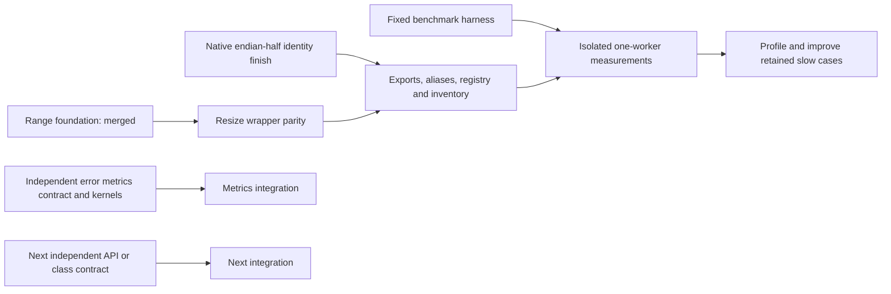

# Parallel implementation and validation plan

Implement the complete scikit-image API in optimized C++ with interchangeable
Python calls, per-function parity, optional process-global workers (default one),
and isolated one-worker comparisons against scikit-image 0.26.0. This includes
classes, nested namespaces, data and I/O. Private helpers and compatibility
forwarding do not count as completed public implementations.

The launch inventory contains 455 public names: 121 native-partial image entries,
two metadata entries, and 332 upstream-only entries. It includes 29 classes with
284 statically discovered member paths; constructors, state, runtime fields and
additional namespaces still need assessment. These counts describe implementation
classification, not verified parity or performance.

## What changed after review

The previous sequence waited for each foundation, wrapper and benchmark in turn.
Only shared integration needs that ordering. Kernel families, Python contracts,
benchmark preparation and class discovery can proceed independently.

Use four active agent slots: one integrator and three workers. Each worker owns
an isolated worktree, explicit files and its own build cache. Frozen candidate
wheels may be shared read-only. The integrator owns shared CMake/binding entry
points, public exports, aliases, registry/inventory changes, installation and
merges. Workers must not revert another worker's changes or edit shared files.

Test and benchmark paths in the inventory establish that files exist. They do
not prove a passing contract, a measured source revision, or a speedup. Track
those separately in [work_items.json](work_items.json) and packet evidence.

## Work launched now

| Packet | Agent | Exclusive work | Current dependency |
|---|---|---|---|
| C++ foundations / integration | Integrator | Native half identity finish, shared wiring | Range merged as `97a7723`; legal endian-half identity is an explicit registration gate |
| Error metrics | `metrics_reductions` | Three metrics' C++/SIMD/binding/helper and dedicated tests | Independent contract and kernel work; request shared wiring from integrator |
| Metrics benchmark harness | `resize_bench` (reused) | Metrics corpus, dedicated workflow and harness tests | Prepare independently; measurements require registered, frozen APIs |
| Transform class contracts | `resize_api` (reused) | Four classes' executable contracts and member/state matrix | Independent test-first packet; return for half-helper checks when its candidate is ready |

The read-only planning reviewer has completed its audit; its slot was reassigned
to error metrics. Private resize/rescale wrappers (`09c11b9`) and resize benchmark
tooling (`2e35855`) have already been merged. Their completed worktrees were removed
after clean/ancestor checks and evidence preservation. The freed workers now run
the next independent packets; public resize registration and measurements remain
gated. The full objective remains active while these packets run.

## Dependency and merge order

1. Workers freeze interfaces early: shape/dtype/ownership rules, worker policy,
   error/warning behavior and any runtime math providers. They report changes
   before another packet depends on them.
2. Workers submit a commit, advertised contract, exact commands/results, source
   and artifact hashes, unresolved cases and required shared wiring. Commit
   validated increments promptly; do not accumulate completed work in worktrees.
3. The integrator reviews and applies shared wiring. For resize/rescale, exercise
   the complete existing contract against the candidate without weakening the
   pending/native guards. Temporary in-memory candidate adapters are test tools,
   not public registration or coverage evidence.
4. Merge validated private kernels and benchmark tooling independently. Register
   public functions only with their tested wrapper, aliases, default API cases
   and regenerated inventory. Record `parity_passed / performance_pending` until
   exact-source measurements exist. A green path-existence test is insufficient.
5. Freeze the candidate wheel, installed SDK, source fingerprint, dependency
   versions and corpus hash. Benchmark the original and native public calls in
   an isolated Actions job, including allocations and normalization. Require one
   worker; additional worker counts are supplementary results.
6. Return measured bottlenecks to their owning worker. Keep every workload, raw
   sample and rejected trial. Merge validated improvements and remeasure the same
   corpus against the exact baseline; do not remove adverse cases.

Registration/build edits pass through one integrator. That short integration
step is the serialization point; independent implementation and contract work
continues while another packet builds, runs CI or waits for measurements.

## Next independent packets

| Priority | Packet and scope | Shared dependency / handoff |
|---|---|---|
| Active | `mean_squared_error`, `normalized_root_mse`, `peak_signal_noise_ratio` | Existing dtype/worker infrastructure; freeze promotions, ranges, shape checks, NaNs, infinities and warnings first |
| Next free worker | Connected-component `label` and its inventoried aliases | Freeze canonical numbering and connectivity before parallel block stitching; SIMD comparisons/run discovery, efficient scalar union/find where appropriate |
| After labeling | Small-object/hole removal, `clear_border`, `relabel_sequential` | Reuse stable label/count interfaces; separate component filtering from labeling ownership |
| Independent | Footprint rectangle, diamond, disk, ball, mirror/pad and decompositions | Preserve tuple/decomposition forms, output dtype/shape and errors; raster generation is an image operation, not metadata |
| Independent contract first | Rank minimum/maximum/mean/sum/pop, then histogram-based rank APIs | Integrator freezes nested-namespace exposure; worker owns a reusable rolling-histogram engine |
| Independent class contracts | Projective, affine, Euclidean and similarity transforms | Inventory constructors, inherited methods, fields, mutation, composition and inversion; implement parent models before subclasses |

Keep all other inventoried names explicitly unassigned until a bounded packet
claims them. Repeat the process for remaining transforms/pyramids, measurements,
features, segmentation, restoration, registration, graph, draw, data, I/O and
utilities. Review additional namespaces and runtime class attributes rather than
treating the current static inventory as exhaustive.

## Evidence and coordination rules

- `implementation` and packet state are separate. Suggested packet states are
  `queued`, `contracting`, `implementing`, `validating`, `parity_passed`,
  `performance_pending`, `measuring`, `measured`, and `accepted`.
- Per-API evidence must identify the tested contract, source SHA, wheel/binary
  hash, runtime profile, strict fallback-disabled result, scalar/SIMD result,
  default-one/global-worker behavior and original-library measurement. Class
  evidence also covers state and members. Null evidence means pending.
- Do not claim all-API completion from representative cases or native-partial
  registration. Every advertised contract and remaining inventory item must
  survive the completion audit. Measure non-image APIs according to their actual
  semantics; do not invent an image-kernel speedup for asset loading or metadata.
- Only the integrator changes this task ledger. Workers report evidence and
  request integration; they do not edit another packet's registry or inventory.
  Planning-ledger-only updates do not trigger the full build/test workflow;
  product, contract-test and integration changes still do.
- Never run local timing experiments. Untimed parity and `--check-only` are
  allowed. Never overlap measurements with builds/tests on their measurement
  host, or rebuild/delete a package a benchmark is using.
- Poll the same live process/Actions handle after observation timeouts. A timeout
  is not terminal and does not authorize cancellation or restart.
- After merging, remove only obsolete, clean worktrees whose commits are
  ancestors of `main`, after auditing retained files. Preserve active
  environments/caches, exact baselines/SDKs, running-job files, raw results,
  rejected trials and unfinished source. Never delete the whole `build/` tree.
  Previously rejected deletion paths remain protected.

The integrator fills a free worker slot from the ready queue, prioritizing work
that does not share writable files or require an unfinished interface. When a
measurement job is running remotely, workers can continue independent contracts
and kernels in their own worktrees. Reuse existing agents for follow-up packets.
