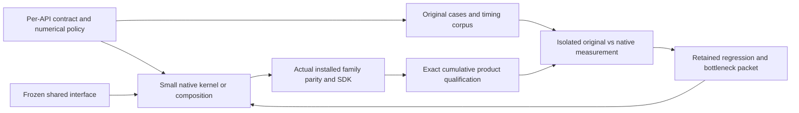

# Complete scikit-image implementation plan

Planning revision: 2026-10-25, audited on 2026-10-24–25 from main
`12fad3488178f52d52d8b4fd161e59790fe63d17`. The implementation goal is **paused**.
This revision authorizes no implementation, build, image call, measurement,
hosted dispatch, implementation-candidate merge/push, or cleanup. Validation and
publication of these planning documents are permitted. The assignments below are
the execution plan for an explicit resume, not a claim that workers are running.

Implement the complete pinned scikit-image 0.26.0 public API in optimized C++,
with interchangeable Python calls, CPU SIMD where useful, one optional
process-global worker setting that defaults to one, per-function parity, and
isolated one-worker comparisons with the original library. Classes, their state
and members, nested namespaces, data, and I/O remain in scope. A Python wrapper,
upstream forwarding, a metadata count, or a private helper is not a completed
native algorithm.

Use these documents together:

- [Per-API implementation paths](API_IMPLEMENTATION_PATHS.md) and their
  [machine-readable records](API_IMPLEMENTATION_PATHS.json) give every one of the
  477 inventoried keys an easiest viable route, dependencies, hazards, native
  frontier, SIMD/worker policy, next action, and measurement recipe.
- [Astra plan review](PLAN_REVIEW_ASTRA.md) explains the evidence and tradeoffs
  behind this revision.
- [work_items.json](work_items.json) records packet ownership and proof pointers.
  Its paused checkpoint records are current; older packet states and the old
  dependency graph require reconciliation before they can launch work.
- [api.json](api.json) is the observed API inventory. It describes implementation
  classification, not accepted full argument coverage or speed.
- The appendix below retains the important historical checkpoints. Historical
  source labels, raw results, failures, and proof scopes must not be rewritten.

## Accepted scope and frozen handoffs

| Inventory classification | Public keys | Meaning |
|---|---:|---|
| Native-partial image functions | 192 | An advertised subset executes natively; full argument and performance closure is still required. |
| Metadata functions | 3 | Separate from computational algorithms. |
| Native-partial classes | 4 | Coordinate/state support exists; independent fitting and matrix solvers remain incomplete. |
| Exception metadata provider | 1 | Compatibility identity, not a numerical implementation. |
| Upstream-only | 277 | Available through compatibility machinery, not native completion. |
| Total | 477 | Includes aliases, classes, metadata, assets, and I/O; it is not an algorithm count. |

The inventory includes 29 classes and 284 statically discovered member paths.
Runtime fields, generated attributes, constructor/state behavior, and additional
public namespaces need their own completion audit. The 19 `rank.generic` and
three bilateral aliases reuse canonical algorithms but still need public path
and signature checks. The old ledger's 391 unassigned API keys are assignment
accounting, not 391 unimplemented algorithms.

| Checkpoint | Evidence already available | First action after resume | Acceptance boundary |
|---|---|---|---|
| Accepted TV admission, actual source `af7b2af`, merged as `bbc1fc1` | [Four-product qualification](evidence/tv-single-admission-whole.json): 707,800 mixed checks, 144 SDK checks, 110 wheel members, 63 SDK members, 18 SDK families | Consume the actual immutable `af7b2af` products for the new comparison | Accepted 192-partial-path parity; this change adds no API paths and has no new speed result. |
| Combined 199-path candidate `3c87fbfdc425c953a280eaabf5934cada746f56d` | `build/worktrees/public199-skylakex-readiness/build/composition/manifest.json`: 2,001 metadata guards, four plans with zero listed blockers, zero whole-product builds | Review the composed source and runtime admission, then qualify that exact source once across all four profiles | Not whole-qualified. Never promote seven APIs from plans, metadata guards, or a failed predecessor. |
| TV comparison controller `8dad040aef9c1cb0c7c4135ad8eff0fc8a136ddd` | `build/worktrees/tv-single-admission-compare/build/admission-controller-review/manifest.json`: four new files, 312 metadata guards, immutable product-pair checks | Review the exact header projection, common inputs, original/`5e068a5`/`af7b2af` roles and genuine product frames; reuse the fixed corpus | Draft controller only; no numerical experiment or timing has run. |
| Iterative thresholds `1329cbb` and Li default supplement `337ba1b` | Original reference and actual qualified-kernel audit are frozen; the separate Li supplement has 38 solver cases and two intentional error-policy exclusions | Review source-backed findings; separate executed solver cases from metadata, unsupported inputs, and expected errors; choose one concrete coverage gap | Root review pending. The expanded 312-case reference does not mean 312 native solver matches. |
| Reconstruction reference `600a403c1368b99e5d85200bc4f6eb6ed262ea0c` | 309 checks per runtime: 259 actual original Cython cases, 13 preentry rejects, three unsafe intake cases, plus other checks | Review the reference; decide signed-zero/provider behavior; preserve and then validate the unfinished scalar C++ draft | Reference only. The draft is unbuilt and has no native acceptance or timing. |

These handoffs have exact paths and next actions in the paused ledger. No frozen
source is silently rebased, relabelled as main, or replaced with a reconstructed
product. If matrix-specific admission still blocks a bounded 199-candidate
preflight, prepare a separate fresh max-tree-only candidate from reviewed
sources. That candidate must earn its own complete product qualification;
failed 199 evidence cannot accept its six APIs. Do not rerun or cancel an already
live campaign merely because an observer timed out.

## Decide the contract before choosing the implementation

For each API row, freeze a small contract matrix before inspecting new candidate
outputs. Cover the pinned signature/defaults, dtype and promotion, dimensions,
channel/axis semantics, memory layout and overlap, allocation/view behavior,
mutation, warnings/errors, callbacks, exceptional values, and provider calls.
Select cases by behavioral partitions and boundary conditions, not by maximizing
assertion counts. Add the relevant upstream tests and generated adversarial
cases; record unassessed partitions explicitly. A common registry smoke test is
necessary but does not replace this matrix.

Use the least complex route that satisfies the complete contract:

1. Reuse an already accepted canonical implementation for true aliases, while
   checking each public path independently.
2. Compose existing native primitives when their dtype, boundary, ordering, and
   ownership rules match. Do not introduce another kernel or provider adapter
   just to obtain a new API name.
3. Port a simple scalar C++ implementation of the reference algorithm where a
   primitive is missing. Establish finite, empty, exceptional, strided, and
   mutable-input behavior before adding fast paths.
4. Add SIMD and optional parallel work to independently computable hot loops.
   Preserve scalar dispatch and the existing global worker setting. Measure the
   public call, including conversions and allocation, before tuning further.
5. For FFT, sparse/dense linear algebra, and codecs, evaluate a suitable C++
   library behind a repository-owned contract instead of recreating a numerical
   ecosystem. Pin and document its build and threading behavior. A call to the
   original scikit-image algorithm, or a NumPy/SciPy algorithm provider, remains
   an explicit native gap. Genuine external protocols such as user callbacks,
   custom estimators, and codec plugins must retain their defined integration
   behavior without being counted as native solvers.

### Numerical parity policy

Structural behavior is exact: public routing, signature, shape, dtype/metadata,
container structure, view and mutation semantics, labels, parent/traverser
identities, stable ties, state transitions, warnings/errors, and callback order.
Byte-preserving copies/rearrangements and integer/discrete algorithms retain
their exact values. Preserve sign bits, NaN behavior, and arithmetic ordering
where they are observable in the advertised contract or already required by an
accepted strict proof.

For floating arithmetic, each contract chooses exactness or a justified
absolute/relative/ULP or residual-based comparison in advance. Use dtype,
conditioning, reference guarantees, and the algorithm's error propagation to
justify that choice. A generic `allclose` threshold is not a contract. Existing
strict proofs remain valid and unchanged; any different future numerical policy
is a separately reviewed prospective contract, with independent cases that were
not used to select it. Do not widen tolerances after looking at failures, adapt
to an oracle result, dispatch on fixture identities, or claim a provider result
as a C++ result.

Iterative algorithms need more than a final value check. Li callbacks, TV
stopping, reconstruction ordering, local optima, threshold ties, and random/model
solvers can amplify small differences. Check observable iteration/callback
behavior, convergence/failure semantics, downstream masks or labels, and
conditioning/near-boundary cases. Retain source-faithful ordering where those
semantics require it. CPU-specific bitwise imitation is justified only by a
required observable contract; it is not the default prerequisite for adding an
unrelated API.

## Three workers and one integrator

On resume, reconcile the frozen checkpoints first, then use the same three
workers for bounded follow-up packets. Worker names are handles, not permanent
specialties. The ledger must record actual source, worktree, writable paths,
read-only dependencies, runtime handles, exit gate, and next handoff.

| Role | First bounded packet after resume | Continuing lane |
|---|---|---|
| Root / integrator | Review the 199 candidate delta and checkpoint receipts; reconcile stale packets; authorize one exact candidate's qualification | Shared CMake/core/exports/SDK/registry wiring, final independent acceptance, prompt merge/push and safe cleanup. Delegate mechanical evidence verification; review code, scope, exceptions, and the verifier's receipt. |
| Worker A | Finish the frozen TV comparison review/preflight using existing products; hand observation to the existing controller once running | Close measured regressions in metrics, TV, rank, resize, or labeling, one measured hypothesis at a time. A running remote job alone does not occupy this worker. |
| Worker B | Review the threshold/Li native frontier and implement one justified missing contract partition | Native-partial breadth, simple draw/util/reduction APIs, and region statistics. Reuse shared primitives and obtain an independent reviewer before handoff. |
| Worker C | Resolve reconstruction's reference/provider boundary and finish the smallest scalar native packet from the preserved draft | Neighborhood, morphology, connectivity, then a dependent family. During external waits, take an independent class/state or data/I/O contract packet from lane P. |

Root assigns independent review to a worker who did not author the changed
algorithm. Rotate reviews as packets finish; do not add a fourth worker or make
root manually reproduce every mechanical validation. A worker is not alone in
the repository and must preserve others' changes. Each worker owns an isolated
worktree and cache; shared product artifacts are read-only.

Bound work in progress:

- One active implementation packet per worker, with at most one frozen handoff
  awaiting integration. A packet normally changes one shared primitive or a
  small coherent API family, not an entire namespace.
- Root keeps at most two new integration candidates waiting for review. Drain
  the existing frozen backlog before creating more competing controllers or
  cumulative products. A blocker is recorded with the exact missing dependency;
  the worker then takes an independent ready packet.
- Commit reviewable source and its scoped proof promptly. Merge and push a
  validated increment promptly on resume; performance-pending status may remain
  explicit after parity acceptance. Do not hold completed private kernels or
  tooling until unrelated algorithms finish.
- Prepare the next contract and timing cases during another packet's build or
  remote measurement. Keep builds/tests off the measurement host and never touch
  packages in use by the measurement.

## Waves and shared primitives

Waves describe dependency order, not whole-library barriers. An API may start
when its own dependencies are ready. The per-API roadmap assigns each key one
primary wave and records the actual prerequisites. Lane P starts early and runs
alongside the numerical work so data, I/O, and class state do not become a late
unplanned project.

| Wave | Deliverable and easiest route | Release criterion |
|---|---|---|
| W0 — frozen checkpoint closure | Review/qualify the 199 candidate, measure qualified TV, classify threshold gaps, resolve reconstruction's entry boundary | Each checkpoint gets its true accepted/pending result; no invented new coverage. |
| W1 — cheap independent APIs and partial-contract closure | Existing native dtype/layout/keyword gaps; direct draw loops; util views/copies and conversions; basic statistics/moments; canonical alias reuse | Small public contracts with minimal new machinery, plus per-function timing. |
| W2 — neighborhood, ordering, connectivity | Reuse histogram/reduction/boundary primitives; rolling windows; reconstruction queue; stable union-find/tree traversal; rank and morphology extensions | Exact topology/tie/output-buffer behavior and safe boundary handling; dependencies shared by later families. |
| W3 — geometry, resampling, solvers, classes | Existing typed resampling/integral primitives; coordinate generation; C++ least-squares/SVD/QR where justified; common fitting/state layer | Full constructor/state/member behavior and actual solver paths, not class metadata alone. |
| W4 — FFT, multiscale, registration, restoration, features | One FFT/convolution layer, pyramids and gradients; direct C++ ports of feature/denoising loops; reuse stable eigensolvers | Fixed numerical policies, boundary/normalization correctness, actual one-worker provider control. |
| W5 — dependent graph, segmentation, model solvers | Graph construction/traversal over accepted labels and features; source-faithful watershed and optimization; reuse sparse/dense solver facilities | Exact discrete decisions plus full state/callback/randomness and convergence coverage. |
| P — providers, assets, I/O, class/state contracts | Asset manifest/cache and loader rules; codec adapters; collection laziness; plotting/UI adapters; external model protocols and runtime attributes | Exact API behavior and measured relevant work, explicit dependency/native frontier, no fake SIMD or image-kernel speed claim. |

Start from the current implementations rather than building a second foundation:

| Shared facility | Existing starting points | Ownership and extension rule |
|---|---|---|
| Typed array intake, strides, conversion and output ownership | `src/image.cpp`, `src/bind_numeric.hpp`, typed resampling bindings | One owned descriptor/boundary contract; extend it for a real family need, avoiding implicit copies that alter mutation or dtype semantics. |
| Global workers and CPU dispatch | `src/execution.hpp`, `src/image.cpp`, `src/simd.hpp`, existing `simd_*_avx2.cpp` | Preserve portable scalar operation and one worker default. Choose a workload-size threshold; prohibit nested provider oversubscription. |
| Histograms, reductions, ordering | `src/threshold.cpp`, `src/li.cpp`, `src/multiotsu.cpp`, `src/rank.cpp`, `src/metrics.cpp` | Reuse code where arithmetic/tie contracts match. Do not force numerically different reductions through one implementation merely to share code. |
| Neighborhoods and boundaries | `src/gaussian_nd.cpp`, `src/morphology.cpp`, `src/morphology_boolean.cpp`, footprints and rank | Share offsets/modes/halos after freezing their rules; keep feedback/output-alias traversals serial when required. |
| Connectivity and ordered queues | `src/components.cpp`, `src/component_consumers.cpp`, reviewed max-tree work, reconstruction draft | Stable labels and parents are public results. Parallelize independent preparation before changing dependent traversal. |
| Geometry and scale | `src/resample.cpp`, `src/resize_range.cpp`, `src/resize_clip.cpp`, `src/projective.cpp`, integral/downscale code | Compose native coordinates, sampling, and dtype policy; separate state/wrappers from the numerical solver. |
| FFT, sparse solvers, codecs and assets | New narrowly scoped facilities only when a roadmap family needs them | Compare viable libraries against the pinned contract; do not create a general framework before the first consumer. |

SIMD applies to independent pixels, coordinates, scans, arithmetic, and selected
reduction stages. Parallelism applies to independent rows, tiles, channels, or
preparation work after a measured size threshold. Tree/queue dependencies,
Gauss-Seidel updates, callback order, stable tie reduction, lazy I/O state, and
metadata often require serial execution. They still honor the global worker
policy, but forcing a parallel algorithm is not an acceptance criterion.

## Qualification, evidence reuse, and early measurement



Keep four distinct gates:

1. **Reference gate:** original source and safe original calls establish the
   contract. Metadata checks, expected failures, and unsafe blocked inputs are
   reported separately from successful numerical calls.
2. **Native family gate:** execute the real C++ binding and installed interface
   with fallback disabled. Check the changed family, dependent shared primitives,
   scalar/SIMD modes, default-one/optional workers, error/state behavior, and
   appropriate native/sanitizer/portable cases. A temporary adapter is private
   evidence only.
3. **Public product gate:** freeze source, wheel, SDK, dependency versions and
   build/runtime identity; run the existing genuine four-profile whole-product
   qualification for the actual cumulative candidate. The family gate catches
   defects early; it does not replace this release gate. Unaffected private
   evidence may be referenced only with explicit identical dependency closure.
4. **Performance gate:** consume the actual qualified artifacts and original
   0.26.0 in isolated one-worker roles. Verify the frozen corpus first, then time
   complete public calls. Retain every case, sample, regression and failed trial.

Use one reusable proof/measurement format and the existing qualification tools
for future families. A family supplies cases, comparisons, expected scope, and
commands; it should not need a new controller, retainer, publisher, and bespoke
certificate for each API. Any tool consolidation is a separate future packet:
preserve historical controllers and raw bytes, and validate the shared tool on
known success, failure, and tampered-input fixtures before adopting it.

A handoff needs source and owned-path deltas, full dependency fingerprints,
commands/results, actual artifact hashes, native/reference/provider/metadata
case counts, unresolved cases, process handles, and one independent verifier
receipt. Root reviews that bounded packet and its exceptions. Reuse an existing
verified immutable object by content hash and exact source/dependency scope;
never infer current behavior from a historical test count or relabel a product.
Fresh changed-source execution remains necessary. Do not repeatedly copy and
manually replay unchanged archives solely to create a new administrative seal.

Prepare performance corpora with the contract, and measure each newly qualified
family promptly. Existing comparisons already identify useful work: metrics,
large multivalued/high-connectivity labeling, footprint decomposition, rank
windowed histograms/noise-filter cases, and TV raster/volume cases. Prioritize
absolute time and representative workload impact, not only large speedup ratios
on tiny calls. Keep allocation/conversion/setup costs visible. Asset/I/O APIs
need reproducible fixture and cache-state measurements; metadata and state-only
APIs need relevant latency/behavior checks, not invented image throughput.

No local timing experiments. Hosted timing uses one native worker and one
original provider thread, matched inputs, repeated paired rounds, and recorded
runtime/CPU identities. Additional worker counts are supplementary. Do not time
alongside builds/tests, rebuild a package being timed, discard adverse cases, or
claim a later source inherits an earlier speedup. A measured baseline with
regressions is progress, not completion of the optimization objective.

## Completion tracking and operations

Report progress by evidence rather than assertion totals:

- 477 public keys: contract assessed / native partial / full advertised native
  contract passed / measured / performance target met; split aliases, metadata,
  assets, and providers from canonical computational algorithms.
- 29 classes and all 284 static member paths: constructor/state/member/solver
  status, plus runtime-discovered fields and namespaces still to assess.
- Per family: tested dtype/layout/parameter partitions, native cases versus
  reference/provider/metadata cases, unsupported partitions, and retained
  regressions with absolute cost and next owner.
- Queue health: active owners and writable paths, frozen handoff age, blockers,
  exact live handles, next merge, and clean obsolete worktrees eligible for
  removal. These operational measures are not implementation acceptance.

The goal is complete only when every inventoried and newly discovered in-scope
public contract is accounted for, required computation is genuinely native,
per-function and class/state parity passes, installed C++/Python products are
qualified, and original-library one-worker evidence establishes the declared
performance result for each relevant API. Do not mark the goal complete with
unsupported argument partitions, hidden algorithm providers, unmeasured APIs,
or unresolved optimization targets disguised by aggregate averages.

These commands inspect the queue; they do not resume the goal or launch work:

```powershell
.venv/Scripts/python.exe tools/work_queue.py --check
.venv/Scripts/python.exe tools/work_queue.py --check --verify-local-proofs
.venv/Scripts/python.exe tools/work_queue.py --agents
.venv/Scripts/python.exe tools/work_queue.py --ready
.venv/Scripts/python.exe tools/work_queue.py --packet <reviewed-packet-id>
.venv/Scripts/python.exe tools/generate_api_implementation_paths.py --check
```

The checker catches cycles, malformed proofs, ownership conflicts and inventory
accounting. It does not prove that a packet's state is current, that an agent is
live, that a proof covers all arguments, or that a performance target was met.
On resume, root reconciles the old packet states with the paused checkpoint map
and the per-API roadmap before choosing any ready packet.

Follow [AGENTS.md](../AGENTS.md) after each validated merge. Remove an obsolete
worktree only with `git worktree remove`, after confirming its commits are
ancestors of main and its tracked/untracked source work is clean. Retain active
environments, running-job files, exact baseline/qualified products, raw results,
rejected trials, and unfinished source. Resolve every cleanup path inside the
workspace before deletion; never delete the whole `build/` directory. Existing
cleanup rejection records stay explicit. No cleanup is authorized by this
planning revision.

## Appendix: retained historical evidence

The prior narrative is preserved in Git at
[`12fad348` / `coverage/EXECUTION_PLAN.md`](https://github.com/bipxx/scikit-imagexx/blob/12fad3488178f52d52d8b4fd161e59790fe63d17/coverage/EXECUTION_PLAN.md).
Its old live assignments, handoff instructions, and counts are historical.
The following records remain authoritative only for their own exact sources:

| Checkpoint | Retained evidence and limitation |
|---|---|
| Resize/rescale and half identity | Sources `aed3349`/`21ac60b`; six actual 9,968-check profiles and the 373-case corpus. [Resize initial report](../benchmarks/resize-public-initial.md) measures source `66e5f78` and retains 49/52/61 slower cases. Later optimization sources require their own results. |
| First public metrics, footprints, and labels | [public-wave1](evidence/public-wave1.json) seals the public/SDK/corpus evidence. Reports for [metrics](../benchmarks/metrics-public-initial.md), [footprints](../benchmarks/footprints-public-initial.md), and [components](../benchmarks/components-public-initial.md) preserve measured regressions; a measured baseline is not optimization completion. |
| Transform classes and component consumers | [integrated-wave2](evidence/integrated-wave2.json), [integrated-wave3](evidence/integrated-wave3.json), and [component consumers](evidence/component-consumers-public.json) retain their exact scopes. Four classes remain partial with explicit numerical providers. |
| Rank expansion and corrected 186-path source | [public-wave7](evidence/public-wave7.json), [failed wave9](evidence/public-wave9-failed-trial.json), and [public-wave10](evidence/public-wave10.json) retain accepted and rejected trials. The corrected `05e79eb` does not erase endian/metadata failures of its predecessors. |
| Rank Otsu/majority and counts optimization | [public-wave11](evidence/public-wave11.json) covers the exact before/after products and the 190-path scope. [Counts comparison](../benchmarks/rank-statistics-counts-comparison.md) retains all 376 IDs, seven rounds, raw samples, and every slower case from run `40084877921`. |
| TV-Chambolle and Bregman additions | [public-wave12](evidence/public-wave12.json) accepts `f87120c` at 191 paths; [public-wave13](evidence/public-wave13.json) accepts `3cdd363` at 192. The initial TV measurement remains tied to `f87120c`; Bregman and later changes have independent performance gates. |
| TV strided cursor | [Cursor public evidence](evidence/tv-chambolle-cursor-public.json) qualifies `5e068a5`. [Controlled comparison](../benchmarks/tv-chambolle-cursor-comparison.md), run `40119412201`, retains 210 rows, 4,410 samples, and 129 union regressions. Actual before/after products stay `3cdd363`/`5e068a5`; reported gains cannot be relabelled as `af7b2af` results. |
| Matrix and max-tree private work | [General matrix kernel](evidence/matrix-transform-general-kernel.json), [profile tooling](evidence/matrix-transform-profile-tooling.json), [max-tree bridge](evidence/max-tree-private-bridge.json), [closing dtype correction](evidence/max-tree-closing-dtype-private.json), and [SDK oracle correction](evidence/max-tree-sdk-oracle-private.json) retain their scoped private proofs. The failed combined run `40117331038` remains failed. |
| Max-tree measurement preparation | [Benchmark reference](evidence/max-tree-benchmark-reference.json) retains 351 source observations and 252 finite candidates per runtime; it is not a native measurement result. |
| Archive and worktree retention | [Released metadata scratch cleanup](evidence/released-metadata-scratch-cleanup-20261024.json) and [TV admission worktree retirement](evidence/tv-admission-public-worktree-retirement.json) preserve archived files, redirects, and protected/rejected paths. They are not instructions to delete other worktrees. |
