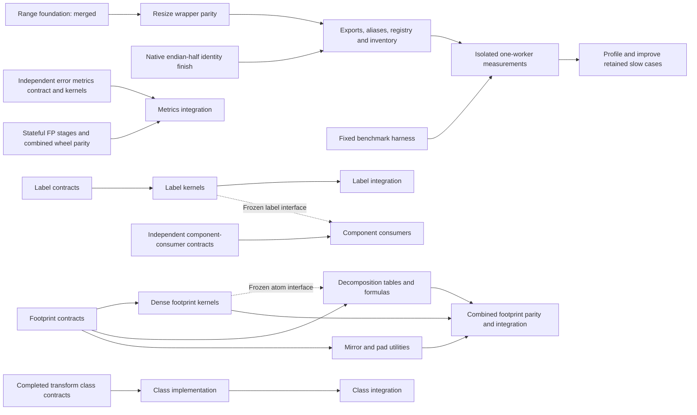

# Parallel implementation and validation plan

Implement the complete scikit-image API in optimized C++ with interchangeable
Python calls, per-function parity, optional process-global workers (default one),
and isolated one-worker comparisons against scikit-image 0.26.0. This includes
classes, nested namespaces, data and I/O. Private helpers and compatibility
forwarding do not count as completed public implementations.

The current inventory contains 474 public paths: 163 native-partial image entries,
three metadata functions, four partial native classes, one exception metadata
provider, and 303 upstream-only entries. The expansion adds 19
source-backed public/legacy rank.generic aliases of existing algorithms, not
19 additional algorithms. Imported dependencies are excluded from that count. It includes 29 classes with
284 statically discovered member paths; constructors, state, runtime fields and
additional namespaces still need assessment. These counts describe implementation
classification, not verified parity or performance.

Three worker agents are executing private consumer output-scan optimization,
the next four rank statistics kernels, and cumulative whole-core validation of
SIMD metrics classification plus qualified R2 aliases. The integrator handles
shared wiring, hosted measurements, verified reports, prompt merges and cleanup.
All four completed report families are merged; live jobs keep their authoritative
handles until terminal.

## What changed after review

The previous sequence waited for each foundation, wrapper and benchmark in turn.
Only shared integration needs that ordering. Kernel families, Python contracts,
benchmark preparation and class discovery can proceed independently.

Use four active agent slots: one integrator and three workers. Each worker owns
an isolated worktree, explicit files and its own build cache. Frozen candidate
wheels may be shared read-only. The integrator owns shared CMake/binding entry
points, public exports, aliases, registry/inventory changes, installation and
merges. Workers must not revert another worker's changes or edit shared files.

Test and benchmark paths in the inventory establish that files exist. They do
not prove a passing contract, a measured source revision, or a speedup. Track
those separately in [work_items.json](work_items.json) and packet evidence.

## Three-agent review and worker lanes

| Lane | Agent | Independent responsibility | Current checkpoint |
|---|---|---|---|
| Integrator | `root` | Shared core/SDK, registry/inventory, hosted measurements, prompt merges and cleanup | Accepted c44 product: 163 image paths and 303 upstream-only. Controlled resize, R1/R2 rank and consumer reports verified and merged; all regressions retained |
| Worker 1 | `metrics_reductions` | Measured consumer bottlenecks | New private branch from frozen 61da: fixed-width output stores and certified contiguous SIMD scan. Preserve provider/alias/partial-error behavior; sorting/hash/layout conversion remain unresolved |
| Worker 2 | `resize_api` | Next rank statistics kernels | Reference contracts pass 6,257 checks on each of three runtimes. Implement geometric mean, noise filter, centered mean and vector histogram privately with unchanged RankView ABI; eight paths remain upstream-only |
| Worker 3 | `resize_bench` | Cumulative metrics/alias actual-core validation | Frozen 61da packages: all authoritative original runners terminal, 538 migrated admission checks pass on each of eight profiles and all 72 SDK checks pass. Final data-only inventory supplement and evidence sealing remain; retain all original obsolete-policy failures |

The agent names are reused from earlier packets; they do not describe their
current assignments. The recorded three-agent review and safe checkpoints are
visible with `tools/work_queue.py --agents`. Live process state is checked with
the collaboration agent tools, rather than inferred from this ledger.

All three reviewers identified the same avoidable dependency: independent
decomposition work waited for dense-kernel completion. The revised queue releases
it from a versioned, hashed atom interface and requires joint kernel parity at
integration. Component-consumer original contracts are also independent of native
labeling. Their implementation waits for the frozen labeling interface.

## Retained checkpoints

The following records describe their measured source revisions; the ledger above
owns current assignment and readiness. A historical passing source does not
establish complete parity or performance of a later cumulative package.

The read-only planning reviewer completed its audit. Native half identity
(`aed3349`) and public resize/rescale (`21ac60b`) are merged. The exact registered
wheels passed 9,968 tests in each of six runtime/SIMD profiles, and the 373-case
corpus passed untimed checks on all three runtimes at workers one and four.
Performance run [39957875987](https://github.com/bipxx/scikit-imagexx/actions/runs/39957875987)
uses source `66e5f78`; all six preparation/measurement jobs completed successfully. Observe this same run;
do not restart it because of a queue or timeout. The [baseline report](../benchmarks/resize-public-initial.md) retains every sample
and 49/52/61 slower cases across Windows/modern/minimum. Row-span normalization
copies are the first measured-bottleneck trial. Actual complete packages pass
10,918 public and 6,506 shared checks in each of six profiles; the unchanged
373-case remeasurement is queued as
[39987242238](https://github.com/bipxx/scikit-imagexx/actions/runs/39987242238).

The private metrics baseline (`03581ae`, integrated as `99abcfc`) passed 4,082
tests in each of six profiles through the actual shared `_core`. It is merged as
`147bd8b`; original worker ancestry is retained by `1945c2e`. Follow-up `070fc64`
fixes buffered reductions and default-policy details, passing six 4,308-case
profiles plus native sanitizers. Stateful callback policies and exact combined
optimized wheels remain registration gates. Private parity is scoped evidence.
Metrics benchmark tooling (`6c74563`, merged as `d94ef6c`) has a fixed 1,231-case
corpus, including 19 expected errors; its one-worker timing workflow is now queued.
The combined public metrics, footprints and label package at `05c3506` now passes
14,963 public-suite checks and 6,506 metadata/shared API checks in each of six
runtime/SIMD profiles. All 18 dedicated untimed corpus runs pass at workers one
and four, plus native tests, sanitizers and external SDK consumers. Counts include
reference and metadata assertions; they are not distinct algorithm counts.
The [acceptance record](evidence/public-wave1.json) seals 702 retained artifacts.
These public integrations are parity-passed with performance pending. The one-worker
[metrics](https://github.com/bipxx/scikit-imagexx/actions/runs/39983272390),
[footprint](https://github.com/bipxx/scikit-imagexx/actions/runs/39983468427) and
[label](https://github.com/bipxx/scikit-imagexx/actions/runs/39983471905)
measurement workflows completed successfully. Their raw samples and every
regression are retained in the three baseline reports. Metrics are slower
overall (0.67–0.85x); footprint raster generation is 2.16–2.50x while decomposition
and view setup remain slower. Labeling raster ratios are 0.82–1.40x with major
large multivalued/high-connectivity regressions. These measurements leave
optimization work, rather than proving completion of the performance objective.

Four public transform classes and canonical exception metadata now pass six
7,520-check mixed public/state/shared profiles, supplementary standalone exception
checks and a 296-case strict public corpus at workers one/four. Model classes
remain partial: NumPy/SciPy matrix/fitting providers and external provider thread
pools are explicit, with independent C++ solvers and performance still pending.
Installed SDK foundations pass 26 native tests on Windows/Linux plus portable,
sanitizer and external consumer gates. Private rank adds nine algorithms and
component consumers add four public wrappers, accepted through eight actual
Release/Debug package profiles with 5,795 checks each and three 474-path inventory
checks. Returned ArrayMap stays internal. Nine rank algorithms still await their
separate public package gates. Debug validation reproduced generic array
dtype-reference access after GIL release; the four fixed bindings are undergoing
full regression checks without disabling assertions. Completed worktrees are removed only after
evidence archiving and clean/ancestor checks.

## Dependency and merge order



1. Workers freeze interfaces early: shape/dtype/ownership rules, worker policy,
   error/warning behavior and any runtime math providers. They report changes
   before another packet depends on them.
2. Workers submit a commit, advertised contract, exact commands/results, source
   and artifact hashes, unresolved cases and required shared wiring. Commit
   validated increments promptly; do not accumulate completed work in worktrees.
3. The integrator reviews and applies shared wiring. For resize/rescale, exercise
   the complete existing contract against the candidate without weakening the
   pending/native guards. Temporary in-memory candidate adapters are test tools,
   not public registration or coverage evidence.
4. Merge validated private kernels and benchmark tooling independently. Register
   public functions only with their tested wrapper, aliases, default API cases
   and regenerated inventory. Record `parity_passed / performance_pending` until
   exact-source measurements exist. A green path-existence test is insufficient.
5. Freeze the candidate wheel, installed SDK, source fingerprint, dependency
   versions and corpus hash. Benchmark the original and native public calls in
   an isolated Actions job, including allocations and normalization. Require one
   worker; additional worker counts are supplementary results.
6. Return measured bottlenecks to their owning worker. Keep every workload, raw
   sample and rejected trial. Merge validated improvements and remeasure the same
   corpus against the exact baseline; do not remove adverse cases.

Registration/build edits pass through one integrator. That short integration
step is the serialization point; independent implementation and contract work
continues while another packet builds, runs CI or waits for measurements.

## Next independent packets

| Priority | Packet and scope | Shared dependency / handoff |
|---|---|---|
| Active cumulative validation | Qualified R2 overlap and SIMD metrics classification at frozen 61da | Authoritative original jobs terminal; four-function admission migration passes 538 checks on each of eight profiles. Finish data-only 163-path inventory supplement and seal core/SDK/source identities before acceptance and release |
| Active measured bottleneck | Consumer raster output scans | Private width dispatch and certified SIMD selects/fills; fixed 878-case corpus, provider/owner/partial-write contracts and all regressions remain unchanged |
| Active independent kernels | Four R4 rank statistics algorithms | Separate scalar statistics and vector-depth capabilities preserve RankView ABI and old bits. Reference-only eight paths stay upstream-only until genuine public gates pass |
| Ready measurement | Four public R3 intensity algorithms | All eight public-package profiles and 1,428-case corpus pass. One-worker hosted run [40034423731](https://github.com/bipxx/scikit-imagexx/actions/runs/40034423731) uses exact fbdfb46; 384 canonical raster workloads, aliases/errors untimed. Poll the same run to terminal |
| Verified reports | Controlled resize and initial R1/R2/consumer campaigns | Completed runs 40020239743, 40024802716, 40024807986 and 40024754860; all raw samples, source boundaries and slower cases retained |
| Retained preparation failure | Consumer campaign 40020440164 | Preserve original failed source-text guards and logs. Corrected LF/CRLF-only provenance passed without changing any of 878 observations, followed by successful campaign 40024754860 |

Keep all other inventoried names explicitly unassigned until a bounded packet
claims them. Repeat the process for remaining transforms/pyramids, measurements,
features, segmentation, restoration, registration, graph, draw, data, I/O and
utilities. Review additional namespaces and runtime class attributes rather than
treating the current static inventory as exhaustive.

## Execute the queue

The integrator uses the ledger checker before assigning work and after every
handoff. These commands only inspect the plan; they do not launch agents, mutate
source, compile, time code or cancel jobs.

```powershell
.venv/Scripts/python.exe tools/work_queue.py --check
.venv/Scripts/python.exe tools/work_queue.py --check --verify-local-proofs
.venv/Scripts/python.exe tools/work_queue.py --agents
.venv/Scripts/python.exe tools/work_queue.py --ready
.venv/Scripts/python.exe tools/work_queue.py --packet footprints-decomposition
```

Each scoped packet records exact owned paths, a base revision, read/link
dependencies, its build policy, a concrete `collaboration.followup_task` handoff
and acceptance gates. `--ready` lists scoped queued packets whose required proof
scope or frozen interface is available, excluding occupied writable files.
It does not change goal status or assert spare
capacity: the integrator keeps at most three worker agents active, reuses a
completed agent with `followup_task`, and supplies the printed handoff with an
explicit isolated worktree and branch. Unscoped inventory items are not launched.
The checker rejects cycles, missing dependencies, excess worker owners, escaping
paths and concurrent ownership of the same file, including Windows case aliases.
It validates interface hashes and requires source/hash-bearing evidence manifests
with numeric native/pending counts. Registration explicitly requires private
native proofs; measurement requires actual public-native and harness proofs.
Reference contracts and expected failures cannot release either gate.
The optional local-proof check hashes retained manifest bytes in this workspace;
a fresh checkout needs those preserved artifacts before that check can pass.

The next handoffs are executable in this order:

1. Freeze and merge the preserved labeling contract increment after checking its
   three-runtime evidence. Keep native-pending cases explicit, then give that
   same worker the native packet. Footprint contracts are already merged.
   Component-consumer contracts can be assigned independently.
2. Keep the metrics agent on its private correctness/optimization follow-up.
   Freeze and merge that increment after all parity/sanitizer gates. Handle
   stateful NumPy callback policies in a separate stagewise packet; an explicit
   fallback guard is a documented gap, not completed native parity.
3. While those workers build or test, the integrator performs short shared
   wiring steps, checks actual combined wheels and merges validated increments.
   Never make independent contract/kernel work wait for an unrelated build.
   After a safe terminal handoff, immediately give a free worker a disjoint ready
   packet while integration or hosted measurements continue. Use the recorded
   worker queues; do not spawn a fourth worker alongside the integrator.
4. Register only the advertised, verified public contract, regenerate inventory,
   then freeze its package and dispatch its original-library measurement job.
   A private helper, original-only test, expected failure or development adapter
   cannot satisfy the public registration gate.
5. Return every measured regression to an owning optimization packet. Preserve
   the complete corpus, raw samples and failed trials, then remeasure retained
   improvements at one worker. Keep runtime-specific results separate.

All active packets use their own ignored cache. An agent's handoff includes its
live process handles; observation timeouts leave those jobs active. A finished
agent reports terminal handles, source SHA, exact artifacts and evidence paths
before the integrator schedules worktree cleanup.
Build environments must be retained: Python, NumPy and pybind11 CMake paths must
not point into an expired temporary build-isolation directory. Interface changes
create a new version/hash and an explicit dependent handoff; frozen interfaces are
not edited silently. Standalone adapters never create a second worker policy in
the installed main `_core`.

## Evidence and coordination rules

- `implementation` and packet state are separate. Suggested packet states are
  `queued`, `contracting`, `implementing`, `validating`, `parity_passed`,
  `performance_pending`, `measuring`, `measured`, and `accepted`.
- Per-API evidence must identify the tested contract, source SHA, wheel/binary
  hash, runtime profile, strict fallback-disabled result, scalar/SIMD result,
  default-one/global-worker behavior and original-library measurement. Class
  evidence also covers state and members. Null evidence means pending.
- Do not claim all-API completion from representative cases or native-partial
  registration. Every advertised contract and remaining inventory item must
  survive the completion audit. Measure non-image APIs according to their actual
  semantics; do not invent an image-kernel speedup for asset loading or metadata.
- Only the integrator changes this task ledger. Workers report evidence and
  request integration; they do not edit another packet's registry or inventory.
  Planning-ledger-only updates do not trigger the full build/test workflow;
  product, contract-test and integration changes still do.
- Never run local timing experiments. Untimed parity and `--check-only` are
  allowed. Never overlap measurements with builds/tests on their measurement
  host, or rebuild/delete a package a benchmark is using.
- Poll the same live process/Actions handle after observation timeouts. A timeout
  is not terminal and does not authorize cancellation or restart.
- After merging, remove only obsolete, clean worktrees whose commits are
  ancestors of `main`, after auditing retained files. Preserve active
  environments/caches, exact baselines/SDKs, running-job files, raw results,
  rejected trials and unfinished source. Never delete the whole `build/` tree.
  Previously rejected deletion paths remain protected.

The integrator fills a free worker slot from the ready queue, prioritizing work
that does not share writable files or require an unfinished interface. When a
measurement job is running remotely, workers can continue independent contracts
and kernels in their own worktrees. Reuse existing agents for follow-up packets.
