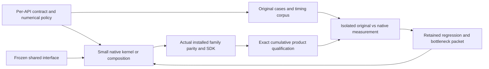

# Complete scikit-image implementation plan

**Qualified baseline:241 image APIs.** [Root admission](evidence/public241-whole-product-admission.json) accepts exact source `4e657ee64fb71e4d707d32e9539fdb4d7cc528af` after all four supported profiles independently pass895,864public checks,200SDK checks and48frozen corpora with no failures/errors/skips. This adds38native-partial paths over the preserved203baseline. Qualified products contain159wheel/71SDK members and25SDK clients; newer main242, tie-free UniqueRows and SDK79 changes keep their separate scoped evidence and need a new whole-product campaign.

**RegularSeeds source integration is complete:** 53 frozen original-first cases, six native modes, 436 private and 468 bounded public/default checks pass. Source now has 242 native-partial image APIs, three metadata helpers and 226 upstream-only APIs. Its nine-case one-thread benchmark is frozen; genuine installed preparation and speed evidence remain pending. NumPy grid calculation and calloc-backed output allocation are explicit providers, while grid-label generation/scatter are owned. Eight installed C++ primitive headers and a relocated consumer now pass normal/scalar component checks; the next genuine build must verify168product/79SDK members and26clients/52checks. This publishes prepared primitives, not complete high-level C++ equivalents for every Python API.

**Latest measured progress:** the merged [UniqueRows tie-free implementation](../benchmarks/unique-rows-tie-free-same-host.md) passes its fixed same-host gate: 1.114885217x direct /1.111665044x normalized over the prior C++ version, and1.755383326x over original scikit-image. All9workloads beat original in both candidate passes; all504samples, the small balanced all-equal CPP loss and3per-pass regression observations remain published. The earlier mixed baseline and prefix-cache report remain unchanged. The merged [LabelPoints fused implementation](../benchmarks/label-points-fused-same-host.md) gives1.677277611x over prior C++ and1.340704225x over original; three sparse cases still lose. These are separate source/host-scoped workload results, not a whole-library aggregate.

The [four-profile239-API review](evidence/current239-qualification-v4.json) is terminal without promotion: 891,952 XML checks contain 16 Windows LevelSet ABI-observation mismatches and no errors/skips; all 200 installed-SDK checks and 48 frozen corpora pass. The genuine Windows product now passes the previously failing FFT/LPI and signed-zero checks. Every profile also fails six inventory descriptor fields; those source-route mappings are fixed with a new prebuild guard. A fresh original-only Windows witness reproduces both platform-sensitive observations and matches all sixteen retained native records exactly. An additive strict Windows-ABI reference supplement is merged; Linux goldens, numerical bounds and failed campaigns remain unchanged. Accepted coverage remains 203 pending a new exact-product campaign.

The [241-API qualification campaign](evidence/current241-qualification-v5.json), frozen at `12fa2aad017573ed58c2a6687551f183aa4140ca`, is terminal without promotion. Modern Linux, debug Linux and Windows independently pass 671,898 public XML checks with no failures/errors/skips, 150 installed-SDK checks and all 36 corpora plus matrix checks; product closure is 159 wheel / 71 SDK members. The modern and Windows Release stagers are authenticated and remain unaccepted. Minimum Python stopped before compilation because a new observer immutability test hashed a Python-version-dependent AST schema. The merged correction hashes the unchanged observer source and passes on retained Python 3.11 and 3.13. All failed evidence remains retained; accepted coverage stays 203 pending a fresh exact-source campaign containing that correction and the now-merged UniqueRows optimization.

The [four-profile successor40710464380](https://github.com/bipxx/scikit-imagexx/actions/runs/40710464380) is accepted for its exact frozen4e products. All earlier failed campaigns and their raw observations remain retained; no older result was relabelled.

Current verified checkpoint (2026-10-28): **242 native-partial image APIs, three metadata helpers and 226 upstream-only APIs**; latest full supported-profile qualification is **241 image APIs at frozen4e**. The phase-3 selector collects **4,366 nodes per mode** and the smoke projection **1,435 nodes**. Collection is not execution or acceptance. Latest one-thread original-library results include Profile line 23.9182x (18/18 wins), Blur 1.5395x (24/24), Compare images 1.6558x (18/18), and Level-set generators **22.845615241x (8/8)**. These are separate workload-specific geometric means, not a library-wide aggregate. All samples and historical losses remain retained.

The four-profile campaign [40666218709](https://github.com/bipxx/scikit-imagexx/actions/runs/40666218709), at older exact source `ab756ce7bf6bff9bed0a7bfca4bf7738261aaf30`, is terminal without promotion. Three Linux numerical qualification seals passed; both Release staging steps failed at a historical whole-controller pin after an intentional SDK metadata edit. The merged correction inverts only that exact reviewed edit and compares the unchanged historical hash. Windows retained **10 numerical failures**; the later signed-zero compiler fix is merged but requires genuine whole-product revalidation, and LPI inverse diagnosis remains separate. All failed artifacts and original expectations remain unchanged. Neither these older products nor scoped fixes qualify current main.

[Level-set result](../benchmarks/level-set-minimum-initial.md) measures exact source `0a24ac663257815c77f2d488b5a281b646c918bf`: checkerboard **59.673227301x**, disk **8.746336663x**, all eight cases faster and **112 raw samples** retained. Calls include public normalization, allocation and output destruction with one global worker and reference pools limited to one. Exact output words and storage metadata pass before timing. The minimum Release also passes 5,460 focused checks, 3,696 color regressions, 1,612 matching checks and 1,421 smoke checks for its 241 registered functions; this measured source predates MapArray registration.

**MapArray optimization is merged:** the [controlled same-host report](../benchmarks/map-array-small-same-host.md) gives 2.607984454x direct / 2.606253914x normalized gain over prior C++, and 3.303183812x balanced speedup over original scikit-image. All three targeted workloads improve in both passes; all five prior original-library wins remain wins. All 504 samples and every loss are retained: dense256 is 0.998309707x versus prior C++, and signed sparse1024 is near original parity with one 0.991050822x pass. This is scoped workload evidence, not complete library superiority or four-profile promotion.

**Historical MapArray baseline: 5/9 wins, geometric mean 1.357390612x**, on exact source `b08aef5fb21cb7bfe87ffa04c35767eab1727d8e`. The [complete report](../benchmarks/map-array-minimum-initial.md) retains all nine cases, all four losses and 126 one-worker samples. Dense maps win 3/3 (3.189581106x); strided input wins 7.871184639x. Both signed sparse cases lose (0.306931330x geometric mean), wide maps are mixed, and preallocated strided output loses (0.693745592x). The largest penalty is +13.860088500 ms for signed sparse 1024x1024. Genuine preparation passed 5,872 focused checks, 3,696 color checks, 1,612 matching checks and 1,423 smoke checks; the measured wheel has 157 members and 71 SDK members. This mixed baseline prompted the controlled follow-up above; all initial slow cases remain published. This remains scoped minimum-host evidence, not a whole-library aggregate or four-profile promotion.

Earlier checkpoint narratives below are historical and retain their original source scopes.


## Current priority: phased fast run

1. MapArray, LabelPoints and UniqueRows optimizations passed their frozen same-host gates and are merged. Keep all initial results and losses, including remaining sparse LabelPoints losses and every CPP control regression; UniqueRows now wins all9original cases in both passes.
2. Address the remaining measured losses with bounded source changes and unchanged per-function parity contracts; do not infer whole-library superiority from separate workload means.
3. The four-profile campaign40710464380 is admitted at exact4e for241image APIs. Prepare the newer current242/SDK79 product next; the later tie-free implementation and header changes retain separate source-scoped proofs. RegularSeeds now passes its53-case private/public parity and is wired; installed C++ primitive headers/client checks are complete as component evidence. Prepare one genuine current242/SDK79 product and measure the frozen nine-case RegularSeeds workload. The UniqueRows duplicate-minimum experiment40716546947 is kept with all raw results/losses retained.

### Earlier scoped checkpoints (historical)

**Profile-line source is integrated:** `measure.profile_line` adds owned typed order-0/1 arbitrary-coordinate sampling through the existing resampler and AVX2 query lanes, with optional global workers. Source `2be752c` is merged as `9ead9b3`. Forty-six original-first specifications pass **372 public + 136 shared checks**, with both **1,409-node collection censuses** verified. All 368 fresh original records match the frozen references; candidate words, layouts, callbacks, warnings, errors and state match exactly. The shared checks prove 120 accepted native sampling calls. Six native modes pass **555,754 controls each** for normal/scalar and sanitizer modes and **277,881 each** for portable modes; old 480 double and 232 typed resampling fixtures also pass normal/scalar regression checks against the actual new object. Literal coordinate generation, channel assembly, flip and reducers remain providers; higher orders, unsupported storage and exceptional sampling keep explicit primitive routes. The metadata observer's wrong native-stage tag is preserved with its first 34-pass run and corrected separately, reusing all 372 public checks. At the Profile checkpoint, source was **234 native-partial image APIs + 3 metadata functions = 237 registered functions**, with **234 upstream-only entries**. Full supported-profile qualification remains **203 image APIs**. [Release40448470579](https://github.com/bipxx/scikit-imagexx/actions/runs/40448470579) completed: the [fixed 18-case one-thread comparison](../benchmarks/profile-line-minimum-initial.md) has **4 wins and 14 losses**, geometric mean **0.977475055x**, with all 252 samples and exact sampled/public words retained. This initial implementation is slower overall; optimization is not yet measured. The phase3 public barrier is configured for **2,924 checks per mode**, not yet executed as a full qualification.

**Mesh surface area is integrated and measured:** `measure.mesh_surface_area` owns typed float32/float64 edge, cross-product, norm and source-ordered reduction arithmetic, with AVX2 across independent faces and optional global workers. Source `680e116` is merged as `6d35344`. Forty-four original-first specifications pass **356 public + 88 shared checks**, with both **1,405-node collection censuses** verified. All 352 saved reference records and 264 returned scalar records match exactly, including profile-specific scalar promotion. Native normal/scalar and sanitizer modes pass **2,579 controls each**, and portable modes **1,297 each**. Literal full face gathering precedes native admission, preserving errors from unused face columns; unsupported or exceptional arithmetic retains the primitive route on that same gathered snapshot. [Release40442613742](https://github.com/bipxx/scikit-imagexx/actions/runs/40442613742) passes **4,064 focused, 3,696 color, 1,612 matching and 1,405 smoke checks**, plus separate intake/width guards. Its [six-case one-thread report](../benchmarks/mesh-surface-area-minimum-initial.md) gives **6/6 wins, geometric mean 2.228286562x**, with all 84 samples, accepted native dispatch and zero observed error. Cases are quadratic meshes with 64/128/256 cells per side, each float32/float64; this is a first comparison on those workloads. At the Mesh checkpoint, source was **233 native-partial image APIs + 3 metadata functions = 236 registered functions**, with **235 upstream-only entries**. Full supported-profile qualification remains **203 image APIs**; the complete phase3 public barrier is configured for **2,831 checks per mode**, not yet executed as a full qualification.

**Compare images is integrated:** `util.compare_images` source `1c22bf6` and benchmark gates are merged as `3176584`. The frozen 54 specifications pass **436 public + 136 shared = 572 checks** across both pinned profiles and normal/scalar dispatch; both profiles collect 1,417 smoke nodes. All 432 fresh original/candidate rows match the frozen reference, including converted storage, dtype/layout, raw output, errors, warnings and protocol order. Scalar/SIMD/sanitizer modes pass 5,297 native controls each, portable modes 4,603. Ordinary C calls return the native array directly; metadata-only allocation handles other assessed layouts. Exceptional arithmetic and unassessed scalar promotion remain explicit primitive partitions. The [first one-thread Release40649386523](https://github.com/bipxx/scikit-imagexx/actions/runs/40649386523) is running the fixed 18-case diff/blend/checkerboard comparison; both profiles already passed its untimed exact prechecks. No performance result is claimed yet. Current source is **236 native-partial image APIs + 3 metadata functions = 239 registered functions**, with **232 upstream-only entries**; latest full supported-profile qualification is **241 image APIs at frozen4e**. The complete phase3 barrier is configured for **3,154 checks per mode**, not an executed full qualification. Eight completed Compare/publication worktrees are retired with full ignored-build preservation.

**Blur source is integrated:** `measure.blur_effect` source `39c196a` is merged as `536fb5f`. Sixty frozen specifications pass **484 public + 136 shared + 8 private intake = 628 checks** across both pinned profiles and normal/scalar dispatch. All 480 fresh-original/candidate rows match the frozen comparator; both profiles collect 1,413 smoke nodes. The uniform entry reuses the ordered moving recurrence, including h_size=1; owned sparse Sobel preserves ordered double accumulation before the typed cast. Literal color/conversion, clamps, cropped reductions and final reducers remain explicit providers. Zero spatial axes remain an explicit unassessed frontier. At the Blur checkpoint, source was **235 native-partial image APIs + 3 metadata functions = 238 registered functions**, with **233 upstream-only entries**. Full supported-profile qualification remains **203 image APIs**. The exact six-stage/public benchmark prechecks pass all 24 cases on both profiles (48 accepted uniform and 96 sparse stages each), without timings. The benchmark and Release gates are merged as `e190a76`; [Release40645607032](https://github.com/bipxx/scikit-imagexx/actions/runs/40645607032) passed: the [first one-thread report](../benchmarks/blur-effect-minimum-initial.md) has **24/24 wins, geometric mean 1.539529955x**, all 336 raw samples and zero observed error. It also verifies 4,492 focused, 3,696 color, 1,612 matching and 1,413 smoke checks, plus separate intake/width guards. All 1,647 source blobs and the complete wheel/runtime/core/SDK identities are authenticated; only this new timing ran and the 18 older timing steps were skipped. The phase3 barrier is configured for **3,045 checks per mode**, not an executed full qualification.

**Polygon source and first performance are integrated:** `measure.points_in_poly` and `grid_points_in_poly` share the ordered C++ dual-ray classifier, AVX2 across independent queries and the global optional workers. Source `c0c82be` is merged as `24299ac`. Forty-two safe original-first specifications pass **344 public + 176 shared + 8 private guard checks**, with both **1,401-node collection censuses** verified. All 336 saved original records and 296 returned arrays match exactly, including noncanonical bool bytes and memoryview ownership for points, uint8 grid labels and later binarize callbacks. Native normal/scalar and sanitizer modes pass **3,344 controls each**, and portable modes **1,684 each**, with exact worker/mode streams. The original short-shape tuple crash and the first overly restrictive NumPy-prelude storage failure remain preserved; safe source references and actual prepared-column validation are explicit. Empty-vertex evaluated queries and undersized builtin shapes are separate source-unsafe boundary refusals, with no original numerical credit. [Release40439586172](https://github.com/bipxx/scikit-imagexx/actions/runs/40439586172) passes 3,886 focused, 3,696 color, 1,612 matching and 1,401 smoke checks plus separate intake/width guards. Its [first one-thread comparison](../benchmarks/polygon-minimum-initial.md) gives **12/12 wins against scikit-image, geometric mean 2.037704761x**: points 2.311963789x and grids 1.795979987x. All 168 samples and exact-output errors are retained. These are the twelve stated float64 work/vertex-count cases, not a prior-C++ gain or universal claim. At the Polygon checkpoint, source was **232 native-partial image APIs + 3 metadata functions = 235 registered functions**, with **236 upstream-only entries**; full supported-profile qualification stays **203 image APIs**. The Polygon checkpoint configured the phase3 public barrier for **2,742 checks per mode**, not yet an executed full qualification.

**Euler source is integrated:** `measure.euler_number` owns 2D/3D configuration histograms and bounded exact integer LUT arithmetic while retaining literal binary conversion, padding and source connectivity ordering. Source `e7ddf548` is merged as `86bd994`, including the kept Crofton packing implementation. Forty-five original-first specifications pass **364 public + 88 shared + 8 private intake checks**, with both **1,393-node collection censuses** verified. All 360 saved original records and 312 returned results match exactly. The four private guard cases reject nonbinary byte input before native indexing; one checked copy establishes the stable binary invariant. Native normal/scalar and sanitizer modes pass **8,857 controls each**, and portable modes **4,448 each**, with exact corresponding streams and optional-worker refusal. The 3D source-scaled LUT is exact in the declared `Snum <= 2**53` domain; larger weighted domains, unsupported ranks and unassessed protocols retain literal primitive routes. Input mutation from connectivity callbacks preserves the source's prior binary snapshot. At the Euler checkpoint, source was **230 native-partial image APIs + 3 metadata functions = 233 registered functions**, with **238 upstream-only entries**; latest full supported-profile qualification is **241 image APIs at frozen4e**. [Release40434056458](https://github.com/bipxx/scikit-imagexx/actions/runs/40434056458) passes 3,714 focused, 3,696 color, 1,612 matching and 1,393 smoke checks plus separate guards. Its [first one-thread comparison](../benchmarks/euler-number-minimum-initial.md) gives **12/12 wins against scikit-image, geometric mean 3.175814244x**, zero observed integer error and all 168 samples. The twelve predeclared cases are: 2D 256/1024-square and 3D 32/64-cube, each uint8/float32/float64, seven paired rounds and **168 samples** retained. This is a first original/current comparison on the declared workloads. The Euler checkpoint configured **2,656 checks per mode** in the phase3 public barrier, separate from the four private intake checks and not yet a full qualification run.

**Kept packed Crofton threshold masks:** [the fixed-six same-host report](../benchmarks/perimeter-crofton-packed-same-host.md) gives **1.205026409x direct / 1.211552164x normalized gain** over the previous C++ product. All four float targets beat both baseline passes in both candidate passes under both metrics; their direct gains range from 1.2828x to 1.3594x. The sole loss is the 1024 uint8 control, **+7.283 microseconds**, without repeat-loss dominance. All six cases beat scikit-image in both candidate passes. All **336 samples**, eight identities and the two uint8 controls are retained. The same-host original/current score moves **5.542982534x to 6.715612487x**; the earlier separate-host 5.6737 result is not multiplied into it. Exact source `cf1a472` is merged as `eb1eb05`: twelve additions replace scalar threshold-mask byte stores with ordered SIMD packs/shuffle, preserving predicates, tails, histogram, arithmetic and worker policy. Native exhaustive mask/output/FP checks and **492 public/shared checks** pass; genuine preparation passes 3,310 focused, 3,696 color, 1,612 matching and 1,385 smoke checks. This measures the declared 231-function product on one EPYC 7763 host; latest full supported-profile qualification is **241 image APIs at frozen4e**.

**Perimeter source is integrated:** `measure.perimeter` retains literal uint8 casting and source neighborhood ordering while owning binary erosion, byte border subtraction, the modulo-256 stencil histogram and the 50-term weighted sum. Source `68ce76f` is merged as `4a98fc7`. Fifty-five original-first specifications pass **444 public + 88 shared checks**, with both **1,389-node collection censuses** verified. All 352 returned component words match their profile's original exactly; histograms, warnings, errors, callback events and state match as well. Six native modes pass **12,793 controls each** for normal/scalar and sanitizer modes and **6,402 each** for portable modes. The shared verification-context failures remain preserved; only three new-API caller conditions were corrected to pass the actual prepared input, with no fixture, numerical-policy or kernel change. Casting, source coefficient construction, scalar boxing and unassessed subclass primitive routes remain explicit providers. At the Perimeter checkpoint, source was **229 native-partial image APIs + 3 metadata functions = 232 registered functions**, with **239 upstream-only entries**; latest full supported-profile qualification is **241 image APIs at frozen4e**. [Release40429430891](https://github.com/bipxx/scikit-imagexx/actions/runs/40429430891) passes 3,532 focused checks, 3,696 color checks, 1,389 smoke checks and 1,612 matching regressions. Its [first one-thread comparison](../benchmarks/perimeter-minimum-initial.md) gives **6/6 wins against scikit-image, geometric mean 12.545133822x**, with all 84 samples and zero observed error. This is a first original/current comparison on the stated binary workloads, not a prior-C++ gain or universal performance claim. Its six default binary-mask workloads were defined before measurement, preserving dtype and seed while keeping mask construction outside timing. The Perimeter checkpoint configured **2,565 checks per mode** in the phase3 focused barrier, not yet an executed full qualification.

**Crofton source is integrated:** `measure.perimeter_crofton` owns ordinary real thresholding, the padded 16-bin stencil histogram and the strict weighted sum. Source integration `6285a53` is merged as `06953fe`. Fifty original-first specifications pass **404 public + 88 shared checks**, with both **1,385-node collection censuses** verified. Six native modes pass **4,176 controls each** for normal/scalar and sanitizer modes and **2,090 each** for portable modes; corresponding output streams match exactly and optional-worker refusal is retained. Histograms, warnings, errors and state match the originals; the largest public reference difference is 7.105427357601002e-15, within the frozen exact-rational `2*gamma_32*S` policy. The shared scalar-projection checker failure is preserved and fixed without changing the public scalar-type contract or numerical allowance. Source coefficients, scalar boxing and storage preparation remain providers; complex/object count preparation and unassessed extended/protocol routes remain explicit native frontiers. At the Crofton checkpoint, source was **228 native-partial image APIs + 3 metadata functions = 231 registered functions**, with **240 upstream-only entries**. Full supported-profile qualification remains **203 image APIs**. [Release40427614006](https://github.com/bipxx/scikit-imagexx/actions/runs/40427614006) passes 3,310 focused checks, 3,696 color checks, 1,385 smoke checks and 1,612 matching regressions. Its [first one-thread comparison](../benchmarks/perimeter-crofton-minimum-initial.md) gives **6/6 wins against scikit-image, geometric mean 5.673746785x**, with all 84 samples and errors retained. This is a first original/current comparison, not a prior-C++ or cross-host gain. The Crofton checkpoint configured **2,454 checks per mode** in the phase3 focused barrier; that configuration is not an executed full qualification.

**Kept packed uint8 block reduction:** the fixed six-case, one-worker same-host comparison gives **3.100525978x direct / 3.101247587x normalized gain** over the previous C++ product. The uint8 targets improve **15.1834x at 256-square / 66.3181x at 1024-square**, repeating against both baseline passes under both metrics. All six cases beat scikit-image in both candidate passes. All four float controls lose in the balanced comparison; the largest penalty is **+99.117 microseconds** for 1024 float32, the only repeat loss under both metrics. All **336 samples** and eight product identities are retained. Source `0bb6753` is merged as `5919364`; 21 added C++ lines pack exact eight-block integer sums with bounded loads, preserving tails, worker boundaries and the existing general paths. Native byte/FP checks and 668 public/shared component checks pass; genuine preparation passes 3,108 focused, 3,696 color and 1,381 smoke checks. This is one minimum-Linux EPYC 9V74 host, not full supported-profile qualification. The [controlled report and raw samples](../benchmarks/block-reduce-u8-same-host.md) are published.

**Kept packed uint8 color conversion:** [the fixed12 same-host comparison](../benchmarks/rgb2yuv-u8-same-host.md) gives **1.267172460x direct / 1.267374129x normalized gain** over the previous C++ product. The two uint8 targets improve **3.532116x at 256-square / 4.045675x at 1024-square**, both repeating against both baselines under both metrics. All twelve cases beat scikit-image in both candidate passes. All **672 samples**, **five direct/five normalized control losses**, and three direct/four normalized repeat losses are retained; the largest control penalty is +96.537 microseconds for 1024 swapped float32. Same-host original/current scores move 4.351957200x to 5.515557963x; the earlier separate-host 3.886 result is not multiplied into this gain. Source `12d5e89` is merged as `277b766`. Fifteen additions and two removals replace scalar uint8 conversion/stack staging with bounded packed conversion, preserving multiplication/addition order, offsets, tails and workers. Kept/candidate native byte/FP streams match within each corresponding mode; 7,540 public component checks pass. Genuine preparation passes 2,818 focused checks, 3,696 color regressions and 1,377 smoke checks. This is one EPYC 9V74 host and the measured 229-function product; full supported-profile qualification stays 203 image APIs.

**Block reduction is integrated:** `measure.block_reduce` owns ordinary typed default sums with exact integer promotion/modular arithmetic, ordered floating sums and SIMD across independent output blocks. Source `21e0ba9` is merged as `9f57640`. The 72 original-first specifications pass **580 public and 88 shared component checks**, with both **1,381-node collection censuses** verified; all 43 frozen native routes and numerical bounds are unchanged. [Release40417700622](https://github.com/bipxx/scikit-imagexx/actions/runs/40417700622) passes **3,108 focused checks**, **3,696 color regressions**, **1,381 smoke checks** and **1,612 matching regressions**. Its [first six-case one-thread comparison](../benchmarks/block-reduce-minimum-initial.md) gives **6/6 wins**, geometric mean **3.844519049x**, with all **84 samples** and nonzero floating errors reported. The half-store, zero/unit-axis allocation and NumPy1 padding-metadata failures remain retained; source fixes preserve the original references and bounds. Half layouts/buffering outside original padded native/aligned C storage and runtime buffer limits, custom reducers/kwargs and exceptional sums remain explicit primitive providers and open native work. Caller integer narrowing preserves source strides; 62 simulated-width/shared checks pass without a Windows execution claim. Native/portable proofs and persistent default-worker1/no-OpenMP refusal checks are retained. At that block checkpoint, source was **227 native-partial image APIs + 3 metadata functions = 230 registered functions**, with **241 upstream-only entries**; full supported-profile qualification stays **203 image APIs**. The optional `latest_only` mode keeps every build/parity/identity gate and times only the newest batch; default timing commands are unchanged.

**RGB2YUV storage is integrated:** float16 and swapped float16/float32/float64 preparation now reaches the existing owned matrix kernel, with per-worker FP capture/restoration and source warning/error dispatch. The 18 original-first specifications pass **148 storage checks plus 7,392 shared color checks = 7,540 component checks** across both runtimes and normal/scalar modes. Source `e9c7237` is merged as `ab7abc0`. [Genuine Release40408342309](https://github.com/bipxx/scikit-imagexx/actions/runs/40408342309) passes **2,818 focused public checks**, **3,696 full color regressions**, **1,377 smoke checks** and **1,612 matching regressions**. Its [fixed12 one-thread comparison](../benchmarks/rgb2yuv-storage-minimum-initial.md) has **12/12 original-library wins**, geometric mean **3.886110368x** overall, **3.731809864x** for six new storage targets and **4.046790791x** for six native controls. All **168 samples**, actual dtype/byte-order fields and zero measured output errors are retained. At this existing-API checkpoint, source coverage stayed 226 native-partial image APIs plus three metadata functions; later block-reduction integration raises that count above, while full supported-profile qualification stays 203. Other transform half routes, swapped integers and unassessed protocols remain explicit gaps; this is not a prior-C++ performance gain.

**Shannon entropy is integrated:** `measure.shannon_entropy` owns canonical sorted symbol counts and binary64 probability/log/pairwise reduction, reusing the existing counting and global worker primitives. Wide integer identities, NaN/signed-zero grouping, base-validation order, warning/error policy and scalar dtype are covered by 30 original-first specifications. NumPy unique for unsupported symbol types and scalar base conversion remain explicit providers. Source `62d1270` is merged as `9f4fe3c`. Components pass **244 public checks and 88 shared checks** across both runtimes and normal/scalar dispatch; both profiles collect **1,377 smoke nodes**. [Genuine minimum Release40403748672](https://github.com/bipxx/scikit-imagexx/actions/runs/40403748672) has passed its installed producer, including both Shannon modes, smoke and the complete histogram-matching suite. Its [first six-case one-thread comparison](../benchmarks/shannon-entropy-minimum-initial.md) is verified: **6/6 wins**, geometric mean **22.457450019x**, with all **84 samples** and zero measured output errors retained. Eleven installed normal/scalar pairs pass **2,744 public checks**, plus **1,377 smoke checks** and **1,612 histogram-matching regressions**. This is the exact measured source, not a combined-current-main or prior-C++ gain. At the Shannon checkpoint, source coverage was **226 native-partial image APIs + 3 metadata functions = 229 registered functions**, with **242 upstream-only entries**; full supported-profile qualification stays **203 image APIs**.

**Kept float32 tiled streaming:** [the fixed12 one-thread comparison](../benchmarks/inertia-f32-streaming-same-host.md) gives **1.119084834x direct / 1.122603981x normalized gain** over the kept double-streaming product. The two 1024-square float32 targets improve **1.922135447x / 1.842475618x**, both repeating against both baselines under both metrics. All twelve cases beat scikit-image in both candidate passes. All **672 samples**, **four direct/two normalized losses** and ten controls (1.004335502x direct) are retained. Tensor256 float32 and eigenvalues1024 uint8 repeat direct losses; the largest penalty is +6.511 microseconds. Source `e360eee` is merged as `b29377e`; it enables the existing typed K=3 tile for float32 without changing formulas, reduction order, workers or numerical policy. Genuine preparation passes nine normal/scalar pairs and 1,365 smoke checks; 2,256 component checks preserve 2,224 numerical records and arrays exactly. The measured source predates coordinate/Shannon additions; full supported-profile qualification stays 203 image APIs.

The user's latest direction is tests first, then small implementation groups,
isolated one-thread benchmarks, and full supported-profile acceptance. Use the
[fast-run guide](FAST_RUN.md) for executable commands. The initial Windows
development smoke gate passed 1,286 checks: all 477 API surfaces, 206 registered
function signatures, 602 supported-dtype parity cases and one registry check.
That phase-1 run used the retained public203 package without rebuilding.
Phase 2 has integrated footprint shapes, colocalization, Butterworth/LPI/window filters, moments and derived moments, inertia tensors/eigenvalues, coordinate moments, Shannon entropy and default block sums, plus the partial `LPIFilter2D` class. RGB storage and packed uint8 optimizations extend existing APIs.
Current source coverage is 234 partial image APIs + 3 metadata functions (237 total), five partial classes and 234 upstream-only entries. The footprint component
contract passes 240 checks in normal and scalar modes, including two large
ellipse cases above the optional parallel-fill threshold. Inventory/runner
checks bring the normal scoped run to 735 passing tests; the five-feature
shared smoke also passes 26 checks. The CMake portable configuration verifies
strict FP and worker-refusal test wiring without rebuilding the whole product.
Colocalization's 545 public component checks pass in normal and scalar modes;
its normal run with inventory/runner checks passes 1,040 tests, and its shared
smoke passes 16. Its 1,608 original semantic projections are now a self-contained
224 KB compressed test fixture, checked against the existing frozen matrix.
AVX2 and portable CMake configurations confirm baseline/leaf ISA separation,
strict FP and optional-worker test wiring. Accepted combined binaries remain
public203; combined wheel/SDK qualification for the additions is pending.
One-thread performance results are now available below. Existing full contracts retain their scope; older
campaign priorities below do not supersede this phased route.

**Coordinate moments are integrated:** `measure.moments_coords` and `moments_coords_central` add owned float32/float64 monomial products and ordered point reductions, with SIMD across independent outputs and the existing global worker budget. NumPy tuple/center/cast/power preparation and K1/complex/exceptional reductions remain explicit providers. The 48 original-first specifications pass **1,940 family and 176 shared checks** across both profiles and dispatch modes; old records and all 716 archives remain exact. Source `a1dafca` is merged as `d1b6198`. [Genuine minimum Release40394363351](https://github.com/bipxx/scikit-imagexx/actions/runs/40394363351) passes **2,622 public checks and 1,373 smoke checks**. Its [first one-thread comparison](../benchmarks/moments-coords-minimum-initial.md) has **12/12 wins**, geometric mean **2.273374651x** (raw 2.712598165x; central 1.905270147x), retaining all 168 samples. Inputs are actual 256/1024-by-2 point clouds; size means points, not square images. Only a provider NaN-sign cross-worker assertion changed after saved originals demonstrated that sign instability; finite values, signed zeros, nonfinite masks, errors and state remain exact, with raw words/failure preserved. Native normal/scalar/sanitizer and separate portable/no-OpenMP controls pass. At the coordinate checkpoint, source coverage was **225 native-partial image APIs + 3 metadata functions = 228 registered functions**, with **243 upstream-only entries**. Full supported-profile qualification remains **203 image APIs**. The later Shannon integration is described above.

`util.unique_rows` is now publicly wired: 52 frozen cases, six native modes, 428 private pipeline checks and 460 bounded public/default checks pass. The one-thread nine-case measurement is running at [Release40695006125](https://github.com/bipxx/scikit-imagexx/actions/runs/40695006125); no UniqueRows speed claim is established. Byte-row ordering/equality/first indices are owned C++; contiguous preparation and final NumPy gather remain explicit providers. Source coverage is 241 image APIs, with full qualification still 203. The [LabelPoints baseline](../benchmarks/label-points-minimum-initial.md) retains all nine cases and 126 samples: 1/9 wins, geometric mean 0.802491952x, with all eight losses published. One fused bounds/offset/scatter candidate is under the fixed same-host comparison [40696160717](https://github.com/bipxx/scikit-imagexx/actions/runs/40696160717); no optimization gain is claimed yet.

**Kept large-double tiled streaming:** [the fixed12 controlled comparison](../benchmarks/inertia-streaming-same-host.md) gives **1.110031361x direct / 1.137751467x normalized gain** over the kept K=3 version. The four targeted 1024-square uint8/float64 cases improve **1.49886244x / 1.52056178x**, each repeating against both baselines under both metrics. Ten of twelve cases beat scikit-image in both candidate passes. All **672 samples**, **six direct/four normalized losses**, and the eight controls' 0.95526086x direct result remain published. Large float32 tensor/eigenvalue controls add 59.339/57.945 microseconds versus baseline and have mixed original-library outcomes; no cause is assigned to those regressions. Exact measured source `64b7fca` is merged as `cbf3050`, with 29 lines preserving reduction order, bounds and worker rules. Native output/FP streams match in eight modes, and 2,256 public checks retain all 2,224 old numerical rows exactly. Genuine preparation passes nine contract pairs and 1,365 smoke checks. This measured wheel predates the independent coordinate API integration; full supported-profile qualification stays 203 image APIs.

**Combined tensor/eigenvalue measurement:** [the 12-case controlled campaign](../benchmarks/inertia-pipeline-k3-same-host.md) verifies the actual combined `070acc7` product against pre-K3 `812a870`: **3.150593082x direct / 3.137168950x normalized gain**, with every case beating both baseline passes under both metrics. Tensor and eigenvalue groups improve **3.299412022x / 3.008486573x directly**. All **672 samples** and all rows are published. Eight of twelve cases beat scikit-image; four 1024-square uint8/float64 cases remain slower, including their absolute penalties in the report. Balanced original/current scores move 0.366327875x to 1.149232434x on one EPYC 9V74 host. Combined validation passes 1,548 component and 176 shared checks with unchanged saved arrays; genuine preparation passes nine normal/scalar contract pairs and 1,365 smoke checks. Those four residual losses motivated the separately measured and kept tiled-streaming experiment above; this first combined report remains unchanged. Full supported-profile qualification remains 203 image APIs.

**Kept K=3 projection optimization:** [the fixed six-case controlled comparison](../benchmarks/inertia-k3-same-host.md) gives **2.415797494x direct / 2.387212955x normalized gain** over the previous C++ inertia path. The three 1024-square targets improve **4.442269025x / 4.379652768x**, each repeating against both baseline passes under both metrics. All six cases beat scikit-image in both candidate passes; there are no direct or normalized regressions in this cohort. All **336 raw samples** are published. Source `a60df8e` is merged as `046f406`; it adds K=3 to the existing fused SIMD template with no formula, reduction-order, worker or tolerance changes. Eight focused kept/candidate native runs agree byte-for-byte on outputs/FP flags; 1,980 public checks and all 1,952 retained numerical records agree with baseline. Genuine preparation passes eight normal/scalar pairs and 1,361 smoke nodes without repeating standalone timings. The [first mixed benchmark](../benchmarks/inertia-tensor-minimum-initial.md) remains intact. This one-host measured wheel predates the independent eigenvalue integration; it is not a combined-main or full supported-profile qualification.

**Inertia eigenvalues are integrated:** `measure.inertia_tensor_eigvals` reuses the existing C++ symmetric solver through a 31-line binding and a 17-line frontend. Supplied T takes precedence; lower-triangle interpretation, clipping, descending scalar-list output and dtype/error behavior are covered by 34 original-first cases on both runtimes. Component validation passes **1,548 checks plus 88 shared checks**, with all prior tensor/moment observations and arrays unchanged; both profiles collect **1,365 smoke nodes**. The generic metadata caller validates this new API as a whole list before comparing item metadata, retaining the full context required by the frozen solver-plus-Weyl bound. Source `812a870` is merged as `d54f664`; [Genuine Release40383375851](https://github.com/bipxx/scikit-imagexx/actions/runs/40383375851) passes all nine installed contract pairs (2,426 checks) and 1,365 smoke checks. Its [first six-case benchmark](../benchmarks/inertia-eigvals-minimum-initial.md), before K=3 fusion, has one win and five losses (0.393826x geometric mean); all 84 raw samples remain published. The completed combined-product preparation40386034670 and 12-case controlled campaign above now measure the eigenvalue gain independently; its four remaining original-library losses stay visible. At that eigenvalue checkpoint source coverage was **223 native-partial image APIs + 3 metadata functions = 226 registered functions**, with **245 upstream-only entries**. Full supported-profile qualification stays **203 image APIs**. NumPy preparation, clipping, list wrapping and unsupported solver domains remain explicit providers.

**Inertia tensor is integrated:** `measure.inertia_tensor` adds one native-partial API, reusing owned central moments and a small typed C++ tensor assembly. NumPy indexing, diagonal summation and exceptional/integer/complex tensor stages remain explicit providers. The 57 original-first cases pass 1,272 component checks across both profiles and dispatch modes, plus 88 shared checks; old moments records and arrays match exactly. Source `7456bfd` is merged as `37b296e`. The first installed run exposed an unnecessary FFT storage check on a valid 3D moment tensor; removing six NumPy-stage checks fixed it without changing arithmetic, fixtures or bounds. [Genuine minimum Release](https://github.com/bipxx/scikit-imagexx/actions/runs/40378736391) passes all eight installed contract pairs, older regressions and 1,361 smoke checks. Its [first one-thread comparison](../benchmarks/inertia-tensor-minimum-initial.md) retains all 84 samples: three of six wins, geometric mean 0.627507734x original/current. All 256-square cases win; all 1024-square cases lose (+5.379077 ms uint8, +0.955479 ms float32, +5.322718 ms float64). Those initial losses motivated the separately kept K=3 optimization above; the original first-run data remain unchanged. At that tensor checkpoint source coverage was **222 native-partial image APIs + 3 metadata functions = 225 registered functions**, with **246 upstream-only entries**. Supported-profile qualification stays **203 image APIs**. The subsequent eigenvalue integration is described above.

**Kept C/F layout optimization:** [the fixed 13-case one-thread comparison](../benchmarks/moments-normalized-layouts-same-host.md) gives **3.346642894x direct / 3.338426256x normalized gain** over the kept C-only version. The four real F-layout targets improve **50.841838826x / 51.004018874x**, with both candidate passes beating both baselines; all 13 cases beat scikit-image in both candidate passes. Nine C controls remain approximately flat (0.998731020x direct), with four direct and six normalized losses preserved. Exact measured source `7733003` is merged as `1344699`; genuine Release passes all seven normal/scalar groups plus 1,357 smoke checks, and component tests pass 4,180 checks. The unchanged kernel now receives C/F arrays with matching output strides. All 728 samples are published. At that checkpoint source coverage was 221 native-partial image APIs, with 203 qualified image APIs. The later inertia tensor integration is described above.

**Kept normalized-moments batch optimization:** [the controlled one-thread comparison](../benchmarks/moments-normalized-batch-same-host.md) measures **51.483161594x float32 / 38.987071152x float64 gain over the previous C++ path**. Across all five cases the direct gain is **4.478043258x**, reference-normalized gain **4.649099324x**; every candidate case beats scikit-image in both passes on one EPYC 7763 host. All three Hu direct losses remain recorded, including float32 +0.221164 microseconds and losses in both metrics. The bounded default 4x4 C-contiguous real path performs powers and SIMD/scalar division in one native call; other layouts/options retain the tested scalar path. Source `aecf521` is merged as `f2eee88` with identical production code. Validation retains 4,819 native controls, 4,276 component/shared passes and 64 additional accepted/fallback checks; None probes have no arithmetic credit. Full qualification stays 203. That C-only checkpoint exposed the F-layout gap addressed by the separate kept 13-case experiment above. No whole-image pipeline speedup is claimed.

**Derived moments source integration adds `measure.moments_normalized` and `moments_hu`.** The 76 prospective specifications produce 155 nodes per runtime/dispatch mode: **620 new checks plus 3,408 unchanged-family checks = 4,028 component passes**. Actual shared-source validation adds 248 parity/error checks and 998 metadata checks; the selector collects 1,357 smoke nodes without executing unrelated tiny-core families. Hu owns the typed C++ polynomial and passes 1,518 native controls in both normal and sanitizer builds. The initial normalization path owns its final typed scalar division, retaining NumPy scalar providers; the optimized C-contiguous default path above now owns the batched arithmetic. A GCC scheduling bug that hid 13 zero-mass warnings is fixed by materializing the real quotient before reading FP status. Both APIs preserve the frozen outcomes and remain native-partial. Their five distinct 4x4 benchmark cases are prepared outside timing; integer normalization has exact source-error coverage and no numerical or timing credit. Source is merged/pushed as `76cdd70`; [the genuine minimum Release](https://github.com/bipxx/scikit-imagexx/actions/runs/40350415600) passes both installed contract modes and all 1,357 smoke checks. Its [first original-library comparison](../benchmarks/moments-derived-minimum-initial.md) retains all 70 samples: Hu wins 3/3 cases (1.09250x/1.33762x/1.28224x); normalization loses both (0.400917x float32, 0.290620x float64), adding 68.814/59.928 microseconds. Overall geometric mean is 0.737598829x. Those first losses motivated the kept batch path above. The later C/F optimization above admits bounded default F-layout inputs too. Full supported-profile qualification remains 203 image APIs. The 2,924-per-mode phase3 public barrier is configured, not yet an executed qualification. Component manifest `f2251086a232cc36079ae1807581980a09b5cf5a102c28083b253325596fbeac` and shared-source manifest `71db6f2aab6997d9ddcecd66b37eede96c56975f0024144daa81c2f3270d0aac` retain the original warning failure and metadata-only corrections.

**Kept moments optimization:** [the one-thread same-host comparison](../benchmarks/moments-f64-wide-same-host.md) reports **1.323055310x direct / 1.338931833x reference-normalized gain** over the previous C++ version across all 18 fixed cases. The six large uint8/float64 targets improve **1.742253016x directly**, with both candidate runs faster than both baseline runs for every target. Three small float32 cases regress by 0.000530–0.000831 ms; all losses and 1,008 samples are retained. On this EPYC 9V45 host, only 9/18 cases beat scikit-image in both candidate runs. Source `19464f2` passes 2,872 public component checks and 6,569,804 native controls, with saved arrays/journals exact against the earlier implementation. Its wider double SIMD loop is merged as `fb3ea27`; main also contains the independently validated buffer guard, so the measured wheel is not an exact combined-main qualification. The subsequent normalized/Hu implementation is described above; test checkpoint `670cf96` and its original-only observations remain preserved.

**Read-only buffer compatibility is validated.** The shared storage boundary now admits exact immutable `bytes` roots, including stepped, reversed, Fortran, swapped-endian and unaligned views. The frozen 62 public specifications and 10 storage-only controls pass with workers1/4: 134 new nodes plus 718 unchanged family nodes in each minimum/modern and normal/scalar mode, totaling **3,408 passes**. Mutable/foreign roots and out-of-bounds views remain rejected. The four initial recorder-only failures are preserved separately; the corrected recorder leaves product code and parity formulas unchanged. Final evidence manifest: `77987b564027fa76811adf50e57ad5ce0ceda6953c8cfa2dd1b5d608305c23eb`. Both CI preparation paths retain the tests; that integration configured **1,651 public checks per mode** before the derived-moments addition. API counts and full supported-profile qualification are unchanged.

**Moments source integration adds `measure.moments`, `moments_central` and `centroid`.** The 100 prospective cases give 203 contract nodes per runtime/dispatch mode. Both pinned runtime profiles pass normal/scalar: **812 moments checks plus 2,060 unchanged-family checks = 2,872 passing component checks**. Standard real images and finite complex spacing/centers use owned f32/f64/c64/c128 per-axis projections; NumPy coordinate powers, exact owned analytical formulas, layout and centroid division remain providers. NP1 dot stays silent for contraction FP flags; the source bmm/matmul path dispatches its captured per-axis policy. Real contiguous SIMD paths preserve ascending reductions/no FMA; all saved arrays/journals match the initial generic implementation exactly. Six final native modes pass 6,568,856 controls, with changed units sanitized and the retained SDK donor uninstrumented. Actual registration passes 392 shared checks, 998 inventory/class/runner checks and 360 exact frozen-policy comparisons, with all 657 prior API/dtype budgets unchanged. The smoke selector collects 1,350 nodes without executing unrelated tiny-core families. Genuine minimum-Linux Release run `40333236658` on exact source `07a3074` passes 203 moments, 179 window, 161 LPI and 175 Butterworth installed tests in each normal/scalar mode, all 1,350 smoke checks and the older minimum regressions. Its [first moments result](../benchmarks/moments-minimum-initial.md) retains all 252 samples: 12/18 original-library wins and a 1.319698648× geometric mean (raw 1.350012476×, central 1.334406078×, centroid 1.275846780×). All six losses are 1024² uint8/float64 cases; centroid adds 1.052761700 ms / 1.033449486 ms respectively. Every case passes the frozen per-cell checker; this is a first original/current comparison, not an earlier-C++ gain. That first run identified float64 projection locality as the next bounded performance target; the measured follow-up above keeps the numerical policy unchanged. The moments integration configured 1,517 public checks per mode and registry222; full supported-profile acceptance remains 203 image APIs. High signed-mass conditioning, arbitrary protocols, other external buffer-root storage variants, extended arithmetic and print/log FP policies remain open; this is native-partial, not full C++ moments coverage.

Moments proofs are preserved under `build/moments-private-v1/` after retiring the merged worktree: `moments-fused-proof-v1/manifest.json` SHA `2614c273ec399c78f1817e57c8a062482c969e577bddf6824ce847bf668084be`; `moments-component-proof-v3/manifest.json` SHA `bbaa0d84d354c375d29891bc8a50b0657e58040d92fe711ae1c9999388e9cf50`; `moments-shared-source-proof-v2/manifest.json` SHA `87e449c4dc2a051f36000a96cbf8b9e38b09f2cf1bb7394f19315fa44486e0a5`. Earlier metadata-only preparation failures and both original-only cohorts are retained. The pre-candidate policy scalar-type correction preserved all formula factors/fixtures; cell-specific checks are reused instead of substituting a looser scalar allowance. Source is merged/pushed as `07a3074`; [installed Release and isolated one-thread measurements](https://github.com/bipxx/scikit-imagexx/actions/runs/40333236658) completed successfully at that exact source. All three final proof hashes are unchanged after preservation.

**Window source integration adds `filters.window`.** Its 89 frozen specifications give 179 nodes per runtime/dispatch mode: **716 window contract checks**, plus unchanged LPI/Butterworth, total **2,060 passing component checks** on minimum/modern and normal/scalar. Orders0/1 use owned C++ grid-constant sampling, including partial endpoints, zero-weight nonfinite propagation and source clipping. Four higher-order specifications remain explicit initial refusals (32 checks, no numerical parity credit), and mixed-empty shapes remain pending. SciPy 1D window generation and NumPy coordinates/clipping are providers, not fully C++ window math. Scalar/runtime AVX2 and optional global workers are validated; six native modes pass 2,623,728 controls. Sanitizers cover the changed native units, not the retained SDK donor. Actual source registration passes 136 shared checks and 994 metadata checks; the smoke selector collects 1,338 nodes without executing unrelated tiny-core families. All 654 prior API/dtype budgets remain unchanged; 21 formula checks match the prospective window policy. Genuine minimum-Linux Release run `40317428784` on exact source `33030dc` passes 179 window, 161 LPI and 175 Butterworth installed tests in each normal/scalar mode, all 1,338 smoke checks and the older minimum regressions. Its [first window result](../benchmarks/window-minimum-initial.md) has 2/2 original-library wins and a 7.288846162× geometric mean: Hann256² takes 0.391585759 ms versus 2.690202600 ms original; Hann1024² takes 5.049911500 ms versus 39.051996000 ms. All 28 samples and zero reported output errors are retained. These are shape-only float64-output calls, not three input-dtype cases; SciPy window and NumPy coordinate/clipping stages remain providers. Full supported-profile acceptance remains pending. Combined phase-3 preparation now requires 1,314 public checks per mode and registry219; qualified combined coverage remains 203 image APIs.

Window proofs are preserved under `build/window-filter-private-v1/` after retiring the merged worktree: `window-kernel-proof-v1/manifest.json` SHA `60882fc111d35678aa4756520fdd19a2fbdf7ff1612ec0171a5b81427484183f`; `window-component-proof-v1/manifest.json` SHA `f132fd6947b8f5f93ccbaae43454c02240e877b39742438d34497bf7ef1eea8e`; `window-shared-source-proof-v1/manifest.json` SHA `4b272e57820cb5d85aef75db06de859752830223b6320ec00185b8010eacee4f`. Earlier selector/hook-order harness failures are preserved; the clean exact-scope run passes without scientific source or tolerance changes. Source is merged/pushed as `33030dc`; [installed Release validation and isolated measurements](https://github.com/bipxx/scikit-imagexx/actions/runs/40317428784) are running at that exact source. All proof hashes are unchanged. CMake probe caches were preserved because automatic approval review rejected their recursive deletion.

**LPI source integration adds `filters.filter_forward`, `filter_inverse`, `wiener` and the partial `LPIFilter2D` class.** Modern and minimum profiles each pass 336 component checks in normal and scalar modes (161 LPI + 175 Butterworth), totaling **1,344 passes: 644 LPI + 700 Butterworth**. Six native modes pass **8,056,540 controls**. The corrected full-real FFT route resolves the 92 retained earlier failures without changing the frozen 80 LPI or 87 Butterworth specifications or numerical policy. NumPy arithmetic/array stages and Python callbacks remain providers; this is partial native FFT execution. The source-derived shared projection passes 54 analytic comparisons while all 645 previous API/dtype budgets remain unchanged. The actual source registry also passes 98 shared checks per runtime/dispatch mode (392 total): signatures, all three default dtypes and shapes, both worker settings, equivalent descriptors and dtype metadata. Genuine minimum-Linux Release run `40311937607` on source `c895db2` now passes 161 LPI and 175 Butterworth installed tests in each normal/scalar mode, plus all 1,334 smoke checks. Its [first LPI result](../benchmarks/lpi-minimum-initial.md) has 18/18 original-library wins and a 1.330318164× geometric mean, retaining 252 raw samples. Calls include a fresh filter/cache and Python callback; NumPy stages remain providers. At the LPI checkpoint, combined phase-3 preparation was wired for 1,135 contracts per mode but remains unrun for that product. Supported-profile qualification remains pending; accepted combined coverage stays 203 image APIs.

Component proof is preserved at `build/lpi-filter-private-v1/fft-full-real-proof-v1/manifest.json`, SHA-256 `05107d5e9ab0edd9b08c2c4963b47867692ab2de999be2008161f6c70b391e2a`. The registered-source proof `lpi-shared-source-proof-v1/manifest.json` under that directory has SHA-256 `36bfe6752d9f098a91b0f1a874f38714d7e9aa82556a6762d38d224f96bd057d`: 392 shared checks plus 994 inventory/class/runner metadata checks pass. The merged worktree is retired; its entire build/evidence directory is preserved with unchanged proof hashes. These are component results, not installed whole-product admission. Source is merged/pushed as `c895db2`; [installed Release and isolated one-thread measurements](https://github.com/bipxx/scikit-imagexx/actions/runs/40311937607) completed successfully at that exact source.

Phase 3 has measured all 73 fixed workloads on fresh offline Linux hosts after
785 public checks in each dispatch mode, 1,318 smoke checks and exact corpus
parity. The [minimum baseline](../benchmarks/phase3-minimum-initial.md) has 52/52
footprint workloads faster than the original; the
[modern baseline](../benchmarks/phase3-modern-initial.md) has 50/52. All 21
colocalization workloads are slower on both baselines.

Merged [affine v1](../benchmarks/phase3-affine-v1.md) and
[width v2](../benchmarks/phase3-width-v2.md) improve the minimum-profile fixed
21-case geometric-mean ratio along **0.0342836736027× → 0.0574776398746× →
0.0919599844761×**. Width v2's measured source `4a78e94` is integrated in
main `78976b7` with unchanged product source. Its **1.599926× improvement over
v1** is **2.682326× over baseline**; every case improves over v1, and all 21
remain slower than scikit-image. These are original/current ratios from
separate hosted runs, not same-host paired candidate/baseline timings. All raw
samples and regressions are published; no all-profile or whole-product claim
follows.

Earlier kept [float64 v3](../benchmarks/phase3-f64-same-host.md) gave
+2.94% normalized / +2.03% direct on one 7763 host. Its cross-CPU HOLD is
historical and resolved; that earlier apparent 12% is not a causal code gain.

Earlier kept [byte-mask v4](../benchmarks/phase3-byte-same-host.md), source
`0135305`, established five original-library intersection wins. Its retained
9V74 measurements are historical, not factors for cumulative cross-CPU gains.

**Earlier kept colocalization: [float32 v5](../benchmarks/phase3-f32-same-host.md), main/checked
source `5b03eded`, exact compiled product `c53198a`.** The unchanged wheel was
reused. One 9V45 ABBA job gives fixed21 scores **0.2042894437937× →
0.2181707370842×**, or **1.067949× normalized / 1.059884× direct gain**.
All ten targeted float32 cases improve 1.093572–1.247566×, with both candidate
medians below both baseline medians. Five normalized and seven direct losses
are retained. The same five cases beat scikit-image; **16 colocalization
regressions remain**. All 73 workloads, 4,088 samples, reference drift and
product identities are published; no universal-profile or full-product
qualification follows.

The initial [preparation 40273141051](https://github.com/bipxx/scikit-imagexx/actions/runs/40273141051)
remains 741 passed / 44 failed. [Diagnostic 40275501905](https://github.com/bipxx/scikit-imagexx/actions/runs/40275501905)
and its [raw receipt](evidence/colocalization-live-reference-checkpoint.json)
prove old/new native observations exactly match fresh originals for all 536
normal/scalar cases, while all reproduce the same 44 frozen MOC word
differences. V5 is unnecessary for that discrepancy on this host; its precise
runtime cause is still unknown. The diagnostic keeps `acceptance=false`.

The separately accepted test policy uses a fresh original only for successful
MOC floating result words, preserving frozen metadata and every other field;
full native/fresh matching remains exact, with no tolerance relaxation or
fixture/matrix/helper rewrite. [New preparation 40277634220](https://github.com/bipxx/scikit-imagexx/actions/runs/40277634220)
passes 785 public checks per mode, 1,318 smoke, 21 metadata tests plus 30
subtests, and 73 corpus checks per mode. Its raw fresh-reference pairs are
verified; the old failure is not relabelled. The separate controlled
measurement, not the diagnostic alone, supports KEEP.

**Packed float32 v6 is rejected:** candidate `8641d0c` remains unmerged;
[the published comparison](../benchmarks/phase3-f32-packed-same-host.md) retains
all raw reports and losses. Actual `movups`/`addps`, 2,787 native controls per
mode and [788 installed tests per mode](https://github.com/bipxx/scikit-imagexx/actions/runs/40285975359)
passed. Same-host ABBA gives **0.986506× normalized / 0.994889× direct gain**,
with 13 normalized and 10 direct fixed21 losses. The packed path remains excluded.

**Integer octahedron is kept and merged in main `f079c6d`**, with product
source exact to measured `9da7ccf`. Its [published same-host comparison](../benchmarks/phase3-octahedron-integer-same-host.md)
gives **12.138864× normalized / 12.070450× direct gain** across all 12 targets
on one 9V45 host; both candidate medians beat both baselines in each target.
Private component checks are 254 public / 2,997 native per mode, followed by
799 installed checks per mode. All 35 direct and 28 normalized losses outside
the target remain published, as do 16 colocalization regressions. This does
not expand whole-product acceptance or claim all-profile speedups.

The [byte-affine candidate](../benchmarks/phase3-byte-affine-same-host.md)
`887aff6` passes 785 installed checks per mode but remains **HOLD/unmerged**.
Controlled run 40288858109 gives 0.999459× direct / 0.999468× normalized over
fixed21: stepped intersection improves 2.313035×, offset by direct losses in
all 14 Manders cases. Local and actual hosted SDK objects have unchanged
Manders hot-loop instructions; placement alone does not establish causality.
Preserve all results; do not change the metric or repeat identical code.
Packed v6 stays rejected.

**Current kept colocalization: [finite float32 scan](../benchmarks/phase3-finite-scan-same-host.md).**
Exact measured source `552d445` is merged in main and already includes the
kept octahedron change. On one Xeon 6973P-C host, controlled ABBA run
[40295836642](https://github.com/bipxx/scikit-imagexx/actions/runs/40295836642)
gives fixed21 **1.253970× direct / 1.184646× normalized gain**; scores move
**0.3476071029603× → 0.4117914024166×**. All ten float32 Manders targets
improve, **1.513748× direct / 1.426518× normalized** in aggregate, with both
candidate medians below both baselines. All 14 Manders cases give 1.349543×
direct gain. All 73 workloads, 4,088 samples, **35 direct / 39 normalized
losses** and absolute penalties are published. Five intersection cases beat
the original; **16 colocalization cases remain slower**.

Both product preparations passed **799 public checks per normal/scalar mode**,
1,318 smoke checks, 21 metadata tests plus 30 subtests and 73 corpus checks per
mode. Baseline and candidate each passed **20,975 native controls per mode**.
The new integer scan emits baseline SSE2, not a newly added AVX2 leaf; floating
reductions and provider boundaries stay unchanged. This is one minimum-Linux
host, not a cumulative cross-CPU gain or full supported-profile acceptance.

**Butterworth is kept in main `936481f`.** Its [first minimum-Linux Release result](../benchmarks/butterworth-minimum-initial.md) has **5/6 wins against the original**, geometric mean **1.112821796×**. The retained uint8 256² loss is **+0.2204691 ms**. Genuine installed gates pass **175 normal + 175 scalar tests and 1,322 smoke checks**; prior components pass 700 and shared defaults 72, with 8,046,020 native controls across six modes. This is owned C++ FFT with NumPy mask/padding/product/crop providers, not a prior-C++ gain or full API/profile claim. At that Butterworth checkpoint, source coverage was **212 partial image APIs + 3 metadata functions = 215**, with 257 upstream-only entries. The later LPI component integration is described above; the separate qualified combined baseline remains public203.

The [legacy regression comparison after Butterworth integration](../benchmarks/phase3-butterworth-legacy-same-host.md) is flat across the unchanged 73 cases: **1.000748117× direct / 0.999452166× normalized**, with **44 direct and 46 normalized losses** retained. Both candidate passes are slower than both baseline passes for intersection stepped, masked and cache-F cases (direct gains **0.918100× / 0.894351× / 0.877160×**). This one-host result establishes neither a cause nor a waiver. Preparation passes **974 public checks in each normal/scalar mode, 1,322 smoke checks, 21 metadata tests plus 30 subtests, and all 73 corpus checks per mode**. The corpus contains no Butterworth cases; the six-case Butterworth and 18-case LPI first results remain separate.

## Historical execution card — public203 integration checkpoint

The following card preserves an earlier checkpoint; it does not replace the
current phased priority above. The [work queue](work_items.json) records file
ownership. Accepted qualified coverage remains **203 native-partial image APIs**,
against the unchanged full inventory.

Execution checkpoint: **public203 main integration, 2026-10-25**. A prepared
the artifact-only TV workflow/publication/certificate handoff; B prepared the
validated public203 source composition; C completed saved-raw profile reviews
and prepared the sanitizer runtime handoff. Root owns exact launches, integration
and acceptance. The queue records ownership; live handles and terminal receipts
establish execution state. Completed handoffs are not active processes.

Modern [colocalization private parity](evidence/colocalization-modern-private-parity-checkpoint.json)
now has **1,072 passing normal assertion replays** and a fresh **1,073-pass scalar
gate**. The original normal pytest outcome remains 1,055 passed / 18 failed;
the source-derived test-only repair preserves every semantic assertion and zero
native credit for provider-only rows. Windows normal/scalar each passed 1,073
tests; its independent raw review verifies 2,144 exact observations. Minimum
normal/scalar each passed 1,073 tests and independently verified 2,144 rows,
retaining all 141 original profile differences. Corrected Windows and minimum
native controls each passed 387. Portable normal passed 538 nodes/536 serial
observations; scalar is running. Sanitizer family parity and public/SDK/performance
gates remain pending. Windows raw receipt:
`build/resume-20261025/colocalization-windows-private-parity-independent-review-v1/final-review.json`.

Footprint source `ad6f4cf` repairs the actual null-root and finite-complex
boundary defects. Modern normal and scalar gates each have **454 passed,
zero failures/errors/skips**; independent review verifies **904 exact rows**
against the frozen 226-case originals. [Minimum private parity](evidence/footprint-minimum-private-parity-checkpoint.json)
also passed 454 tests per mode and independently verified all 904 observations,
including the three original profile differences. Native controls passed
minimum 2,925 and portable 1,464. Windows v1 CRT-link and v2 resource-tool failures
are preserved; v3 relink passed independent review without recompilation.
Windows normal/scalar each passed 454 tests; portable normal/scalar each passed
229. Independent saved-raw review verifies all 1,356 observations across those
profiles. Portable's reviewed test successor has 226 serial observations plus two existing
metadata guards and one global worker-budget refusal control: 229 nodes, zero
parallel numerical credit. Sanitizer native normal/scalar each passed 2,925
controls, with four new TUs instrumented and SDK primitives/worker explicitly
uninstrumented. Sanitizer Python family gates and public, SDK and performance
acceptance remain pending. NumPy providers remain explicit.
The [original causal diagnoses](evidence/private-normal-gate-failure-diagnosis.json)
and failed ce3d run remain unchanged. Raw review:
`build/resume-20261025/footprint-ad6-modern-parity-independent-review/final-review.json`.

The [four-profile H diagnostic](evidence/h-four-profile-installed-diagnostic.json)
passed on exact failed741 binaries: **28,352 rows**, including 448 blocked
zero-call cases. Windows-only successor `40231513839` passed. Fresh ea35
whole-product qualification [40237475475](https://github.com/bipxx/scikit-imagexx/actions/runs/40237475475)
has [root whole-product admission](evidence/public203-whole-product-admission.json):
four profiles, **828,304 XML checks**, zero failures/errors/skips, three Release
products, 68 SDK members and 23 families. All seven raw archives are retained and
independently verified. The [main composition](evidence/public203-main-integration.json)
matches all 298 qualified computational Git paths and preserves newer tooling.
The exact admitted binaries remain ea35; this source merge is not a new binary
qualification. Original whole qualification `40200919182` stays failed.

Max-tree comparison `40200431797` ended cancelled: minimum preparation hit the
explicit six-hour limit; Windows and modern preparation passed, measurement was
skipped. Three receipt ZIPs are retained and independently verified. The reviewed
six-job profile/mode split is merged as `834b1ae`; successor
[40237980827](https://github.com/bipxx/scikit-imagexx/actions/runs/40237980827)
is in progress, preserving all cases, workers 1/4 and the isolated one-worker
measurement method. Require all six fresh receipts; do not redispatch or relabel
old partial receipts. No new timing is accepted. See the
[terminal record](evidence/max-tree-default-comparison-timeout.json).

The [TV comparator successor](evidence/tv-positive-zero-ea35-source-admission.json)
`6662516` explicitly requires ea35/run40237475475, with 723 metadata checks.
All cases, before-product pins and timing bodies remain unchanged. Workflow and
certificate source `9845cad8` is ready for root review; publication/dispatch and
the actual isolated comparison remain. No zero-helper speedup is established. Retained
af7 results identify short-iteration F-order rasters as an absolute-cost target,
with a maximum minimum-profile median penalty of 1.477 ms. This is an existing
measurement, not attribution to a particular scan or a new optimization result.

Manifest-read deduplication and queue ownership repairs are complete. Preserve
policy-blocked scratch paths and active inputs. The [compilexx project notes](../../compilexx/scikit-imagexx-plan-inefficiencies.md)
record lessons; this card and the queue own live execution state.

## Historical execution notes

Execution resumed by explicit user request on 2026-10-25: implement this plan
using three agents. At that checkpoint, A owned the H floating production successor;
B independently diagnoses failed public200 and reviews the new TV campaign;
C owns H original references and the historical assertion migration plan.
Root owns shared registration, CMake, public integration and final acceptance.
The paused planning snapshot below records the audit context; its prohibition
on implementation has been superseded by the explicit resume. Existing
acceptance gates and frozen evidence remain unchanged.

Resume progress: threshold references `1329cbb` and `337ba1b` are reviewed and
merged as `767e2ca`. Their [expanded audit](evidence/iterative-threshold-expanded-audit.json)
verifies 1,137 original-reference checks and distinguishes 456 default-policy
Li solver matches from 24 unsupported warning-policy projections. The broader
312-case audit retains its unsupported/provider/unsafe partitions. This adds no
native API paths or performance result.

The independently reviewed TV comparison controller is merged as `9f834bb`;
its root-reviewed experiment keeps actual `5e068a5` and `af7b2af` product labels.
Run `40163025231` is terminal successful, with all ten raw artifacts independently
authenticated. Its [policy-gap audit](evidence/tv-admission-comparison-policy-gap.json)
keeps the measurements diagnostic: the legacy all-warn observer bypassed the
changed default-policy finite-loop route. A separate passive default-policy70
observer and fail-closed v2 receipts are being implemented before a fresh run.
No new speedup is accepted.

The original 199-path run `40161615893` remains terminal failed and fully retained.
The corrected exact `d92d9ff` product/run `40166462583` now has
[root whole-product admission](evidence/public199-whole-product-admission.json):
four passing profiles, 813,192 XML checks with zero failures/errors/skips,
three actual Release products and 20 SDK families. Its seven new partial paths
are merged as `32f6488`. Accepted native-partial inventory is now 199; this does
not establish full argument coverage or new performance.

The [max-tree comparison consumer](evidence/max-tree-comparison-reviewed.json)
is reviewed and merged as `9c18e27`, with 345 three-runtime metadata checks and
115 main-layout checks. Genuine199 products are now admitted; certificate and
exact timed-path review remain before native preparation/measurement. Two merged
consumer worktrees were [retired with archived proofs](evidence/max-tree-consumer-worktree-retirement.json);
the remaining worktree is retained for separate opaque-link review.

The [shared experiment publisher](evidence/shared-experiment-publication.json)
is merged as `c24f7b3`; its run `40162423182` published the authenticated TV
certificate. Its merged worktree is retired with all ignored proof bytes archived.
NMI's [original reference freeze](evidence/nmi-original-reference-audit.json)
is merged as `b5fadfa`, while [private native admission](evidence/nmi-private-native-review.json)
for `fadef4c` adds no public/SDK or performance acceptance.

Reconstruction's [offset repair](evidence/reconstruction-offset-private-review.json)
has scoped private admission. Its [public200 composition `b4a5c3a`](evidence/reconstruction-public200-source-review.json)
has 1,947 metadata checks and four clean plans; a subsequent source-only
direct-C++ descriptor-overlap finding requires narrow hardening before freezing; its
595 public checks were collected only. Whole-product/SDK acceptance is pending.

The [metrics SIMD increment `0322181`](evidence/metrics-endian-range-private.json)
is merged as `edb897e` after independent private source/parity/closure review:
172,832 raw-range/FEnv controls, six full original case reports and 288 focused
PSNR checks. It is an unmeasured optimization of a retained endian-float32
bottleneck. Compose this exact delta into the next cumulative200 candidate
before whole qualification, avoiding a separate product build solely for it.
The admitted199 products remain pinned to `d92d9ff`; the separately merged
metrics delta is not part of those binaries.

Li's bounded uint16 extension `2abd0ac` is [privately admitted](evidence/li-u16-private-admission.json)
and merged as `4d8f54f`: values0..255 reuse the unchanged byte histogram/solver,
with checked owner extents and alignment-safe copies. The independently reviewed
[installed gate](evidence/li-u16-installed-gate-source-review.json) requires 86 exact
observations and 42 actual solver completions per mode, plus an assertion-enabled
native CTest. Its runtime execution, cumulative product and timing remain pending.

The [reconstruction benchmark reference](evidence/reconstruction-benchmark-reference-admission.json)
is merged as `dd32011`: 192 original observations and 270 checks, with no native
or timing credit. Multiple markers, barrier/plateau/corridor and high-cardinality
floating terrain supplements are mandatory before its first timing campaign.

Latest integration checkpoint: [cumulative200 source `bedab75`](evidence/public200-cumulative-source-preflight.json)
combines main's metrics/Li increments and reconstruction descriptor hardening.
It has 716 metadata checks and four explicit200-path plans with zero blockers;
whole-product qualification waits final independent private-successor admission.
The initial strict staging mismatch and corrected successor pins are retained.

TV's repaired controller is merged as `28cfc58`. Its independently reviewed new
certificate is [publishing once as run40173372973](evidence/tv-default-certificate-publication-dispatch.json).
Publication artifact acceptance and a new actual-default-path comparison remain
pending; old run40163025231 stays diagnostic. Agent C's prospective16 terrain
supplement fills the original48 cohort's marker/barrier/high-cardinality gaps.
Agents A/B are independently reviewing each other's sealed private successors.

Historical checkpoint: [parallel implementation evidence](evidence/parallel-implementation-checkpoint-20261025.json).
Original public200 source2835001/run40174473080 is terminal failed across four
profiles, fully retained and unaccepted. Independent actual-failure diagnosis is
in progress. The inventory prebuild guard is merged as de5e669; candidate source
declarations must agree with registration before builds. Accepted products remain
exact d92d9ff/199; privately admitted Li, metrics and reconstruction successors
still require successful cumulative qualification.

New TV comparison40174240551 completed all eight jobs successfully. All ten raw
artifacts are authenticated; root raw/source/auth review validates4410 timing
intervals and fresh default70 dispatch. Independent final evidence/math review
is pending, so no new performance result is accepted. Old40163025231 remains
diagnostic. NMI staging4b82e81 closes its scoped source blocker but is unqualified.
H public202 remains blocked on preserved floating/default availability; the
owned floating successor must cover all378 proven follow-ups, not a temporary
narrow bridge. The additional70 source-frozen controls have original-only first
captures and exact repeats; implementation and independent final review continue.
Reconstruction's16-case terrain supplement is reviewed and merged as ccc6197.
Earlier progress paragraphs above remain historical checkpoints.

Latest bounded measurement: [TV default-policy campaign](TV_ADMISSION_PERFORMANCE.md)
is root accepted for exact192 products,70fixtures/threeprofiles/globalworker1.
All4410intervals/3780default observations are independently checked on Windows
and Linux; allregressions remain in the210-rowCSV. After/original geometric
mean speedups are1.557x/1.276x/1.358x;27/31/28cases remain slower. This is no
full-API performance claim. B owns its measured-bottleneck follow-up plan.

The exact archived failed283 Li products are being diagnosed by reviewed
controller92f2a79/run40183231914, dispatched once with no build/timing. Original
observer8118 remains the authority; source-only checkout portability follow-up
does not mutate that source/run. C owns the exactzero-testobserver collection
policy and metadata guards. H9b metadata migration is reviewed/admitted; A
continues floating production, with source/donor review before any native calls.
Earlier progress paragraphs retain their historical pending checkpoints.

Historical paused planning snapshot (superseded by active execution above):
Planning revision: 2026-10-25, audited on 2026-10-24–25 from main
`12fad3488178f52d52d8b4fd161e59790fe63d17`. The implementation goal is **paused**.
This revision authorizes no implementation, build, image call, measurement,
hosted dispatch, implementation-candidate merge/push, or cleanup. Validation and
publication of these planning documents are permitted. The assignments below are
the execution plan for an explicit resume, not a claim that workers are running.

Implement the complete pinned scikit-image 0.26.0 public API in optimized C++,
with interchangeable Python calls, CPU SIMD where useful, one optional
process-global worker setting that defaults to one, per-function parity, and
isolated one-worker comparisons with the original library. Classes, their state
and members, nested namespaces, data, and I/O remain in scope. A Python wrapper,
upstream forwarding, a metadata count, or a private helper is not a completed
native algorithm.

Use these documents together:

- [Per-API implementation paths](API_IMPLEMENTATION_PATHS.md) and their
  [machine-readable records](API_IMPLEMENTATION_PATHS.json) give every one of the
  477 inventoried keys an easiest viable route, dependencies, hazards, native
  frontier, SIMD/worker policy, next action, and measurement recipe.
- [Astra plan review](PLAN_REVIEW_ASTRA.md) explains the evidence and tradeoffs
  behind this revision.
- [work_items.json](work_items.json) records packet ownership and proof pointers.
  Its explicitly historical paused checkpoints are retained; current assignments
  and admissions are recorded in execution_policy and packet checkpoints.
- [api.json](api.json) is the observed API inventory. It describes implementation
  classification, not accepted full argument coverage or speed.
- The appendix below retains the important historical checkpoints. Historical
  source labels, raw results, failures, and proof scopes must not be rewritten.

## Accepted scope and frozen handoffs

| Inventory classification | Public keys | Meaning |
|---|---:|---|
| Native-partial image functions | 199 | An advertised subset executes natively; full argument and performance closure is still required. |
| Metadata functions | 3 | Separate from computational algorithms. |
| Native-partial classes | 4 | Coordinate/state support exists; independent fitting and matrix solvers remain incomplete. |
| Exception metadata provider | 1 | Compatibility identity, not a numerical implementation. |
| Upstream-only | 270 | Available through compatibility machinery, not native completion. |
| Total | 477 | Includes aliases, classes, metadata, assets, and I/O; it is not an algorithm count. |

The inventory includes 29 classes and 284 statically discovered member paths.
Runtime fields, generated attributes, constructor/state behavior, and additional
public namespaces need their own completion audit. The 19 `rank.generic` and
three bilateral aliases reuse canonical algorithms but still need public path
and signature checks. The old ledger's 391 unassigned API keys are assignment
accounting, not 391 unimplemented algorithms.

| Checkpoint | Evidence already available | First action after resume | Acceptance boundary |
|---|---|---|---|
| Accepted TV admission, actual source `af7b2af`, merged as `bbc1fc1` | [Four-product qualification](evidence/tv-single-admission-whole.json): 707,800 mixed checks, 144 SDK checks, 110 wheel members, 63 SDK members, 18 SDK families | Consume the actual immutable `af7b2af` products for the new comparison | Accepted 192-partial-path parity; this change adds no API paths and has no new speed result. |
| Combined 199-path candidate `3c87fbfdc425c953a280eaabf5934cada746f56d` | `build/worktrees/public199-skylakex-readiness/build/composition/manifest.json`: 2,001 metadata guards, four plans with zero listed blockers, zero whole-product builds | Review the composed source and runtime admission, then qualify that exact source once across all four profiles | Not whole-qualified. Never promote seven APIs from plans, metadata guards, or a failed predecessor. |
| TV comparison controller `8dad040aef9c1cb0c7c4135ad8eff0fc8a136ddd` | `build/worktrees/tv-single-admission-compare/build/admission-controller-review/manifest.json`: four new files, 312 metadata guards, immutable product-pair checks | Review the exact header projection, common inputs, original/`5e068a5`/`af7b2af` roles and genuine product frames; reuse the fixed corpus | Draft controller only; no numerical experiment or timing has run. |
| Iterative thresholds `1329cbb` and Li default supplement `337ba1b` | Original reference and actual qualified-kernel audit are frozen; the separate Li supplement has 38 solver cases and two intentional error-policy exclusions | Review source-backed findings; separate executed solver cases from metadata, unsupported inputs, and expected errors; choose one concrete coverage gap | Root review pending. The expanded 312-case reference does not mean 312 native solver matches. |
| Reconstruction reference `600a403c1368b99e5d85200bc4f6eb6ed262ea0c` | 309 checks per runtime: 259 actual original Cython cases, 13 preentry rejects, three unsafe intake cases, plus other checks | Review the reference; decide signed-zero/provider behavior; preserve and then validate the unfinished scalar C++ draft | Reference only. The draft is unbuilt and has no native acceptance or timing. |

These handoffs have exact paths and next actions in the paused ledger. No frozen
source is silently rebased, relabelled as main, or replaced with a reconstructed
product. If matrix-specific admission still blocks a bounded 199-candidate
preflight, prepare a separate fresh max-tree-only candidate from reviewed
sources. That candidate must earn its own complete product qualification;
failed 199 evidence cannot accept its six APIs. Do not rerun or cancel an already
live campaign merely because an observer timed out.

## Decide the contract before choosing the implementation

For each API row, freeze a small contract matrix before inspecting new candidate
outputs. Cover the pinned signature/defaults, dtype and promotion, dimensions,
channel/axis semantics, memory layout and overlap, allocation/view behavior,
mutation, warnings/errors, callbacks, exceptional values, and provider calls.
Select cases by behavioral partitions and boundary conditions, not by maximizing
assertion counts. Add the relevant upstream tests and generated adversarial
cases; record unassessed partitions explicitly. A common registry smoke test is
necessary but does not replace this matrix.

Use the least complex route that satisfies the complete contract:

1. Reuse an already accepted canonical implementation for true aliases, while
   checking each public path independently.
2. Compose existing native primitives when their dtype, boundary, ordering, and
   ownership rules match. Do not introduce another kernel or provider adapter
   just to obtain a new API name.
3. Port a simple scalar C++ implementation of the reference algorithm where a
   primitive is missing. Establish finite, empty, exceptional, strided, and
   mutable-input behavior before adding fast paths.
4. Add SIMD and optional parallel work to independently computable hot loops.
   Preserve scalar dispatch and the existing global worker setting. Measure the
   public call, including conversions and allocation, before tuning further.
5. For FFT, sparse/dense linear algebra, and codecs, evaluate a suitable C++
   library behind a repository-owned contract instead of recreating a numerical
   ecosystem. Pin and document its build and threading behavior. A call to the
   original scikit-image algorithm, or a NumPy/SciPy algorithm provider, remains
   an explicit native gap. Genuine external protocols such as user callbacks,
   custom estimators, and codec plugins must retain their defined integration
   behavior without being counted as native solvers.

### Numerical parity policy

Structural behavior is exact: public routing, signature, shape, dtype/metadata,
container structure, view and mutation semantics, labels, parent/traverser
identities, stable ties, state transitions, warnings/errors, and callback order.
Byte-preserving copies/rearrangements and integer/discrete algorithms retain
their exact values. Preserve sign bits, NaN behavior, and arithmetic ordering
where they are observable in the advertised contract or already required by an
accepted strict proof.

For floating arithmetic, each contract chooses exactness or a justified
absolute/relative/ULP or residual-based comparison in advance. Use dtype,
conditioning, reference guarantees, and the algorithm's error propagation to
justify that choice. A generic `allclose` threshold is not a contract. Existing
strict proofs remain valid and unchanged; any different future numerical policy
is a separately reviewed prospective contract, with independent cases that were
not used to select it. Do not widen tolerances after looking at failures, adapt
to an oracle result, dispatch on fixture identities, or claim a provider result
as a C++ result.

Iterative algorithms need more than a final value check. Li callbacks, TV
stopping, reconstruction ordering, local optima, threshold ties, and random/model
solvers can amplify small differences. Check observable iteration/callback
behavior, convergence/failure semantics, downstream masks or labels, and
conditioning/near-boundary cases. Retain source-faithful ordering where those
semantics require it. CPU-specific bitwise imitation is justified only by a
required observable contract; it is not the default prerequisite for adding an
unrelated API.

## Three workers and one integrator

On resume, reconcile the frozen checkpoints first, then use the same three
workers for bounded follow-up packets. Worker names are handles, not permanent
specialties. The ledger must record actual source, worktree, writable paths,
read-only dependencies, runtime handles, exit gate, and next handoff.

| Role | First bounded packet after resume | Continuing lane |
|---|---|---|
| Root / integrator | Review the 199 candidate delta and checkpoint receipts; reconcile stale packets; authorize one exact candidate's qualification | Shared CMake/core/exports/SDK/registry wiring, final independent acceptance, prompt merge/push and safe cleanup. Delegate mechanical evidence verification; review code, scope, exceptions, and the verifier's receipt. |
| Worker A | Finish the frozen TV comparison review/preflight using existing products; hand observation to the existing controller once running | Close measured regressions in metrics, TV, rank, resize, or labeling, one measured hypothesis at a time. A running remote job alone does not occupy this worker. |
| Worker B | Review the threshold/Li native frontier and implement one justified missing contract partition | Native-partial breadth, simple draw/util/reduction APIs, and region statistics. Reuse shared primitives and obtain an independent reviewer before handoff. |
| Worker C | Resolve reconstruction's reference/provider boundary and finish the smallest scalar native packet from the preserved draft | Neighborhood, morphology, connectivity, then a dependent family. During external waits, take an independent class/state or data/I/O contract packet from lane P. |

Root assigns independent review to a worker who did not author the changed
algorithm. Rotate reviews as packets finish; do not add a fourth worker or make
root manually reproduce every mechanical validation. A worker is not alone in
the repository and must preserve others' changes. Each worker owns an isolated
worktree and cache; shared product artifacts are read-only.

Bound work in progress:

- One active implementation packet per worker, with at most one frozen handoff
  awaiting integration. A packet normally changes one shared primitive or a
  small coherent API family, not an entire namespace.
- Root keeps at most two new integration candidates waiting for review. Drain
  the existing frozen backlog before creating more competing controllers or
  cumulative products. A blocker is recorded with the exact missing dependency;
  the worker then takes an independent ready packet.
- Commit reviewable source and its scoped proof promptly. Merge and push a
  validated increment promptly on resume; performance-pending status may remain
  explicit after parity acceptance. Do not hold completed private kernels or
  tooling until unrelated algorithms finish.
- Prepare the next contract and timing cases during another packet's build or
  remote measurement. Keep builds/tests off the measurement host and never touch
  packages in use by the measurement.

## Waves and shared primitives

Waves describe dependency order, not whole-library barriers. An API may start
when its own dependencies are ready. The per-API roadmap assigns each key one
primary wave and records the actual prerequisites. Lane P starts early and runs
alongside the numerical work so data, I/O, and class state do not become a late
unplanned project.

| Wave | Deliverable and easiest route | Release criterion |
|---|---|---|
| W0 — frozen checkpoint closure | Review/qualify the 199 candidate, measure qualified TV, classify threshold gaps, resolve reconstruction's entry boundary | Each checkpoint gets its true accepted/pending result; no invented new coverage. |
| W1 — cheap independent APIs and partial-contract closure | Existing native dtype/layout/keyword gaps; direct draw loops; util views/copies and conversions; basic statistics/moments; canonical alias reuse | Small public contracts with minimal new machinery, plus per-function timing. |
| W2 — neighborhood, ordering, connectivity | Reuse histogram/reduction/boundary primitives; rolling windows; reconstruction queue; stable union-find/tree traversal; rank and morphology extensions | Exact topology/tie/output-buffer behavior and safe boundary handling; dependencies shared by later families. |
| W3 — geometry, resampling, solvers, classes | Existing typed resampling/integral primitives; coordinate generation; C++ least-squares/SVD/QR where justified; common fitting/state layer | Full constructor/state/member behavior and actual solver paths, not class metadata alone. |
| W4 — FFT, multiscale, registration, restoration, features | One FFT/convolution layer, pyramids and gradients; direct C++ ports of feature/denoising loops; reuse stable eigensolvers | Fixed numerical policies, boundary/normalization correctness, actual one-worker provider control. |
| W5 — dependent graph, segmentation, model solvers | Graph construction/traversal over accepted labels and features; source-faithful watershed and optimization; reuse sparse/dense solver facilities | Exact discrete decisions plus full state/callback/randomness and convergence coverage. |
| P — providers, assets, I/O, class/state contracts | Asset manifest/cache and loader rules; codec adapters; collection laziness; plotting/UI adapters; external model protocols and runtime attributes | Exact API behavior and measured relevant work, explicit dependency/native frontier, no fake SIMD or image-kernel speed claim. |

Start from the current implementations rather than building a second foundation:

| Shared facility | Existing starting points | Ownership and extension rule |
|---|---|---|
| Typed array intake, strides, conversion and output ownership | `src/image.cpp`, `src/bind_numeric.hpp`, typed resampling bindings | One owned descriptor/boundary contract; extend it for a real family need, avoiding implicit copies that alter mutation or dtype semantics. |
| Global workers and CPU dispatch | `src/execution.hpp`, `src/image.cpp`, `src/simd.hpp`, existing `simd_*_avx2.cpp` | Preserve portable scalar operation and one worker default. Choose a workload-size threshold; prohibit nested provider oversubscription. |
| Histograms, reductions, ordering | `src/threshold.cpp`, `src/li.cpp`, `src/multiotsu.cpp`, `src/rank.cpp`, `src/metrics.cpp` | Reuse code where arithmetic/tie contracts match. Do not force numerically different reductions through one implementation merely to share code. |
| Neighborhoods and boundaries | `src/gaussian_nd.cpp`, `src/morphology.cpp`, `src/morphology_boolean.cpp`, footprints and rank | Share offsets/modes/halos after freezing their rules; keep feedback/output-alias traversals serial when required. |
| Connectivity and ordered queues | `src/components.cpp`, `src/component_consumers.cpp`, reviewed max-tree work, reconstruction draft | Stable labels and parents are public results. Parallelize independent preparation before changing dependent traversal. |
| Geometry and scale | `src/resample.cpp`, `src/resize_range.cpp`, `src/resize_clip.cpp`, `src/projective.cpp`, integral/downscale code | Compose native coordinates, sampling, and dtype policy; separate state/wrappers from the numerical solver. |
| FFT, sparse solvers, codecs and assets | New narrowly scoped facilities only when a roadmap family needs them | Compare viable libraries against the pinned contract; do not create a general framework before the first consumer. |

SIMD applies to independent pixels, coordinates, scans, arithmetic, and selected
reduction stages. Parallelism applies to independent rows, tiles, channels, or
preparation work after a measured size threshold. Tree/queue dependencies,
Gauss-Seidel updates, callback order, stable tie reduction, lazy I/O state, and
metadata often require serial execution. They still honor the global worker
policy, but forcing a parallel algorithm is not an acceptance criterion.

## Qualification, evidence reuse, and early measurement



Keep four distinct gates:

1. **Reference gate:** original source and safe original calls establish the
   contract. Metadata checks, expected failures, and unsafe blocked inputs are
   reported separately from successful numerical calls.
2. **Native family gate:** execute the real C++ binding and installed interface
   with fallback disabled. Check the changed family, dependent shared primitives,
   scalar/SIMD modes, default-one/optional workers, error/state behavior, and
   appropriate native/sanitizer/portable cases. A temporary adapter is private
   evidence only.
   Before the broad campaign, reuse the relevant schema/checkout regressions and
   run one ordinary owned-array call through each changed binding. Check the
   required cohort identities, not only a nonempty green XML or total count.
3. **Public product gate:** freeze source, wheel, SDK, dependency versions and
   build/runtime identity; run the existing genuine four-profile whole-product
   qualification for the actual cumulative candidate. The family gate catches
   defects early; it does not replace this release gate. Unaffected private
   evidence may be referenced only with explicit identical dependency closure.
4. **Performance gate:** consume the actual qualified artifacts and original
   0.26.0 in isolated one-worker roles. Verify the frozen corpus first, then time
   complete public calls. Retain every case, sample, regression and failed trial.

Use one reusable proof/measurement format and the existing qualification tools
for future families. A family supplies cases, comparisons, expected scope, and
commands; it should not need a new controller, retainer, publisher, and bespoke
certificate for each API. Any tool consolidation is a separate future packet:
preserve historical controllers and raw bytes, and validate the shared tool on
known success, failure, and tampered-input fixtures before adopting it.

A handoff needs source and owned-path deltas, full dependency fingerprints,
commands/results, actual artifact hashes, native/reference/provider/metadata
case counts, unresolved cases, process handles, and one independent verifier
receipt. Root reviews that bounded packet and its exceptions. Reuse an existing
verified immutable object by content hash and exact source/dependency scope;
never infer current behavior from a historical test count or relabel a product.
Fresh changed-source execution remains necessary. Do not repeatedly copy and
manually replay unchanged archives solely to create a new administrative seal.
State the changed inputs and reused receipt/closure explicitly in the existing
handoff. Do not add a separate manifest or controller just to repeat that split.
Name the next missing gate, owner and public/SDK integration destination in each
private family's existing packet. For future footprint observations, reuse the
colocalization node-to-raw-file mapping so worker identity is independently
recoverable. Preserve current evidence without inventing per-row labels.

Prepare performance corpora with the contract, and measure each newly qualified
family promptly. Existing comparisons already identify useful work: metrics,
large multivalued/high-connectivity labeling, footprint decomposition, rank
windowed histograms/noise-filter cases, and TV raster/volume cases. Prioritize
absolute time and representative workload impact, not only large speedup ratios
on tiny calls. Keep allocation/conversion/setup costs visible. Asset/I/O APIs
need reproducible fixture and cache-state measurements; metadata and state-only
APIs need relevant latency/behavior checks, not invented image throughput.
At the next qualified function, update its existing performance record with the
corpus, qualified product, measurement or precise blocker, worst retained
absolute regression, and next owner. After the current review, reserve one
execution lane for a measured bottleneck; choose its case from retained absolute
costs rather than a geometric mean. Missing absolute-cost data is a reporting
gap, not a reason to guess the most important case or claim it optimized.

No local timing experiments. Hosted timing uses one native worker and one
original provider thread, matched inputs, repeated paired rounds, and recorded
runtime/CPU identities. Additional worker counts are supplementary. Do not time
alongside builds/tests, rebuild a package being timed, discard adverse cases, or
claim a later source inherits an earlier speedup. A measured baseline with
regressions is progress, not completion of the optimization objective.

## Completion tracking and operations

Report progress by evidence rather than assertion totals:

- 477 public keys: contract assessed / native partial / full advertised native
  contract passed / measured / performance target met; split aliases, metadata,
  assets, and providers from canonical computational algorithms.
- 29 classes and all 284 static member paths: constructor/state/member/solver
  status, plus runtime-discovered fields and namespaces still to assess.
- Per family: tested dtype/layout/parameter partitions, native cases versus
  reference/provider/metadata cases, unsupported partitions, and retained
  regressions with absolute cost and next owner.
- Queue health: active owners and writable paths, frozen handoff age, blockers,
  exact live handles, next merge, and clean obsolete worktrees eligible for
  removal. These operational measures are not implementation acceptance.

The goal is complete only when every inventoried and newly discovered in-scope
public contract is accounted for, required computation is genuinely native,
per-function and class/state parity passes, installed C++/Python products are
qualified, and original-library one-worker evidence establishes the declared
performance result for each relevant API. Do not mark the goal complete with
unsupported argument partitions, hidden algorithm providers, unmeasured APIs,
or unresolved optimization targets disguised by aggregate averages.

These commands inspect the queue; they do not resume the goal or launch work:

```powershell
.venv/Scripts/python.exe tools/work_queue.py --check
.venv/Scripts/python.exe tools/work_queue.py --check --verify-local-proofs
.venv/Scripts/python.exe tools/work_queue.py --agents
.venv/Scripts/python.exe tools/work_queue.py --ready
.venv/Scripts/python.exe tools/work_queue.py --packet <reviewed-packet-id>
.venv/Scripts/python.exe tools/generate_api_implementation_paths.py --check
```

The checker catches cycles, malformed proofs, ownership conflicts and inventory
accounting. It does not prove that a packet's state is current, that an agent is
live, that a proof covers all arguments, or that a performance target was met.
On resume, root reconciles the old packet states with the paused checkpoint map
and the per-API roadmap before choosing any ready packet.

Follow [AGENTS.md](../AGENTS.md) after each validated merge. Remove an obsolete
worktree only with `git worktree remove`, after confirming its commits are
ancestors of main and its tracked/untracked source work is clean. Retain active
environments, running-job files, exact baseline/qualified products, raw results,
rejected trials, and unfinished source. Resolve every cleanup path inside the
workspace before deletion; never delete the whole `build/` directory. Existing
cleanup rejection records stay explicit. No cleanup is authorized by this
planning revision.

## Appendix: retained historical evidence

The prior narrative is preserved in Git at
[`12fad348` / `coverage/EXECUTION_PLAN.md`](https://github.com/bipxx/scikit-imagexx/blob/12fad3488178f52d52d8b4fd161e59790fe63d17/coverage/EXECUTION_PLAN.md).
Its old live assignments, handoff instructions, and counts are historical.
The following records remain authoritative only for their own exact sources:

| Checkpoint | Retained evidence and limitation |
|---|---|
| Resize/rescale and half identity | Sources `aed3349`/`21ac60b`; six actual 9,968-check profiles and the 373-case corpus. [Resize initial report](../benchmarks/resize-public-initial.md) measures source `66e5f78` and retains 49/52/61 slower cases. Later optimization sources require their own results. |
| First public metrics, footprints, and labels | [public-wave1](evidence/public-wave1.json) seals the public/SDK/corpus evidence. Reports for [metrics](../benchmarks/metrics-public-initial.md), [footprints](../benchmarks/footprints-public-initial.md), and [components](../benchmarks/components-public-initial.md) preserve measured regressions; a measured baseline is not optimization completion. |
| Transform classes and component consumers | [integrated-wave2](evidence/integrated-wave2.json), [integrated-wave3](evidence/integrated-wave3.json), and [component consumers](evidence/component-consumers-public.json) retain their exact scopes. Four classes remain partial with explicit numerical providers. |
| Rank expansion and corrected 186-path source | [public-wave7](evidence/public-wave7.json), [failed wave9](evidence/public-wave9-failed-trial.json), and [public-wave10](evidence/public-wave10.json) retain accepted and rejected trials. The corrected `05e79eb` does not erase endian/metadata failures of its predecessors. |
| Rank Otsu/majority and counts optimization | [public-wave11](evidence/public-wave11.json) covers the exact before/after products and the 190-path scope. [Counts comparison](../benchmarks/rank-statistics-counts-comparison.md) retains all 376 IDs, seven rounds, raw samples, and every slower case from run `40084877921`. |
| TV-Chambolle and Bregman additions | [public-wave12](evidence/public-wave12.json) accepts `f87120c` at 191 paths; [public-wave13](evidence/public-wave13.json) accepts `3cdd363` at 192. The initial TV measurement remains tied to `f87120c`; Bregman and later changes have independent performance gates. |
| TV strided cursor | [Cursor public evidence](evidence/tv-chambolle-cursor-public.json) qualifies `5e068a5`. [Controlled comparison](../benchmarks/tv-chambolle-cursor-comparison.md), run `40119412201`, retains 210 rows, 4,410 samples, and 129 union regressions. Actual before/after products stay `3cdd363`/`5e068a5`; reported gains cannot be relabelled as `af7b2af` results. |
| Matrix and max-tree private work | [General matrix kernel](evidence/matrix-transform-general-kernel.json), [profile tooling](evidence/matrix-transform-profile-tooling.json), [max-tree bridge](evidence/max-tree-private-bridge.json), [closing dtype correction](evidence/max-tree-closing-dtype-private.json), and [SDK oracle correction](evidence/max-tree-sdk-oracle-private.json) retain their scoped private proofs. The failed combined run `40117331038` remains failed. |
| Max-tree measurement preparation | [Benchmark reference](evidence/max-tree-benchmark-reference.json) retains 351 source observations and 252 finite candidates per runtime; it is not a native measurement result. |
| Archive and worktree retention | [Released metadata scratch cleanup](evidence/released-metadata-scratch-cleanup-20261024.json) and [TV admission worktree retirement](evidence/tv-admission-public-worktree-retirement.json) preserve archived files, redirects, and protected/rejected paths. They are not instructions to delete other worktrees. |

The merged publisher worktree has been [retired with all proof bytes archived](evidence/shared-publication-worktree-retirement.json); active environments, donor products and benchmark inputs remain protected.


## Execution checkpoint: 2026-10-25, combined H203 and TV

The historical snapshot for this checkpoint is
[checkpoint v2](evidence/parallel-implementation-checkpoint-20261025-v2.json).
Earlier handoff tables and checkpoints remain historical. Accepted image coverage
is still 199 native-partial paths; no full-library or new speedup claim follows.

Three workers are assigned independently: A reviews the frozen original-only
colocalization reference; B implements its three owned native APIs in new files;
C prepares source-first contracts for the remaining footprint family. The root
owns shared integration, admissions, hosted qualification and performance review.

TV's helper-only optimization has passed private parity and is merged to main.
Combined source `7417676` includes it, H203 and the independently reviewed
reconstruction internal-tie assertion repair. Hosted qualification run
[40200919182](https://github.com/bipxx/scikit-imagexx/actions/runs/40200919182)
was dispatched once for four fresh profiles; it has no product acceptance yet.
The failed201 predecessor remains failed with all raw observations retained.

Independent max-tree comparison
[40200431797](https://github.com/bipxx/scikit-imagexx/actions/runs/40200431797)
reuses exact accepted199 products, authenticates ordinary defaults on preparation
hosts and gates new artifact-only one-worker measurement hosts. It does not
depend on H203, rebuild a product, or measure current unqualified source.
Keep every timing/regression and separate optional-worker scaling from the
required one-worker original-library comparison. Source review, private parity,
qualified product and measured performance remain separate acceptance boundaries.
